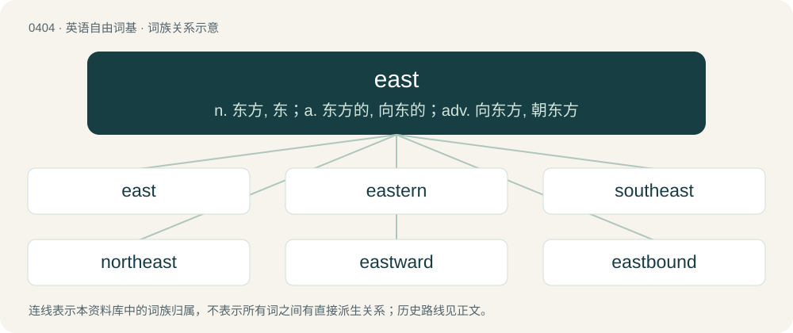

# 0465 · east — n. 东方, 东；a. 东方的, 向东的；adv. 向东方, 朝东方

[总目录](../00_总目录_按常用程度.md)

**类型**：英语自由词基　｜　**来源语言**：见词源记录

## 核心含义与来源

- 核心含义：n. 东方, 东；a. 东方的, 向东的；adv. 向东方, 朝东方
- 英文含义：The direction of the earth's rotation, specifically 90°.
- 词形：east

**来源记录 1**（名词；The direction of the earth's rotation, specifically 90°.）

From Middle English est, from Old English ēast, from Proto-West Germanic \*austr, from Proto-Germanic \*austrą, from Proto-Germanic \*austraz, from Proto-Indo-European \*h₂éwsteros (“east”). Cognates Cognate with Scots aist (“east”), North Frisian uast, ååst, ööst (“east”), Saterland Frisian Aaste (“east”), West Frisian east (“east”), Dutch oost (“east”), German Ost (“east”), Danish and Norwegian Bokmål øst (“east”), Faroese eystur (“east”), Icelandic austur (“east”), Norwegian Nynorsk aust, øst (“east”), Swedish ost, öst, öster (“east”); also with Avestan 𐬎𐬱𐬀𐬯𐬙𐬀𐬭𐬀 (ušastara, “eastern”), Latin auster (“south”).

## 词族图

## 单词速览（常用到不常用）

| 单词 | 音标 | 释义 |
|---|---|---|
| [east](#w-1) | /iːst/ | n. 东方, 东；a. 东方的, 向东的；adv. 向东方, 朝东方 |
| [eastern](#w-2) | 英 /ˈiː.stən/；美 /ˈi.stɚn/ | n. 东方人, 东正教徒；a. 东方的, 向东的, 自东的 |
| [southeast](#w-3) | British/Southern/Standard /sawˈθɪjst/ | n. 东南, 东南地区；a. 东南的, 向东南的, 来自东南的；adv. 往东南, 来自东南 |
| [northeast](#w-4) | British/Southern/Standard /noːˈθɪjst/ | n. 东北；a. 东北的, 向东北的, 来自东北的；adv. 向东北, 来自东北 |
| [eastward](#w-5) | 英 /ˈiːst.wəd/；美 /ˈist.wɚd/ | n. 朝东方向；a. 向东方的；adv. 向东 |
| [eastbound](#w-6) | 美 /ˈistbaʊnd/ | a. 往东的, 向东旅行的 |
| [eastside](#w-7) |  | a. 纽约市曼哈顿东区的 |
| [eastwards](#w-8) | /ˈiːstwədz/ | adv. 向东方地 |
| [eastland](#w-9) |  | \[人名\] 伊斯特兰; \[地名\] \[美国\] 伊斯特兰 |

## 逐词详解

### 1. east

**词性**：名词　｜　**音标**：/iːst/

**中文释义**：n. 东方, 东；a. 东方的, 向东的；adv. 向东方, 朝东方

**英文义项**：The direction of the earth's rotation, specifically 90°. / The eastern region or area; the inhabitants thereof.

**词源与演化**：

From Middle English est, from Old English ēast, from Proto-West Germanic \*austr, from Proto-Germanic \*austrą, from Proto-Germanic \*austraz, from Proto-Indo-European \*h₂éwsteros (“east”). Cognates Cognate with Scots aist (“east”), North Frisian uast, ååst, ööst (“east”), Saterland Frisian Aaste (“east”), West Frisian east (“east”), Dutch oost (“east”), German Ost (“east”), Danish and Norwegian Bokmål øst (“east”), Faroese eystur (“east”), Icelandic austur (“east”), Norwegian Nynorsk aust, øst (“east”), Swedish ost, öst, öster (“east”); also with Avestan 𐬎𐬱𐬀𐬯𐬙𐬀𐬭𐬀 (ušastara, “eastern”), Latin auster (“south”).

**例句**：

> Portsmouth is to the east of Southampton.

该用例对应义项：The direction of the earth's rotation, specifically 90°.

### 2. eastern

**词性**：形容词　｜　**音标**：英 /ˈiː.stən/；美 /ˈi.stɚn/

**中文释义**：n. 东方人, 东正教徒；a. 东方的, 向东的, 自东的

**英文义项**：Of, facing, situated in, or related to the east. / Blowing from the east; easterly.

**构词拆分**：east + -ern

**词源与演化**：

From Middle English esturne, esterne, from Old English ēasterne (“eastern”), from Proto-Germanic \*austrōnijaz (“eastern”), from Proto-Indo-European \*h₂ews-ro- (“eastern”), from Proto-Indo-European \*h₂ews- (“dawn, east”). Cognate with Old Saxon and Old High German ōstrōni (“eastern”), Old Norse austrœnn (“eastern”). Morphologically east + -ern.

**例句**：

> The eastern end of the island.

该用例对应义项：lying toward or situated in the east

### 3. southeast

**词性**：形容词　｜　**音标**：British/Southern/Standard /sawˈθɪjst/

**中文释义**：n. 东南, 东南地区；a. 东南的, 向东南的, 来自东南的；adv. 往东南, 来自东南

**英文义项**：Of, in or pertaining to the southeast; southeastern. / Situated toward or in the direction of the southeast; southeastward; southeasterly.

**构词拆分**：south + east

**词源与演化**：

From Middle English southest, from Old English sūþēast, equivalent to south + east.

**用法示例／搭配（非完整句）**：

> A southeast course.

该用例对应义项：Situated toward or in the direction of the southeast; southeastward; southeasterly.

### 4. northeast

**词性**：形容词　｜　**音标**：British/Southern/Standard /noːˈθɪjst/

**中文释义**：n. 东北；a. 东北的, 向东北的, 来自东北的；adv. 向东北, 来自东北

**英文义项**：Of, in or pertaining to the northeast; northeastern. / Situated toward or in the direction of the northeast; northeastward; northeasterly.

**构词拆分**：north + east

**词源与演化**：

From Middle English northest, from Old English norþēast, equivalent to north + east.

**用法示例／搭配（非完整句）**：

> a northeast course

该用例对应义项：Situated toward or in the direction of the northeast; northeastward; northeasterly.

### 5. eastward

**词性**：名词　｜　**音标**：英 /ˈiːst.wəd/；美 /ˈist.wɚd/

**中文释义**：n. 朝东方向；a. 向东方的；adv. 向东

**英文义项**：The direction or area lying to the east.

**构词拆分**：east + -ward

**词源与演化**：

From Middle English estward, from Old English ēastweard, ēasteweard; equivalent to east + -ward.

**例句**：

> The empire expanded eastward, in search of resources for its burgeoning textile industry.

### 6. eastbound

**词性**：形容词　｜　**音标**：美 /ˈistbaʊnd/

**中文释义**：a. 往东的, 向东旅行的

**英文义项**：Moving or heading towards the east.

**构词拆分**：east + -bound

**词源与演化**：

From east + -bound.

**例句**：

> The eastbound train is late again!

该用例对应义项：Moving or heading towards the east.

### 7. eastside

**词性**：名词

**中文释义**：a. 纽约市曼哈顿东区的

**英文义项**：The east side of a district or city.

**构词拆分**：east + side

**词源与演化**：

From east + side.

### 8. eastwards

**词性**：副词　｜　**音标**：/ˈiːstwədz/

**中文释义**：adv. 向东方地

**英文义项**：eastward.

**构词拆分**：From east + -wards.

**词源与演化**：

From east + -wards.

**例句**：

> A band of rain, heading eastwards, will reach all parts by the end of the day.

### 9. eastland

**词性**：名词

**中文释义**：\[人名\] 伊斯特兰; \[地名\] \[美国\] 伊斯特兰

**英文义项**：The eastern part of a geographic area; a land lying to the east.

**构词拆分**：east + land

**词源与演化**：

From east + land.
