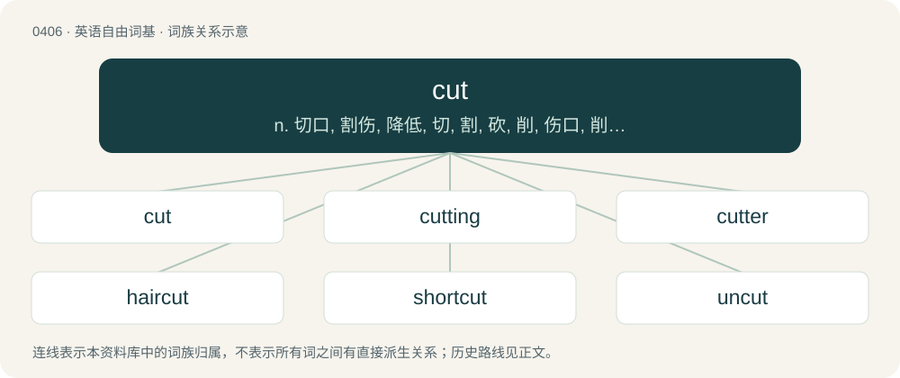

# 0469 · cut — n. 切口, 割伤, 降低, 切, 割, 砍, 削, 伤口, 削减, 缩短, 删节, 通路；a. 经切割的, 缩减的；vt. 切, 割, 减少, 刺痛, 开辟, 雕刻, 删节, 缩短, 停止, 排斥, 切断, 关, 显出

[总目录](../00_总目录_按常用程度.md)

**类型**：英语自由词基　｜　**来源语言**：见词源记录

## 核心含义与来源

- 核心含义：n. 切口, 割伤, 降低, 切, 割, 砍, 削, 伤口, 削减, 缩短, 删节, 通路；a. 经切割的, 缩减的；vt. 切, 割, 减少, 刺痛, 开辟, 雕刻, 删节, 缩短, 停止, 排斥, 切断, 关, 显出
- 英文含义：To perform an incision on, for example with a knife.
- 词形：cut

**来源记录 1**（动词；To perform an incision on, for example with a knife.）

From Middle English cutten, of North Germanic origin, from Old Norse \*kytja, \*kutta, from Proto-Germanic \*kutjaną, \*kuttaną (“to cut”), of uncertain origin, perhaps related to Proto-Germanic \*kwetwą (“meat, flesh”) (compare Old Norse kvett (“meat”)). Sometimes instead compared to French couteau, itself from Latin culter (“knife”). Copmare Scots kut, kit (“to cut”)); also akin to Middle Swedish kotta (“to cut or carve with a knife”) (compare dialectal Swedish kåta, kuta (“to cut or chip with a knife”), Swedish kuta, kytti (“a knife”)), Norwegian Bokmål kutte (“to cut”), Norwegian Nynorsk kutte (“to cut”), Icelandic kuta (“to cut with a knife”), Old Norse kuti (“small knife”), Norwegian kyttel, kytel, kjutul (“pointed slip of wood used to strip bark”). Displaced Middle English snithen (from snīþan), still attested in dialectal snithe and snead. See snide. The adjective sense of "drunk" (now rare and now usually used in the originally humorous derivative form of half-cut) dates from the 17th century, from cut in the leg or to have cut your leg, a euphemism for being very drunk.

## 词族图

## 单词速览（常用到不常用）

| 单词 | 音标 | 释义 |
|---|---|---|
| [cut](#w-1) | 英 /kʌt/ | n. 切口, 割伤, 降低, 切, 割, 砍, 削, 伤口, 削减, 缩短, 删节, 通路；a. 经切割的, 缩减的；vt. 切, 割, 减少, 刺痛, 开辟, 雕刻, 删节, 缩短, 停止, 排斥, 切断, 关, 显出 |
| [cutting](#w-2) | 英 /ˈkʌtɪŋ/ | n. 切断, 切下, 路堑；\[化\] 切屑 |
| [cutter](#w-3) | 英 /ˈkʌtə/；美 /ˈkʌtɚ/ | n. 裁剪者, 切割者, 切割器；\[化\] 刀具; 剪切机; 切刀; 切胶机 |
| [haircut](#w-4) | /ˈhɛə(ɹ)kʌt/ | n. 理发, (男子的)发式 |
| [shortcut](#w-5) | 英 /ˈʃɔːtkʌt/；美 /ˈʃoɹtˌkʌt/ | n. 捷径, 最短路线；\[计\] 快捷方式 |
| [uncut](#w-6) | 英 /ʌnˈkʌt/ | a. 未割的, 未修剪的, 未切的, 边未切齐的, 毛边的, 未削减的, 未缩略的 |
| [undercut](#w-7) | /ˈʌndə(ɹ)kʌt/ | n. 底切, 牛腰部下侧嫩肉, 下口, 下旋削球；vt. 廉价出售, 底切, 雕出, 下旋削球；vi. 切除底部 |
| [cutthroat](#w-8) | 英 /ˈkʌtθɹəʊt/；美 /ˈkʌtθɹoʊt/ | n. 凶手, 谋杀者；a. 杀人的, 残酷的 |
| [uppercut](#w-9) | /ˈʌpəkʌt/ | n. 上钩拳；v. 用上钩拳击 |
| [woodcut](#w-10) | 美 /ˈwʊdˌkʌt/ | n. 木刻, 木刻印版 |
| [cutty](#w-11) | /ˈkʌti/ | a. 极短的, 锐利的；n. 短匙, 短柄烟斗 |
| [cutlet](#w-12) | /ˈkʌtlit/ | n. 肉片, 炸肉片, 炸肉排 |
| [recut](#w-13) | /reɪˈkʌt/ | v. 再切, 重切 |

## 逐词详解

### 1. cut

**词性**：动词　｜　**音标**：英 /kʌt/

**中文释义**：n. 切口, 割伤, 降低, 切, 割, 砍, 削, 伤口, 削减, 缩短, 删节, 通路；a. 经切割的, 缩减的；vt. 切, 割, 减少, 刺痛, 开辟, 雕刻, 删节, 缩短, 停止, 排斥, 切断, 关, 显出

**英文义项**：To perform an incision on, for example with a knife. / To divide with a knife, scissors, or another sharp instrument.

**词源与演化**：

From Middle English cutten, of North Germanic origin, from Old Norse \*kytja, \*kutta, from Proto-Germanic \*kutjaną, \*kuttaną (“to cut”), of uncertain origin, perhaps related to Proto-Germanic \*kwetwą (“meat, flesh”) (compare Old Norse kvett (“meat”)). Sometimes instead compared to French couteau, itself from Latin culter (“knife”). Copmare Scots kut, kit (“to cut”)); also akin to Middle Swedish kotta (“to cut or carve with a knife”) (compare dialectal Swedish kåta, kuta (“to cut or chip with a knife”), Swedish kuta, kytti (“a knife”)), Norwegian Bokmål kutte (“to cut”), Norwegian Nynorsk kutte (“to cut”), Icelandic kuta (“to cut with a knife”), Old Norse kuti (“small knife”), Norwegian kyttel, kytel, kjutul (“pointed slip of wood used to strip bark”). Displaced Middle English snithen (from snīþan), still attested in dialectal snithe and snead. See snide. The adjective sense of "drunk" (now rare and now usually used in the originally humorous derivative form of half-cut) dates from the 17th century, from cut in the leg or to have cut your leg, a euphemism for being very drunk.

**例句**：

> The camera then cut to the woman on the front row who was clearly overcome and crying tears of joy.

该用例对应义项：To make an abrupt transition from one scene or image to another.

### 2. cutting

**词性**：名词　｜　**音标**：英 /ˈkʌtɪŋ/

**中文释义**：n. 切断, 切下, 路堑；\[化\] 切屑

**英文义项**：The action of the verb to cut. / A section removed from a larger whole.

**构词拆分**：cut + -ing

**词源与演化**：

From cut + -ing.

**例句**：

> Boring, drilling, milling, and turning are all different kinds of metal cutting processes.

该用例对应义项：The process of bringing metals to a desired shape by chipping away the unwanted material.

### 3. cutter

**词性**：名词　｜　**音标**：英 /ˈkʌtə/；美 /ˈkʌtɚ/

**中文释义**：n. 裁剪者, 切割者, 切割器；\[化\] 刀具; 剪切机; 切刀; 切胶机

**英文义项**：A person or device that cuts (in various senses). / A single-masted, fore-and-aft rigged, sailing vessel with at least two headsails, and a mast set further aft than that of a sloop.

**构词拆分**：By surface analysis, cut + -er

**词源与演化**：

From Middle English cutter, cuttere, kutter. By surface analysis, cut + -er.

**例句**：

> In some CNC programs, the diameter of the cutter (such as an end mill) is handled by cutter compensation codes.

该用例对应义项：A person or device that cuts (in various senses).

### 4. haircut

**词性**：名词　｜　**音标**：/ˈhɛə(ɹ)kʌt/

**中文释义**：n. 理发, (男子的)发式

**英文义项**：The act of cutting of the hair, often done professionally by a barber, hair stylist, or beautician. / The style into which the hair is cut.

**构词拆分**：hair + cut

**词源与演化**：

From hair + cut.

**用法示例／搭配（非完整句）**：

> to take a haircut

该用例对应义项：A partial loss, financially: thus, in a bankruptcy proceeding, the proportional reduction in the debt that will be paid to each creditor (based on an evaluation of the total debt owed and the total assets of the debtor); among investors, the negative return on investment from a losing proposition.

### 5. shortcut

**词性**：名词　｜　**音标**：英 /ˈʃɔːtkʌt/；美 /ˈʃoɹtˌkʌt/

**中文释义**：n. 捷径, 最短路线；\[计\] 快捷方式

**英文义项**：A path between two points that is faster than the commonly used paths. / A method to accomplish something that omits one or more steps.

**构词拆分**：short + cut

**词源与演化**：

From short + cut.

**例句**：

> There are shortcuts to some of my favourite applications on my desktop.

该用例对应义项：A file that points to the location of another file and serves as a quick way to access it.

### 6. uncut

**词性**：形容词　｜　**音标**：英 /ʌnˈkʌt/

**中文释义**：a. 未割的, 未修剪的, 未切的, 边未切齐的, 毛边的, 未削减的, 未缩略的

**英文义项**：Not cut. / Of a gemstone, not cut or ground to the desired shape.

**构词拆分**：un- + cut

**词源与演化**：

From Middle English unkut, uncutte, unkyt, unkutt, equivalent to un- + cut.

**例句**：

> A book with its leaves still uncut.

该用例对应义项：(of pages of a book) having adjacent leaves still joined at the fore edge

### 7. undercut

**词性**：名词　｜　**音标**：/ˈʌndə(ɹ)kʌt/

**中文释义**：n. 底切, 牛腰部下侧嫩肉, 下口, 下旋削球；vt. 廉价出售, 底切, 雕出, 下旋削球；vi. 切除底部

**英文义项**：A cut made in the lower part of something; the material so removed. / The notch cut in a tree to direct its fall when being felled.

**构词拆分**：under- + cut

**词源与演化**：

From Middle English undercutten, equivalent to under- + cut.

**例句**：

> These challenges could undercut efforts by many African countries to increase agricultural production.

### 8. cutthroat

**词性**：形容词　｜　**音标**：英 /ˈkʌtθɹəʊt/；美 /ˈkʌtθɹoʊt/

**中文释义**：n. 凶手, 谋杀者；a. 杀人的, 残酷的

**英文义项**：Involving the cutting of throats. / Of or relating to a card game where everyone plays for him or herself rather than playing with a partner.

**构词拆分**：From cut + throat.

**词源与演化**：

From cut + throat.

**例句**：

> He found that playing cutthroat Spades was much more difficult than playing with a partner.

该用例对应义项：Of or relating to a card game where everyone plays for him or herself rather than playing with a partner.

### 9. uppercut

**词性**：动词　｜　**音标**：/ˈʌpəkʌt/

**中文释义**：n. 上钩拳；v. 用上钩拳击

**英文义项**：To strike with an uppercut.

**构词拆分**：upper + cut

**词源与演化**：

From upper + cut.

**例句**：

> The bowler was bowling a bouncer so he uppercut the ball for six.

该用例对应义项：To strike with an uppercut.

### 10. woodcut

**词性**：名词　｜　**音标**：美 /ˈwʊdˌkʌt/

**中文释义**：n. 木刻, 木刻印版

**英文义项**：An engraved block of wood, especially one used as a printing form. / A method of printmaking from such a block.

**构词拆分**：wood + cut

**词源与演化**：

From wood + cut.

### 11. cutty

**词性**：形容词　｜　**音标**：/ˈkʌti/

**中文释义**：a. 极短的, 锐利的；n. 短匙, 短柄烟斗

**英文义项**：Short, shortened, or small; curtailed. / Having many cuts.

**构词拆分**：From cut + -y.

**词源与演化**：

From cut + -y.

**例句**：

> Black cutty pipes are decidedly in bad form.

### 12. cutlet

**词性**：名词　｜　**音标**：/ˈkʌtlit/

**中文释义**：n. 肉片, 炸肉片, 炸肉排

**英文义项**：A thin slice of meat, usually fried. / A chop, a specific piece of meat (especially pork, chicken, or beef) cut from the side of an animal.

**构词拆分**：cut + -let

**词源与演化**：

From French côtelette (recorded in English since 1706), from Middle French costelette (“little rib”), from coste + -elette, from Old French coste (“rib, side”), from Latin costa. Influenced by English cut, as if from cut + -let. Doublet of kotlet and kotleta.

**例句**：

> The breaded pork cutlet they serve in Tom's company cafeteria is so crispy and delicious.

### 13. recut

**词性**：动词　｜　**音标**：/reɪˈkʌt/

**中文释义**：v. 再切, 重切

**英文义项**：to cut again.

**构词拆分**：re- + cut

**词源与演化**：

From re- + cut.
