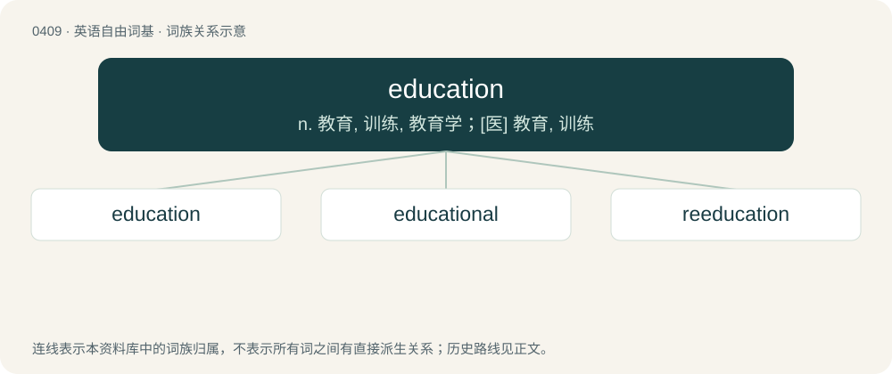

# 0471 · education — n. 教育, 训练, 教育学；\[医\] 教育, 训练

[总目录](../00_总目录_按常用程度.md)

**类型**：英语自由词基　｜　**来源语言**：见词源记录

## 核心含义与来源

- 核心含义：n. 教育, 训练, 教育学；\[医\] 教育, 训练
- 英文含义：The process of imparting knowledge, skill and judgment.
- 词形：education

**来源记录 1**（名词；The process of imparting knowledge, skill and judgment.）

Borrowed from Middle French éducation, from Latin ēducātiō (“a breeding, bringing up, rearing”), from ēducō (“to educate, train”), from ēdūcō (“to lead forth, to take out; to raise up, to erect”). See educate. Morphologically educate + -ion.

## 词族图

## 单词速览（常用到不常用）

| 单词 | 音标 | 释义 |
|---|---|---|
| [education](#w-1) | 美 /ˌɛd͡ʒ.əˈkeɪ.ʃən/；/ˌɛd͡ʒ.ʊˈkeɪ.ʃən/ | n. 教育, 训练, 教育学；\[医\] 教育, 训练 |
| [educational](#w-2) | 英 /ˌɛd͡ʒ.ʊˈkeɪ.ʃə.nəl/；美 /ˌɛd͡ʒ.əˈkeɪ.ʃə.nəl/ | a. 教育的, 教育性的 |
| [reeducation](#w-3) | /ˈriː.edjuˈkeiʃən/ | n. 再教育；\[法\] 再教育, 重新教育 |

## 逐词详解

### 1. education

**词性**：名词　｜　**音标**：美 /ˌɛd͡ʒ.əˈkeɪ.ʃən/；/ˌɛd͡ʒ.ʊˈkeɪ.ʃən/

**中文释义**：n. 教育, 训练, 教育学；\[医\] 教育, 训练

**英文义项**：The process of imparting knowledge, skill and judgment. / Facts, skills and ideas that have been learned, especially through formal instruction.

**构词拆分**：educate + -ion

**词源与演化**：

Borrowed from Middle French éducation, from Latin ēducātiō (“a breeding, bringing up, rearing”), from ēducō (“to educate, train”), from ēdūcō (“to lead forth, to take out; to raise up, to erect”). See educate. Morphologically educate + -ion.

**例句**：

> The educations our children receive depend on their economic status.

该用例对应义项：Facts, skills and ideas that have been learned, especially through formal instruction.

### 2. educational

**词性**：形容词　｜　**音标**：英 /ˌɛd͡ʒ.ʊˈkeɪ.ʃə.nəl/；美 /ˌɛd͡ʒ.əˈkeɪ.ʃə.nəl/

**中文释义**：a. 教育的, 教育性的

**英文义项**：Of, or relating to education. / Instructive, or helping to educate.

**构词拆分**：education + -al

**词源与演化**：

From education + -al.

**例句**：

> I can't see the educational value of going on a field trip to the clothes factory.

该用例对应义项：Instructive, or helping to educate.

### 3. reeducation

**词性**：名词　｜　**音标**：/ˈriː.edjuˈkeiʃən/

**中文释义**：n. 再教育；\[法\] 再教育, 重新教育

**英文义项**：The act of educating again or anew so as to rehabilitate or adapt to new situations. / Involuntary political indoctrination.

**构词拆分**：re- + education

**词源与演化**：

From re- + education.
