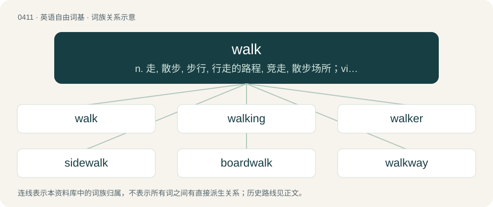

# 0472 · walk — n. 走, 散步, 步行, 行走的路程, 竞走, 散步场所；vi. 走路, 步行, 处世；vt. 走过, 遛, 使走, 护送...走

[总目录](../00_总目录_按常用程度.md)

**类型**：英语自由词基　｜　**来源语言**：见词源记录

## 核心含义与来源

- 核心含义：n. 走, 散步, 步行, 行走的路程, 竞走, 散步场所；vi. 走路, 步行, 处世；vt. 走过, 遛, 使走, 护送...走
- 英文含义：To move on the feet by alternately setting each foot (or pair or group of feet, in the case of animals with four or more feet) forward, with at least one foot on the ground at all times. Compare run.
- 词形：walk

**多个词源／构词路径**：同一拼写可能有不同来源；以下按词性和含义分别列出。

**来源记录 1**（动词；To move on the feet by alternately setting each foot (or pair or group of feet, in the case of animals with four or more feet) forward, with at least one foot on the ground at all times. Compare run.）

From Middle English walk, walke, walken, walkyn, wolken (“to roll, toss, or turn; to walk; to move; to be living; to beat or full; to perform”), a conflation of Old English wealcan (“to move around; to revolve; to roll; to fluctuate; to discuss”) (ġewealcan (“to go, traverse; to roll”)) and Old English wealcian (“to curl, roll up, twist; to wrinkle”); both from Proto-West Germanic \*walkan, from Proto-Germanic \*walkaną (“to roll, toss, turn, wind; to walk, wander, wend; to full, trample”), \*walkōną (“to roll about; to full”), from Proto-Indo-European \*walg- (“to twist, turn, move”). Cognates Cognate with Bavarian woikn (“to full, tan; to knead dough; to roll out dough”), Cimbrian balchan (“to beat, hit, strike”), Dutch zwalken (“to walk around”), German walken (“to full, tan, walk; to knead; to beat up”), Danish valke (“to full, walk, waulk”), Faroese válka (“make dirty; stir up dirt”), Swedish valka (“to full cloth, to waulk”); also Latin valgus (“bent out; bandy, bow-legged”). More at vagrant and whelk. Doublet of waulk.

**来源记录 2**（名词；A trip made by walking.）

From Middle English walc, walk, walke, from Old English \*wealc (as in Old English wealcspinl) and ġewealc (“rolling, turning; motion, surging”), from Proto-Germanic \*walką. Cognate with Icelandic volk (“difficulty, hardship, trouble”).

## 词族图

## 单词速览（常用到不常用）

| 单词 | 音标 | 释义 |
|---|---|---|
| [walk](#w-1) | 英 /wɔːk/；/wɔk/ | n. 走, 散步, 步行, 行走的路程, 竞走, 散步场所；vi. 走路, 步行, 处世；vt. 走过, 遛, 使走, 护送...走 |
| [walking](#w-2) | 英 /ˈwɔː.kɪŋ/；美 /ˈwɔ.kɪŋ/ | n. 步行, 步态；a. 步行的, 步行用的 |
| [walker](#w-3) | 英 /ˈwɔːkə/；美 /ˈwɔkɚ/ | n. 徒步者, 轻便鞋；\[法\] 山林巡视官 |
| [sidewalk](#w-4) | 英 /ˈsaɪdwɔːk/；美 /ˈsaɪdwɔk/ | n. 人行道 |
| [boardwalk](#w-5) | 英 /ˈbɔːd.wɔːk/；美 /ˈbɔɹdˌwɔk/ | n. 木板路, 木板铺成的散步道 |
| [walkway](#w-6) | 英 /ˈwɔːkˌweɪ/；美 /ˈwɔkˌweɪ/ | n. 走道, 人行道 |
| [catwalk](#w-7) | /ˈkætwɒːk/ | n. 狭小通道 |
| [walkie](#w-8) |  | n. 步行式 |
| [crosswalk](#w-9) | /ˈkrɒswɒːk/ | n. 行人穿越道 |
| [walkable](#w-10) | /ˈwɔːkəbəl/ | a. 适于步行的, 可以走去的 |
| [cakewalk](#w-11) | 美 /ˈkeɪk.wɔk/ | n. 步态竞赛, 阔步舞；vi. 举行步态竞赛 |
| [spacewalk](#w-12) | /ˈspeiswɒːk/ | n. 太空行走 |
| [riverwalk](#w-13) |  | 【英文】A pedestrian street or pathway alongside a river, providing a space for outdoor activity. |
| [moonwalk](#w-14) | 英 /ˈmuːnwɔːk/；美 /ˈmunwɔk/ | n. & vi(作)月球行走 |
| [skywalk](#w-15) | /ˈskaiwɔːk/ | n. &lt;美&gt;(在市区大楼之间建造的通常为封闭式的)人行天桥 |
| [sleepwalk](#w-16) | /ˈsliːpwɔːk/ | vi. 梦游 |

## 逐词详解

### 1. walk

**词性**：动词　｜　**音标**：英 /wɔːk/；/wɔk/

**中文释义**：n. 走, 散步, 步行, 行走的路程, 竞走, 散步场所；vi. 走路, 步行, 处世；vt. 走过, 遛, 使走, 护送...走

**英文义项**：To move on the feet by alternately setting each foot (or pair or group of feet, in the case of animals with four or more feet) forward, with at least one foot on the ground at all times. Compare run. / To "walk free", i.e. to win, or avoid, a criminal court case, particularly when actually guilty.

**词源与演化**：

From Middle English walk, walke, walken, walkyn, wolken (“to roll, toss, or turn; to walk; to move; to be living; to beat or full; to perform”), a conflation of Old English wealcan (“to move around; to revolve; to roll; to fluctuate; to discuss”) (ġewealcan (“to go, traverse; to roll”)) and Old English wealcian (“to curl, roll up, twist; to wrinkle”); both from Proto-West Germanic \*walkan, from Proto-Germanic \*walkaną (“to roll, toss, turn, wind; to walk, wander, wend; to full, trample”), \*walkōną (“to roll about; to full”), from Proto-Indo-European \*walg- (“to twist, turn, move”). Cognates Cognate with Bavarian woikn (“to full, tan; to knead dough; to roll out dough”), Cimbrian balchan (“to beat, hit, strike”), Dutch zwalken (“to walk around”), German walken (“to full, tan, walk; to knead; to beat up”), Danish valke (“to full, walk, waulk”), Faroese válka (“make dirty; stir up dirt”), Swedish valka (“to full cloth, to waulk”); also Latin valgus (“bent out; bandy, bow-legged”). More at vagrant and whelk. Doublet of waulk.

**例句**：

> If we don't bolt the washing machine down, it's going to walk across the room.

该用例对应义项：Of an object or machine, to move by shifting between two positions, as if it were walking.

### 2. walking

**词性**：形容词　｜　**音标**：英 /ˈwɔː.kɪŋ/；美 /ˈwɔ.kɪŋ/

**中文释义**：n. 步行, 步态；a. 步行的, 步行用的

**英文义项**：Incarnate as a human; living. / Able to walk in spite of injury or sickness.

**构词拆分**：walk + -ing

**词源与演化**：

From Middle English walkynge, walkinge, walkinde, walkende, walkand, walkande, from Old English wealcende (attested as Old English wealcendes), from Proto-Germanic \*walkandz, present participle of Proto-Germanic \*walkaną (“to roll, trample, walk”), equivalent to walk + -ing.

**例句**：

> Elizabeth knows so many words that they call her the walking dictionary.

该用例对应义项：Incarnate as a human; living.

### 3. walker

**词性**：名词　｜　**音标**：英 /ˈwɔːkə/；美 /ˈwɔkɚ/

**中文释义**：n. 徒步者, 轻便鞋；\[法\] 山林巡视官

**英文义项**：The agent noun of to walk: a person who walks or a thing which walks, especially a pedestrian or a participant in a walking race. / One who walks (takes for a walk).

**构词拆分**：walk + -er

**词源与演化**：

From Middle English walkere (“one who walks, traveller”), equivalent to walk + -er.

**例句**：

> The elderly woman used a walker to help her move around more easily.

该用例对应义项：A walking frame or baby walker.

### 4. sidewalk

**词性**：名词　｜　**音标**：英 /ˈsaɪdwɔːk/；美 /ˈsaɪdwɔk/

**中文释义**：n. 人行道

**英文义项**：A paved footpath located at the side of a road, for the use of pedestrians. / Any paved footpath, even if not located at the side of a road.

**构词拆分**：side + walk

**词源与演化**：

From side + walk.

**例句**：

> Stay on the sidewalk.

该用例对应义项：A paved footpath located at the side of a road, for the use of pedestrians.

### 5. boardwalk

**词性**：名词　｜　**音标**：英 /ˈbɔːd.wɔːk/；美 /ˈbɔɹdˌwɔk/

**中文释义**：n. 木板路, 木板铺成的散步道

**英文义项**：A slightly elevated path (walkway) for pedestrians over sandy or swampy ground, typically made out of wood; specifically (Canada, US) one running alongside a body of water or beach.

**构词拆分**：board + walk

**词源与演化**：

From board + walk.

**例句**：

> Get your skates on so we can roller skate on the boardwalk!

### 6. walkway

**词性**：名词　｜　**音标**：英 /ˈwɔːkˌweɪ/；美 /ˈwɔkˌweɪ/

**中文释义**：n. 走道, 人行道

**英文义项**：A clearly defined path for pedestrians.

**构词拆分**：walk + way

**词源与演化**：

From walk + way.

**例句**：

> He went slowly and deliberately to his car, being careful not to step on the cracks in the cement walkway.

### 7. catwalk

**词性**：名词　｜　**音标**：/ˈkætwɒːk/

**中文释义**：n. 狭小通道

**英文义项**：An elevated enclosed passage providing access fore and aft from the bridge of a merchant vessel. / Any similar elevated walkway.

**构词拆分**：cat + walk

**词源与演化**：

From cat + walk.

**例句**：

> Models displayed clothes on a catwalk at the fashion show.

该用例对应义项：narrow platform extending out into an auditorium

### 8. walkie

**词性**：名词

**中文释义**：n. 步行式

**英文义项**：A walkie-talkie. / A pallet truck, beside which the operator must walk.

**构词拆分**：walk + -ie

**词源与演化**：

From walk + -ie.

**例句**：

> Tom called Mary on a walkie talkie.

### 9. crosswalk

**词性**：名词　｜　**音标**：/ˈkrɒswɒːk/

**中文释义**：n. 行人穿越道

**英文义项**：A point designated for pedestrians to cross a street. / A mapping between equivalent elements (fields) in different database schemas.

**构词拆分**：From cross + walk.

**词源与演化**：

From cross + walk.

**例句**：

> Keep together, kids, when we go across the street in/at the crosswalk.

该用例对应义项：A point designated for pedestrians to cross a street.

### 10. walkable

**词性**：形容词　｜　**音标**：/ˈwɔːkəbəl/

**中文释义**：a. 适于步行的, 可以走去的

**英文义项**：Able to be walked; suitable for pedestrians. / Short enough or close enough to be accessible by walking.

**构词拆分**：walk + -able

**词源与演化**：

From walk + -able.

**例句**：

> This route is no longer walkable since the bush and the vines grew over it.

该用例对应义项：Able to be walked; suitable for pedestrians.

### 11. cakewalk

**词性**：名词　｜　**音标**：美 /ˈkeɪk.wɔk/

**中文释义**：n. 步态竞赛, 阔步舞；vi. 举行步态竞赛

**英文义项**：The style of music associated with such a contest. / The dance, or strutting style of dance, associated with such a contest.

**构词拆分**：cake + walk

**词源与演化**：

From cake + walk. Originally an African-American form of dance and music that developed after the Civil War, later popularised by minstrel shows. It was danced at social events, with the best dancers often receiving cake as a prize. It derives from dance competitions by plantation slaves in which the style of dance lampooned the ballroom dances of the slaveowners. Slaveowners seem to have found the competitions entertaining and the habit of offering cake may originate from this period. The name is sometimes also applied to the dance's precursor on the plantations. Doing the cakewalk well required virtuosity, and a major aesthetic aspect of that virtuosity was the apparent ease with which the dance was performed. This gave rise to the idiom as easy as a cakewalk, which in turn led to the sense of cakewalk as something that is easy. See the linked Wikipedia article for more.

**例句**：

> Winning the tournament was a cakewalk for him.

该用例对应义项：an easy accomplishment

### 12. spacewalk

**词性**：名词　｜　**音标**：/ˈspeiswɒːk/

**中文释义**：n. 太空行走

**英文义项**：Any activity by an astronaut outside of a spacecraft or space station in space.

**构词拆分**：space + walk

**词源与演化**：

From space + walk.

**例句**：

> Russian cosmonaut Alexei Leonov performed the first spacewalk on March 18, 1965.

### 13. riverwalk

**词性**：名词

**英文义项**：A pedestrian street or pathway alongside a river, providing a space for outdoor activity.

**构词拆分**：river + walk

**词源与演化**：

From river + walk.

### 14. moonwalk

**词性**：名词　｜　**音标**：英 /ˈmuːnwɔːk/；美 /ˈmunwɔk/

**中文释义**：n. & vi(作)月球行走

**英文义项**：An exploration of the Moon's surface on foot by an astronaut. / Activity on the Moon, outside any moonbase, exposed to space, by an astronaut

**构词拆分**：Moon + walk

**词源与演化**：

From Moon + walk. \* (backslide): Coined by Michael Jackson in 1983, when popularizing the backslide and renaming it.

**例句**：

> Michael Jackson perfected the moonwalk in the 1980s.

该用例对应义项：a kind of dance step in which the dancer seems to be sliding on the spot

### 15. skywalk

**词性**：名词　｜　**音标**：/ˈskaiwɔːk/

**中文释义**：n. &lt;美&gt;(在市区大楼之间建造的通常为封闭式的)人行天桥

**英文义项**：Synonym of skybridge and skyway. / A type of observation deck.

**构词拆分**：sky + walk

**词源与演化**：

From sky + walk.

### 16. sleepwalk

**词性**：动词　｜　**音标**：/ˈsliːpwɔːk/

**中文释义**：vi. 梦游

**英文义项**：To walk or perform other actions while sleeping; to somnambulate. / To perform actions without being aware of them; to do something that invites certain results without confronting that possibility.

**构词拆分**：sleep + walk

**词源与演化**：

From sleep + walk.

**例句**：

> They're trying to sleepwalk past their health problems.

该用例对应义项：To perform actions without being aware of them; to do something that invites certain results without confronting that possibility.
