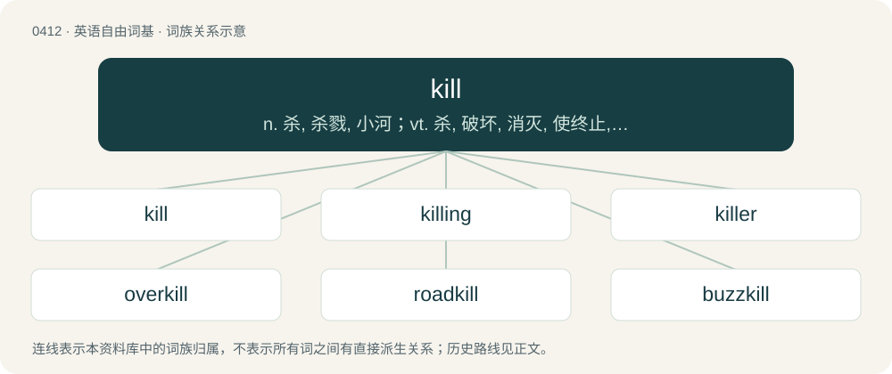

# 0473 · kill — n. 杀, 杀戮, 小河；vt. 杀, 破坏, 消灭, 使终止, 抵消, 否决；vi. 杀死

[总目录](../00_总目录_按常用程度.md)

**类型**：英语自由词基　｜　**来源语言**：见词源记录

## 核心含义与来源

- 核心含义：n. 杀, 杀戮, 小河；vt. 杀, 破坏, 消灭, 使终止, 抵消, 否决；vi. 杀死
- 英文含义：To put to death; to extinguish the life of.
- 词形：kill

**来源记录 1**（动词；To put to death; to extinguish the life of.）

From Middle English killen, kyllen, cüllen (“to strike, beat, cut”), of obscure origin. Cognate with Scots kele, keil (“to kill”). \* Perhaps from unattested Old English \*cyllan, from Proto-West Germanic \*kwulljan, from Proto-Germanic \*kwuljaną, from Proto-Indo-European \*gʷelH- (“to throw, hit, hurt by throwing”). \* Or, possibly a variant of Old English cwellan (“to kill, murder, execute”) (see quell). \* Or, from Old Norse kolla (“to hit on the head, harm”), related to Norwegian kylla (“to poll”), Middle Dutch kollen (“to knock down”), Icelandic kollur (“top, head”); see also coll, cole). Compare also Saterland Frisian källe (“to hurt”), Middle Dutch kellen (“to kill, hurt”), Middle Low German kellen, killen (“to ache strongly, cause one great pain”) (whence German Low German kellen, killen (“to hurt, injure, torment, vex”)), Middle High German kellen (“to torment; torture”).

## 词族图

## 单词速览（常用到不常用）

| 单词 | 音标 | 释义 |
|---|---|---|
| [kill](#w-1) | 英 /ˈkɪl/；/ˈkɪʊ̯/ | n. 杀, 杀戮, 小河；vt. 杀, 破坏, 消灭, 使终止, 抵消, 否决；vi. 杀死 |
| [killing](#w-2) | /ˈkɪl.ɪŋ/ | n. 谋杀, 杀戮；a. 杀害的, 疲惫的, 迷人的 |
| [killer](#w-3) | 英 /ˈkɪlə/；美 /ˈkɪlɚ/ | n. (非正式)杀人者, 屠杀者, 猛兽, 致死(疾病), 杀手, 止痛药, 限制器, 瞄准器；\[计\] 删除程序; 断路器 |
| [overkill](#w-4) | 英 /ˈəʊ.vəˌkɪl/；美 /ˈoʊ.vɚˌkɪl/ | n. 超量毁伤, 过度杀伤威力；vt. 过度地杀伤 |
| [roadkill](#w-5) | 英 /ˈɹəʊdˌkɪl/；美 /ˈɹoʊdˌkɪl/ | 路上被轧死的动物 |
| [buzzkill](#w-6) | 美 /ˈbʌzkɪl/ | n. 扫兴、泼冷水的人或事 (something or someone with a dispiriting effect) |
| [killjoy](#w-7) | 美 /ˈkɪlˌd͡ʒɔɪ/ | n. 令人扫兴的人, 煞风景 |
| [killy](#w-8) |  | \[人名\] 基利 |

## 逐词详解

### 1. kill

**词性**：动词　｜　**音标**：英 /ˈkɪl/；/ˈkɪʊ̯/

**中文释义**：n. 杀, 杀戮, 小河；vt. 杀, 破坏, 消灭, 使终止, 抵消, 否决；vi. 杀死

**英文义项**：To put to death; to extinguish the life of. / To render inoperative.

**词源与演化**：

From Middle English killen, kyllen, cüllen (“to strike, beat, cut”), of obscure origin. Cognate with Scots kele, keil (“to kill”). \* Perhaps from unattested Old English \*cyllan, from Proto-West Germanic \*kwulljan, from Proto-Germanic \*kwuljaną, from Proto-Indo-European \*gʷelH- (“to throw, hit, hurt by throwing”). \* Or, possibly a variant of Old English cwellan (“to kill, murder, execute”) (see quell). \* Or, from Old Norse kolla (“to hit on the head, harm”), related to Norwegian kylla (“to poll”), Middle Dutch kollen (“to knock down”), Icelandic kollur (“top, head”); see also coll, cole). Compare also Saterland Frisian källe (“to hurt”), Middle Dutch kellen (“to kill, hurt”), Middle Low German kellen, killen (“to ache strongly, cause one great pain”) (whence German Low German kellen, killen (“to hurt, injure, torment, vex”)), Middle High German kellen (“to torment; torture”).

**例句**：

> He killed the engine and turned off the headlights, but remained in the car, waiting.

该用例对应义项：To render inoperative.

### 2. killing

**词性**：名词　｜　**音标**：/ˈkɪl.ɪŋ/

**中文释义**：n. 谋杀, 杀戮；a. 杀害的, 疲惫的, 迷人的

**英文义项**：The act of killing. / An instance of someone being killed.

**构词拆分**：kill + -ing

**词源与演化**：

From Middle English kyllyng; equivalent to kill + -ing.

**例句**：

> He made a killing on the stock market.

该用例对应义项：A large amount of money.

### 3. killer

**词性**：名词　｜　**音标**：英 /ˈkɪlə/；美 /ˈkɪlɚ/

**中文释义**：n. (非正式)杀人者, 屠杀者, 猛兽, 致死(疾病), 杀手, 止痛药, 限制器, 瞄准器；\[计\] 删除程序; 断路器

**英文义项**：One who or that which kills. / That which causes stress or is extremely difficult, especially that which may cause failure at a task.

**构词拆分**：By surface analysis, kill + -er

**词源与演化**：

From Middle English killer, kyller. By surface analysis, kill + -er.

**例句**：

> The final hill in the race course was a killer.

该用例对应义项：That which causes stress or is extremely difficult, especially that which may cause failure at a task.

### 4. overkill

**词性**：名词　｜　**音标**：英 /ˈəʊ.vəˌkɪl/；美 /ˈoʊ.vɚˌkɪl/

**中文释义**：n. 超量毁伤, 过度杀伤威力；vt. 过度地杀伤

**英文义项**：A destructive capacity that exceeds that needed to destroy an enemy; especially with nuclear weapons. / Destruction beyond what is necessary to kill, especially in murder.

**构词拆分**：over- + kill

**词源与演化**：

From over- + kill.

**例句**：

> Should I give you yet more homework, or would that be overkill?

该用例对应义项：An unnecessary excess of whatever is needed to achieve a goal.

### 5. roadkill

**词性**：名词　｜　**音标**：英 /ˈɹəʊdˌkɪl/；美 /ˈɹoʊdˌkɪl/

**中文释义**：路上被轧死的动物

**英文义项**：The killing of an animal by a road vehicle. / A successful kill in a deathmatch game by hitting an opponent with a road vehicle. A point or score (when considered collectively) gained by successfully killing opponents by a road vehiclein a deathmatch game.

**构词拆分**：road + kill

**词源与演化**：

From road + kill.

**例句**：

> Vultures usually feed on carrion or roadkill.

该用例对应义项：the dead body of an animal that has been killed on a road by a vehicle

### 6. buzzkill

**词性**：名词　｜　**音标**：美 /ˈbʌzkɪl/

**中文释义**：n. 扫兴、泼冷水的人或事 (something or someone with a dispiriting effect)

**英文义项**：Something that or someone who spoils an otherwise enjoyable event. / A person who attends a social event and occupies their time with unsociable activities.

**构词拆分**：buzz (“feeling of energy or excitement”) + kill

**词源与演化**：

From buzz (“feeling of energy or excitement”) + kill.

### 7. killjoy

**词性**：名词　｜　**音标**：美 /ˈkɪlˌd͡ʒɔɪ/

**中文释义**：n. 令人扫兴的人, 煞风景

**英文义项**：A person who is anti-fun, or prevents others from having fun.

**构词拆分**：kill + joy

**词源与演化**：

From kill + joy, first attested in 1776.

**例句**：

> Altan never misses a chance to be a killjoy.

### 8. killy

**词性**：形容词

**中文释义**：\[人名\] 基利

**英文义项**：Involving killing.

**构词拆分**：kill + -y

**词源与演化**：

From kill + -y.
