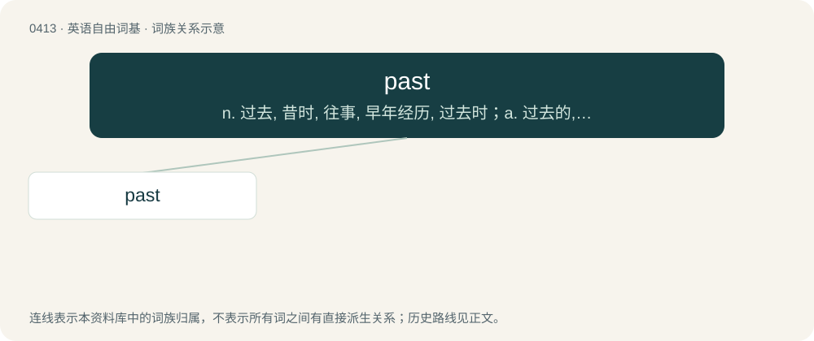

# 0474 · past — n. 过去, 昔时, 往事, 早年经历, 过去时；a. 过去的, 结束的, 卸任的, 过去时的；prep. 越过, 晚于, 超越, 超出...的可能性(能力、范围等)

[总目录](../00_总目录_按常用程度.md)

**类型**：英语自由词基　｜　**来源语言**：见词源记录

## 核心含义与来源

- 核心含义：n. 过去, 昔时, 往事, 早年经历, 过去时；a. 过去的, 结束的, 卸任的, 过去时的；prep. 越过, 晚于, 超越, 超出...的可能性(能力、范围等)
- 英文含义：The period of time that has already happened, in contrast to the present and the future.
- 词形：past

**来源记录 1**（名词；The period of time that has already happened, in contrast to the present and the future.）

From Middle English passed, past participle of passen (“to pass, to go by”), whence Modern English pass.

## 词族图

## 单词速览（常用到不常用）

| 单词 | 音标 | 释义 |
|---|---|---|
| [past](#w-1) | 英 /pɑːst/；美 /pæst/ | n. 过去, 昔时, 往事, 早年经历, 过去时；a. 过去的, 结束的, 卸任的, 过去时的；prep. 越过, 晚于, 超越, 超出...的可能性(能力、范围等) |

## 逐词详解

### 1. past

**词性**：名词　｜　**音标**：英 /pɑːst/；美 /pæst/

**中文释义**：n. 过去, 昔时, 往事, 早年经历, 过去时；a. 过去的, 结束的, 卸任的, 过去时的；prep. 越过, 晚于, 超越, 超出...的可能性(能力、范围等)

**英文义项**：The period of time that has already happened, in contrast to the present and the future. / The past tense.

**词源与演化**：

From Middle English passed, past participle of passen (“to pass, to go by”), whence Modern English pass.

**用法示例／搭配（非完整句）**：

> a book about a time machine that can transport people back into the past

该用例对应义项：The period of time that has already happened, in contrast to the present and the future.
