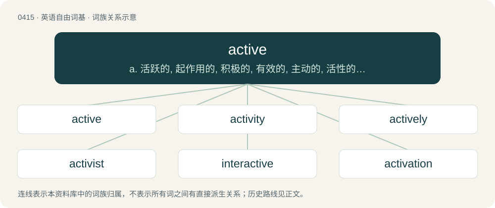

# 0476 · active — a. 活跃的, 起作用的, 积极的, 有效的, 主动的, 活性的, 现行的, 现役的；n. 主动语态, 积极分子

[总目录](../00_总目录_按常用程度.md)

**类型**：英语自由词基　｜　**来源语言**：见词源记录

## 核心含义与来源

- 核心含义：a. 活跃的, 起作用的, 积极的, 有效的, 主动的, 活性的, 现行的, 现役的；n. 主动语态, 积极分子
- 英文含义：Having the power or quality of acting; causing change; communicating action or motion; acting;—opposed to passive, that receives.
- 词形：active

**来源记录 1**（形容词；Having the power or quality of acting; causing change; communicating action or motion; acting;—opposed to passive, that receives.）

From Middle English actyf, from Old French actif, from Latin āctīv(us), from agere (“to do, to act”), ultimately from Proto-Indo-European \*h₂éǵeti. By surface analysis, act + -ive.

## 词族图

## 单词速览（常用到不常用）

| 单词 | 音标 | 释义 |
|---|---|---|
| [active](#w-1) | /ˈæk.tɪv/ | a. 活跃的, 起作用的, 积极的, 有效的, 主动的, 活性的, 现行的, 现役的；n. 主动语态, 积极分子 |
| [activity](#w-2) | 英 /ækˈtɪv.ɪ.ti/；/ækˈtɪv.ə.ti/ | n. 活动, 行动, 活跃, 活力；\[计\] 活动 |
| [actively](#w-3) | /ˈæktɪvli/ | adv. 活跃地, 积极地 |
| [activist](#w-4) | 美 /ˈæk.tɪ.vɪst/ | n. 激进主义分子 |
| [interactive](#w-5) | 英 /ˌɪn.təˈɹæk.tɪv/；美 /ˌɪn.tɚˈæk.tɪv/ | a. 相互作用的, 相互影响的；\[计\] 交互, 人机对话的 |
| [activation](#w-6) | 英 /ˌæktɪˈveɪʃn̩/；美 /ˌæktəˈveɪʃən/ | n. 活化, 激活；\[化\] 活化; 活化作用; 激活; 激活作用 |
| [activate](#w-7) | /ˈæktɪˌveɪt/ | vt. 使活动, 使激活, 正式建成；vi. 有活力 |
| [radioactive](#w-8) | 英 /ˌɹeɪdiəʊˈaktɪv/；美 /ˌɹeɪdioʊˈæktɪv/ | a. 放射性的, 有放射能的；\[医\] 放射性的, 放射的 |
| [activism](#w-9) | 英 /ˈæk.tɪ.vɪ.zəm/ | n. 激进主义, 行动主义, 能动论；\[法\] 激进主义, 行动主义 |
| [proactive](#w-10) | 英 /pɹəʊˈæk.tɪv/；美 /pɹoʊˈæk.tɪv/ | a. 〈心理〉前摄的 |
| [retroactive](#w-11) | 英 /ˌɹɛt.ɹəʊˈæk.tɪv/；美 /ˌɹɛ.tɹoʊˈæk.tɪv/ | a. 反动的, 追溯的, 有追溯效力的；\[经\] 有追溯效力的 |
| [psychoactive](#w-12) | 美 /ˌsaɪkoʊˈæktɪv/ | a. 对神经起显著作用的, 对神经起特殊作用的 |
| [hyperactive](#w-13) | 英 /ˌhaɪpəɹˈæk.tɪv/ | a. 活动过度的；\[计\] 超...的 |
| [overactive](#w-14) | /ˈəuvəˈræktiv/ | \[医\] 活动过度的 |
| [bioactive](#w-15) | /,baiəjˈæktiv/ | a. 生物活性的 |
| [activewear](#w-16) | /ˈæktiv,wεə/ | n. 运动服（等于active wear） |

## 逐词详解

### 1. active

**词性**：形容词　｜　**音标**：/ˈæk.tɪv/

**中文释义**：a. 活跃的, 起作用的, 积极的, 有效的, 主动的, 活性的, 现行的, 现役的；n. 主动语态, 积极分子

**英文义项**：Having the power or quality of acting; causing change; communicating action or motion; acting;—opposed to passive, that receives. / Quick in physical movement; of an agile and vigorous body; nimble.

**构词拆分**：By surface analysis, act + -ive

**词源与演化**：

From Middle English actyf, from Old French actif, from Latin āctīv(us), from agere (“to do, to act”), ultimately from Proto-Indo-European \*h₂éǵeti. By surface analysis, act + -ive.

**例句**：

> She remains active in the local community.

她仍然积极参与当地社区的活动。

### 2. activity

**词性**：名词　｜　**音标**：英 /ækˈtɪv.ɪ.ti/；/ækˈtɪv.ə.ti/

**中文释义**：n. 活动, 行动, 活跃, 活力；\[计\] 活动

**英文义项**：The state or quality of being active; activeness. / Something done as an action or a movement.

**构词拆分**：active + -ity

**词源与演化**：

From Middle French activité, from Latin activitas. Equivalent to active + -ity.

**例句**：

> The activity for the morning was a walk to the store.

该用例对应义项：Something done as an action or a movement.

### 3. actively

**词性**：副词　｜　**音标**：/ˈæktɪvli/

**中文释义**：adv. 活跃地, 积极地

**英文义项**：In an active manner. / In the active form; not passive.

**构词拆分**：active + -ly

**词源与演化**：

From late Middle English actyvely; equivalent to active + -ly.

**例句**：

> She was actively working, not “sleeping on the job”.

该用例对应义项：In an active manner.

### 4. activist

**词性**：名词　｜　**音标**：美 /ˈæk.tɪ.vɪst/

**中文释义**：n. 激进主义分子

**英文义项**：One who is politically active in the role of a citizen; especially, one who campaigns for change. / One who is conspicuously active in carrying out any occupational or professional functions.

**构词拆分**：active + -ist

**词源与演化**：

From active + -ist.

**例句**：

> Activist groups for the environment and food safety question the product's safety.

### 5. interactive

**词性**：形容词　｜　**音标**：英 /ˌɪn.təˈɹæk.tɪv/；美 /ˌɪn.tɚˈæk.tɪv/

**中文释义**：a. 相互作用的, 相互影响的；\[计\] 交互, 人机对话的

**英文义项**：Interacting with or communicating with and reacting to each other; influencing or having an effect on each other; acting or capable of acting on each other or with the other. / Offering or involving interaction with the user.

**构词拆分**：inter- + active

**词源与演化**：

From inter- + active.

**用法示例／搭配（非完整句）**：

> an interactive digital map with zoom and pan features

该用例对应义项：Offering or involving interaction with the user.

### 6. activation

**词性**：名词　｜　**音标**：英 /ˌæktɪˈveɪʃn̩/；美 /ˌæktəˈveɪʃən/

**中文释义**：n. 活化, 激活；\[化\] 活化; 活化作用; 激活; 激活作用

**英文义项**：Making active and effective; bringing into a state of activity. / The process of making a radioisotope by bombarding a stable element with neutrons or protons.

**构词拆分**：active + -ation + activate + -ion

**词源与演化**：

From active or activate + -ation

**用法示例／搭配（非完整句）**：

> using shopper activation to convert shoppers into buyers

该用例对应义项：The promotion of a brand through an event or campaign.

### 7. activate

**词性**：动词　｜　**音标**：/ˈæktɪˌveɪt/

**中文释义**：vt. 使活动, 使激活, 正式建成；vi. 有活力

**英文义项**：To encourage development or induce increased activity; to stimulate. / To put a device, mechanism (alarm etc.) or system into action or motion; to trigger, to actuate, to set off, to enable.

**构词拆分**：active + -ate

**词源与演化**：

From active + -ate.

**例句**：

> The burglar alarm activates automatically.

该用例对应义项：To enter an active state.

### 8. radioactive

**词性**：形容词　｜　**音标**：英 /ˌɹeɪdiəʊˈaktɪv/；美 /ˌɹeɪdioʊˈæktɪv/

**中文释义**：a. 放射性的, 有放射能的；\[医\] 放射性的, 放射的

**英文义项**：Exhibiting radioactivity. / Dangerous and disgusting, particularly of people or ideas.

**构词拆分**：radio- + active

**词源与演化**：

Coined by Pierre Curie and Marie Curie in 1898 as French radio-actif, equivalent to English radio- + active.

**例句**：

> Even sleazy tactics and his radioactive mouth may not be able to contain this debacle.

该用例对应义项：Dangerous and disgusting, particularly of people or ideas.

### 9. activism

**词性**：名词　｜　**音标**：英 /ˈæk.tɪ.vɪ.zəm/

**中文释义**：n. 激进主义, 行动主义, 能动论；\[法\] 激进主义, 行动主义

**英文义项**：The practice of using action to achieve a result, such as political demonstration or a strike in support of or in opposition to an issue.

**构词拆分**：active + -ism

**词源与演化**：

From active + -ism.

**例句**：

> Slacktivism is a portmanteau formed out of the words slacker and activism.

### 10. proactive

**词性**：形容词　｜　**音标**：英 /pɹəʊˈæk.tɪv/；美 /pɹoʊˈæk.tɪv/

**中文释义**：a. 〈心理〉前摄的

**英文义项**：Acting in advance to deal with an expected change or difficulty.

**构词拆分**：pro- + active

**词源与演化**：

From pro- + active; originally coined 1933 by Paul Whiteley and Gerald Blankfort in a psychology paper, used in technical sense. Used in a popular context and sense (courage, perseverance) in 1946 book Man’s Search for Meaning by neuropsychiatrist Viktor Emil Frankl, in the context of dealing with the Holocaust, as contrast with reactive.

**例句**：

> We can deal with each problem as it pops up, or we can take a proactive stance and try to prevent future problems.

该用例对应义项：Acting in advance to deal with an expected change or difficulty.

### 11. retroactive

**词性**：形容词　｜　**音标**：英 /ˌɹɛt.ɹəʊˈæk.tɪv/；美 /ˌɹɛ.tɹoʊˈæk.tɪv/

**中文释义**：a. 反动的, 追溯的, 有追溯效力的；\[经\] 有追溯效力的

**英文义项**：Extending in scope, effect, application or influence to a prior time or to prior conditions

**构词拆分**：retro- + active

**词源与演化**：

First attested in 1610. From French rétroactif, equivalent to retro- + active.

**例句**：

> Retroactive jealousy is more toxic than reactive jealousy.

### 12. psychoactive

**词性**：形容词　｜　**音标**：美 /ˌsaɪkoʊˈæktɪv/

**中文释义**：a. 对神经起显著作用的, 对神经起特殊作用的

**英文义项**：Affecting the mind or mental processes.

**构词拆分**：psycho- + active

**词源与演化**：

From psycho- + active.

**例句**：

> LSD and DMT are psychoactive drugs.

该用例对应义项：Affecting the mind or mental processes.

### 13. hyperactive

**词性**：形容词　｜　**音标**：英 /ˌhaɪpəɹˈæk.tɪv/

**中文释义**：a. 活动过度的；\[计\] 超...的

**英文义项**：Having an increased state of activity / having attention deficit disorder (no longer used by the scientific community)

**构词拆分**：hyper- + active

**词源与演化**：

From hyper- + active.

**例句**：

> I asked you not to give him Coca Cola. Tom's hyperactive.

### 14. overactive

**词性**：形容词　｜　**音标**：/ˈəuvəˈræktiv/

**中文释义**：\[医\] 活动过度的

**英文义项**：Excessively active.

**构词拆分**：over- + active

**词源与演化**：

From over- + active.

**例句**：

> Fanaticism is the highly volatile mix of narrow-mindedness and overactive imagination.

### 15. bioactive

**词性**：形容词　｜　**音标**：/,baiəjˈæktiv/

**中文释义**：a. 生物活性的

**英文义项**：Biologically active; having a biological effect. / Describing a terrarium, vivarium, etc. that is self-sustaining and mimics a natural habitat.

**构词拆分**：bio- + active

**词源与演化**：

From bio- + active.

### 16. activewear

**词性**：名词　｜　**音标**：/ˈæktiv,wεə/

**中文释义**：n. 运动服（等于active wear）

**英文义项**：Casual clothing that is comfortable to wear when exercising or partaking in sport; sportswear.

**构词拆分**：active + -wear

**词源与演化**：

From active + -wear.
