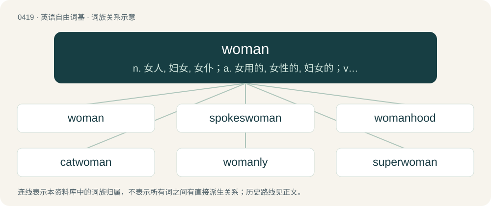

# 0478 · woman — n. 女人, 妇女, 女仆；a. 女用的, 女性的, 妇女的；vt. 贬称...为女人, 使成女人腔

[总目录](../00_总目录_按常用程度.md)

**类型**：英语自由词基　｜　**来源语言**：见词源记录

## 核心含义与来源

- 核心含义：n. 女人, 妇女, 女仆；a. 女用的, 女性的, 妇女的；vt. 贬称...为女人, 使成女人腔
- 英文含义：An adult female human.
- 词形：woman

**来源记录 1**（名词；An adult female human.）

From Middle English womman, from earlier wimman, wifman, from Old English wīfmann (“woman”, literally “female person”), a compound of wīf (“woman, female”, whence English wife) + mann (“person, human being”, whence English man). For details on the pronunciation and spelling history, see the usage notes below. Cognate with Scots woman, weman (“woman”), Saterland Frisian Wieuwmoanske (“female person, female human, woman”). Similar construction can be found in West Frisian frommes (“woman, girl”) (from frou and minske, literally "woman human") and Afrikaans vroumens (“woman”, literally “woman-person”). Further information on vocalic development The current pronunciation of the first vowel of the singular began to appear in western England in the 13th century under the rounding influence of the w, though the older pronunciation with /i/ (→ modern /ɪ/) remained in use into the 15th century. Although the vowel of the plural was sometimes also altered to /u/ (→ modern /ʊ/) beginning in the 14th century, the pronunciation with /ɪ/ ultimately won out there, possibly under the influence of pairs like foot–feet. However, some speakers (especially of New Zealand English or South African English) have either retained or reinnovated the pronunciation of the plural with /ʊ/. The modern spelling women for the plural is due to influence of the singular; it is attested from the 15th century. For a time in the 16th and 17th centuries, the pronunciation of the singular sometimes drifted even further back towards /uː/ or /ɔː~oː/ (→ modern /oʊ~əʊ/) and the plural sometimes drifted even further forward towards /iː/, leading to comparisons of the words to "woe man" or "we men".)

## 词族图

## 单词速览（常用到不常用）

| 单词 | 音标 | 释义 |
|---|---|---|
| [woman](#w-1) | 英 /ˈwʊmən/；美 /ˈwoʊmən/ | n. 女人, 妇女, 女仆；a. 女用的, 女性的, 妇女的；vt. 贬称...为女人, 使成女人腔 |
| [spokeswoman](#w-2) | /ˈspəuks,wumən/ | n. 女发言人, 女代言人 |
| [womanhood](#w-3) | /ˈwʊmənhʊd/ | n. 女子成年身分, 女子成年期, 女子成年资格, 女子气质, 女子特性 |
| [catwoman](#w-4) |  | 猫女（虚拟人物） |
| [womanly](#w-5) | /ˈwʊmənli/ | a. 像女人的；有女子气质的 |
| [superwoman](#w-6) | /ˈsjuːpə,wumən/ | n. 女超人 |

## 逐词详解

### 1. woman

**词性**：名词　｜　**音标**：英 /ˈwʊmən/；美 /ˈwoʊmən/

**中文释义**：n. 女人, 妇女, 女仆；a. 女用的, 女性的, 妇女的；vt. 贬称...为女人, 使成女人腔

**英文义项**：An adult female human. / All female humans collectively; womankind.

**词源与演化**：

From Middle English womman, from earlier wimman, wifman, from Old English wīfmann (“woman”, literally “female person”), a compound of wīf (“woman, female”, whence English wife) + mann (“person, human being”, whence English man). For details on the pronunciation and spelling history, see the usage notes below. Cognate with Scots woman, weman (“woman”), Saterland Frisian Wieuwmoanske (“female person, female human, woman”). Similar construction can be found in West Frisian frommes (“woman, girl”) (from frou and minske, literally "woman human") and Afrikaans vroumens (“woman”, literally “woman-person”). Further information on vocalic development The current pronunciation of the first vowel of the singular began to appear in western England in the 13th century under the rounding influence of the w, though the older pronunciation with /i/ (→ modern /ɪ/) remained in use into the 15th century. Although the vowel of the plural was sometimes also altered to /u/ (→ modern /ʊ/) beginning in the 14th century, the pronunciation with /ɪ/ ultimately won out there, possibly under the influence of pairs like foot–feet. However, some speakers (especially of New Zealand English or South African English) have either retained or reinnovated the pronunciation of the plural with /ʊ/. The modern spelling women for the plural is due to influence of the singular; it is attested from the 15th century. For a time in the 16th and 17th centuries, the pronunciation of the singular sometimes drifted even further back towards /uː/ or /ɔː~oː/ (→ modern /oʊ~əʊ/) and the plural sometimes drifted even further forward towards /iː/, leading to comparisons of the words to "woe man" or "we men".)

**用法示例／搭配（非完整句）**：

> the first woman president of Spain

该用例对应义项：An adult female human.

### 2. spokeswoman

**词性**：名词　｜　**音标**：/ˈspəuks,wumən/

**中文释义**：n. 女发言人, 女代言人

**英文义项**：A woman who speaks as the voice of a group of people.

**构词拆分**：spoke (“past participle of speak”) + -s- + woman

**词源与演化**：

From spoke (“past participle of speak”) + -s- + woman.

**例句**：

> The high commissioner’s spokeswoman said the government had shown some willingness to initiate reforms.

### 3. womanhood

**词性**：名词　｜　**音标**：/ˈwʊmənhʊd/

**中文释义**：n. 女子成年身分, 女子成年期, 女子成年资格, 女子气质, 女子特性

**英文义项**：The state or condition of being a woman. / All of the women of a given place, area, or subgroup regarded collectively.

**构词拆分**：By surface analysis, woman + -hood

**词源与演化**：

From Middle English womanhoode, wommanhod, whomanhode, variants of wommanhede. By surface analysis, woman + -hood.

**例句**：

> She was a vigorous youth poised on the brink of womanhood.

该用例对应义项：The state or condition of being a woman.

### 4. catwoman

**词性**：名词

**中文释义**：猫女（虚拟人物）

**英文义项**：A woman in a cat costume.

**构词拆分**：cat + woman

**词源与演化**：

From cat + woman.

### 5. womanly

**词性**：形容词　｜　**音标**：/ˈwʊmənli/

**中文释义**：a. 像女人的；有女子气质的

**英文义项**：Considered typical of, stereotypical of, or appropriate to women; feminine. / Female.

**构词拆分**：woman + -ly (adjectival suffix)

**词源与演化**：

From Middle English womanly, wommanlich, wommanly, wommanlych, wummonlich, equivalent to woman + -ly (adjectival suffix).

**例句**：

> Shake hands like a man. This is a rather womanly grip.

### 6. superwoman

**词性**：名词　｜　**音标**：/ˈsjuːpə,wumən/

**中文释义**：n. 女超人

**英文义项**：A woman who looks after a home and children as well as being employed in a full-time job. / A woman with superhuman powers.

**构词拆分**：super- + woman

**词源与演化**：

From super- + woman. From 1943's Superwoman, published by DC Comics in 1943.
