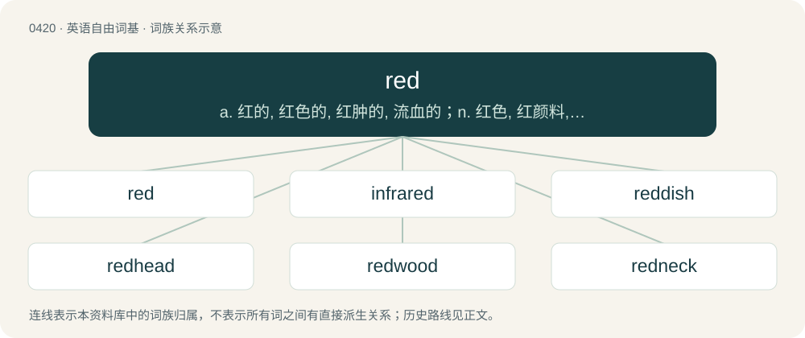

# 0480 · red — a. 红的, 红色的, 红肿的, 流血的；n. 红色, 红颜料, 赤字；\[计\] 简化, 减少

[总目录](../00_总目录_按常用程度.md)

**类型**：英语自由词基　｜　**来源语言**：见词源记录

## 核心含义与来源

- 核心含义：a. 红的, 红色的, 红肿的, 流血的；n. 红色, 红颜料, 赤字；\[计\] 简化, 减少
- 英文含义：The colour of the setting sun, blood, and strawberries; the colour which is evoked by the longest visible wavelengths (between about 625–740 nm), and a primary additive colour.
- 词形：red

**来源记录 1**（名词；The colour of the setting sun, blood, and strawberries; the colour which is evoked by the longest visible wavelengths (between about 625–740 nm), and a primary additive colour.）

Inherited from Middle English red, from Old English rēad, from Proto-West Germanic \*raud, from Proto-Germanic \*raudaz, from Proto-Indo-European \*h₁rowdʰós, from \*h₁rewdʰ- + \*-ós. Cognates See also West Frisian read, Low German root, rood, rot, rod, Dutch rood, German rot, Danish and Norwegian Bokmål rød, Norwegian Nynorsk raud, Swedish röd, Faroese reyður, Icelandic rauður; also Welsh rhudd, Latin ruber, rufus, Tocharian A rtär, Tocharian B ratre, Ancient Greek ἐρυθρός (eruthrós), Albanian pruth (“redhead”), Russian ру́дый (rúdyj) ("red", "redhaired"). Czech rudý, Lithuanian raúdas, Finnish rauta, Estonian raud, Serbo-Croatian riđ ("reddish", "red"), Avestan 𐬭𐬀𐬊𐬌𐬛𐬌𐬙𐬀 (raoidita), Sanskrit रुधिर (rudhirá, “red, bloody”).

## 词族图

## 单词速览（常用到不常用）

| 单词 | 音标 | 释义 |
|---|---|---|
| [red](#w-1) | 英 /ɹɛd/ | a. 红的, 红色的, 红肿的, 流血的；n. 红色, 红颜料, 赤字；\[计\] 简化, 减少 |
| [infrared](#w-2) | 英 /ˌɪnfɹəˈɹɛd/ | a. 红外线的；n. 红外线 |
| [reddish](#w-3) | /ˈɹɛdɪʃ/ | a. 微红的, 略带红色的 |
| [redhead](#w-4) | /ˈɹɛdˌhɛd/ | n. 红发的人 |
| [redwood](#w-5) | 英 /ˈɹɛdwʊd/ | n. (美国)红杉, 红树 |
| [redneck](#w-6) | /ˈɹɛdnɛk/ | n. 红脖子（指美国南方保守的露天劳动者）；乡下人 |
| [reddy](#w-7) | 英 /ˈɹɛdi/ | 【英文】Somewhat red in colour. |
| [redness](#w-8) | /ˈrednis/ | n. 红, 红色 |
| [redstone](#w-9) | 英 /ˈɹɛd.stəʊn/；美 /ˈɹɛd.stoʊn/ | n. 赤砂岩；红石导弹 |
| [redline](#w-10) | /ˈɹɛd.laɪn/ | vi.对某社团进行经济歧视, 按安全飞行速度驾驶飞机；vt.&lt;美&gt;(用红线)划去, 取消, 排除, 歧视 |
| [redshirt](#w-11) | 英 /ˈɹɛd.ʃəː(ɹ)t/ | \[体\]大学生选手 |
| [redshift](#w-12) | /ˈɹɛdˌʃɪft/ | n. （天体）红移, 红向移动 |
| [redheaded](#w-13) | /ˈredˈhedid/ | a. 红发的, 红头羽毛的 |
| [redden](#w-14) | /ˈɹɛdn̩/ | vi. 变红, 脸红；vt. 使变红 |
| [redskin](#w-15) | 美 /ˈɹɛdˌskɪn/ | n. 红皮肤人 |
| [redfish](#w-16) | /ˈredfiʃ/ | n. 鲑鱼 |
| [redfin](#w-17) | /ˈredfin/ | n. \[鱼\]红鳍淡水■鱼 |
| [redwing](#w-18) | /ˈredwiŋ/ | n. 红翼鸫 |

## 逐词详解

### 1. red

**词性**：名词　｜　**音标**：英 /ɹɛd/

**中文释义**：a. 红的, 红色的, 红肿的, 流血的；n. 红色, 红颜料, 赤字；\[计\] 简化, 减少

**英文义项**：The colour of the setting sun, blood, and strawberries; the colour which is evoked by the longest visible wavelengths (between about 625–740 nm), and a primary additive colour. / A revolutionary socialist or (most commonly) a Communist; (usually capitalized) a Bolshevik, a supporter of the Bolsheviks in the Russian Civil War.

**词源与演化**：

Inherited from Middle English red, from Old English rēad, from Proto-West Germanic \*raud, from Proto-Germanic \*raudaz, from Proto-Indo-European \*h₁rowdʰós, from \*h₁rewdʰ- + \*-ós. Cognates See also West Frisian read, Low German root, rood, rot, rod, Dutch rood, German rot, Danish and Norwegian Bokmål rød, Norwegian Nynorsk raud, Swedish röd, Faroese reyður, Icelandic rauður; also Welsh rhudd, Latin ruber, rufus, Tocharian A rtär, Tocharian B ratre, Ancient Greek ἐρυθρός (eruthrós), Albanian pruth (“redhead”), Russian ру́дый (rúdyj) ("red", "redhaired"). Czech rudý, Lithuanian raúdas, Finnish rauta, Estonian raud, Serbo-Croatian riđ ("reddish", "red"), Avestan 𐬭𐬀𐬊𐬌𐬛𐬌𐬙𐬀 (raoidita), Sanskrit रुधिर (rudhirá, “red, bloody”).

**例句**：

> Red can be seen as hot or angry.

该用例对应义项：The colour of the setting sun, blood, and strawberries; the colour which is evoked by the longest visible wavelengths (between about 625–740 nm), and a primary additive colour.

### 2. infrared

**词性**：名词　｜　**音标**：英 /ˌɪnfɹəˈɹɛd/

**中文释义**：a. 红外线的；n. 红外线

**英文义项**：The electromagnetic radiation of a wavelength longer than visible light, but shorter than microwave radiation, having a wavelength between 700 nm and 1 mm. / A specific wavelength in this range.

**构词拆分**：infra- + red

**词源与演化**：

From infra- + red.

**例句**：

> They could sense radiation in the infrared.

该用例对应义项：the infrared region of the electromagnetic spectrum; electromagnetic wave frequencies below the visible range

### 3. reddish

**词性**：形容词　｜　**音标**：/ˈɹɛdɪʃ/

**中文释义**：a. 微红的, 略带红色的

**英文义项**：Somewhat red.

**构词拆分**：red + -ish

**词源与演化**：

From Middle English redisch; equivalent to red + -ish.

**例句**：

> What color is your urine: bright, tawny, reddish or golden brown?

### 4. redhead

**词性**：名词　｜　**音标**：/ˈɹɛdˌhɛd/

**中文释义**：n. 红发的人

**英文义项**：A person with red hair. / A North American duck (Aythya americana) highly esteemed as a game bird.

**构词拆分**：red + head

**词源与演化**：

Bahuvrihi compound of red + head.

**例句**：

> I'm a natural redhead, so I most definitely freckle.

### 5. redwood

**词性**：名词　｜　**音标**：英 /ˈɹɛdwʊd/

**中文释义**：n. (美国)红杉, 红树

**英文义项**：A tree of the species Sequoia sempervirens. / Any of the evergreen conifers belonging to the genus Sequoia in the wide sense.

**构词拆分**：red + wood

**词源与演化**：

From red + wood.

**例句**：

> This redwood deck will last forever.

该用例对应义项：A tree of the species Sequoia sempervirens.

### 6. redneck

**词性**：名词　｜　**音标**：/ˈɹɛdnɛk/

**中文释义**：n. 红脖子（指美国南方保守的露天劳动者）；乡下人

**英文义项**：A poor, rural, usually white, person from the Southern United States or parts of the Midwest and Northeast, especially one whose beliefs are seen as unsophisticated and backward; sometimes with additional connotations of being bigoted. / yokel, hick, country bumpkin

**构词拆分**：Bahuvrīhi compound of red + neck

**词源与演化**：

Bahuvrīhi compound of red + neck. Compare rooinek. The term originally characterized farmers that had a red neck, caused by sunburn from long hours working in the fields.

**例句**：

> The way he talks and acts, you can tell he's a redneck.

### 7. reddy

**词性**：形容词　｜　**音标**：英 /ˈɹɛdi/

**英文义项**：Somewhat red in colour.

**构词拆分**：red + -y

**词源与演化**：

From red + -y.

**例句**：

> The song "I Am Woman" by Helen Reddy became the unofficial anthem of the Women's Liberation Movement.

### 8. redness

**词性**：名词　｜　**音标**：/ˈrednis/

**中文释义**：n. 红, 红色

**英文义项**：The state or quality of being red. / A red discoloration, especially of skin.

**构词拆分**：red + -ness

**词源与演化**：

From Middle English reednes, rednesse, from Old English rēadnes (“redness”), equivalent to red + -ness.

**例句**：

> Redness and swelling are associated with certain superficial infections.

该用例对应义项：A red discoloration, especially of skin.

### 9. redstone

**词性**：名词　｜　**音标**：英 /ˈɹɛd.stəʊn/；美 /ˈɹɛd.stoʊn/

**中文释义**：n. 赤砂岩；红石导弹

**英文义项**：A type of versatile material used to create electrical circuits and mechanisms. / The entire system of circuitry, using redstone as its most basic material.

**构词拆分**：red + stone

**词源与演化**：

From red + stone, after its color.

**例句**：

> He made a complicated redstone circuit to help farm sugar cane.

该用例对应义项：A type of versatile material used to create electrical circuits and mechanisms.

### 10. redline

**词性**：名词　｜　**音标**：/ˈɹɛd.laɪn/

**中文释义**：vi.对某社团进行经济歧视, 按安全飞行速度驾驶飞机；vt.&lt;美&gt;(用红线)划去, 取消, 排除, 歧视

**英文义项**：A drawing, document, etc. that has been marked for correction or modification. / The maximum speed, temperature, pressure, etc., at which a device (such as the engine in a car, aircraft, etc.) is designed to operate.

**构词拆分**：red + line

**词源与演化**：

From red + line, originating with the frequent use of red pen or pencil to mark corrections on drawings and documents (1), and the red markings on a tachometer (2).

### 11. redshirt

**词性**：名词　｜　**音标**：英 /ˈɹɛd.ʃəː(ɹ)t/

**中文释义**：\[体\]大学生选手

**英文义项**：A college athlete who spends a year not participating in official athletic activities, but does not lose his or her eligibility to participate in following years. / An unimportant character introduced only to be killed in order to underscore the peril to the important characters; an expendable character.

**构词拆分**：red + shirt

**词源与演化**：

Calque of Italian camicia rossa, equivalent to red + shirt. In later senses with reference to the uniforms or outfits worn by such people. The fandom slang sense emerged from the tendency of red-uniformed Starfleet officers to die in episodes of Star Trek: The Original Series.

**例句**：

> Sensing danger, Captain Kirk decided to beam down to the surface with Spock, McCoy, and a couple of redshirts.

该用例对应义项：An unimportant character introduced only to be killed in order to underscore the peril to the important characters; an expendable character.

### 12. redshift

**词性**：名词　｜　**音标**：/ˈɹɛdˌʃɪft/

**中文释义**：n. （天体）红移, 红向移动

**英文义项**：An increase in the wavelength of a photon or of light while in transit, corresponding to a lower frequency and a shift toward the red end of the electromagnetic spectrum.

**构词拆分**：red + shift

**词源与演化**：

From red + shift.

### 13. redheaded

**词性**：形容词　｜　**音标**：/ˈredˈhedid/

**中文释义**：a. 红发的, 红头羽毛的

**英文义项**：Having red hair. / Having a red head.

**构词拆分**：red + headed

**词源与演化**：

From red + headed.

**例句**：

> That little redheaded girl they have over at Cuthbert's is as smart as they make 'em.

### 14. redden

**词性**：动词　｜　**音标**：/ˈɹɛdn̩/

**中文释义**：vi. 变红, 脸红；vt. 使变红

**英文义项**：To become red or redder. / To make red or redder.

**构词拆分**：red + -en

**词源与演化**：

From red + -en.

**例句**：

> With every minute, the flames began to redden the sky in a dramatic display.

### 15. redskin

**词性**：名词　｜　**音标**：美 /ˈɹɛdˌskɪn/

**中文释义**：n. 红皮肤人

**英文义项**：A Native American.

**构词拆分**：red + skin

**词源与演化**：

From red + skin. References to indigenous Americans' skin being red can be found from the 1580s, although not consistently (another European in 1584 described indigenous Americans as "yellowish"); in some cases the reference may be not to their skin color per se but to their painting themselves with red paint. A letter ostensibly from 1699, which was formerly cited as the earliest reference to "red skins", was not published until 1900 and is now recognized as fake. The earliest documented instance of the term "redskin" is from a 1769 discussion between the Piankeshaw and John Wilkins, this and other early uses appear to be translating terms meaning red + skin, flesh, or people that the tribes of the Illinois / Mississippi Valley area used to refer to themselves when communicating with the French (who translated such terms as French peau-rouge) and with English-speakers (whence redskin). Piecewise doublet of Rauðskinna.

### 16. redfish

**词性**：名词　｜　**音标**：/ˈredfiʃ/

**中文释义**：n. 鲑鱼

**英文义项**：Any member of the genus Sebastes, or edible red rockfishs. / especially Sebastes norvegicus, found in North American waters, also called rosefish or ocean perch.

**构词拆分**：red + fish

**词源与演化**：

From red + fish.

### 17. redfin

**词性**：名词　｜　**音标**：/ˈredfin/

**中文释义**：n. \[鱼\]红鳍淡水■鱼

**英文义项**：A common shiner, a small North American dace of species Luxilus cornutus. / A redfin shiner (Lythrurus umbratilis), of the central US.

**构词拆分**：red + fin

**词源与演化**：

From red + fin, having a red dorsal fin, especially males in the breeding season.

### 18. redwing

**词性**：名词　｜　**音标**：/ˈredwiŋ/

**中文释义**：n. 红翼鸫

**英文义项**：A small thrush, Turdus iliacus, native to Eurasia, with a white eye stripe and red under-wing feathers. / A red-winged blackbird

**构词拆分**：red + wing

**词源与演化**：

From red + wing.
