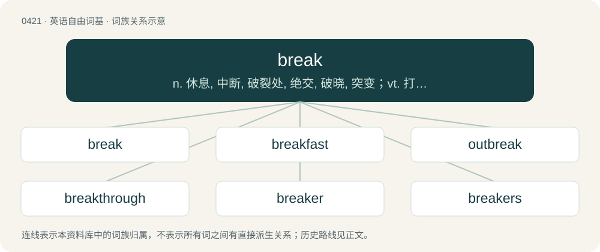

# 0481 · break — n. 休息, 中断, 破裂处, 绝交, 破晓, 突变；vt. 打破, 弄破, 弄坏, 破坏, 违反, 打断, 削弱, 放弃；vi. 破碎, 决裂, 破晓, 突变, 变弱, 暂停

[总目录](../00_总目录_按常用程度.md)

**类型**：英语自由词基　｜　**来源语言**：见词源记录

## 核心含义与来源

- 核心含义：n. 休息, 中断, 破裂处, 绝交, 破晓, 突变；vt. 打破, 弄破, 弄坏, 破坏, 违反, 打断, 削弱, 放弃；vi. 破碎, 决裂, 破晓, 突变, 变弱, 暂停
- 英文含义：To separate into two or more pieces, to fracture or crack, by a process that cannot easily be reversed for reassembly.
- 词形：break

**多个词源／构词路径**：同一拼写可能有不同来源；以下按词性和含义分别列出。

**来源记录 1**（动词；To separate into two or more pieces, to fracture or crack, by a process that cannot easily be reversed for reassembly.）

From Middle English breken, from Old English brecan (“to break”), from Proto-West Germanic \*brekan, from Proto-Germanic \*brekaną (“to break”), from Proto-Indo-European \*bʰreg- (“to break”). Doublet of bray. Cognates Cognates of Germanic origin include Scots brek (“to break”), West Frisian brekke (“to break”), Dutch breken (“to break”), Low German breken (“to break”), German brechen (“to break”), French broyer (“to crush, grind”), Gothic 𐌱𐍂𐌹𐌺𐌰𐌽 (brikan, “to break, destroy”), Norwegian brek (“desire, yearning”). Also cognate with Albanian brishtë (“fragile”), Latin frangō (“break, break up, shatter”, verb), whence English fracture and other terms – fragile, frail, fraction, and fragment. The modern pronunciation shows an irregular change of Early Modern English /ɛː/ to /eɪ/ in the standard language; contrast this with the development of other words such as speak and wreak.

**来源记录 2**（名词；A section of extended repetition of the percussion break to a song, created by a hip-hop DJ as rhythmic dance music.）

Clipping of breakdown (the percussion break of songs chosen by a DJ for use in hip-hop music) and see also breakdancing.

## 词族图

## 单词速览（常用到不常用）

| 单词 | 音标 | 释义 |
|---|---|---|
| [break](#w-1) | 英 /bɹeɪk/ | n. 休息, 中断, 破裂处, 绝交, 破晓, 突变；vt. 打破, 弄破, 弄坏, 破坏, 违反, 打断, 削弱, 放弃；vi. 破碎, 决裂, 破晓, 突变, 变弱, 暂停 |
| [breakfast](#w-2) | 英 /ˈbreɪkˌfɑːst/；美 /ˈbɹeɪkˌfæst/ | n. 早餐 |
| [outbreak](#w-3) | /ˈaʊtbɹeɪk/ | n. 爆发, 暴动；\[医\] 暴发 |
| [breakthrough](#w-4) | 英 /ˈbɹeɪk.θɹuː/；美 /ˈbɹeɪk.θɹu/ | n. 突破；\[经\] 突破, 新发现, 新进展 |
| [breaker](#w-5) | 英 /ˈbɹeɪkə/；美 /ˈbɹeɪkɚ/ | n. 断路器；\[化\] 破碎机 |
| [breakers](#w-6) | 英 /ˈbɹeɪ̯kəs/ | n. 爆烈人（一款街机游戏的名称）；碎浪区；碎浪 |
| [heartbreak](#w-7) | 英 /ˈhɑːt.bɹeɪk/；美 /ˈhɑɹt.bɹeɪk/ | n. 心碎, 伤心事 |
| [breakaway](#w-8) | /ˈbɹeɪkəweɪ/ | n. 脱离, (美)(非正式)一碰就散开/脱落的, 分裂 |
| [unbreakable](#w-9) | /.ʌnˈbreikəbl/ | a. 不会破的, 不易打碎的 |
| [daybreak](#w-10) | 英 /ˈdeɪbɹeɪk/ | n. 黎明 |
| [jailbreak](#w-11) | /ˈd͡ʒeɪlˌbɹeɪk/ | n. 越狱 |
| [breakage](#w-12) | /ˈbɹeɪkɪd͡ʒ/ | n. 破坏, 破损处, 破损量；\[化\] 破裂; 断裂 |
| [breakwater](#w-13) | 英 /ˈbɹeɪkˌwɔːtə/ | n. 防浪堤 |
| [breakneck](#w-14) | 英 /ˈbɹeɪkˌnɛk/ | a. 要使颈骨折断似的, 非常危险的 |
| [brokeback](#w-15) |  | 断背 |
| [breakable](#w-16) | /ˈbɹeɪkəbəl/ | a. 会破的, 易破的；n. 易破的东西, 易碎的东西 |
| [breakpoint](#w-17) |  | \[计\] 断点 |
| [tiebreak](#w-18) |  | 平分决胜局；抢七局 |
| [breakdancing](#w-19) |  | 【英文】An urban style of acrobatic street dance that originated in the hip hop culture of New York City in the late 20th century. |

## 逐词详解

### 1. break

**词性**：动词　｜　**音标**：英 /bɹeɪk/

**中文释义**：n. 休息, 中断, 破裂处, 绝交, 破晓, 突变；vt. 打破, 弄破, 弄坏, 破坏, 违反, 打断, 削弱, 放弃；vi. 破碎, 决裂, 破晓, 突变, 变弱, 暂停

**英文义项**：To separate into two or more pieces, to fracture or crack, by a process that cannot easily be reversed for reassembly. / To crack or fracture (bone) under a physical strain.

**词源与演化**：

From Middle English breken, from Old English brecan (“to break”), from Proto-West Germanic \*brekan, from Proto-Germanic \*brekaną (“to break”), from Proto-Indo-European \*bʰreg- (“to break”). Doublet of bray. Cognates Cognates of Germanic origin include Scots brek (“to break”), West Frisian brekke (“to break”), Dutch breken (“to break”), Low German breken (“to break”), German brechen (“to break”), French broyer (“to crush, grind”), Gothic 𐌱𐍂𐌹𐌺𐌰𐌽 (brikan, “to break, destroy”), Norwegian brek (“desire, yearning”). Also cognate with Albanian brishtë (“fragile”), Latin frangō (“break, break up, shatter”, verb), whence English fracture and other terms – fragile, frail, fraction, and fragment. The modern pronunciation shows an irregular change of Early Modern English /ɛː/ to /eɪ/ in the standard language; contrast this with the development of other words such as speak and wreak.

**例句**：

> I’ve got to break this habit I have of biting my nails. Can you break this habit of mine?

该用例对应义项：To interrupt; to destroy the continuity of; to dissolve or terminate.

### 2. breakfast

**词性**：名词　｜　**音标**：英 /ˈbreɪkˌfɑːst/；美 /ˈbɹeɪkˌfæst/

**中文释义**：n. 早餐

**英文义项**：The first meal of the day, usually eaten in the morning. / A meal consisting of food normally eaten in the morning, which may typically include eggs, sausages, toast, bacon, etc.

**构词拆分**：break + fast

**词源与演化**：

From Middle English brekefast, brekefaste, equivalent to break + fast (literally, "to end the nightly fast"), likely a variant of Old English fæstenbryċe, (literally, "fast-breach"). Cognate with Dutch breekvasten (“breakfast”).

**例句**：

> I had an early dinner because the breakfast in this hostel is superb.

该用例对应义项：The first meal of the day, usually eaten in the morning.

### 3. outbreak

**词性**：名词　｜　**音标**：/ˈaʊtbɹeɪk/

**中文释义**：n. 爆发, 暴动；\[医\] 暴发

**英文义项**：An eruption; the sudden appearance of a rash, disease, etc. / A sudden increase.

**构词拆分**：out- + break

**词源与演化**：

From Middle English outbreken, oute-breken, from Old English ūtābrecan (“to break out”), equivalent to out- + break. Cognate with Saterland Frisian uutbreeke (“to break out, burst out”), West Frisian útbrekke (“to break out”), Dutch uitbreken (“to break out, burst out”), German ausbrechen (“to break out, erupt”). The noun is cognate with Saterland Frisian Uutbreek (“outbreak”), West Frisian útbrek (“outbreak”), Dutch uitbraak (“outbreak”), and German Ausbruch (“outbreak”), and is comparable to Danish udbrud (“outbreak”), Faroese and Icelandic útbrot (“rash”), Norwegian utbrudd (“outbreak”), and Swedish utbrott (“outbreak”).

**例句**：

> There has been an outbreak of broken windows in the street.

该用例对应义项：An outburst or sudden eruption, especially of violence and mischief.

### 4. breakthrough

**词性**：形容词　｜　**音标**：英 /ˈbɹeɪk.θɹuː/；美 /ˈbɹeɪk.θɹu/

**中文释义**：n. 突破；\[经\] 突破, 新发现, 新进展

**英文义项**：Characterized by major progress or overcoming some obstacle. / Involving the contraction of a disease by a person with a decreased susceptibility, such as a person who has been vaccinated to help prevent that disease.

**构词拆分**：break + through

**词源与演化**：

From break + through. Compare German Durchbruch and Dutch doorbraak (“breakthrough”, literally “through-break”).

**用法示例／搭配（非完整句）**：

> a breakthrough technological advance

该用例对应义项：Characterized by major progress or overcoming some obstacle.

### 5. breaker

**词性**：名词　｜　**音标**：英 /ˈbɹeɪkə/；美 /ˈbɹeɪkɚ/

**中文释义**：n. 断路器；\[化\] 破碎机

**英文义项**：Something that breaks (something else). / A machine for breaking rocks, or for breaking coal at the mines.

**构词拆分**：break + -er

**词源与演化**：

From Middle English breker, brekere, equivalent to break + -er. Cognate with Dutch breker, German Low German Breker, German Brecher.

**例句**：

> A: Is John at the tipple? B: No, he's at the breaker today.

该用例对应义项：The building in which such a machine is placed.

### 6. breakers

**词性**：形容词　｜　**音标**：英 /ˈbɹeɪ̯kəs/

**中文释义**：n. 爆烈人（一款街机游戏的名称）；碎浪区；碎浪

**英文义项**：Outstandingly pleasing, breaking out oneˈs excitement.

**构词拆分**：break + -ers

**词源与演化**：

From break + -ers.

**例句**：

> Medical experts worry returning spring breakers could bring COVID-19 home with them.

### 7. heartbreak

**词性**：名词　｜　**音标**：英 /ˈhɑːt.bɹeɪk/；美 /ˈhɑɹt.bɹeɪk/

**中文释义**：n. 心碎, 伤心事

**英文义项**：Overwhelming mental anguish or grief, especially that caused by loss or disappointment.

**构词拆分**：heart + break

**词源与演化**：

From heart + break. Compare heartache § Etymology.

**例句**：

> Tom was my first crush, my first love and later my first heartbreak.

### 8. breakaway

**词性**：形容词　｜　**音标**：/ˈbɹeɪkəweɪ/

**中文释义**：n. 脱离, (美)(非正式)一碰就散开/脱落的, 分裂

**英文义项**：Having broken away from a larger unit. / Capable of breaking off without damaging the larger structure.

**构词拆分**：break + away

**词源与演化**：

From break + away, a deverbal from break away.

**例句**：

> The breakaway republic is slowly establishing order and civil society.

该用例对应义项：Having broken away from a larger unit.

### 9. unbreakable

**词性**：形容词　｜　**音标**：/.ʌnˈbreikəbl/

**中文释义**：a. 不会破的, 不易打碎的

**英文义项**：Difficult or impossible to break and therefore able to withstand rough usage. / Resilient.

**构词拆分**：un- + break + -able

**词源与演化**：

From un- + break + -able.

**用法示例／搭配（非完整句）**：

> the unbreakable spirit of the rebels

该用例对应义项：Resilient.

### 10. daybreak

**词性**：名词　｜　**音标**：英 /ˈdeɪbɹeɪk/

**中文释义**：n. 黎明

**英文义项**：The beginning of the day; the first moment of daylight.

**构词拆分**：day + break

**词源与演化**：

From day + break.

**例句**：

> It wasn't until daybreak that I was able to get to sleep.

### 11. jailbreak

**词性**：名词　｜　**音标**：/ˈd͡ʒeɪlˌbɹeɪk/

**中文释义**：n. 越狱

**英文义项**：An escape from prison. / A modification to a closed platform's technical restrictions that enables installation or execution of software (or OS modification) the platform's original design was intended to prevent. Typical devices are iPhones and game consoles.

**构词拆分**：jail + break

**词源与演化**：

From jail + break.

### 12. breakage

**词性**：名词　｜　**音标**：/ˈbɹeɪkɪd͡ʒ/

**中文释义**：n. 破坏, 破损处, 破损量；\[化\] 破裂; 断裂

**英文义项**：The act of breaking. / Something that has been broken.

**构词拆分**：break + -age

**词源与演化**：

From break + -age.

**例句**：

> At the end of the party, there were two reported breakages.

该用例对应义项：Something that has been broken.

### 13. breakwater

**词性**：名词　｜　**音标**：英 /ˈbɹeɪkˌwɔːtə/

**中文释义**：n. 防浪堤

**英文义项**：A construction in or around a harbour designed to break the force of the sea and to provide shelter for vessels lying inside. / A low bulkhead across the forecastle deck of a ship which diverts water breaking over the bows into the scuppers.

**构词拆分**：break + water

**词源与演化**：

From break + water. Compare Dutch breekwater (“breakwater”). Compare firebreak.

**例句**：

> A long breakwater was built, along with piers and docking terminals.

### 14. breakneck

**词性**：形容词　｜　**音标**：英 /ˈbɹeɪkˌnɛk/

**中文释义**：a. 要使颈骨折断似的, 非常危险的

**英文义项**：Dangerously fast; hell-for-leather.

**构词拆分**：break + neck

**词源与演化**：

From break + neck.

**例句**：

> He came running around the corner at a breakneck pace and couldn't stop in time to avoid hitting the fruit stand.

该用例对应义项：Dangerously fast; hell-for-leather.

### 15. brokeback

**词性**：形容词

**中文释义**：断背

**英文义项**：Hunchbacked. / Broken; derelict.

**构词拆分**：break + back

**词源与演化**：

From break + back; first used for "hunchback" in Carson McCullers' 1943 novella The Ballad of the Sad Café.

**例句**：

> The brokeback bridges in the hills sadden me: this place used to be beautiful.

该用例对应义项：Broken; derelict.

### 16. breakable

**词性**：名词　｜　**音标**：/ˈbɹeɪkəbəl/

**中文释义**：a. 会破的, 易破的；n. 易破的东西, 易碎的东西

**英文义项**：Something that is (easily) breakable. / A set of customized hardware that is part of a drum kit. Breakables typically consist of: the drummer's cymbals including high-hats, the snare drum, the kick pedal and the drummer's stool.

**构词拆分**：break + -able

**词源与演化**：

From break + -able.

**例句**：

> We had to wrap all the breakables before the movers arrived.

该用例对应义项：Something that is (easily) breakable.

### 17. breakpoint

**词性**：名词

**中文释义**：\[计\] 断点

**英文义项**：A point in a program at which operation may be interrupted during debugging so that the state of the program at that point can be investigated. / A location referred to when issuing watches, warnings, or advisories for specific areas.

**构词拆分**：break + point

**词源与演化**：

From break + point.

### 18. tiebreak

**词性**：名词

**中文释义**：平分决胜局；抢七局

**英文义项**：A tiebreaker, a game or an extension to a game played to resolve a tied score.

**构词拆分**：tie + break

**词源与演化**：

From tie + break.

**例句**：

> I'd never seen someone lose a tiebreak where their opponent double faulted four times, until now. What a crazy choke!

### 19. breakdancing

**词性**：名词

**英文义项**：An urban style of acrobatic street dance that originated in the hip hop culture of New York City in the late 20th century.

**构词拆分**：break + dancing

**词源与演化**：

From break + dancing. Influenced by breakdown (the percussion break of songs chosen by a DJ for use in hip-hop music) -- breakdancers were originally those who danced to a breakdown.

**例句**：

> Tom declined a full scholarship and went to study breakdancing in Brazil.
