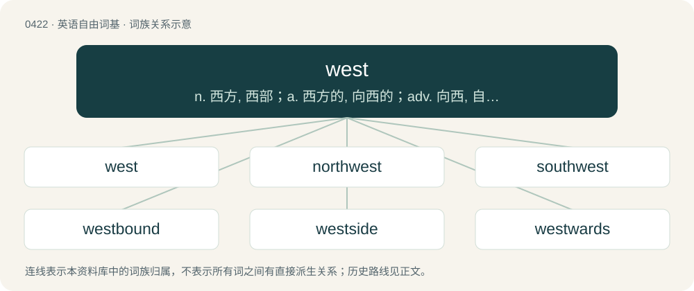

# 0482 · west — n. 西方, 西部；a. 西方的, 向西的；adv. 向西, 自西方, 在西方

[总目录](../00_总目录_按常用程度.md)

**类型**：英语自由词基　｜　**来源语言**：见词源记录

## 核心含义与来源

- 核心含义：n. 西方, 西部；a. 西方的, 向西的；adv. 向西, 自西方, 在西方
- 英文含义：The direction opposite to that of the earth's rotation, specifically 270°.
- 词形：west

**来源记录 1**（名词；The direction opposite to that of the earth's rotation, specifically 270°.）

From Middle English west, from Old English west, from Proto-West Germanic \*westr (“western”), from Proto-Germanic \*westrą (“west”), from Proto-Germanic \*westraz (“west”), from Proto-Indo-European \*wek⁽ʷ⁾speros (“evening”). Cognates Cognate with Scots wast (“west”), North Frisian waast, weest, wäst (“west”), Saterland Frisian Wääste (“west”), West Frisian and Dutch west (“west”), German West (“west”), Danish, Norwegian Bokmål, and Norwegian Nynorsk vest (“west”), Faroese and Icelandic vestur (“west”), Swedish väst, väster (“west”); also with Irish feascar, feasgar (“evening; vespers”), Cornish gorthugher (“evening”), Manx fastyr (“afternoon, evening; vespers”), Scottish Gaelic feasgar (“afternoon, evening”), Latin vesper (“evening”), Ancient Greek ἕσπερος (hésperos, “evening; western”), Latvian vakars (“evening”), Lithuanian vakaras (“evening”), Czech, Slovak and Slovene večer (“evening”), Kashubian wieczór (“evening”), Polish wieczerz, wieczór (“evening”), Russian вечер (večer, “evening”), Serbo-Croatian вече, вечер, veče, večer (“evening”), Armenian գիշեր (gišer, “night”). Compare also Catalan oest (“west”), French ouest (“west”), Galician oeste, ueste (“west”), Italian ovest (“west”), Portuguese, Spanish oeste (“west”) (all ultimately borrowings of the Old English word).

## 词族图

## 单词速览（常用到不常用）

| 单词 | 音标 | 释义 |
|---|---|---|
| [west](#w-1) | /wɛst/ | n. 西方, 西部；a. 西方的, 向西的；adv. 向西, 自西方, 在西方 |
| [northwest](#w-2) | 英 /nɔːθˈwɛst/；美 /nɔɹθˈwɛst/ | n. 西北, 西北方；a. 西北的, 在西北的, 来自西北的；adv. 向西北 |
| [southwest](#w-3) | /saʊθˈwɛst/ | n. 西南, 西南方, 西南地区；a. 西南的, 来自西南方的；adv. 往西南, 来自西南 |
| [westbound](#w-4) | /ˈwɛstbaʊnd/ | a. 向西行的, 向西驶的 |
| [westside](#w-5) | 英 /ˈwɛst.saɪd/ | \[地名\] \[美国\] 韦斯特赛德 |
| [westwards](#w-6) | /ˈwestwədz/ | adv. 向西 |
| [westland](#w-7) |  | 【英文】The western part of a geographic area; a land lying to the west. |
| [wester](#w-8) | /ˈwestə/ | n. 西风 |

## 逐词详解

### 1. west

**词性**：名词　｜　**音标**：/wɛst/

**中文释义**：n. 西方, 西部；a. 西方的, 向西的；adv. 向西, 自西方, 在西方

**英文义项**：The direction opposite to that of the earth's rotation, specifically 270°. / The western region or area; the inhabitants thereof.

**词源与演化**：

From Middle English west, from Old English west, from Proto-West Germanic \*westr (“western”), from Proto-Germanic \*westrą (“west”), from Proto-Germanic \*westraz (“west”), from Proto-Indo-European \*wek⁽ʷ⁾speros (“evening”). Cognates Cognate with Scots wast (“west”), North Frisian waast, weest, wäst (“west”), Saterland Frisian Wääste (“west”), West Frisian and Dutch west (“west”), German West (“west”), Danish, Norwegian Bokmål, and Norwegian Nynorsk vest (“west”), Faroese and Icelandic vestur (“west”), Swedish väst, väster (“west”); also with Irish feascar, feasgar (“evening; vespers”), Cornish gorthugher (“evening”), Manx fastyr (“afternoon, evening; vespers”), Scottish Gaelic feasgar (“afternoon, evening”), Latin vesper (“evening”), Ancient Greek ἕσπερος (hésperos, “evening; western”), Latvian vakars (“evening”), Lithuanian vakaras (“evening”), Czech, Slovak and Slovene večer (“evening”), Kashubian wieczór (“evening”), Polish wieczerz, wieczór (“evening”), Russian вечер (večer, “evening”), Serbo-Croatian вече, вечер, veče, večer (“evening”), Armenian գիշեր (gišer, “night”). Compare also Catalan oest (“west”), French ouest (“west”), Galician oeste, ueste (“west”), Italian ovest (“west”), Portuguese, Spanish oeste (“west”) (all ultimately borrowings of the Old English word).

**例句**：

> We used to live in the west of the country.

该用例对应义项：The direction opposite to that of the earth's rotation, specifically 270°.

### 2. northwest

**词性**：形容词　｜　**音标**：英 /nɔːθˈwɛst/；美 /nɔɹθˈwɛst/

**中文释义**：n. 西北, 西北方；a. 西北的, 在西北的, 来自西北的；adv. 向西北

**英文义项**：Of, in or pertaining to the northwest; northwestern. / Situated toward or in the direction of the northwest; northwestward; northwesterly.

**构词拆分**：north + west

**词源与演化**：

From Middle English northwest, from Old English norþwest, equivalent to north + west.

**用法示例／搭配（非完整句）**：

> a northwest course

该用例对应义项：Situated toward or in the direction of the northwest; northwestward; northwesterly.

### 3. southwest

**词性**：形容词　｜　**音标**：/saʊθˈwɛst/

**中文释义**：n. 西南, 西南方, 西南地区；a. 西南的, 来自西南方的；adv. 往西南, 来自西南

**英文义项**：Of, in or pertaining to the southwest; southwestern. / Situated toward or in the direction of the southwest; southwestward; southwesterly.

**构词拆分**：south + west

**词源与演化**：

From Middle English southwest, southewest, from Old English sūþwest and sūþanwestan, equivalent to south + west. Cognate with West Frisian súdwest, Dutch zuidwest, German Südwesten, Danish sydvest, Swedish sydväst.

**用法示例／搭配（非完整句）**：

> A southwest course.

该用例对应义项：Situated toward or in the direction of the southwest; southwestward; southwesterly.

### 4. westbound

**词性**：形容词　｜　**音标**：/ˈwɛstbaʊnd/

**中文释义**：a. 向西行的, 向西驶的

**英文义项**：Which is, or will be, moving towards the west.

**构词拆分**：west + -bound

**词源与演化**：

From west + -bound.

**例句**：

> Westbound traffic was blocked for miles.

该用例对应义项：Which is, or will be, moving towards the west.

### 5. westside

**词性**：名词　｜　**音标**：英 /ˈwɛst.saɪd/

**中文释义**：\[地名\] \[美国\] 韦斯特赛德

**英文义项**：The western side of a building, street, area etc.

**构词拆分**：west + side

**词源与演化**：

From west + side.

### 6. westwards

**词性**：副词　｜　**音标**：/ˈwestwədz/

**中文释义**：adv. 向西

**英文义项**：westward, towards the west

**构词拆分**：From west + -wards.

**词源与演化**：

From west + -wards.

**例句**：

> We traveled westwards for 100 miles.

### 7. westland

**词性**：名词

**英文义项**：The western part of a geographic area; a land lying to the west.

**构词拆分**：west + land

**词源与演化**：

From west + land.

### 8. wester

**词性**：名词　｜　**音标**：/ˈwestə/

**中文释义**：n. 西风

**英文义项**：A strong westerly wind, a wind blowing from the west.

**构词拆分**：From west + -er.

**词源与演化**：

From west + -er.

**例句**：

> “This is the climate crisis you haven’t heard of,” said Philippus Wester.
