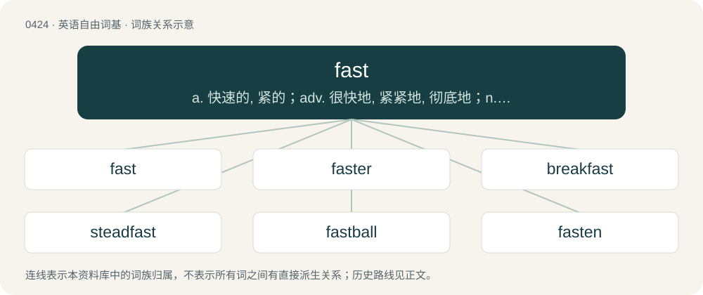

# 0483 · fast — a. 快速的, 紧的；adv. 很快地, 紧紧地, 彻底地；n. 绝食, 斋戒

[总目录](../00_总目录_按常用程度.md)

**类型**：英语自由词基　｜　**来源语言**：见词源记录

## 核心含义与来源

- 核心含义：a. 快速的, 紧的；adv. 很快地, 紧紧地, 彻底地；n. 绝食, 斋戒
- 英文含义：Firmly or securely fixed in place; stable.
- 词形：fast

**多个词源／构词路径**：同一拼写可能有不同来源；以下按词性和含义分别列出。

**来源记录 1**（形容词；Firmly or securely fixed in place; stable.）

From Middle English fast, fest, from Old English fæst (“firm, secure”), from Proto-West Germanic \*fast, from Proto-Germanic \*fastuz; see it for cognates and further etymology. The development of “rapid” from an original sense of “secure” apparently happened first in the adverb and then transferred to the adjective; compare hard in expressions like “to run hard”. The original sense of “secure, firm” is now slightly archaic, but retained in the related fasten (“make secure”). Also compare close meaning change from Latin rapiō (“to snatch”) to Latin rapidus (“rapid, quick”), from Irish sciob (“to snatch”) to Irish sciobtha (“quick”).

**来源记录 2**（副词；In a firm or secure manner, securely; in such a way as not to be moved; safe, sound .）

From Middle English fast, faste, from Old English fæste, from fæst + -e (adverb-forming suffix).

**来源记录 3**（动词；To practice religious abstinence, especially from food.）

From Middle English fasten, from Old English fæstan (“to fast”), from Proto-West Germanic \*fastēn, from Proto-Germanic \*fastāną (“to fast”), from the same root as Proto-Germanic \*fastijaną (“to fasten”), derived from \*fastuz, and thereby related to Etymology 1. The religious sense is presumably introduced in the Gothic church, from Gothic 𐍆𐌰𐍃𐍄𐌰𐌽 (fastan, “hold fast (viz. to the rule of abstinence)”). This semantic development is unique to Gothic, the term glosses Greek νηστεύω (nēsteúō), Latin ieiuno which do not have similar connotations of "holding fast". The feminine noun Old High German fasta likely existed in the 8th century (shift to neuter Old High German fasten from the 9th century, whence modern German Fasten). The Old English noun originally had the sense "fortress, enclosure" and takes the religious sense only in late Old English, perhaps influenced by Old Norse fasta. The use for reduced nutrition intake for medical reasons or for weight reduction develops by the mid-1970s, back-formed from the use of the verbal noun fasting in this sense (1960s).

**来源记录 4**（名词；The act or practice of fasting, religious abstinence from food.）

From Middle English faste, fasten, from Old English fæsten (“fast, fasting”), from Proto-West Germanic \*fastuni, from Proto-Germanic \*fastu(b)nją (“fast, fasting”). Cognate with Old Frisian festene, feste (Modern West Frisian fêsten, fêste), Middle Dutch vastene (Modern Dutch vasten), Middle Low German vastene (Modern German Low German Fasten), German Faste, Fasten (“fast, fasting”), Gothic 𐍆𐌰𐍃𐍄𐌿𐌱𐌽𐌹 (fastubni, “fasting”). Possibly merged with Old Norse fasta (“fast, fasting”), whence also Danish faste (“fast, fasting”), Swedish fasta (“fast, fasting”).

## 词族图

## 单词速览（常用到不常用）

| 单词 | 音标 | 释义 |
|---|---|---|
| [fast](#w-1) | 英 /fɑːst/；美 /fæst/ | a. 快速的, 紧的；adv. 很快地, 紧紧地, 彻底地；n. 绝食, 斋戒 |
| [faster](#w-2) | 英 /ˈfɑːstə/；美 /ˈfæstɚ/ | \[计\] 加快 |
| [breakfast](#w-3) | 英 /ˈbreɪkˌfɑːst/；美 /ˈbɹeɪkˌfæst/ | n. 早餐 |
| [steadfast](#w-4) | 英 /ˈstɛdfɑːst/；美 /ˈstɛdfæst/ | a. 坚定的, 踏实的, 固定的, 不变的 |
| [fastball](#w-5) | /ˈfɑːstbɔːl/ | n. \[棒\](投手投出的)快球 |
| [fasten](#w-6) | 英 /ˈfɑːsn̩/；美 /ˈfæsn̩/ | vt. 拴紧, 使固定, 系, 集中于, 强加于；vi. 扣紧 |
| [superfast](#w-7) | /ˈsupɚˌfæst/ | 超高速的 |
| [ultrafast](#w-8) | /,ʌltrəˈfɑːst;-ˈfæst/ | \[计\] 超高速的 |
| [fastness](#w-9) | 英 /ˈfɑːs(t)nəs/；美 /ˈfæs(t)nəs/ | n. 要塞, 巩固, 迅速；\[医\] 抗拒性 |

## 逐词详解

### 1. fast

**词性**：形容词　｜　**音标**：英 /fɑːst/；美 /fæst/

**中文释义**：a. 快速的, 紧的；adv. 很快地, 紧紧地, 彻底地；n. 绝食, 斋戒

**英文义项**：Firmly or securely fixed in place; stable. / Firm against attack; fortified by nature or art; impregnable; strong.

**词源与演化**：

From Middle English fast, fest, from Old English fæst (“firm, secure”), from Proto-West Germanic \*fast, from Proto-Germanic \*fastuz; see it for cognates and further etymology. The development of “rapid” from an original sense of “secure” apparently happened first in the adverb and then transferred to the adjective; compare hard in expressions like “to run hard”. The original sense of “secure, firm” is now slightly archaic, but retained in the related fasten (“make secure”). Also compare close meaning change from Latin rapiō (“to snatch”) to Latin rapidus (“rapid, quick”), from Irish sciob (“to snatch”) to Irish sciobtha (“quick”).

**例句**：

> Plutonium-240 has a much higher fission cross-section for fast neutrons than for thermal neutrons.

该用例对应义项：Having a kinetic energy between 1 million and 20 million electron volts; often used to describe the energy state of free neutrons at the moment of their release by a nuclear fission or nuclear fusion reaction (i.e., before the neutrons have been slowed down by anything).

### 2. faster

**词性**：名词　｜　**音标**：英 /ˈfɑːstə/；美 /ˈfæstɚ/

**中文释义**：\[计\] 加快

**英文义项**：One who fasts, or voluntarily refrains from eating.

**构词拆分**：fast + -er

**词源与演化**：

From fast (“refrain from eating”) + -er.

**例句**：

> Recently the demand for this product has increased faster than the supply.

### 3. breakfast

**词性**：名词　｜　**音标**：英 /ˈbreɪkˌfɑːst/；美 /ˈbɹeɪkˌfæst/

**中文释义**：n. 早餐

**英文义项**：The first meal of the day, usually eaten in the morning. / A meal consisting of food normally eaten in the morning, which may typically include eggs, sausages, toast, bacon, etc.

**构词拆分**：break + fast

**词源与演化**：

From Middle English brekefast, brekefaste, equivalent to break + fast (literally, "to end the nightly fast"), likely a variant of Old English fæstenbryċe, (literally, "fast-breach"). Cognate with Dutch breekvasten (“breakfast”).

**例句**：

> I had an early dinner because the breakfast in this hostel is superb.

该用例对应义项：The first meal of the day, usually eaten in the morning.

### 4. steadfast

**词性**：形容词　｜　**音标**：英 /ˈstɛdfɑːst/；美 /ˈstɛdfæst/

**中文释义**：a. 坚定的, 踏实的, 固定的, 不变的

**英文义项**：Fixed or unchanging; steady. / Firmly loyal or constant; unswerving.

**构词拆分**：stead (“place; spot; position”) + fast (“firm; fixed”)

**词源与演化**：

From Middle English stedefast, from Old English stedefæst, from Proto-Germanic \*stadifastuz, equivalent to stead (“place; spot; position”) + fast (“firm; fixed”). Cognate with Middle Dutch stedevast (“steadfast”), Icelandic staðfestur (“steadfast”), Danish stedfast (“firmly attached, secured”), Danish stadfæste (“to confirm; ratify”), Norwegian Nynorsk stadfesta (“confirm, ratify; establish”), Swedish stadfästa (“to confirm; establish”).

**用法示例／搭配（非完整句）**：

> steadfast commitment

该用例对应义项：Firmly loyal or constant; unswerving.

### 5. fastball

**词性**：名词　｜　**音标**：/ˈfɑːstbɔːl/

**中文释义**：n. \[棒\](投手投出的)快球

**英文义项**：A high-speed pitch of a baseball. / A four-seam fastball, which is a backspin pitch thrown with a ball gripped in the direction to cause four of the seams of the ball to cross the flight path and released with roughly equal pressure by the index and middle fingers

**构词拆分**：fast (adjective) + ball

**词源与演化**：

From fast (adjective) + ball.

**例句**：

> The pitcher had a blazing fastball.

该用例对应义项：A four-seam fastball, which is a backspin pitch thrown with a ball gripped in the direction to cause four of the seams of the ball to cross the flight path and released with roughly equal pressure by the index and middle fingers

### 6. fasten

**词性**：动词　｜　**音标**：英 /ˈfɑːsn̩/；美 /ˈfæsn̩/

**中文释义**：vt. 拴紧, 使固定, 系, 集中于, 强加于；vi. 扣紧

**英文义项**：To attach or connect in a secure manner. / To cause to take close effect; to make to tell; to land.

**构词拆分**：fast + -en

**词源与演化**：

From Middle English fastenen, from Old English fæstnian, from Proto-West Germanic \*fastinōn (“to secure, fasten”). Equivalent to fast + -en.

**例句**：

> The sailor fastened the boat to the dock with a half-hitch.

该用例对应义项：To attach or connect in a secure manner.

### 7. superfast

**词性**：形容词　｜　**音标**：/ˈsupɚˌfæst/

**中文释义**：超高速的

**英文义项**：Extremely fast.

**构词拆分**：super- + fast

**词源与演化**：

From super- + fast.

**例句**：

> I bought myself this superfast popcorn machine as a Christmas present.

### 8. ultrafast

**词性**：形容词　｜　**音标**：/,ʌltrəˈfɑːst;-ˈfæst/

**中文释义**：\[计\] 超高速的

**英文义项**：Very fast, or of very short duration; especially concerning events that take place in femtosecond or picosecond timescales.

**构词拆分**：ultra- + fast

**词源与演化**：

From ultra- + fast.

### 9. fastness

**词性**：名词　｜　**音标**：英 /ˈfɑːs(t)nəs/；美 /ˈfæs(t)nəs/

**中文释义**：n. 要塞, 巩固, 迅速；\[医\] 抗拒性

**英文义项**：The quality or state of being strongly attached; firmness, secureness, tenacity. / The ability of a dye to withstand fading.

**构词拆分**：fast + -ness

**词源与演化**：

From Middle English fastnes, fastnesse (“immovableness, stability; firmness, solidness; secure attachment; constancy; obstinacy; something giving firmness or strength; of sleep: soundness; of a wound: healing; assurance, confirmation”) \[and other forms\], from Old English fæstnes (“fastness, firmness, stability; resolution; tenacity; vigour; firmament; fortification”) \[and other forms\], from fæst (“firm, stable; constant”) (from Proto-Germanic \*fastuz (“firm, fixed; secure”); see further at that entry) + -nes (suffix forming abstract nouns denoting a quality or state). The English word may be analysed as fast + -ness.
