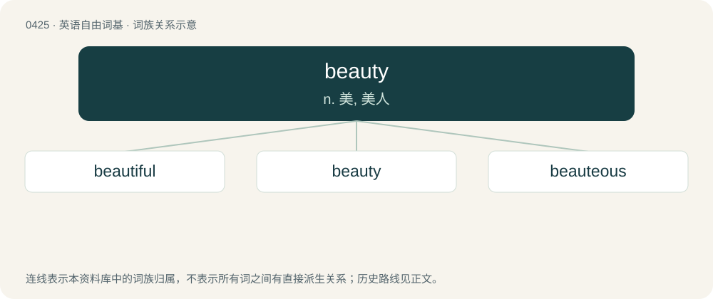

# 0487 · beauty — n. 美, 美人

[总目录](../00_总目录_按常用程度.md)

**类型**：英语自由词基　｜　**来源语言**：见词源记录

## 核心含义与来源

- 核心含义：n. 美, 美人
- 英文含义：The quality of being (especially visually) attractive, pleasing, fine or good-looking; comeliness.
- 词形：beauty

**来源记录 1**（名词；The quality of being (especially visually) attractive, pleasing, fine or good-looking; comeliness.）

From Middle English bewty, bewte, beaute, bealte, from Anglo-Norman and Old French beauté (early Old French spelling biauté), from Vulgar Latin \*bellitātem (“beauty”), from Latin bellus (“beautiful, fair”); see beau. In this sense, mostly displaced native Old English fæġernes, whence Modern English fairness.

## 词族图

## 单词速览（常用到不常用）

| 单词 | 音标 | 释义 |
|---|---|---|
| [beautiful](#w-1) | 英 /ˈbjuːtɪ.fəl/；美 /ˈbju.tɪ.fəl/ | a. 美丽的 |
| [beauty](#w-2) | 英 /ˈbjuːti/；美 /ˈbjuti/ | n. 美, 美人 |
| [beauteous](#w-3) | 英 /ˈbjuːtɪəs/ | a. 美丽的 |

## 逐词详解

### 1. beautiful

**词性**：形容词　｜　**音标**：英 /ˈbjuːtɪ.fəl/；美 /ˈbju.tɪ.fəl/

**中文释义**：a. 美丽的

**英文义项**：Possessing beauty, impressing the eye; attractive. / Used emphatically or ironically, after the noun it qualifies.

**构词拆分**：beauty + -ful

**词源与演化**：

From Middle English bewteful, beautefull (“attractive to the eye, beautiful”), equivalent to beauty + -ful. In this sense, largely displaced Old English fæġer (whence fair).

**例句**：

> Anyone who has ever met her thought she was absolutely beautiful.

该用例对应义项：Possessing beauty, impressing the eye; attractive.

### 2. beauty

**词性**：名词　｜　**音标**：英 /ˈbjuːti/；美 /ˈbjuti/

**中文释义**：n. 美, 美人

**英文义项**：The quality of being (especially visually) attractive, pleasing, fine or good-looking; comeliness. / Someone who is beautiful.

**词源与演化**：

From Middle English bewty, bewte, beaute, bealte, from Anglo-Norman and Old French beauté (early Old French spelling biauté), from Vulgar Latin \*bellitātem (“beauty”), from Latin bellus (“beautiful, fair”); see beau. In this sense, mostly displaced native Old English fæġernes, whence Modern English fairness.

**例句**：

> The beauty of the deal is it costs nothing!

该用例对应义项：The excellence or genius of a scheme or decision.

### 3. beauteous

**词性**：形容词　｜　**音标**：英 /ˈbjuːtɪəs/

**中文释义**：a. 美丽的

**英文义项**：beautiful.

**构词拆分**：beauty + -ous；beauty + -eous

**词源与演化**：

From Middle English beautevous, bewteose, beautuous, boyteous, beuteus, beuteowse, bewtyvows, equivalent to beauty + -ous and/or beauty + -eous.

**例句**：

> How beauteous mankind is! O brave new world, That has such people in't!
