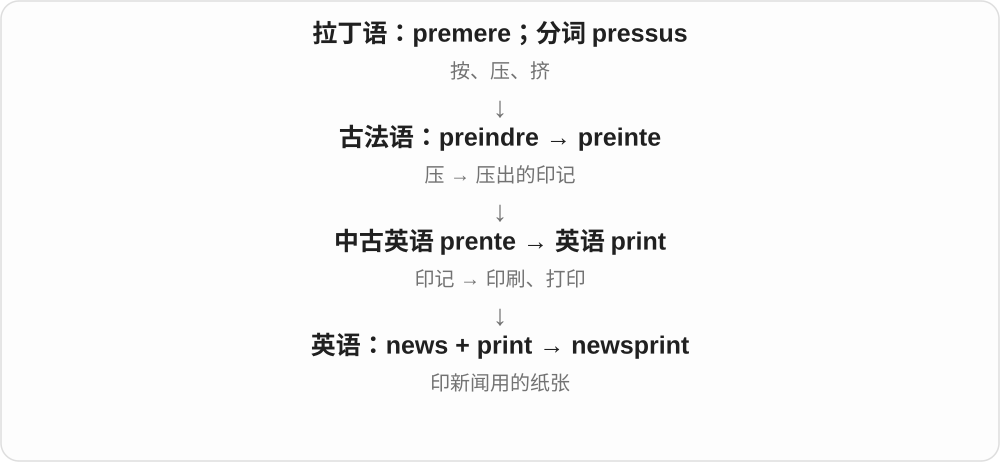

# 0487 · news — 新闻、消息及其传播

[逐词精讲目录](../00_逐词精讲目录.md) · [总目录](../00_总目录_按常用程度.md)

## 核心词根与来源

news 与 new 的新事物用法有关，虽带 s，现代通常作为不可数整体名词。newscast、newsreel、newswire 的后半成分解释媒介；newsreader 软件义接旧新闻组技术。

**NEWS：新消息经什么媒介、由谁送到人眼前**

播报成节目，胶片成新闻短片，供稿成电讯服务，持续更新成信息流；人物按职责再分。

- **新闻与价值**：news · newsworthy
- **播报与播报者**：newscast · newscaster · newsreader
- **不同传播形式**：newsflash · newsreel · newswire · newsfeed
- **职业和既有媒体词**：newsman · newsboy · newspaper · newsletter · newsroom · newsstand · newsprint · newsagent · newsgroup

## 词形与演化规律

newsworthy 先讲价值；newscast → newscaster 与 newsreader 放一起；newsflash、newsreel、newswire、newsfeed 分清快讯、影像、供稿、动态流；newsman、newsboy 分职业。

## 单词速览（按词族由简到繁）

同一基础词的相关扩展放在一起，先读基础形式，再读扩展；各组之间优先读常用的。具体词源关系见各词讲解。

| 单词 | 音标 | 核心意思 |
|---|---|---|
| [news](#w-1) | 英 /njuːz/；美 /nuːz/ | 消息；新闻 |
| [newspaper](#w-2) | 英 /ˈnjuːzpeɪpə/；美 /ˈnuːzpeɪpər/ | 报纸；报社或新闻出版机构 |
| [newsletter](#w-3) | 英 /ˈnjuːzletə/；美 /ˈnuːzletər/ | 简报；定期通讯；电子订阅通讯 |
| [newsroom](#w-4) | 英 /ˈnjuːzruːm/；美 /ˈnuːzruːm/ | 新闻编辑室；新闻采编部门 |
| [newsworthy](#w-5) | 英 /ˈnjuːzwɜːði/；美 /ˈnuːzwɜːrði/ | 值得报道的；有新闻价值的 |
| [newscast](#w-6) | 英 /ˈnjuːzkɑːst/；美 /ˈnuːzkæst/ | 新闻广播；新闻播报节目 |
| [newscaster](#w-18) | 英 /ˈnjuːzkɑːstə/；美 /ˈnuːzkæstər/ | 新闻播音员；新闻主播 |
| [newsreader](#w-7) | 英 /ˈnjuːzriːdə/；美 /ˈnuːzriːdər/ | 新闻播音员；新闻组阅读程序〔技术用法〕 |
| [newsflash](#w-8) | 英 /ˈnjuːzflæʃ/；美 /ˈnuːzflæʃ/ | 新闻快讯；突然插播的短消息 |
| [newsstand](#w-9) | 英 /ˈnjuːzstænd/；美 /ˈnuːzstænd/ | 报刊亭；售报摊 |
| [newsreel](#w-10) | 英 /ˈnjuːzriːl/；美 /ˈnuːzriːl/ | 新闻短片；新闻纪录影片〔尤旧式〕 |
| [newswire](#w-11) | 英 /ˈnjuːzwaɪə/；美 /ˈnuːzwaɪər/ | 通讯社新闻供稿线路、服务；新闻电讯 |
| [newsfeed](#w-12) | 英 /ˈnjuːzfiːd/；美 /ˈnuːzfiːd/ | 新闻、动态信息流 |
| [newsprint](#w-13) | 英 /ˈnjuːzprɪnt/；美 /ˈnuːzprɪnt/ | 新闻纸；用于印报纸的纸 |
| [newsman](#w-14) | 英 /ˈnjuːzmæn/；美 /ˈnuːzmæn/ | 新闻工作者；记者〔传统男性称谓〕 |
| [newsagent](#w-15) | 英 /ˈnjuːzeɪdʒənt/；美 /ˈnuːzeɪdʒənt/ | 报刊经销商；报刊店 |
| [newsgroup](#w-16) | 英 /ˈnjuːzɡruːp/；美 /ˈnuːzɡruːp/ | 网络新闻组；按主题组织的早期网络讨论区 |
| [newsboy](#w-17) | 英 /ˈnjuːzbɔɪ/；美 /ˈnuːzbɔɪ/ | 报童；卖报、送报者 |

## 逐词讲解

### 1. news — 消息；新闻

**音标**：英 /njuːz/；美 /nuːz/

**先抓住这个画面**

新发生、值得告诉别人的事。

**怎么拆**

中古英语把 new 当作新事物，再用复数形式 news；这一表达受法语 nouvelles 等同类形式影响。后来 news 常按单数不可数名词使用。

**怎么变成今天的意思**

**英语 new 的名词用法**  
新事物

↓

**复数 news**  
新发生的事情、消息

↓

**现代不可数名词 news**  
消息、新闻报道

news is good 要用 is；一条消息说 a piece of news。词尾 s 留下了历史痕迹，但现代不能仅凭它就按复数处理。news 并不是 north、east、west、south 四个方向的首字母缩写。

**常见搭配与例句**

good news；breaking news；a piece of news；That’s news to me。

> The news is better than we expected.

消息比我们预料的好。

> I have a piece of news that may interest you.

我有一条你可能感兴趣的消息。

> They’re moving abroad? That’s news to me.

他们要搬到国外？这事我还是头一次听说。

**别混淆**

news 是消息本身，a newspaper 是一份报纸。不能把一条新闻说成 a news，也不能因为词尾 s 就说 these news。

### 2. newspaper — 报纸；报社或新闻出版机构

**音标**：英 /ˈnjuːzpeɪpə/；美 /ˈnuːzpeɪpər/

**先抓住这个画面**

把新闻放在一份定期发行的纸上。

**怎么拆**

news 新闻 + paper 纸；随着印刷新闻定期发行，组合词用来称报纸，也可转指办报机构。

**怎么变成今天的意思**

**英语 news；paper**  
新闻；纸

↓

**newspaper**  
载有新闻的报纸

↓

**机构用法**  
出版报纸的新闻机构

read a newspaper 是读报；work for a newspaper 通常是为报社工作。现在报社也可以通过网站发布内容，所以这个词不总要求你眼前真的有一张纸。

**常见搭配与例句**

a daily newspaper；a local newspaper；a newspaper article。

> She unfolded the newspaper and read the front page.

她展开报纸，读起头版。

> He writes about local history for a regional newspaper.

他为一家地区报社撰写本地历史文章。

**别混淆**

news 不可数；newspaper 可数。two newspapers 可以是两份报纸，也可指两家报社，结合语境判断。

### 3. newsletter — 简报；定期通讯；电子订阅通讯

**音标**：英 /ˈnjuːzletə/；美 /ˈnuːzletər/

**先抓住这个画面**

把最近值得告诉一群人的消息，定期装成一封或一份发送出去。

**怎么拆**

news“消息” + letter“信”，由传递消息的信发展为定期出版或发送的通讯。

**怎么变成今天的意思**

**拉丁 littera／litera**  
字母；复数也可指书信、文献和学问

↓

**古法语 letre → 英语 letter**  
字母；写成的书信

↓

**英语 news + letter → newsletter**  
消息信件 → 面向订阅者或成员的定期通讯

学校、社区、公司或独立作者都可以发 newsletter。它可以是纸质的，也可以通过电子邮件发送；内容可能是新闻、项目进展或选读文章，并不必然是广告，也不必然每天出版。

**常见搭配与例句**

subscribe to a newsletter；a monthly newsletter；an email newsletter。

> The museum sends a monthly newsletter to its members.

博物馆每月向会员发送一份通讯。

> I found the article through a newsletter about local history.

我通过一份介绍地方历史的订阅通讯读到了这篇文章。

**别混淆**

newspaper 通常是面向更广泛公众的报纸；newsletter 常面向某个主题、组织或订阅群体。

### 4. newsroom — 新闻编辑室；新闻采编部门

**音标**：英 /ˈnjuːzruːm/；美 /ˈnuːzruːm/

**先抓住这个画面**

记者、编辑在这里收集、核实、组织报道，是新闻生产的工作空间。

**怎么拆**

news + room；从具体采编空间，也可借指参与新闻工作的团队。

**怎么变成今天的意思**

**news；room**  
并列组合部分

↓

**newsroom**  
新闻采编工作场所、部门

a busy newsroom 忙碌编辑室，newsroom staff 采编人员。数字化团队也能叫 newsroom，不必都挤在同一间房。

**常见搭配与例句**

newsroom staff；a newspaper newsroom；inside the newsroom。

> The newsroom became busy as the election results came in.

选举结果陆续传来，编辑室忙了起来。

> The documentary shows how a newsroom checks a major story.

纪录片展示了新闻编辑部如何核实一条重要报道。

**别混淆**

newsroom 做报道，newsgroup 是按主题组织的网络讨论区；两者都带 news，用途不同。

### 5. newsworthy — 值得报道的；有新闻价值的

**音标**：英 /ˈnjuːzwɜːði/；美 /ˈnuːzwɜːrði/

**先抓住这个画面**

事情不只是发生了，还值得放到公众面前讲，才称 newsworthy。

**怎么拆**

news + -worthy（值得……的），worthy 与 worth 有关；不是说这条新闻一定值某个价格。

**怎么变成今天的意思**

**news；-worthy**  
并列构词部分

↓

**newsworthy**  
值得作为新闻报道的

a newsworthy event 有新闻价值的事件，make something newsworthy 使某事值得报道。是否值得涉及影响、时效等判断，不等于一定轰动。

**常见搭配与例句**

a newsworthy event；a newsworthy development；consider newsworthy。

> The discovery was considered newsworthy.

这项发现被认为值得报道。

> Not every change is a newsworthy event.

不是每一个变化都有新闻价值。

**别混淆**

newsworthy 值得报道，news 真消息、新闻这一名词本身不自动评价重要程度。

### 6. newscast — 新闻广播；新闻播报节目

**音标**：英 /ˈnjuːzkɑːst/；美 /ˈnuːzkæst/

**先抓住这个画面**

不是一张报纸，而是通过电视、广播等把一组新闻播出来。

**怎么拆**

news + -cast，cast 从 broadcast 等播送表达中类推；不是新闻人物的演员阵容 cast。

**怎么变成今天的意思**

**news；-cast〔播送〕**  
并列构词部分

↓

**newscast**  
广播、电视等新闻播报节目

the evening newscast 晚间新闻，a local newscast 地方新闻节目。常指一档、一段播报，可数。

**常见搭配与例句**

the evening newscast；a local newscast；watch a newscast。

> The evening newscast opened with the election results.

晚间新闻以选举结果开场。

> She listened to the local newscast on the radio.

她用收音机听地方新闻。

**别混淆**

newscast 整档播报，newsflash 常是短快讯；两者都可能含同一事件，时长、节目组织不同。

### 7. newscaster — 新闻播音员；新闻主播

**音标**：英 /ˈnjuːzkɑːstə/；美 /ˈnuːzkæstər/

**先抓住这个画面**

newscast 是节目，newscaster 是把新闻讲给观众听的人。

**怎么拆**

newscast + -er，-er 表执行播报活动的人；不是从 news 里直接截出一个 caster 就表示所有记者。

**怎么变成今天的意思**

**newscast**  
播报新闻的节目、活动

↓

**newscast + -er → newscaster**  
播报新闻的人

a television newscaster 电视新闻主播，a radio newscaster 广播新闻播音员。实际工作有时兼采编，但词义重点是播报。

**常见搭配与例句**

a television newscaster；a radio newscaster；an experienced newscaster。

> The newscaster introduced the next report.

新闻主播引出了下一篇报道。

> A familiar radio newscaster read the morning headlines.

一位听众熟悉的广播播音员播读了晨间头条。

**别混淆**

newscaster、newsreader 常重叠；reporter 记者更常突出采访、报道，不一定在演播室主持节目。

### 8. newsreader — 新闻播音员；新闻组阅读程序〔技术用法〕

**音标**：英 /ˈnjuːzriːdə/；美 /ˈnuːzriːdər/

**先抓住这个画面**

可以是读新闻给你听的人，也可以是帮你读取旧式网络新闻组的程序。

**怎么拆**

news + reader，reader 是 read + -er；人的播报角色与软件工具都是参与读取的名词用法，不说程序变成了人。

**怎么变成今天的意思**

**news；reader〔read + -er〕**  
并列构词部分

↓

**newsreader**  
新闻播读者；新闻组阅读软件

a BBC newsreader 可指该机构新闻播音员，a Usenet newsreader 是读取、参与新闻组的软件。news 在技术名称中不限时事报道。

**常见搭配与例句**

a television newsreader；a radio newsreader；a Usenet newsreader。

> The newsreader paused before announcing the result.

新闻播音员公布结果前停顿了一下。

> The old guide explains how to configure a newsreader for Usenet.

旧指南讲解怎样为 Usenet 配置新闻组阅读程序。

**别混淆**

newsreader 职业用法与 newscaster 近；普通阅读新闻的任何人通常直接说 a news reader、reader，具体职业称呼看语境。

### 9. newsflash — 新闻快讯；突然插播的短消息

**音标**：英 /ˈnjuːzflæʃ/；美 /ˈnuːzflæʃ/

**先抓住这个画面**

正常节目还在播，一条刚到的重要消息突然插进来，快速告诉观众。

**怎么拆**

news + flash，flash 借快速、突然出现的感觉，不是真把灯泡闪在报纸上。

**怎么变成今天的意思**

**news；flash**  
并列构词部分

↓

**newsflash**  
短促、及时的新闻快讯

a breaking newsflash 突发快讯。口语 Newsflash: ... 也可讽刺提醒明显事实，像“你还不知道吗”，语气可能不客气。

**常见搭配与例句**

a newsflash about；interrupt with a newsflash；Newsflash: ...。

> The program was interrupted by a newsflash.

节目被一条新闻快讯打断了。

> A newsflash announced that the missing hikers had been found.

快讯宣布失踪徒步者已找到。

**别混淆**

newsflash 偏短消息，newsreel 旧式新闻影片，newsfeed 持续更新的信息流；媒介与组织方式不同。

### 10. newsstand — 报刊亭；售报摊

**音标**：英 /ˈnjuːzstænd/；美 /ˈnuːzstænd/

**先抓住这个画面**

路边摆出一排报纸杂志，过路人停下来买一份。

**怎么拆**

news（新闻；这里借指报刊）+ stand（摊台），不是让新闻站立起来。news 本来以 s 结尾，不另把这里的 s 误认成连接后缀。

**怎么变成今天的意思**

**英语 news；stand〔摊台〕**  
并列组合的两部分

↓

**news + stand〔摊台〕 → newsstand**  
出售报刊的摊亭

常在车站、街边、机场看到。on newsstands 可表示刊物正在市面发售，并不是所有刊物一定只通过小亭出售。

**常见搭配与例句**

a station newsstand；buy a paper at a newsstand；on newsstands。

> I bought a magazine at the station newsstand.

我在车站报刊亭买了本杂志。

> The new issue reaches newsstands next week.

新一期杂志下周上市。

**别混淆**

newsstand 是销售报刊的地点，newsletter 是定期通讯；stand 这一后半先把它定成摊台。

### 11. newsreel — 新闻短片；新闻纪录影片〔尤旧式〕

**音标**：英 /ˈnjuːzriːl/；美 /ˈnuːzriːl/

**先抓住这个画面**

电视普及前，影院里也能看新闻；它们被拍成一卷卷短影片。

**怎么拆**

news + reel（胶片卷），从实体胶片媒介理解，不是把 news + real“真实”拼错。

**怎么变成今天的意思**

**news；reel〔胶片卷〕**  
并列构词部分

↓

**newsreel**  
记录、报道时事的短影片

wartime newsreels 战时新闻影片，archive newsreel footage 馆藏新闻影像。今天常在纪录片、历史档案材料里遇见。

**常见搭配与例句**

archive newsreel footage；a wartime newsreel；old newsreels。

> The documentary includes newsreel footage from the 1930s.

纪录片用了20世纪30年代的新闻影片素材。

> People once watched newsreels at the cinema.

人们过去曾在影院观看新闻短片。

**别混淆**

newsreel 是新闻影片形式，documentary 纪录片范围更广；旧新闻影像可以被后来的纪录片引用。

### 12. newswire — 通讯社新闻供稿线路、服务；新闻电讯

**音标**：英 /ˈnjuːzwaɪə/；美 /ˈnuːzwaɪər/

**先抓住这个画面**

新闻不只送给一个读者，还通过一套供稿渠道迅速送到许多媒体。

**怎么拆**

news + wire，wire 与早期有线电讯传稿背景相连；数字时代名称延续，不要求编辑桌边仍有那根旧电线。

**怎么变成今天的意思**

**news；wire〔电讯线路〕**  
并列构词部分

↓

**newswire**  
新闻电讯传送、供稿服务

a newswire service 新闻电讯供稿服务，a story on the newswire 电讯线路上的报道。常与通讯社、媒体生产流程有关。

**常见搭配与例句**

a newswire service；newswire reports；a story on the newswire。

> The editor saw the report on a newswire.

编辑在新闻电讯供稿中看到了这篇报道。

> The agency distributes stories through its newswire service.

通讯社通过新闻供稿服务分发报道。

**别混淆**

newswire 供稿服务与渠道，newsroom 编辑部工作场所、团队；一个编辑部可使用多种供稿渠道。

### 13. newsfeed — 新闻、动态信息流

**音标**：英 /ˈnjuːzfiːd/；美 /ˈnuːzfiːd/

**先抓住这个画面**

不是一本固定顺序的书，而是一条不断往你面前补新内容的流。

**怎么拆**

news + feed，feed 在技术语境指持续提供的内容流；不是给记者喂饭。也常分写 news feed。

**怎么变成今天的意思**

**news；feed〔内容供应流〕**  
并列构词部分

↓

**newsfeed**  
持续更新的新闻、动态内容流

scroll through a newsfeed 刷动态流，a personalized newsfeed 个性化信息流。社交平台上的内容可包括朋友动态，不只政治时事。

**常见搭配与例句**

scroll through a newsfeed；a personalized newsfeed；update the newsfeed。

> The app lets users customize their newsfeed.

应用让用户自定义信息流。

> I found the announcement while scrolling through my newsfeed.

我刷动态时看到了那则公告。

**别混淆**

newsfeed 内容流，newsletter 定期通讯，newsgroup 按主题讨论区；都带 news，但交互、组织方式不同。

### 14. newsprint — 新闻纸；用于印报纸的纸

**音标**：英 /ˈnjuːzprɪnt/；美 /ˈnuːzprɪnt/

**先抓住这个画面**

不是某条新闻的内容，而是那种适合大量印报纸的纸张。

**怎么拆**

news 新闻 + print 印刷，组合词专门指印报纸使用的纸。

**怎么变成今天的意思**

通常作不可数名词，谈纸的种类、消耗量或供应。艺术课也常用这种便宜纸练习。

**常见搭配与例句**

a roll of newsprint；newsprint prices；draw on newsprint。

> The students practised drawing on sheets of newsprint.

学生们在新闻纸上练习绘画。

> The printing company bought several rolls of newsprint.

印刷公司买了几卷新闻纸。

**别混淆**

newspaper 是报纸这一出版物；newsprint 主要是它用的材料。

### 15. newsman — 新闻工作者；记者〔传统男性称谓〕

**音标**：英 /ˈnjuːzmæn/；美 /ˈnuːzmæn/

**先抓住这个画面**

职业围着新闻采访、编辑、播报展开；传统名称用 man 指人。

**怎么拆**

news + man，现代职业表达也常用 journalist、reporter，不必用 man 来指所有从业者。

**怎么变成今天的意思**

**news；man**  
并列构词部分

↓

**newsman**  
从事新闻工作的人的传统称谓

a veteran newsman 资深新闻工作者，a local newsman 当地记者。常见于人物简介、较传统的新闻文体。

**常见搭配与例句**

a veteran newsman；a local newsman；a television newsman。

> The memoir was written by a veteran newsman.

回忆录由一位资深新闻工作者撰写。

> A local newsman interviewed the villagers.

一位当地记者采访了村民。

**别混淆**

newsman 新闻职业人，newsboy 传统卖报、送报者；两个词不只是在说成年人、儿童年龄差。

### 16. newsagent — 报刊经销商；报刊店

**音标**：英 /ˈnjuːzeɪdʒənt/；美 /ˈnuːzeɪdʒənt/

**先抓住这个画面**

newsagent 原本是帮新闻出版物到达读者手里的经销者，后来也指卖这些东西的店。

**怎么拆**

news（新闻、报刊）+ agent（经销或代理者）。

**怎么变成今天的意思**

英国英语常见；a newsagent’s 可指报刊店，往往也卖文具等物品。不是现场采访新闻的记者。

**常见搭配与例句**

a local newsagent；at the newsagent’s；a newspaper from the newsagent。

> I bought a magazine at the newsagent’s.

我在报刊店买了一本杂志。

> The local newsagent keeps a copy of the paper for her.

当地报刊经销商会为她留一份报纸。

**别混淆**

newsagent 卖报刊；journalist 采访报道；news agency 是新闻通讯社。

### 17. newsgroup — 网络新闻组；按主题组织的早期网络讨论区

**音标**：英 /ˈnjuːzɡruːp/；美 /ˈnuːzɡruːp/

**先抓住这个画面**

网上按主题开出一个讨论版，大家往里面发帖、回复，并不是一队记者。

**怎么拆**

news + group；互联网用法尤其与 Usenet 等新闻组系统相连。news 在技术名称中不局限时事新闻。

**怎么变成今天的意思**

**news；group**  
并列构词部分

↓

**newsgroup**  
按主题组织网络帖子和讨论的新闻组

a photography newsgroup 可以讨论摄影，不要求只发布新闻。今天读早期互联网材料常遇见；不能把普通消息推送 news feed 直接当同一系统。

**常见搭配与例句**

post to a newsgroup；a discussion newsgroup；read a newsgroup。

> He found the answer in an old photography newsgroup.

他在一个旧摄影新闻组里找到了答案。

> Users posted questions to the newsgroup and replied to one another.

用户在新闻组发问题，互相回复。

**别混淆**

newsgroup 是主题讨论机制；newsletter 通常是定期通讯，newsroom 是新闻编辑室。看到 news 先分用途。

### 18. newsboy — 报童；卖报、送报者

**音标**：英 /ˈnjuːzbɔɪ/；美 /ˈnuːzbɔɪ/

**先抓住这个画面**

报纸需要从印刷、发行处到读者手里，街头叫卖或送到门口的人做这一步。

**怎么拆**

news + boy，news 借指报纸，boy 是传统儿童、年轻男性的职业称呼。不是在新闻节目里演小孩。

**怎么变成今天的意思**

**news；boy**  
并列构词部分

↓

**newsboy**  
传统街头卖报、送报者称谓

a street newsboy 街头报童，a newsboy cap 报童帽。历史语境常见，帽子名称后来成为服饰名称，不要求佩戴者真卖报。

**常见搭配与例句**

a street newsboy；a newsboy cap；work as a newsboy。

> The old photograph shows a newsboy outside the station.

老照片里，一个报童站在车站外。

> He wore a wool newsboy cap.

他戴着一顶羊毛报童帽。

**别混淆**

newsboy 卖报送报，newsreader 播读新闻；两者处在新闻传播的不同环节。

## 这一组要分清什么

news 不因 s 就写 news are；newscast 节目、newscaster 人；newsfeed 动态流与 newsgroup 讨论区不同；newsreel 的 reel 是胶片卷。

## 串起来练习

The newsreader opened the newscast with a newsworthy discovery reported on the newswire.

新闻播音员以电讯供稿里一项值得报道的发现为新闻节目开场。
