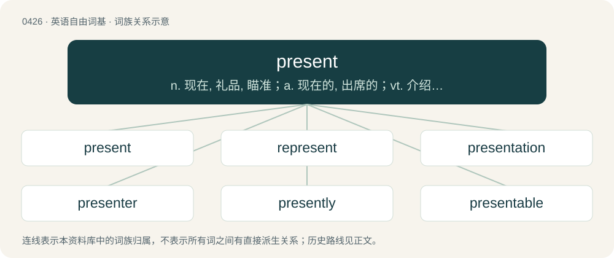

# 0488 · present — n. 现在, 礼品, 瞄准；a. 现在的, 出席的；vt. 介绍, 引见, 赠送, 提出, 呈现, 上演

[总目录](../00_总目录_按常用程度.md)

**类型**：英语自由词基　｜　**来源语言**：见词源记录

## 核心含义与来源

- 核心含义：n. 现在, 礼品, 瞄准；a. 现在的, 出席的；vt. 介绍, 引见, 赠送, 提出, 呈现, 上演
- 英文含义：Relating to now, for the time being; current.
- 词形：present

**多个词源／构词路径**：同一拼写可能有不同来源；以下按词性和含义分别列出。

**来源记录 1**（形容词；Relating to now, for the time being; current.）

From Middle English present, from Old French present, from Latin praesent-, praesens, present participle of praeesse (“to be present”), from Latin prae- (“pre-”) + esse (“to be”). Displaced Old English andweard (“present, current”).

**来源记录 2**（名词；A gift, especially one given for birthdays, Christmas, anniversaries, graduations, weddings, or any other special occasions.）

From Middle English presenten, from Old French presenter, from Latin praesentāre (“to show”), from praesent-, praesens, present participle of praeesse (“be in front of”).

## 词族图

## 单词速览（常用到不常用）

| 单词 | 音标 | 释义 |
|---|---|---|
| [present](#w-1) | 英 /ˈpɹɛz.ənt/ | n. 现在, 礼品, 瞄准；a. 现在的, 出席的；vt. 介绍, 引见, 赠送, 提出, 呈现, 上演 |
| [represent](#w-2) | /ˌɹi(ː).pɹɪˈzɛnt/ | 【英文】To present again, for instance for medical attention. |
| [presentation](#w-3) | 英 /ˌpɹɛzn̩ˈteɪʃn̩/ | n. 赠与, 描述, 介绍；\[计\] 简报 |
| [presenter](#w-4) | /pɹɪˈzɛntə(ɹ)/ | n. 节目主持人, 奉献者, 提出者；\[法\] 告发者, 提出者, 推荐者 |
| [presently](#w-5) | 英 /ˈpɹɛzəntli/ | adv. 目前, 不久 |
| [presentable](#w-6) | 英 /pɹəˈzɛntəbəl/ | a. 体面的, 可表现的, 可提出的 |
| [omnipresent](#w-7) | British/Southern/Standard /ˌɔmnɪjˈpɹɛz(ə)nt/ | a. 无所不在的, 普通存在的 |

## 逐词详解

### 1. present

**词性**：形容词　｜　**音标**：英 /ˈpɹɛz.ənt/

**中文释义**：n. 现在, 礼品, 瞄准；a. 现在的, 出席的；vt. 介绍, 引见, 赠送, 提出, 呈现, 上演

**英文义项**：Relating to now, for the time being; current. / Located in the immediate vicinity.

**词源与演化**：

From Middle English present, from Old French present, from Latin praesent-, praesens, present participle of praeesse (“to be present”), from Latin prae- (“pre-”) + esse (“to be”). Displaced Old English andweard (“present, current”).

**例句**：

> Sorry, I was distracted just now, I'll try to be more present from now on.

该用例对应义项：Attentive; alert; focused.

### 2. represent

**词性**：动词　｜　**音标**：/ˌɹi(ː).pɹɪˈzɛnt/

**英文义项**：To present again, for instance for medical attention. / To present again, possibly in an altered form.

**构词拆分**：re- + present

**词源与演化**：

From re- + present.

**用法示例／搭配（非完整句）**：

> video game represented as live-action television

该用例对应义项：To present again, possibly in an altered form.

### 3. presentation

**词性**：名词　｜　**音标**：英 /ˌpɹɛzn̩ˈteɪʃn̩/

**中文释义**：n. 赠与, 描述, 介绍；\[计\] 简报

**英文义项**：The act of presenting, or something presented. / The outward appearance or representation of a person or thing to the human mind.

**构词拆分**：present + -ation

**词源与演化**：

From Old French presentation (French présentation), from Latin praesentātiōnem, accusative singular of praesentātiō (“representation, exhibition”). Morphologically present + -ation.

**例句**：

> The presentation of the thirty-four-year-old male in the emergency room was slight fever, dilated pupils, and marked disorientation.

该用例对应义项：The symptoms, signs, and other possible indications of disease, trauma, etc., that are exhibited by a patient who has sought, or has otherwise come to, the attention of a physician.

### 4. presenter

**词性**：名词　｜　**音标**：/pɹɪˈzɛntə(ɹ)/

**中文释义**：n. 节目主持人, 奉献者, 提出者；\[法\] 告发者, 提出者, 推荐者

**英文义项**：Someone who presents a broadcast programme; a compere or master of ceremonies. / Someone who presents a thing or person to someone else.

**构词拆分**：present + -er

**词源与演化**：

From present + -er.

**例句**：

> A BBC presenter called Jeremy Hunt "Jeremy Cunt" live on air.

### 5. presently

**词性**：副词　｜　**音标**：英 /ˈpɹɛzəntli/

**中文释义**：adv. 目前, 不久

**英文义项**：Before long; soon. / At present; now; currently.

**构词拆分**：present + -ly

**词源与演化**：

From Middle English presently; equivalent to present + -ly.

**例句**：

> Presently all was quiet again.

该用例对应义项：Before long; soon.

### 6. presentable

**词性**：形容词　｜　**音标**：英 /pɹəˈzɛntəbəl/

**中文释义**：a. 体面的, 可表现的, 可提出的

**英文义项**：In good enough shape to be shown or offered to other people; tidy; attractive. / Acceptable; worth considering.

**构词拆分**：present + -able

**词源与演化**：

From Middle French presentable, from Old French, as if present + -able.

**例句**：

> Before we go out, let me just go to the washroom and make myself presentable.

该用例对应义项：In good enough shape to be shown or offered to other people; tidy; attractive.

### 7. omnipresent

**词性**：形容词　｜　**音标**：British/Southern/Standard /ˌɔmnɪjˈpɹɛz(ə)nt/

**中文释义**：a. 无所不在的, 普通存在的

**英文义项**：Being everywhere simultaneously.

**构词拆分**：omni- + present

**词源与演化**：

Borrowed from Medieval Latin omnipraesēns, equivalent to omni- + present.

**例句**：

> Some humans believe that there exists a god who is omniscient, omnipotent and omnipresent.
