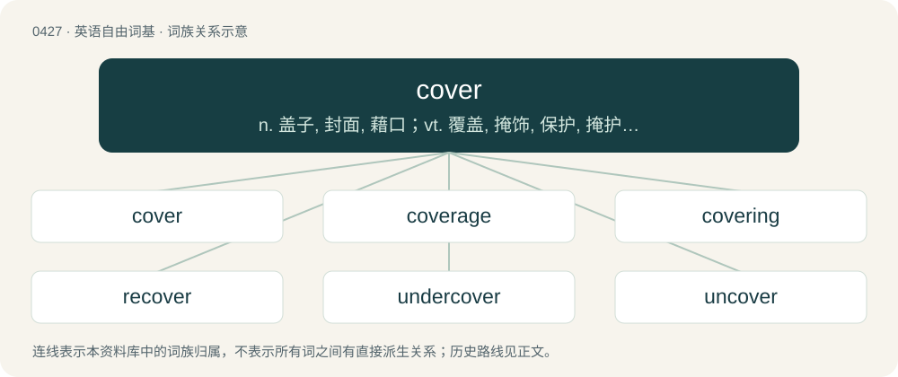

# 0489 · cover — n. 盖子, 封面, 藉口；vt. 覆盖, 掩饰, 保护, 掩护, 包括；vi. 覆盖

[总目录](../00_总目录_按常用程度.md)

**类型**：英语自由词基　｜　**来源语言**：见词源记录

## 核心含义与来源

- 核心含义：n. 盖子, 封面, 藉口；vt. 覆盖, 掩饰, 保护, 掩护, 包括；vi. 覆盖
- 英文含义：A lid.
- 词形：cover

**来源记录 1**（名词；A lid.）

From Middle English coveren, borrowed from Old French covrir, cueuvrir (modern French couvrir), from Late Latin coperire, from Latin cooperiō (“to cover completely”), from co- (intensive prefix) + operiō (“to close, cover”). Displaced native Middle English thecchen and bethecchen (“to cover”) (from Old English þeccan, beþeccan (“to cover”)), Middle English helen, (over)helen, (for)helen (“to cover, conceal”) (from Old English helan (“to conceal, cover, hide”)), Middle English wrien, (be)wreon (“to cover”) (from Old English (be)wrēon (“to cover”)), Middle English hodren, hothren (“to cover up”) (from Low German hudren (“to cover up”)). According to the Oxford English Dictionary, the original sense of the verb and noun cover was “hide from view” as in its cognate covert. Except in the limited sense of “cover again”, the word recover is unrelated and is cognate with recuperate. Cognate with Spanish cubrir and Portuguese cobrir.

## 词族图

## 单词速览（常用到不常用）

| 单词 | 音标 | 释义 |
|---|---|---|
| [cover](#w-1) | 英 /ˈkʌvə/；美 /ˈkʌvɚ/ | n. 盖子, 封面, 藉口；vt. 覆盖, 掩饰, 保护, 掩护, 包括；vi. 覆盖 |
| [coverage](#w-2) | 英 /ˈkʌv.(ə.)ɹɪdʒ/ | n. 覆盖的范围, 保险总额, 新闻报导；\[化\] 可达范围; 覆盖度 |
| [covering](#w-3) | /ˈkʌvəɹɪŋ/ | n. 覆盖物, 掩蔽物；a. 掩护的, 掩盖的；\[计\] 覆盖 |
| [recover](#w-4) | 英 /ɹiːˈkʌvə/；美 /ɹiˈkʌvɚ/ | 【英文】To cover again. |
| [undercover](#w-5) | /ˌʌndə(ɹ)ˈkʌvə(ɹ)/ | a. 秘密从事的, 秘密的, 从事间谍活动的；\[法\] 暗中从事的, 秘密的 |
| [uncover](#w-6) | 英 /ʌnˈkʌvə(ɹ)/；美 /ʌnˈkʌvɚ/ | vt. 揭露, 揭开, 暴露, 脱帽致敬；vi. 脱帽致敬, 揭去盖子 |
| [hardcover](#w-7) | 英 /ˈhɑːdˌkʌvə/；美 /ˈhɑɹdˌkʌvɚ/ | a. 硬书皮的；n. 硬封面的书, 精装书 |
| [softcover](#w-8) | /sɒftˈkʌvər/ | n. 软封面; 平装（书） |

## 逐词详解

### 1. cover

**词性**：名词　｜　**音标**：英 /ˈkʌvə/；美 /ˈkʌvɚ/

**中文释义**：n. 盖子, 封面, 藉口；vt. 覆盖, 掩饰, 保护, 掩护, 包括；vi. 覆盖

**英文义项**：A lid. / Area or situation which screens a person or thing from view.

**词源与演化**：

From Middle English coveren, borrowed from Old French covrir, cueuvrir (modern French couvrir), from Late Latin coperire, from Latin cooperiō (“to cover completely”), from co- (intensive prefix) + operiō (“to close, cover”). Displaced native Middle English thecchen and bethecchen (“to cover”) (from Old English þeccan, beþeccan (“to cover”)), Middle English helen, (over)helen, (for)helen (“to cover, conceal”) (from Old English helan (“to conceal, cover, hide”)), Middle English wrien, (be)wreon (“to cover”) (from Old English (be)wrēon (“to cover”)), Middle English hodren, hothren (“to cover up”) (from Low German hudren (“to cover up”)). According to the Oxford English Dictionary, the original sense of the verb and noun cover was “hide from view” as in its cognate covert. Except in the limited sense of “cover again”, the word recover is unrelated and is cognate with recuperate. Cognate with Spanish cubrir and Portuguese cobrir.

**例句**：

> The captain signalled his best fielder from short leg to cover.

该用例对应义项：A fielding position on the off side, between point and mid off, about 30° forward of square; a fielder in this position.

### 2. coverage

**词性**：名词　｜　**音标**：英 /ˈkʌv.(ə.)ɹɪdʒ/

**中文释义**：n. 覆盖的范围, 保险总额, 新闻报导；\[化\] 可达范围; 覆盖度

**英文义项**：An amount by which something or someone is covered. / The amount and type of attention given to an event or topic in news media or other media.

**构词拆分**：cover + -age

**词源与演化**：

From cover + -age. First attested in 1912. Compare Middle English coverage (“a charge for having or stall or booth at a fair”).

**例句**：

> Before laying sod on that clay, the ground needs two inches of coverage with topsoil.

该用例对应义项：An amount by which something or someone is covered.

### 3. covering

**词性**：名词　｜　**音标**：/ˈkʌvəɹɪŋ/

**中文释义**：n. 覆盖物, 掩蔽物；a. 掩护的, 掩盖的；\[计\] 覆盖

**英文义项**：That which covers or conceals; a cover; something spread or laid over or wrapped about another. / Action of the verb to cover.

**构词拆分**：cover (verb) + -ing

**词源与演化**：

From Middle English coverynge, -inge, keverynge, -inge \[verbal noun of coveren, keveren (“to cover”)\]; or, verbal noun from cover (verb) + -ing.

**例句**：

> Under a covering of dust.

该用例对应义项：a natural object that covers or envelops

### 4. recover

**词性**：动词　｜　**音标**：英 /ɹiːˈkʌvə/；美 /ɹiˈkʌvɚ/

**英文义项**：To cover again. / To add a new roof membrane or steep-slope covering over an existing one.

**构词拆分**：re- + cover

**词源与演化**：

From re- + cover.

### 5. undercover

**词性**：形容词　｜　**音标**：/ˌʌndə(ɹ)ˈkʌvə(ɹ)/

**中文释义**：a. 秘密从事的, 秘密的, 从事间谍活动的；\[法\] 暗中从事的, 秘密的

**英文义项**：Performed or happening in secret. / Employed or engaged in spying or secret investigation.

**构词拆分**：under + cover

**词源与演化**：

From under + cover.

**例句**：

> Tom spent three years in the Boston working as an undercover policeman.

### 6. uncover

**词性**：动词　｜　**音标**：英 /ʌnˈkʌvə(ɹ)/；美 /ʌnˈkʌvɚ/

**中文释义**：vt. 揭露, 揭开, 暴露, 脱帽致敬；vi. 脱帽致敬, 揭去盖子

**英文义项**：To remove a cover from. / To reveal the identity of.

**构词拆分**：un- + cover

**词源与演化**：

From Middle English uncoveren, equivalent to un- + cover.

**例句**：

> The murderer has finally been uncovered.

该用例对应义项：To reveal the identity of.

### 7. hardcover

**词性**：名词　｜　**音标**：英 /ˈhɑːdˌkʌvə/；美 /ˈhɑɹdˌkʌvɚ/

**中文释义**：a. 硬书皮的；n. 硬封面的书, 精装书

**英文义项**：A book with a rigid binding, often of cardboard or leather.

**构词拆分**：hard + cover

**词源与演化**：

From hard + cover.

**例句**：

> I bought the novel in paperback because it was cheaper than the hardcover.

### 8. softcover

**词性**：形容词　｜　**音标**：/sɒftˈkʌvər/

**中文释义**：n. 软封面; 平装（书）

**英文义项**：Having covers made of paper or thin cardboard; paperback.

**构词拆分**：soft + cover

**词源与演化**：

From soft + cover.
