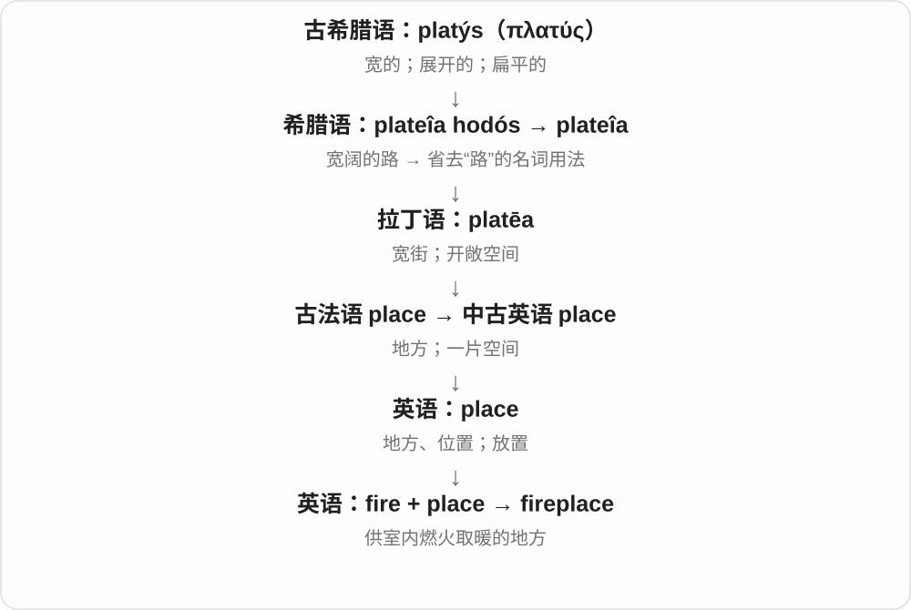
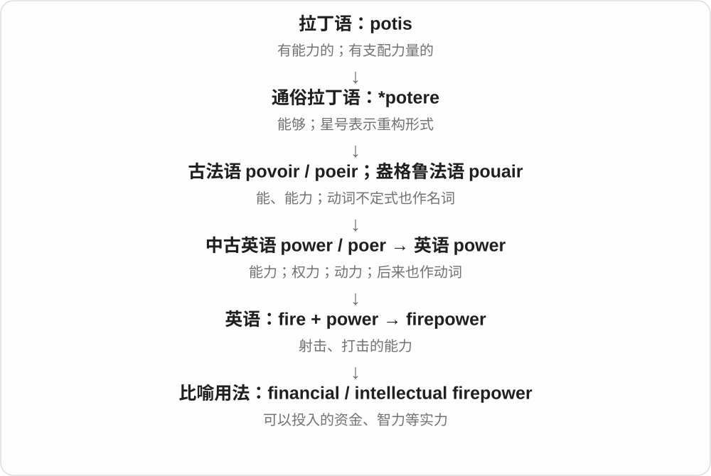
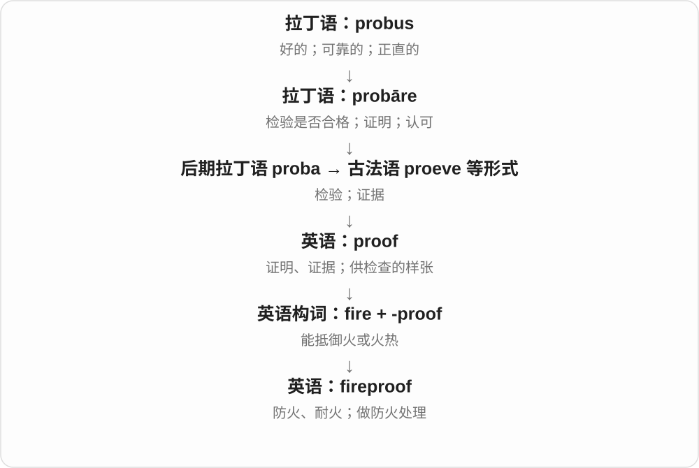

# 0489 · fire — 火、点燃；射击；强烈情绪等

[逐词精讲目录](../00_逐词精讲目录.md) · [总目录](../00_总目录_按常用程度.md)

## 核心词根与来源

fire 接古英语 fȳr。fiery 保留历史拼写变化，不常规写 firey；fireworks 的欧洲相关构词传播有不确定细节；fireman 在旧蒸汽机语境还可司炉。

**FIRE：燃烧发光发热，再看开火、消防和强度比喻**

火能取暖，也能失控；firefighter 扑火，firefight 却常是交火，关键看 fire 的哪种义参与。

- **基本火与词形、状态**：fire · fired · fiery · afire
- **射击与停止射击**：firearm · gunfire · firefight · ceasefire · firepower · crossfire · misfire · firebomb
- **消防人物与活动**：firefighter · firefighting · fireman · firehouse · fireproof · firewall
- **野外火与燃料、聚会场景**：wildfire · bushfire · firewood · campfire · fireplace · fireside · firelight
- **生物、火球、声光与强烈意象**：firefly · fireball · firework · fireworks · firecracker · firestorm · hellfire · firebrand · backfire
- **fire → firing：火、烧制、射击与解雇**：fire · firing
- **fire → fires：火、火灾与发射、解雇动作**：fire · fires · firing
- **firefly → fireflies：火光的比喻与飞虫名称**：firefly · fireflies
- **firearm → firearms：火药发射的武器名称**：firearm · firearms
- **fire + fight + -er → firefighters**：firefighters

## 词形与演化规律

fire → fired、fiery、afire；射击分 firearm、gunfire、firefight、ceasefire；消防人物与活动相邻；野火、柴火营火、自然火光命名、强烈反应及旧火把意象分组。

本族火名词发展动作；枪炮、陶器和工作岗位有不同用法，不把全部现代义硬归成一个动作。

本族古英语 fyr 的火词，现代名词复数与动词三单同形，场景决定意思。

名字按发光小虫的形象组合，现代分类是甲虫，不把日常 fly 命名材料当成家蝇分类。

fire 火、燃烧 + arm 武器 → firearm；arm 在这里接法语、拉丁 arma 武器，不是现代胳膊义。整个复合名词末尾加 s，通常汉译枪械、火器。

firefighter 是 fire 火 + fighter 对抗者的英语复合词，末尾 -s 读 /z/。现代消防员的工作范围还包括救援，职业名从灭火职责形成。

## 单词速览（按词族由简到繁）

同一基础词的相关扩展放在一起，先读基础形式，再读扩展；各组之间优先读常用的。具体词源关系见各词讲解。

| 单词 | 音标 | 核心意思 |
|---|---|---|
| [fire](#w-1) | 英 /ˈfaɪə/；美 /ˈfaɪər/ | 火；火灾；点燃；开火；解雇；热情 |
| [fired](#w-2) | 英 /ˈfaɪəd/；美 /ˈfaɪərd/ | 被解雇的；烧制过的；fire 的过去式、分词 |
| [firing](#w-40) | 英 /ˈfaɪərɪŋ/；美 /ˈfaɪrɪŋ/ | 开火、射击；烧制；解雇〔现在分词、动名词及相关名词〕 |
| [fires](#w-41) | 英 /ˈfaɪəz/；美 /ˈfaɪərz/ | 火、火灾、炉火等〔复数〕；开火、解雇、点燃等〔第三人称单数〕 |
| [fireworks](#w-3) | 英 /ˈfaɪəwɜːks/；美 /ˈfaɪərwɜːrks/ | 烟花；焰火表演；激烈冲突、精彩表现〔比喻〕 |
| [firearm](#w-4) | 英 /ˈfaɪərɑːm/；美 /ˈfaɪərɑːrm/ | 枪械；火器 |
| [firearms](#w-43) | 英 /ˈfaɪərɑːmz/；美 /ˈfaɪrɑrmz/ | 枪械、火器〔复数〕 |
| [fiery](#w-5) | 英 /ˈfaɪəri/；美 /ˈfaɪəri/ | 火焰般的；火红的；激烈热情的；很辣的 |
| [fireplace](#w-6) | 英 /ˈfaɪəpleɪs/；美 /ˈfaɪərpleɪs/ | 壁炉；室内炉火的位置 |
| [firefighter](#w-8) | 英 /ˈfaɪəfaɪtə/；美 /ˈfaɪərfaɪtər/ | 消防员 |
| [firefighters](#w-44) | 英 /ˈfaɪəfaɪtəz/；美 /ˈfaɪɚfaɪtɚz/ | 消防员〔复数〕 |
| [firepower](#w-11) | 英 /ˈfaɪəˌpaʊə/；美 /ˈfaɪərˌpaʊər/ | 火力；可用于竞争或解决问题的强大资源 |
| [firewall](#w-12) | 英 /ˈfaɪəwɔːl/；美 /ˈfaɪərwɔːl/ | 防火墙；网络访问过滤防护系统 |
| [fireman](#w-13) | 英 /ˈfaɪəmən/；美 /ˈfaɪərmən/ | 消防员〔传统称谓〕；锅炉司炉工 |
| [fireball](#w-14) | 英 /ˈfaɪəbɔːl/；美 /ˈfaɪərbɔːl/ | 火球；火流星；精力旺盛的人〔比喻〕 |
| [firewood](#w-15) | 英 /ˈfaɪəwʊd/；美 /ˈfaɪərwʊd/ | 柴火；作燃料的木材 |
| [firefly](#w-16) | 英 /ˈfaɪəflaɪ/；美 /ˈfaɪərflaɪ/ | 萤火虫 |
| [fireflies](#w-42) | 英 /ˈfaɪəflaɪz/；美 /ˈfaɪərflaɪz/ | 萤火虫〔复数〕 |
| [firework](#w-20) | 英 /ˈfaɪəwɜːk/；美 /ˈfaɪərwɜːrk/ | 烟花；烟火 |
| [firestorm](#w-22) | 英 /ˈfaɪəstɔːm/；美 /ˈfaɪərstɔːrm/ | 猛烈火灾、火风暴；强烈抗议、争议浪潮 |
| [firefight](#w-24) | 英 /ˈfaɪəfaɪt/；美 /ˈfaɪərfaɪt/ | 交火；枪战；激烈争论〔引申〕 |
| [firefighting](#w-21) | 英 /ˈfaɪəfaɪtɪŋ/；美 /ˈfaɪərfaɪtɪŋ/ | 消防、灭火；忙于救急处理〔比喻〕 |
| [firehouse](#w-26) | 英 /ˈfaɪəhaʊs/；美 /ˈfaɪərhaʊs/ | 消防站〔美式〕 |
| [fireproof](#w-27) | 英 /ˈfaɪəpruːf/；美 /ˈfaɪərpruːf/ | 防火的；耐火的；做防火处理 |
| [fireside](#w-28) | 英 /ˈfaɪəsaɪd/；美 /ˈfaɪərsaɪd/ | 炉边；炉边的；家居温暖的 |
| [firecracker](#w-29) | 英 /ˈfaɪəkrækə/；美 /ˈfaɪərkrækər/ | 鞭炮；性格活泼有劲的人〔比喻〕 |
| [firebrand](#w-31) | 英 /ˈfaɪəbrænd/；美 /ˈfaɪərbrænd/ | 燃烧的木块、火把；煽动者、激进人物 |
| [firelight](#w-38) | 英 /ˈfaɪəlaɪt/；美 /ˈfaɪərlaɪt/ | 火光 |
| [firebomb](#w-39) | 英 /ˈfaɪəbɒm/；美 /ˈfaɪərbɑːm/ | 燃烧弹；用燃烧弹袭击 |
| [gunfire](#w-7) | 英 /ˈɡʌnfaɪə/；美 /ˈɡʌnfaɪər/ | 枪炮射击；枪声 |
| [wildfire](#w-9) | 英 /ˈwaɪldfaɪə/；美 /ˈwaɪldfaɪər/ | 野火；林野火灾 |
| [ceasefire](#w-10) | 英 /ˈsiːsfaɪə/；美 /ˈsiːsfaɪər/ | 停火；停火协议、状态 |
| [backfire](#w-17) | 英 /ˌbækˈfaɪə/；美 /ˌbækˈfaɪər/ | 产生反效果；发动机回火 |
| [campfire](#w-18) | 英 /ˈkæmpfaɪə/；美 /ˈkæmpfaɪər/ | 营火；篝火 |
| [crossfire](#w-19) | 英 /ˈkrɒsfaɪə/；美 /ˈkrɔːsfaɪər/ | 交叉火力；夹击；争端中的波及 |
| [hellfire](#w-23) | 英 /ˈhelfaɪə/；美 /ˈhelfaɪər/ | 地狱之火〔宗教、虚构叙事〕；烈火般谴责的意象 |
| [bushfire](#w-32) | 英 /ˈbʊʃfaɪə/；美 /ˈbʊʃfaɪər/ | 林野火灾；丛林、草木火灾〔尤澳洲用语〕 |
| [misfire](#w-33) | 英 /ˌmɪsˈfaɪə/；美 /ˌmɪsˈfaɪər/ | 未正常点火、发射；失败；产生不理想的效果 |
| [afire](#w-34) | 英 /əˈfaɪə/；美 /əˈfaɪər/ | 着火的；炽热、充满强烈感受的〔文学〕 |

## 逐词讲解

### 1. fire — 火；火灾；点燃；开火；解雇；热情

**音标**：英 /ˈfaɪə/；美 /ˈfaɪər/

**先抓住这个画面**

先是燃烧发光、发热的火；后来也说火器射击、强烈热情，解雇则是另一个常用动词义。

**怎么拆**

接古英语 fȳr、中古英语 fyr，远早于现代枪械；动词点燃由火名词等相关用法发展。射击与火器背景相连，不把解雇解释成真拿火烧人。

**怎么变成今天的意思**

**古英语 fȳr → 中古英语 fyr**  
火；更早属日耳曼继承词族

↓

**英语 fire**  
火、点燃；射击；解雇；热情等扩展

light a fire 生火，a house fire 房屋火灾，fire a weapon 开火，fire someone 解雇。fire questions at 连珠炮式发问；fire in her eyes 可说眼里有热情、斗志。

**常见搭配与例句**

a fire breaks out；catch fire；fire someone；fire questions at；play with fire。

> A fire broke out in the old warehouse.

旧仓库起火了。

> The reporter fired questions at the spokesperson.

记者向发言人连珠炮似的发问。

> She was fired after repeatedly missing work.

她多次缺勤后被解雇了。

**别混淆**

on fire 着火，under fire 遭火力攻击或批评；fire 的强度比喻不保证每次真有火焰。

### 2. fired — 被解雇的；烧制过的；fire 的过去式、分词

**音标**：英 /ˈfaɪəd/；美 /ˈfaɪərd/

**先抓住这个画面**

人被 fired 是丢了职位，陶器被 fired 是进窑烧制；两者都要先选 fire 的动词义。

**怎么拆**

fire + -ed，末尾读 /d/。从动词不同义项形成分词、形容词，不把烧陶器说成辞退它。

**怎么变成今天的意思**

**古英语 fȳr → 中古英语 fyr**  
火；更早属日耳曼继承词族

↓

**英语 fire**  
火、点燃；射击；解雇；热情等扩展

↓

**fire + -ed → fired**  
射击、点燃等过去分词；解雇、烧制后的状态

get fired 被解雇，fired clay 烧制陶土，fired up 兴奋、斗志被点燃。fired up 的积极情绪不等于刚被辞退。

**常见搭配与例句**

get fired；fired clay；be fired up；a fired employee。

> He was worried about getting fired.

他担心被解雇。

> The sculpture is made from fired clay.

雕塑由烧制陶土制成。

**别混淆**

fired 被解雇，retired 退休，不是拼写相近就一样；两种离开工作的背景不同。

### 3. firing — 开火、射击；烧制；解雇〔现在分词、动名词及相关名词〕

**音标**：英 /ˈfaɪərɪŋ/；美 /ˈfaɪrɪŋ/

**先抓住这个画面**

枪炮发射、陶器入窑烧制，都与火的使用有关；工作里的 firing 则是解除雇佣关系。先看宾语和场景，再选中文意思。

**怎么拆**

fire 去不发音 e 加 -ing。fire 接古英语 fyr 火，现代动词由火、点燃等相关用法发展；射击、烧制、解雇分别形成常见用法。

**怎么变成今天的意思**

**古英语 fyr → fire**  
火与点燃动作；后有枪炮发射等

↓

**fire 去 e 加 -ing → firing**  
射击、烧制、解雇等动作过程或名称

firing a kiln 烧窑；firing questions at someone 接连向某人抛问题；the firing of a manager 解雇经理。

**常见搭配与例句**

a firing range 射击练习场；the firing temperature 烧制温度。

> The pottery needs another firing before it is ready.

这批陶器还需要再烧一次才能完成。

> Reporters were firing questions at the speaker.

记者们接连向发言者抛出问题。

**别混淆**

firing pottery 常指烧制陶器；firing an employee 是解雇员工。fire 读音中的元音要连起来，不能照字母读成 fit 的 /ɪ/。

### 4. fires — 火、火灾、炉火等〔复数〕；开火、解雇、点燃等〔第三人称单数〕

**音标**：英 /ˈfaɪəz/；美 /ˈfaɪərz/

**先抓住这个画面**

几处各自燃着的火，是 fires 的名词；某个人在发射、点燃或解除雇佣关系，则是相应动词。共同拼写不能代替场景判断。

**怎么拆**

fire + -s，末尾读 /z/。fire 接古英语 fyr 火；英语动词与点火等名词意象相关，射击、解雇后来分别形成固定用法。

**怎么变成今天的意思**

**古英语 fyr → fire 的名词、动词分支**  
火、点燃 → 火器发射、解雇等后起用法

↓

**fire + -s → fires**  
多处火；某人发射、点火或解雇等

forest fires 森林火灾；small fires 几处小火；fires a question at someone 突然向某人发问。

**常见搭配与例句**

open fires 壁炉等敞开炉火；fires an employee 解雇员工。

> The report describes several forest fires.

报告描述了几场森林火灾。

> The interviewer fires another question at the guest.

采访者又向嘉宾抛出一个问题。

**别混淆**

fire 不可数可说火这种现象；fires 可数是分别发生、分别点起的火。fires someone 说解雇，不能按物理燃烧去翻译。

### 5. fireworks — 烟花；焰火表演；激烈冲突、精彩表现〔比喻〕

**音标**：英 /ˈfaɪəwɜːks/；美 /ˈfaɪərwɜːrks/

**先抓住这个画面**

很多烟花一起在夜空展开是一场 fireworks；争论、表现激烈得像火花乱溅，也借这个词。

**怎么拆**

对应 fire + work(s)，与荷兰 vuurwerk、德语 Feuerwerk 等相关欧洲构词有联系，传播细节有推测。work 在这里选制品、装置，不是火有工作岗位。

**怎么变成今天的意思**

**相关欧洲火＋制品表达；英语 fire + work(s)**  
烟火制品命名的构词、传播背景

↓

**英语 fireworks**  
烟花或整场焰火；引申强烈场面

watch the fireworks 看焰火表演，expect fireworks 预期有激烈争论或精彩场面。firework 单数是一枚烟花制品，fireworks 常说集合、表演。

**常见搭配与例句**

watch the fireworks；a fireworks display；expect fireworks。

> We watched the fireworks from the riverbank.

我们在河岸看焰火。

> There were fireworks when the two rivals met in the debate.

两位对手在辩论碰面时，场面火花四射。

**别混淆**

fireworks 夜空焰火，firefighting 消防灭火；名称都带 fire，但活动目标不同。

### 6. firearm — 枪械；火器

**音标**：英 /ˈfaɪərɑːm/；美 /ˈfaɪərɑːrm/

**先抓住这个画面**

arm 在这里是武器，fire 指火器发射背景，不是人的手臂烧起来。

**怎么拆**

fire（火器射击）+ arm（武器），复数 firearms 很常见；arm 的武器义与身体手臂义不能在此混译。

**怎么变成今天的意思**

**fire〔射击、火器〕；arm〔武器〕**  
并列构词部分

↓

**firearm**  
利用发射药等原理发射弹丸的枪械、火器

a historic firearm 历史火器，firearm collection 火器藏品。实际法律分类可能另有专门范围，普通词义先抓枪械。

**常见搭配与例句**

a historic firearm；a firearm collection；firearm regulations。

> The museum displays historic firearms.

博物馆展出历史火器。

> The detective found an old firearm in the fictional scene.

虚构场景中，侦探发现了一支旧枪。

**别混淆**

firearm 枪械，firefighter 消防员；arm 在这里不是保护消防员的那条胳膊。

### 7. firearms — 枪械、火器〔复数〕

**音标**：英 /ˈfaɪərɑːmz/；美 /ˈfaɪrɑrmz/

**先抓住这个画面**

firearms 把枪械按件、按类来谈。名字里的 fire 是发射所用的燃烧力量，arm 在这里是武器。

**怎么拆**

fire + arm 武器 → firearm，再加 -s → firearms。arm 的武器义接法语、拉丁 arma，不能把这里的 arms 解释成胳膊。

**怎么变成今天的意思**

**英语 fire + arm 武器 → firearm**  
复合词以燃烧、发射的武器为命名关系

↓

**firearm + -s → firearms**  
整个名词末尾加复数，词尾 /mz/

antique firearms 是古董火器；a collection of firearms 是一批枪械收藏；firearms in a museum 是博物馆里的火器。

**常见搭配与例句**

antique firearms；a collection of firearms；firearms on display。

> The museum has a collection of antique firearms.

博物馆收藏了一批古董火器。

> The catalogue describes the firearms on display.

目录介绍了展出的火器。

**别混淆**

arms 泛说武器，firearms 是其中火器这一类；不能因为都写 arm，就把 bows 等一概叫 firearms。

### 8. fiery — 火焰般的；火红的；激烈热情的；很辣的

**音标**：英 /ˈfaɪəri/；美 /ˈfaɪəri/

**先抓住这个画面**

颜色像火、话语像火、辣味像火，都把强烈感觉借到身上。

**怎么拆**

接中古英语 fyry，由 fyr“火”等形成，现代对应 fire + -y，但标准常见拼写是 fiery，不按外观写作 firey。

**怎么变成今天的意思**

**古英语 fȳr → 中古英语 fyr**  
火；更早属日耳曼继承词族

↓

**英语 fire**  
火、点燃；射击；解雇；热情等扩展

↓

**中古英语 fyry → 英语 fiery**  
与火相似；强烈、火热

fiery red hair 火红头发，a fiery speech 激烈演讲，a fiery temper 火爆脾气，fiery food 很辣的食物。

**常见搭配与例句**

a fiery speech；a fiery temper；fiery red；a fiery curry。

> She delivered a fiery speech about the closure.

她就关闭一事发表了激烈演讲。

> The curry was far too fiery for me.

这份咖喱对我来说太辣了。

**别混淆**

fiery 不一定是字面 burning 燃着；fiery speech 常是情绪强烈，不需要纸稿真的着火。

### 9. fireplace — 壁炉；室内炉火的位置

**音标**：英 /ˈfaɪəpleɪs/；美 /ˈfaɪərpleɪs/

**先抓住这个画面**

房间里专门留出一处，让火在里面燃烧并给人取暖。

**怎么拆**

fire 火 + place 地方，现代英语复合词。

**怎么变成今天的意思**

传统上常嵌在墙内、接烟道；现代也有燃气或电壁炉。词义按用途发展，不是任意着火的地点。

**常见搭配与例句**

sit by the fireplace；an open fireplace；a stone fireplace。

> They sat by the fireplace and talked late into the evening.

他们坐在壁炉旁聊天，直到夜深。

> The room has an old stone fireplace.

房间里有一座老石壁炉。

**别混淆**

fireplace 是壁炉这一设施或空间；fire 指其中的火；chimney 是排烟的烟囱。

### 10. firefighter — 消防员

**音标**：英 /ˈfaɪəfaɪtə/；美 /ˈfaɪərfaɪtər/

**先抓住这个画面**

职业工作是与失控火灾及相关险情作斗争，不是持枪交战的人。

**怎么拆**

fire + fighter，fighter 是 fight + -er；相比传统 fireman 不限定性别。

**怎么变成今天的意思**

**fire；fighter〔fight + -er〕**  
并列构词部分

↓

**firefighter**  
受训练从事灭火、救援等工作的人

a trained firefighter 受训消防员，a volunteer firefighter 志愿消防员。具体职责因机构而异，词最基本抓灭火、消防。

**常见搭配与例句**

a volunteer firefighter；a trained firefighter；a team of firefighters。

> The firefighters helped everyone leave the building.

消防员帮助所有人离开建筑。

> Her sister works as a firefighter.

她姐姐是消防员。

**别混淆**

firefighter 消防员，fighter 可是战斗者、拳手或战斗机；复合词选的是对抗火灾这一义。

### 11. firefighters — 消防员〔复数〕

**音标**：英 /ˈfaɪəfaɪtəz/；美 /ˈfaɪɚfaɪtɚz/

**先抓住这个画面**

面对火灾，负责灭火并参与相关救援的人，就是 firefighters。fire 给出面对的对象，fighter 给出与危险对抗的人。

**怎么拆**

fire 火 + fighter 对抗者 → firefighter；fighter 又是 fight + 完整 -er。再加复数 -s → firefighters，末尾 /z/。这是英语复合词。

**怎么变成今天的意思**

**英语 fight 对抗 + -er → fighter**  
用动作命名参与者

↓

**fire + fighter → firefighter → firefighters**  
从灭火名称理解消防职业，实际工作也包括救援等

local firefighters 是当地消防员；a team of firefighters 是一队消防员；firefighters at the station 是消防站里的消防员。

**常见搭配与例句**

local firefighters；a team of firefighters；firefighters at the station。

> The children met the firefighters during a visit to the station.

孩子们参观消防站时见到了消防员。

> The documentary follows a team of firefighters through a working week.

纪录片跟拍一队消防员一周的工作。

**别混淆**

fighter 本身可以说战士、拳击手等；放进 firefighter 后，整体固定为消防员这一职业名。复合词要把各部分关系与整体用法一起记。

### 12. firepower — 火力；可用于竞争或解决问题的强大资源

**音标**：英 /ˈfaɪəˌpaʊə/；美 /ˈfaɪərˌpaʊər/

**先抓住这个画面**

firepower 是“能向目标投入多大力量”：本义是武器火力，比喻中则可以是资金、人才或技术。

**怎么拆**

fire 在这里指开火，加 power，形成英语复合词；随后发展出资源实力的比喻义。

**怎么变成今天的意思**

military firepower 谈武器整体打击能力；financial firepower 是支持行动的资金实力。后者不是字面上的燃烧或用火。

**常见搭配与例句**

military firepower；financial firepower；intellectual firepower。

> The historian compared the firepower of the two fleets.

历史学家比较了两支舰队的火力。

> The company lacks the financial firepower to buy its larger rival.

这家公司没有足够资金收购规模更大的竞争对手。

**别混淆**

firepower 突出能投入较量的力量；resources 更中性，泛指可用资源。

### 13. firewall — 防火墙；网络访问过滤防护系统

**音标**：英 /ˈfaɪəwɔːl/；美 /ˈfaɪərwɔːl/

**先抓住这个画面**

建筑里用墙分隔火势；网络里也在边界按规则决定哪些连接、数据能通过。

**怎么拆**

fire + wall，先有阻隔火势的实体结构名，计算机安全再借墙的隔离、过滤画面。不是网络真的起火才用。

**怎么变成今天的意思**

**fire；wall**  
并列构词部分

↓

**firewall**  
阻隔火势的墙 → 按规则过滤网络流量的系统

a building firewall 建筑防火墙，a network firewall 网络防火墙。网络词义可以指软件、硬件或组合，重点在按规则控制流量。

**常见搭配与例句**

a network firewall；firewall rules；a firewall between buildings。

> A firewall separates the two parts of the building.

一道防火墙隔开建筑的两部分。

> The firewall blocked an unexpected connection.

防火墙拦住了一次意外连接。

**别混淆**

firewall 过滤、隔离网络访问，antivirus 反病毒工具侧重识别处理恶意程序；两种工具关注点不同。

### 14. fireman — 消防员〔传统称谓〕；锅炉司炉工

**音标**：英 /ˈfaɪəmən/；美 /ˈfaɪərmən/

**先抓住这个画面**

现代常是灭火的人，蒸汽机历史里却可能是负责让炉火一直烧着的人。

**怎么拆**

fire + man，按与火打交道的职责命名；灭火与维持炉火是两种工作，不能说所有旧火车 firemen 都在扑火。

**怎么变成今天的意思**

**fire；man**  
并列构词部分

↓

**fireman**  
传统消防员称谓；另为维持锅炉燃烧的司炉工

a fireman in an old story 可能消防员，a locomotive fireman 常是蒸汽机车司炉工。现代不标性别的消防职业称呼通常用 firefighter。

**常见搭配与例句**

a locomotive fireman；a fireman’s helmet；a retired fireman。

> The retired fireman spoke about his career.

退休消防员讲述了职业经历。

> The locomotive fireman tended the boiler fire.

机车司炉工照管锅炉炉火。

**别混淆**

fireman 在旧火车、轮船语境先查司炉义；firefighter 则明确对抗火灾，不是添煤工作的通称。

### 15. fireball — 火球；火流星；精力旺盛的人〔比喻〕

**音标**：英 /ˈfaɪəbɔːl/；美 /ˈfaɪərbɔːl/

**先抓住这个画面**

一团球状火光是直观画面，亮得惊人的流星、人身上猛烈的活力也借来命名。

**怎么拆**

fire + ball，ball 取团状、球状形象；物理火球、天文亮流星和人物比喻是不同语境扩展，不是同一种东西互相变成。

**怎么变成今天的意思**

**fire；ball**  
并列构词部分

↓

**fireball**  
球状火光；极亮流星；精力旺盛的人

a huge fireball 巨大火球，a fireball in the sky 天空火流星。She is a fireball 可以夸精力、个性强烈，未必说脾气坏。

**常见搭配与例句**

a huge fireball；a bright fireball；a fireball of energy。

> A bright fireball crossed the night sky.

一颗明亮火流星划过夜空。

> My grandmother is a fireball of energy.

我祖母精力旺盛得像团火。

**别混淆**

天文 fireball 是特别明亮的流星现象，不等于已落到地上的 meteorite 陨石；具体亮度界线有专业定义。

### 16. firewood — 柴火；作燃料的木材

**音标**：英 /ˈfaɪəwʊd/；美 /ˈfaɪərwʊd/

**先抓住这个画面**

木头不是拿来做柜子，而是留着烧火、取暖的。

**怎么拆**

fire + wood，中古英语 ferwode、fyrewoode 等已有相应组合。按用途命名，不是木头正在燃烧才算 firewood。

**怎么变成今天的意思**

**fire；wood**  
并列构词部分

↓

**firewood**  
用于燃烧的木材、柴

a pile of firewood 一堆柴，collect firewood 收集柴火。通常不可数，一块柴可说 a piece of firewood。

**常见搭配与例句**

a pile of firewood；collect firewood；a piece of firewood。

> A pile of firewood stood beside the shed.

棚屋旁堆着一堆柴。

> They stored the firewood under a roof.

他们把柴存放在有顶遮护的地方。

**别混淆**

firewood 是木材燃料，firewood smoke 才是燃烧后的烟；没点燃的一堆柴仍是 firewood。

### 17. firefly — 萤火虫

**音标**：英 /ˈfaɪəflaɪ/；美 /ˈfaɪərflaɪ/

**先抓住这个画面**

小虫在暗处发光，像随身带一星火；那是生物发光，不是真有火在烧。

**怎么拆**

fire + fly，按会发光的小虫形象命名。萤火虫属于甲虫，英文日常名里的 fly 不保证昆虫分类就是家蝇那一类。

**怎么变成今天的意思**

**fire〔火光的比喻〕；fly〔飞虫命名成分〕**  
并列构词部分

↓

**firefly**  
能发出生物光的萤火虫类甲虫

fireflies glow 萤火虫发光，watch fireflies 看萤火虫；复数 y 变 ies。不同种类的发光行为有差别，不把名字当所有细节的说明。

**常见搭配与例句**

watch fireflies；fireflies glow；a firefly’s light。

> We watched fireflies glow above the grass.

我们看着萤火虫在草丛上发光。

> A firefly landed on the window screen.

一只萤火虫落在纱窗上。

**别混淆**

firefly 是昆虫，firelight 是火光；虫体的光不是微型燃烧火堆。

### 18. fireflies — 萤火虫〔复数〕

**音标**：英 /ˈfaɪəflaɪz/；美 /ˈfaɪərflaɪz/

**先抓住这个画面**

夜里草丛间忽然亮起、移动的光点，让人联想到带着火光的小飞虫，所以有 fireflies 这个形象名称。

**怎么拆**

fire 火光的比喻 + fly 飞虫 → firefly；辅音字母后 y 改 i 加 -es → fireflies。现代萤火虫属甲虫，不按名称里的 fly 认成家蝇。

**怎么变成今天的意思**

**fire + fly → firefly**  
按发光小虫形象组合的日常名称

↓

**firefly → fireflies**  
复合词末尾按 fly—flies 变化

watch fireflies 是看萤火虫；glowing fireflies 说发光的萤火虫，不是真在燃烧。

**常见搭配与例句**

fireflies in the grass 草丛中的萤火虫；flashing fireflies 闪光的萤火虫。

> We watched fireflies flashing above the grass.

我们看着萤火虫在草上方闪光。

> A few fireflies appeared near the trees at dusk.

黄昏时树边出现了几只萤火虫。

**别混淆**

日常名称靠外形、现象来记，现代分类另有依据；fly 在复合名中不总等于狭义苍蝇。

### 19. firework — 烟花；烟火

**音标**：英 /ˈfaɪəwɜːk/；美 /ˈfaɪərwɜːrk/

**先抓住这个画面**

点燃后把光、声音和形状送到空中，供人观赏。

**怎么拆**

fire（火）+ work（制成物、技艺成果），英语组合词；复数 fireworks 常指烟花整体或烟花表演。

**怎么变成今天的意思**

**英语 fire；work**  
并列的两个构词材料

↓

**fire + work → firework**  
以燃烧产生观赏效果的烟花

a firework 是一个烟花装置，watch the fireworks 是看烟花表演。比喻 There will be fireworks 还可能说将有激烈争执或强烈反应。

**常见搭配与例句**

a firework display；watch the fireworks；set off fireworks。

> We watched the fireworks from across the river.

我们隔着河看烟花。

> A single firework lit up the sky.

一枚烟花照亮了天空。

**别混淆**

firework 不是任何会燃烧的东西；firewood 是烧火木柴，firework 是特定烟花制品。

### 20. firestorm — 猛烈火灾、火风暴；强烈抗议、争议浪潮

**音标**：英 /ˈfaɪəstɔːm/；美 /ˈfaɪərstɔːrm/

**先抓住这个画面**

火与强气流互相加强，场面像风暴；一件事激起猛烈反应，也像争议四面扑来。

**怎么拆**

fire + storm，字面有大火与强烈气流的背景，比喻再接强烈、广泛反应。不是每场普通失火都自动是技术意义的 firestorm。

**怎么变成今天的意思**

**fire；storm**  
并列构词部分

↓

**firestorm**  
猛烈大火相关现象 → 强烈反应、争议浪潮

a firestorm of criticism 批评浪潮，spark a firestorm 激起激烈反应。现代一般报道常先遇到比喻义。

**常见搭配与例句**

a firestorm of criticism；spark a firestorm；a political firestorm。

> The decision sparked a firestorm of criticism.

决定激起了猛烈批评。

> The book describes the city’s destruction in a firestorm.

书描述了城市在猛烈火风暴中的毁坏。

**别混淆**

firestorm 强调反应猛烈、席卷范围，fireworks 可说争论、精彩场面的火花；两种比喻不能所有句子都换。

### 21. firefight — 交火；枪战；激烈争论〔引申〕

**音标**：英 /ˈfaɪəfaɪt/；美 /ˈfaɪərfaɪt/

**先抓住这个画面**

双方互相开火，fire 在这里是射击；不是最常见意义上的拿水灭火。

**怎么拆**

fire（枪火）+ fight（战斗），常指一段交火。fight a fire 分写却是扑灭火灾，顺序、组合方式要分清。

**怎么变成今天的意思**

**fire〔枪火〕；fight**  
并列构词部分

↓

**firefight**  
互射的短时战斗；引申激烈争论

a brief firefight 短暂交火，a firefight between 两方交火。办公室比喻也可能说激烈争执，按语境选。

**常见搭配与例句**

a brief firefight；a firefight between；caught in a firefight。

> The novel describes a brief firefight near the bridge.

小说描写了桥附近一段短暂交火。

> The meeting turned into a verbal firefight.

会议变成了一场唇枪舌剑。

**别混淆**

firefight 常是交火，firefighting 是消防、救急处理；别把 firefighting crew 译成枪战队伍。

### 22. firefighting — 消防、灭火；忙于救急处理〔比喻〕

**音标**：英 /ˈfaɪəfaɪtɪŋ/；美 /ˈfaɪərfaɪtɪŋ/

**先抓住这个画面**

真实火场是在灭火；工作里若一个问题刚压下、另一个又起，也像整天救火。

**怎么拆**

fire + fighting，fighting 是 fight + -ing。重心是对抗火灾的活动，不是 firefight 交火再随便加 ing。

**怎么变成今天的意思**

**fire；fighting〔fight + -ing〕**  
并列构词部分

↓

**firefighting**  
灭火活动、职业；引申不断处理紧急问题

firefighting equipment 消防设备，a firefighting team 消防队；constant firefighting 常抱怨工作总在被动救急，没空做长期改进。

**常见搭配与例句**

firefighting equipment；a firefighting team；constant firefighting。

> The exhibition shows the history of firefighting equipment.

展览展示消防设备的历史。

> The team spent the week firefighting instead of improving the system.

团队一周都忙着救急，没能改进系统。

**别混淆**

firefighting 灭火、救急，firefight 交火；管理比喻里的 firefighting 不要求办公室真有火。

### 23. firehouse — 消防站〔美式〕

**音标**：英 /ˈfaɪəhaʊs/；美 /ˈfaɪərhaʊs/

**先抓住这个画面**

消防员和消防车辆平时待命、整备的据点。

**怎么拆**

fire + house，旧英语有含火房间、炉房等组合；现代美式消防站义按消防服务场所发展，不是说建筑本身正在着火。

**怎么变成今天的意思**

**古英语 hūs → 中古英语 hous**  
住宅、住所、遮蔽处

↓

**fire + house 的较早场所组合**  
与火相关的建筑、房间

↓

**现代美式 firehouse**  
消防人员和器材驻地

美式常用 firehouse，fire station 跨地区更直接。旧消防站改作别用时，也可保留 historical firehouse 名称。

**常见搭配与例句**

a local firehouse；an old firehouse；firehouse doors。

> The children visited the local firehouse.

孩子们参观了当地消防站。

> The old firehouse now houses a small museum.

旧消防站如今容纳着一家小博物馆。

**别混淆**

firehouse 是消防站，fireplace 是壁炉，house fire 是房屋火灾；词序和后半决定对象。

### 24. fireproof — 防火的；耐火的；做防火处理

**音标**：英 /ˈfaɪəpruːf/；美 /ˈfaɪərpruːf/

**先抓住这个画面**

让材料或结构在火面前更能坚持，保护里面的东西或延缓损坏。

**怎么拆**

fire 火 + -proof 能抵御。

**怎么变成今天的意思**

常见 fireproof safe、fireproof door；具体耐火能力有条件和时间范围，词本身不是“无论烧多久都没事”的保证。

**常见搭配与例句**

a fireproof safe；fireproof materials；fireproof a structure。

> Important documents were stored in a fireproof safe.

重要文件存放在防火保险柜里。

> The renovation included fireproofing the steel supports.

翻修工程包括给钢支撑做防火处理。

**别混淆**

fireproof 指防火耐火；firefighter 是消防员，后半段是 fighter，与 proof 无关。

### 25. fireside — 炉边；炉边的；家居温暖的

**音标**：英 /ˈfaɪəsaɪd/；美 /ˈfaɪərsaɪd/

**先抓住这个画面**

围着炉火坐下，距离近、气氛暖，容易让人想到亲切交谈。

**怎么拆**

fire（炉火）+ side（旁边），空间义可延伸为温暖、非正式的交流风格。

**怎么变成今天的意思**

**英语 fire；side**  
并列组合的两个材料

↓

**fire + side → fireside**  
炉火旁；亲切非正式的气氛

a fireside chat 可是真炉边闲聊，也可指刻意营造亲切风格的访谈。历史特定广播名称也用此表达，不要求每次都真有壁炉。

**常见搭配与例句**

by the fireside；a fireside chat；fireside stories。

> They spent the evening reading by the fireside.

他们晚上坐在炉边看书。

> The event ended with an informal fireside chat.

活动以一场亲切随意的访谈结束。

**别混淆**

fireside 是火边，fireplace 是壁炉这一设施。坐在 fireside 不等于坐进 fireplace。

### 26. firecracker — 鞭炮；性格活泼有劲的人〔比喻〕

**音标**：英 /ˈfaɪəkrækə/；美 /ˈfaɪərkrækər/

**先抓住这个画面**

啪的一声突然炸响；人说话、行动特别有活力，也能被比作一个小鞭炮。

**怎么拆**

fire + cracker，cracker 与 crack“噼啪响、裂开”加 -er 的名词关系有关；这里不是普通苏打饼干。

**怎么变成今天的意思**

**fire；cracker〔与 crack + -er 相应〕**  
并列构词部分

↓

**firecracker**  
产生响声的鞭炮；比喻活力强的人

the sound of firecrackers 鞭炮声，a real firecracker 用于人可夸活泼、有冲劲，也可能带不好惹的感觉。

**常见搭配与例句**

the sound of firecrackers；a real firecracker；firecracker noise。

> We heard firecrackers in the distance.

我们听见远处鞭炮声。

> The film’s grandmother is a real firecracker.

电影里的祖母真是个活力十足的人。

**别混淆**

firecracker 主要先记响声型鞭炮，fireworks 更广说烟花、焰火表演；具体制品分类不从一个后缀硬定。

### 27. firebrand — 燃烧的木块、火把；煽动者、激进人物

**音标**：英 /ˈfaɪəbrænd/；美 /ˈfaɪərbrænd/

**先抓住这个画面**

一根燃烧木头能把别处也点着，人物比喻就说他很能点起情绪、鼓动变革。

**怎么拆**

fire + brand，brand 在这里取燃烧木块等旧义，不是现代商标。中古英语有 fyr-brand、furbrond，后来人物比喻常见。

**怎么变成今天的意思**

**fire；brand〔燃烧木块的旧义〕**  
并列构词部分

↓

**firebrand**  
燃烧木块 → 煽动、激起强烈反应的人

a political firebrand 激进政治人物，a young firebrand 年轻激进人物。可欣赏勇气、改革热情，也可批评制造冲突，语气取决于说话人。

**常见搭配与例句**

a political firebrand；a young firebrand；a radical firebrand。

> The novel follows a young political firebrand.

小说追踪一位年轻激进政治人物。

> The guard carried a burning firebrand through the dark passage.

守卫举着燃烧木条穿过黑暗通道。

**别混淆**

firebrand 是人等固定名，firebrand speech 通常不如 a fiery speech 自然；fiery 是直接形容言辞火热的常用词。

### 28. firelight — 火光

**音标**：英 /ˈfaɪəlaɪt/；美 /ˈfaɪərlaɪt/

**先抓住这个画面**

炉火、营火一跳一跳，把周围人的脸照暖。

**怎么拆**

fire + light，古英语 fȳrlēoht、中古英语 fire liȝt 等已有相应词形；强调火发出的光，不是火灾这件事。

**怎么变成今天的意思**

**fire；light**  
并列构词部分

↓

**firelight**  
火焰发出的光

by firelight 借火光，flickering firelight 闪烁火光；常见于夜景、叙事。

**常见搭配与例句**

by firelight；flickering firelight；in the firelight。

> They sat talking by firelight.

他们借着火光坐着聊天。

> Her face glowed in the firelight.

她的脸被火光映得暖暖的。

**别混淆**

firelight 是光，fireplace 是壁炉位置、装置；一句 glowing firelight 不表示一整个发光的房间。

### 29. firebomb — 燃烧弹；用燃烧弹袭击

**音标**：英 /ˈfaɪəbɒm/；美 /ˈfaɪərbɑːm/

**先抓住这个画面**

fire 点明这种炸弹造成的主要破坏：使目标燃烧。

**怎么拆**

fire“火” + bomb“炸弹”，是现代英语合成词。

**怎么变成今天的意思**

**希腊语 bombos → 拉丁语 bombus**  
轰鸣、低沉的响声

↓

**意大利语 bomba → 法语 bombe**  
炸弹；一般认为与前面的响声词有关

↓

**英语 bomb**  
炸弹；轰炸

↓

**fire + bomb → firebomb**  
以引起燃烧为作用的炸弹；相应袭击动作

firebomb 在新闻里可作名词，也可直接作动词：a building was firebombed 是建筑遭燃烧弹袭击。记住“引起火灾”的作用就够了，不能把任何意外失火都叫 firebombing。

**常见搭配与例句**

a firebomb attack；a building was firebombed。

> A firebomb damaged the empty warehouse.

一枚燃烧弹损坏了那座空仓库。

> The novel describes a shop that was firebombed during the unrest.

小说描写了一家在骚乱中遭燃烧弹袭击的商店。

**别混淆**

fire 是火或火灾的宽泛说法；firebomb 特指这类袭击装置或动作。

### 30. gunfire — 枪炮射击；枪声

**音标**：英 /ˈɡʌnfaɪə/；美 /ˈɡʌnfaɪər/

**先抓住这个画面**

枪开火时产生的射击和声响，重点不是一场自然火灾。

**怎么拆**

gun + fire，fire 选武器发射义。用火把枪点燃的字面拼法不是现代主要意思。

**怎么变成今天的意思**

**gun；fire〔射击〕**  
并列构词部分

↓

**gunfire**  
枪炮射击及其声音

hear gunfire 听见枪声，distant gunfire 远处枪炮声，come under gunfire 遭枪火攻击。通常不可数，不直接 a gunfire 来数一次响声。

**常见搭配与例句**

distant gunfire；hear gunfire；an exchange of gunfire。

> Distant gunfire could be heard in the film’s opening scene.

影片开场能听到远处枪声。

> The report described an exchange of gunfire.

报道描述了一次交火。

**别混淆**

gunfire 枪声、射击，gunfight 双方用枪交战；听到枪声不自动证明已经发生交火。

### 31. wildfire — 野火；林野火灾

**音标**：英 /ˈwaɪldfaɪə/；美 /ˈwaɪldfaɪər/

**先抓住这个画面**

火不再乖乖待在炉里，而在林地、草地等野外蔓延。

**怎么拆**

wild + fire，古英语有 wilde fȳr，中古英语相关组合延续。wild 说失控、野外特征，不等于每次都由自然原因引发。

**怎么变成今天的意思**

**wild；fire**  
并列构词部分

↓

**wildfire**  
野外蔓延的火灾

a wildfire spreads 野火蔓延，spread like wildfire 像野火一样迅速传开，常说消息、谣言。野外火灾不只发生在密林。

**常见搭配与例句**

a wildfire spreads；wildfire damage；spread like wildfire。

> The documentary follows a forest recovering after a wildfire.

纪录片跟踪森林在野火后的恢复。

> The news spread like wildfire through the town.

消息像野火一样迅速传遍小镇。

**别混淆**

wildfire 是失控野火，campfire 是营地有特定用途的火；后者失控可能造成前者，但并非同一名称。

### 32. ceasefire — 停火；停火协议、状态

**音标**：英 /ˈsiːsfaɪə/；美 /ˈsiːsfaɪər/

**先抓住这个画面**

cease 是停止，让枪火先停下来；停火不等于所有争议都已经解决。

**怎么拆**

cease（停止）+ fire（射击、战事），由停止开火的表达词汇化为名词，也可见动词用法。

**怎么变成今天的意思**

**cease；fire〔开火〕**  
并列构词部分

↓

**ceasefire**  
停止交火的安排、状态

agree to a ceasefire 同意停火，a temporary ceasefire 临时停火，a ceasefire agreement 停火协议。具体范围、期限由相应安排交代。

**常见搭配与例句**

agree to a ceasefire；a temporary ceasefire；a ceasefire agreement。

> The two sides agreed to a temporary ceasefire in the story.

故事里，双方同意临时停火。

> The documentary examines how the ceasefire was negotiated.

纪录片考察了停火是怎样谈成的。

**别混淆**

ceasefire 停火，peace treaty 和约更偏正式解决战争关系的条约；不能看到停火就当争端已彻底结束。

### 33. backfire — 产生反效果；发动机回火

**音标**：英 /ˌbækˈfaɪə/；美 /ˌbækˈfaɪər/

**先抓住这个画面**

本来想把事情推向有利方向，结果却反过来伤到自己的目标。

**怎么拆**

back + fire，机械里有燃烧方向异常、回火等义；再用结果反噬的画面说明计划适得其反。

**怎么变成今天的意思**

**英语 back；fire**  
组合时并列的两个材料

↓

**back + fire → backfire**  
回火；比喻引出反效果

a plan backfires 是计划不但没奏效，还造成相反或不利结果。引擎 backfires 是具体机械现象，不能把所有响声都仅凭词汇解释诊断。

**常见搭配与例句**

backfire on someone；a plan backfires；an engine backfires。

> The attempt to hide the mistake backfired.

掩盖错误的做法适得其反。

> The old engine backfired loudly.

旧发动机发出很响的回火声。

**别混淆**

fail 只说失败，backfire 更突出反效果：想让人喜欢，结果更惹人反感。

### 34. campfire — 营火；篝火

**音标**：英 /ˈkæmpfaɪə/；美 /ˈkæmpfaɪər/

**先抓住这个画面**

野营时围坐取暖、照明、讲故事的那一堆火。

**怎么拆**

camp + fire，按营地、野营活动中的用途组合；不等于所有野外火灾。

**怎么变成今天的意思**

**camp；fire**  
并列构词部分

↓

**campfire**  
营地或野营活动中的火堆

sit around a campfire 围营火坐，campfire stories 营火边讲的故事。词本身描写场景，不说明某处是否允许点火。

**常见搭配与例句**

sit around a campfire；campfire stories；a campfire song。

> They told stories around the campfire.

他们围着营火讲故事。

> The novel opens with a campfire scene in the mountains.

小说以山里营火旁的场景开篇。

**别混淆**

campfire 有具体营地用途，wildfire 野外失控火灾；语境先分是否在谈计划中的活动或灾害。

### 35. crossfire — 交叉火力；夹击；争端中的波及

**音标**：英 /ˈkrɒsfaɪə/；美 /ˈkrɔːsfaɪər/

**先抓住这个画面**

两边的火力或指责交错，中间的人被夹在其中。

**怎么拆**

英语 cross- 交叉 + fire 火力，英语内部复合。

**怎么变成今天的意思**

**英语 cross-**  
横跨；交叉；不同事物相交

↓

**cross- + fire → crossfire**  
不同方向的火力；引申为争执的夹击

caught in the crossfire 可以真指被交火波及，也可说员工、孩子等被双方争执牵连。比喻义仍保留“夹在两边中间”的关系。

**常见搭配与例句**

caught in the crossfire；an exchange of crossfire；political crossfire。

> The workers were caught in the crossfire between the two departments.

员工被卷入两个部门的争执。

> The report described civilians caught in the crossfire.

报道描述了被交火波及的平民。

**别混淆**

gunfire 只说枪声或射击；crossfire 强调不同方向交错，常突出中间人被波及。

### 36. hellfire — 地狱之火〔宗教、虚构叙事〕；烈火般谴责的意象

**音标**：英 /ˈhelfaɪə/；美 /ˈhelfaɪər/

**先抓住这个画面**

宗教、故事里用来描绘惩罚的地狱烈火；在言辞里常营造极强威吓、谴责感。

**怎么拆**

hell + fire，古英语 hellefȳr、中古英语 helle fire 等已有相应组合。按信仰或虚构叙事理解，不把名称当普通火灾分类。

**怎么变成今天的意思**

**hell；fire**  
并列构词部分

↓

**hellfire**  
宗教、叙事中的地狱之火

a sermon about hellfire 关于地狱之火的布道，hellfire and brimstone 常指强烈谴责罪恶、警示惩罚的宗教言辞。

**常见搭配与例句**

hellfire and brimstone；a sermon about hellfire；threaten with hellfire。

> The painting shows souls surrounded by hellfire.

画作描绘灵魂被地狱烈火包围。

> The novel contrasts the preacher’s hellfire sermons with the villagers’ quiet lives.

小说对照了牧师严厉的地狱惩罚布道与村民平静的生活。

**别混淆**

hellfire 属宗教、夸张叙事语域，wildfire 是现实野外火灾名称；不是火烧得大就改叫 hellfire。

### 37. bushfire — 林野火灾；丛林、草木火灾〔尤澳洲用语〕

**音标**：英 /ˈbʊʃfaɪə/；美 /ˈbʊʃfaɪər/

**先抓住这个画面**

澳洲语境的 bush 常泛说野外林地，不只是一小丛矮灌木。

**怎么拆**

bush + fire，按澳洲等英语用法里的野外草木环境命名。不能把 bush 每次都缩成一株灌木。

**怎么变成今天的意思**

**bush〔野外林地等〕；fire**  
并列构词部分

↓

**bushfire**  
草木、林野环境中的火灾

a major bushfire 重大林野火灾，bushfire damage 林野火灾损害。地域用词与 wildfire 有交集，不按词形强分成只烧树、只烧草。

**常见搭配与例句**

a major bushfire；bushfire damage；the bushfire season。

> The archive contains photographs of a major bushfire.

档案保存了一场重大林野火灾的照片。

> The town rebuilt its community hall after the bushfire.

林野火灾后，小镇重建了社区礼堂。

**别混淆**

bushfire 与 wildfire 常重叠，前者带更明显澳洲等地域用词色彩；不由 bush 一个词断定起火原因。

### 38. misfire — 未正常点火、发射；失败；产生不理想的效果

**音标**：英 /ˌmɪsˈfaɪə/；美 /ˌmɪsˈfaɪər/

**先抓住这个画面**

本来期待“这一下会起作用”，结果没打响，甚至弄巧成拙。

**怎么拆**

可能来自短语 miss fire 连写，也可联系 mis- + fire，两条形式可能汇合。

**怎么变成今天的意思**

**英语 miss fire，或 mis- + fire；两种形式可能汇合**  
未能正常发火

↓

**misfire**  
未正常点火或发射；行动没有达到预期效果

发动机 misfires 是燃烧、点火没有正常配合；a joke misfires 是笑话没有逗笑，反而冷场或惹人不快。比喻义保留了“该有的效果没有正常出来”的画面。

**常见搭配与例句**

an engine misfires；a joke misfires；a campaign misfires。

> The engine began to misfire on the way home.

回家途中，发动机开始点火不正常。

> His attempt at humor misfired and made the room go quiet.

他想开个玩笑，却弄巧成拙，让整个房间安静了下来。

**别混淆**

backfire 更明确表示产生与预期相反的后果；misfire 可以只是没成功，也可能产生不良效果。

### 39. afire — 着火的；炽热、充满强烈感受的〔文学〕

**音标**：英 /əˈfaɪə/；美 /əˈfaɪər/

**先抓住这个画面**

某物正在燃着，或人的想象、热情像已经被点起来。

**怎么拆**

中古英语 afire，对应 a-（源自 on 等状态表达）+ fire；a- 不是数量一个。常在谓语后、修饰状态，不像普通形容词到处放。

**怎么变成今天的意思**

**古英语 fȳr → 中古英语 fyr**  
火；更早属日耳曼继承词族

↓

**英语 fire**  
火、点燃；射击；解雇；热情等扩展

↓

**a-〔处于……状态〕+ fire → afire**  
燃着；比喻热情、想象被点燃

set afire 点着，afire with excitement 兴奋得火热。较文学，日常通常 on fire。

**常见搭配与例句**

set afire；be afire；afire with excitement。

> The poem describes a sky afire with sunset colors.

诗里描写天空被晚霞映得如同燃烧。

> Her imagination was afire after the performance.

看完演出，她的想象像被点燃了。

**别混淆**

afire 状态词，a fire 两词是一个火堆、一次火灾；The shed is afire 不等于 The shed is a fire。

## 这一组要分清什么

firefight 交火、firefighting 灭火；fired 解雇或烧制，retired 退休；firefly 甲虫发光，不是微型火；firebrand 的 brand 是燃烧木块旧义。

## 串起来练习

The firefighter watched a documentary about firefighting while the children watched fireflies outside.

消防员看消防纪录片时，孩子们在外面看萤火虫。
