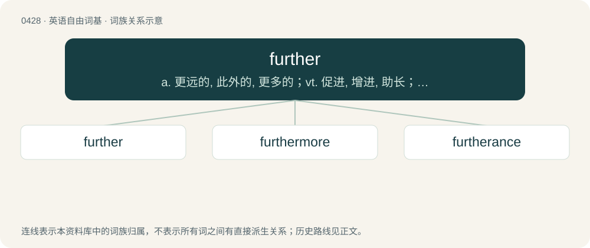

# 0491 · further — a. 更远的, 此外的, 更多的；vt. 促进, 增进, 助长；adv. 更进一步地, 更远地, 此外

[总目录](../00_总目录_按常用程度.md)

**类型**：英语自由词基　｜　**来源语言**：见词源记录

## 核心含义与来源

- 核心含义：a. 更远的, 此外的, 更多的；vt. 促进, 增进, 助长；adv. 更进一步地, 更远地, 此外
- 英文含义：To help forward; to assist.
- 词形：further

**来源记录 1**（动词；To help forward; to assist.）

From Middle English further, forther, from Old English forþor, furþor (“further”, adverb), from Proto-West Germanic \*furþer, from Proto-Indo-European \*per- (a common preposition), equivalent to fore + -ther (a vestigial comparative ending still present in such words as other, either, whether, and, in altered form, in after); or as sometimes stated, as forth + -er. Cognate with Scots forder, furder (“further”), Saterland Frisian foarder (“further”), West Frisian fierder (“further”), Dutch verder (“further”), German fürder (“further”).

## 词族图

## 单词速览（常用到不常用）

| 单词 | 音标 | 释义 |
|---|---|---|
| [further](#w-1) | 英 /ˈfɜːðə/；美 /ˈfɝ.ðɚ/ | a. 更远的, 此外的, 更多的；vt. 促进, 增进, 助长；adv. 更进一步地, 更远地, 此外 |
| [furthermore](#w-2) | 英 /ˈfɜː(ɹ).ðə(ɹ)ˌmɔː(ɹ)/；美 /ˈfɝ.ðɚˌmoɹ/ | adv. 此外, 而且 |
| [furtherance](#w-3) | 英 /ˈfɜːðəɹəns/；美 /ˈfɝðɚəns/ | n. 助成, 促进, 援助的方法, 提供援助者 |

## 逐词详解

### 1. further

**词性**：动词　｜　**音标**：英 /ˈfɜːðə/；美 /ˈfɝ.ðɚ/

**中文释义**：a. 更远的, 此外的, 更多的；vt. 促进, 增进, 助长；adv. 更进一步地, 更远地, 此外

**英文义项**：To help forward; to assist. / To encourage growth; to support progress or growth of something; to promote.

**构词拆分**：forth + -er

**词源与演化**：

From Middle English further, forther, from Old English forþor, furþor (“further”, adverb), from Proto-West Germanic \*furþer, from Proto-Indo-European \*per- (a common preposition), equivalent to fore + -ther (a vestigial comparative ending still present in such words as other, either, whether, and, in altered form, in after); or as sometimes stated, as forth + -er. Cognate with Scots forder, furder (“further”), Saterland Frisian foarder (“further”), West Frisian fierder (“further”), Dutch verder (“further”), German fürder (“further”).

**用法示例／搭配（非完整句）**：

> to further the peace process

该用例对应义项：To encourage growth; to support progress or growth of something; to promote.

### 2. furthermore

**词性**：副词　｜　**音标**：英 /ˈfɜː(ɹ).ðə(ɹ)ˌmɔː(ɹ)/；美 /ˈfɝ.ðɚˌmoɹ/

**中文释义**：adv. 此外, 而且

**英文义项**：In addition; besides; further; what's more (i.e. to denote additional information).

**构词拆分**：further + -more

**词源与演化**：

From Middle English furthermore, forthermore, forthermar (also as forther mo), equivalent to further + -more.

**例句**：

> He skillfully took charge of the event, and furthermore, he stayed late after it to clean up.

该用例对应义项：In addition; besides; further; what's more (i.e. to denote additional information).

### 3. furtherance

**词性**：名词　｜　**音标**：英 /ˈfɜːðəɹəns/；美 /ˈfɝðɚəns/

**中文释义**：n. 助成, 促进, 援助的方法, 提供援助者

**英文义项**：The act of furthering or helping forward; assistance towards something desired.

**构词拆分**：further + -ance

**词源与演化**：

From further + -ance.
