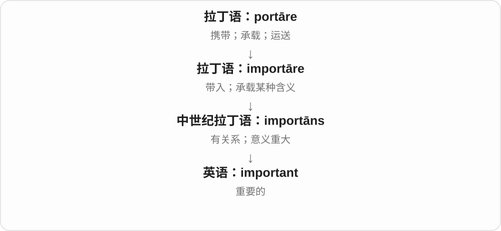
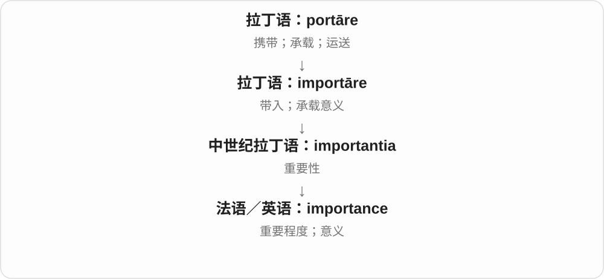
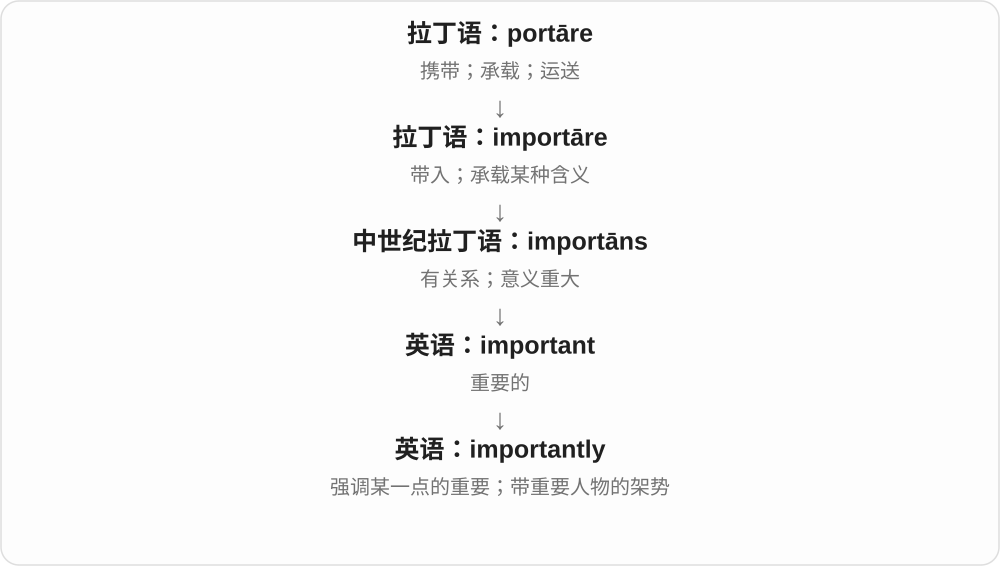

# 0491 · important — 重要、对结果有影响

[逐词精讲目录](../00_逐词精讲目录.md) · [总目录](../00_总目录_按常用程度.md)

## 核心词根与来源

important 经法语接 importer 的关系重大等用法，更早有关拉丁 importāre 带入；不能在现代把重要一律解释成进口。

**IMPORTANT：拿走这一点，会不会让结果大不一样**

important 说分量，importance 说重要性，importantly 说明判断角度，unimportant 是否定这个分量。

- **重要及其角度、性质**：important · importantly · importance
- **无关紧要的反面**：unimportant

## 词形与演化规律

important → importantly、importance；un- + important → unimportant。

## 单词速览（按词族由简到繁）

同一基础词的相关扩展放在一起，先读基础形式，再读扩展；各组之间优先读常用的。具体词源关系见各词讲解。

| 单词 | 音标 | 核心意思 |
|---|---|---|
| [important](#w-1) | 英 /ɪmˈpɔːtənt/；美 /ɪmˈpɔːrtənt/ | 重要的；影响大的 |
| [importance](#w-4) | 英 /ɪmˈpɔːtəns/；美 /ɪmˈpɔːrtəns/ | 重要性；分量；意义 |
| [importantly](#w-2) | 英 /ɪmˈpɔːtəntli/；美 /ɪmˈpɔːrtəntli/ | 重要的是；更重要地；自命不凡地 |
| [unimportant](#w-3) | 英 /ˌʌnɪmˈpɔːtənt/；美 /ˌʌnɪmˈpɔːrtənt/ | 不重要的；无关紧要的 |

## 逐词讲解

### 1. important — 重要的；影响大的

**音标**：英 /ɪmˈpɔːtənt/；美 /ɪmˈpɔːrtənt/

**先抓住这个画面**

important 是一件事有分量：它会影响结果，或者对某个人有特殊价值，不能轻易忽略。

**怎么拆**

连着拉丁语 importāre“带入、传达”，中世纪拉丁语 importāns 发展出“关系重大”的意思。不是“进口的东西都重要”。

**怎么变成今天的意思**

从承载意义、带来后果，走向值得重视。用“有分量”帮助理解很直观，但 important 本身不要求东西真的很重。

**常见搭配与例句**

an important decision（重要决定）；be important to someone（对某人很重要）；It is important to…（做……很重要）。

> This decision is important to everyone on the team.

这个决定对团队每个人都很重要。

> It is important to read the instructions carefully.

仔细阅读说明很重要。

**别混淆**

important 是重要；urgent 是急迫。重要的事未必今天必须做，急事也未必影响最大。

### 2. importance — 重要性；分量；意义

**音标**：英 /ɪmˈpɔːtəns/；美 /ɪmˈpɔːrtəns/

**先抓住这个画面**

importance 把“这件事有多值得在意”变成一个可以讨论的概念。它谈的不是东西有多大，而是影响或价值有多大。

**怎么拆**

来自法语 importance 或中世纪拉丁语 importantia，与 important 同族；现代把 -ant / -ance 的形容词、名词关系一起记。

**怎么变成今天的意思**

the importance of practice 是练习为什么值得重视。attach importance to 是把某件事放在较高位置，也就是重视它。

**常见搭配与例句**

the importance of…（……的重要性）；attach importance to…（重视……）；of great importance（非常重要）。

> The experience taught her the importance of preparation.

这段经历让她明白了准备的重要性。

> They attach great importance to clear communication.

他们非常重视清楚的沟通。

**别混淆**

importance 是名词，important 是形容词。This is important 与 This is of importance 意思相近，后者较正式。

### 3. importantly — 重要的是；更重要地；自命不凡地

**音标**：英 /ɪmˈpɔːtəntli/；美 /ɪmˈpɔːrtəntli/

**先抓住这个画面**

importantly 常像在下一句话前画一道重点：“请注意，接下来这一点很要紧。”most importantly 则把最关键的一点抬出来。

**怎么拆**

important + -ly，构成副词。

**怎么变成今天的意思**

常见用法是修饰整句话，说明后面信息的重要性。另一种较少见的方式副词用法形容人摆出一副自以为了不起的样子。

**常见搭配与例句**

more importantly（更重要的是）；most importantly（最重要的是）；speak importantly（故作重要地说，较少见）。

> The plan is affordable and, more importantly, practical.

这个方案成本可承担，更重要的是切实可行。

> Most importantly, everyone understood the next step.

最重要的是，每个人都明白下一步该做什么。

**别混淆**

important 修饰名词或作表语；importantly 常评说整句话。不是在所有 important 后面随便加 ly 都能得到自然表达。

### 4. unimportant — 不重要的；无关紧要的

**音标**：英 /ˌʌnɪmˈpɔːtənt/；美 /ˌʌnɪmˈpɔːrtənt/

**先抓住这个画面**

这件事即使拿掉、改掉，也几乎不影响当前要紧的结果。

**怎么拆**

un-（不）+ important，否定重要、有影响的性质；不是把 import“进口”倒回去。

**怎么变成今天的意思**

**important**  
重要、对结果有分量的

↓

**un- + important → unimportant**  
在相应范围里无关紧要的

an unimportant detail 不重要的细节，seem unimportant 看着无关紧要。重要与否相对当前目标，不必对所有场景永远不重要。

**常见搭配与例句**

an unimportant detail；seem unimportant；relatively unimportant。

> We spent too long arguing about an unimportant detail.

我们为一个无关紧要的细节争了太久。

> The difference may seem unimportant at first.

这点差别起初可能显得不重要。

**别混淆**

unimportant 不重要，unknown 不知道；一件尚不知道的事可能非常重要，两个判断不等同。

## 这一组要分清什么

unimportant 不重要，unknown 未知；一个细节是否要紧取决于当前问题，不由它小不小直接决定。

## 串起来练习

An apparently unimportant detail can reveal something important.

一个表面无关紧要的细节，也能揭示重要的东西。
