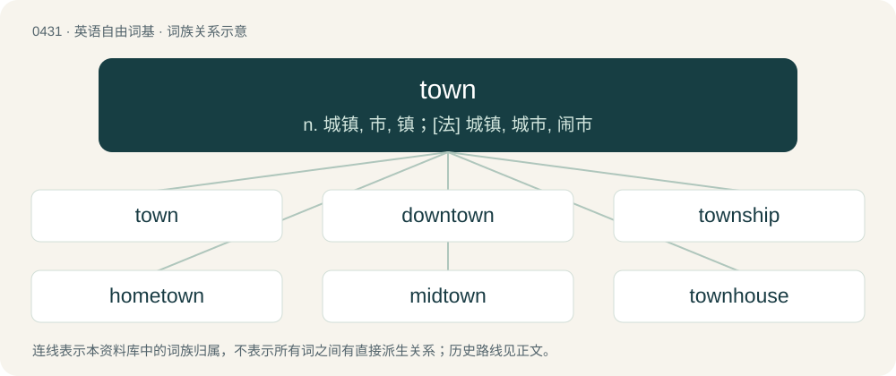

# 0493 · town — n. 城镇, 市, 镇；\[法\] 城镇, 城市, 闹市

[总目录](../00_总目录_按常用程度.md)

**类型**：英语自由词基　｜　**来源语言**：见词源记录

## 核心含义与来源

- 核心含义：n. 城镇, 市, 镇；\[法\] 城镇, 城市, 闹市
- 英文含义：A settlement; an area with residential districts, shops and amenities, and its own local government; especially one larger than a village and smaller than a city, historically enclosed by a fence or walls, with total populations ranging from several hundred to more than a hundred thousand (as of the early 21st century)
- 词形：town

**来源记录 1**（名词；A settlement; an area with residential districts, shops and amenities, and its own local government; especially one larger than a village and smaller than a city, historically enclosed by a fence or walls, with total populations ranging from several hundred to more than a hundred thousand (as of the early 21st century)）

Inherited from Middle English toun, from Old English tūn, from Proto-West Germanic \*tūn, from Proto-Germanic \*tūną, borrowed from Proto-Celtic \*dūnom (“stronghold, rampart”), possibly from Proto-Indo-European \*duh₂-nós (“lasting, durable”), from \*dewh₂- (“to last”) + \*-nós. Cognate with Saterland Frisian Tuun (“garden”), West Frisian tún (“enclosure, garden”), Dutch tuin (“garden”), German Low German Tuun (“fence”), German Zaun (“fence”), Danish tun, Swedish tun and Norwegian Nynorsk tun (“yard”); also archaic Welsh din (“hill”), Irish dún (“fortress”). Doublet of dun. See also -ton and tine (“to enclose”).

## 词族图

## 单词速览（常用到不常用）

| 单词 | 音标 | 释义 |
|---|---|---|
| [town](#w-1) | 英 /ˈtaʊ̯n/；/ˈtæʊ̯n/ | n. 城镇, 市, 镇；\[法\] 城镇, 城市, 闹市 |
| [downtown](#w-2) | 英 /ˈdaʊ̯nˌtaʊ̯n/；/ˈdæʊ̯nˌtæʊ̯n/ | n. 市中心区；a. 市中心的；adv. 往闹市区 |
| [township](#w-3) | 英 /ˈtaʊnʃɪp/ | n. 小镇, 镇区；\[法\] 镇区, 乡 |
| [hometown](#w-4) | 美 /ˈhoʊmˌtaʊn/ | n. 故乡, 家乡 |
| [midtown](#w-5) | /ˈmidtajn/ | n. 商业区与住宅区之间的地区 |
| [townhouse](#w-6) | 美 /ˈtaʊnˌhaʊs/ | n. 连栋房屋; 城市住房 |
| [townsfolk](#w-7) |  | n. 镇民, 市民, 城里生长的人, 城镇居民 |
| [crosstown](#w-8) | /ˌkrɒsˈtaʊn/ | a. 穿越市区的, 横越市区的；adv. 穿市区, 横跨市区地；n. 穿越市区的公共汽车 |
| [towner](#w-9) | /ˈtaʊnər/ | 城镇居民 |
| [townie](#w-10) | /ˈtaʊni/ | a. 城市生活的 |
| [townsite](#w-11) | /taʊnˈsaɪt/ | 城镇所在地; 城址 |

## 逐词详解

### 1. town

**词性**：名词　｜　**音标**：英 /ˈtaʊ̯n/；/ˈtæʊ̯n/

**中文释义**：n. 城镇, 市, 镇；\[法\] 城镇, 城市, 闹市

**英文义项**：A settlement; an area with residential districts, shops and amenities, and its own local government; especially one larger than a village and smaller than a city, historically enclosed by a fence or walls, with total populations ranging from several hundred to more than a hundred thousand (as of the early 21st century) / Any more urbanized centre than the place of reference.

**词源与演化**：

Inherited from Middle English toun, from Old English tūn, from Proto-West Germanic \*tūn, from Proto-Germanic \*tūną, borrowed from Proto-Celtic \*dūnom (“stronghold, rampart”), possibly from Proto-Indo-European \*duh₂-nós (“lasting, durable”), from \*dewh₂- (“to last”) + \*-nós. Cognate with Saterland Frisian Tuun (“garden”), West Frisian tún (“enclosure, garden”), Dutch tuin (“garden”), German Low German Tuun (“fence”), German Zaun (“fence”), Danish tun, Swedish tun and Norwegian Nynorsk tun (“yard”); also archaic Welsh din (“hill”), Irish dún (“fortress”). Doublet of dun. See also -ton and tine (“to enclose”).

**例句**：

> I'll be in Yonkers, then I'm driving into town to see the Knicks at the Garden tonight.

该用例对应义项：Any more urbanized centre than the place of reference.

### 2. downtown

**词性**：形容词　｜　**音标**：英 /ˈdaʊ̯nˌtaʊ̯n/；/ˈdæʊ̯nˌtæʊ̯n/

**中文释义**：n. 市中心区；a. 市中心的；adv. 往闹市区

**英文义项**：Of, relating to, or situated in the central business district.

**构词拆分**：down + town

**词源与演化**：

From down + town.

**例句**：

> John walked every day to his downtown job.

该用例对应义项：Of, relating to, or situated in the central business district.

### 3. township

**词性**：名词　｜　**音标**：英 /ˈtaʊnʃɪp/

**中文释义**：n. 小镇, 镇区；\[法\] 镇区, 乡

**英文义项**：The territory of a town. / A subdivision of a county.

**构词拆分**：town + -ship

**词源与演化**：

From Middle English towneship, townschip, tounshipe, tunscipe, from Old English tūnsċipe (“the inhabitants of a town; township”), equivalent to town + -ship.

**例句**：

> Vienna is a township in Ohio.

### 4. hometown

**词性**：名词　｜　**音标**：美 /ˈhoʊmˌtaʊn/

**中文释义**：n. 故乡, 家乡

**英文义项**：An individual’s place of birth, childhood home, or place of main residence. / Designating a decision or judgement that is biased, or perceived to be biased, in favour of local preference.

**构词拆分**：home + town

**词源与演化**：

From home + town.

**用法示例／搭配（非完整句）**：

> hometown decision, hometown verdict

该用例对应义项：Designating a decision or judgement that is biased, or perceived to be biased, in favour of local preference.

### 5. midtown

**词性**：名词　｜　**音标**：/ˈmidtajn/

**中文释义**：n. 商业区与住宅区之间的地区

**英文义项**：The part of a city between uptown and downtown.

**构词拆分**：mid- + town

**词源与演化**：

From mid- + town.

**例句**：

> The daily trek to midtown Manhattan takes about an hour and a half.

### 6. townhouse

**词性**：名词　｜　**音标**：美 /ˈtaʊnˌhaʊs/

**中文释义**：n. 连栋房屋; 城市住房

**英文义项**：A row house or terraced house. / A house in an urban setting.

**构词拆分**：town + house

**词源与演化**：

From town + house. Compare Dutch tuinhuis (“summer house, cabana”), tuinhuisje (“bower”).

### 7. townsfolk

**词性**：名词

**中文释义**：n. 镇民, 市民, 城里生长的人, 城镇居民

**英文义项**：The people who live in a town, especially the lower and middle classes.

**构词拆分**：From town + -s- + folk.

**词源与演化**：

From town + -s- + folk.

**例句**：

> "Have you seen my pencil?" asked the alien to the flabbergasted townsfolk.

### 8. crosstown

**词性**：形容词　｜　**音标**：/ˌkrɒsˈtaʊn/

**中文释义**：a. 穿越市区的, 横越市区的；adv. 穿市区, 横跨市区地；n. 穿越市区的公共汽车

**英文义项**：Extending across a city or town. / Connecting different areas of a city or town without passing through downtown.

**构词拆分**：From cross- + town.

**词源与演化**：

From cross- + town.

**例句**：

> The football team beat our crosstown rivals last night.

该用例对应义项：Situated at the other end of town.

### 9. towner

**词性**：名词　｜　**音标**：/ˈtaʊnər/

**中文释义**：城镇居民

**英文义项**：A person from a certain town, or part of town

**构词拆分**：town + -er

**词源与演化**：

From town + -er.

### 10. townie

**词性**：名词　｜　**音标**：/ˈtaʊni/

**中文释义**：a. 城市生活的

**英文义项**：A person living in a university area who is not associated with the university. / A person who has moved from a town or city to a rural area. Especially, one who is perceived not to have adopted rural ways.

**构词拆分**：town + -ie

**词源与演化**：

From town + -ie (“person associated”).

### 11. townsite

**词性**：名词　｜　**音标**：/taʊnˈsaɪt/

**中文释义**：城镇所在地; 城址

**英文义项**：In former British colonies, a tract of land authorized to be developed as a town and then surveyed and marked out with streets.

**构词拆分**：town + site

**词源与演化**：

From town + site.
