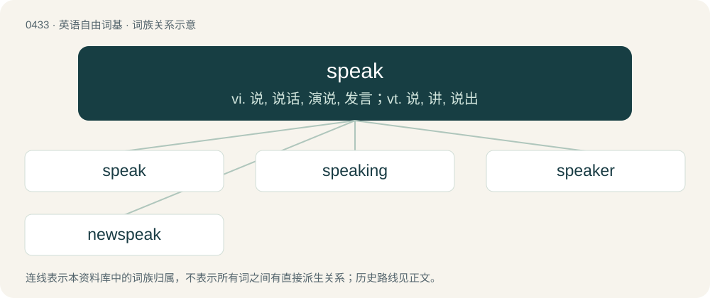

# 0496 · speak — vi. 说, 说话, 演说, 发言；vt. 说, 讲, 说出

[总目录](../00_总目录_按常用程度.md)

**类型**：英语自由词基　｜　**来源语言**：见词源记录

## 核心含义与来源

- 核心含义：vi. 说, 说话, 演说, 发言；vt. 说, 讲, 说出
- 英文含义：To communicate with one's voice, to say words out loud.
- 词形：speak

**来源记录 1**（动词；To communicate with one's voice, to say words out loud.）

From Middle English speke, speken (“to speak”), from Old English specan (“to speak”). This is usually taken to be an irregular alteration of earlier sprecan, spreocan (“to speak”), from Proto-West Germanic \*sprekan, from Proto-Germanic \*sprekaną (“to speak, make a sound”), from Proto-Indo-European \*spreg- (“to make a sound, utter, speak”). Finding this proposed loss of r from the stable cluster spr unparalleled, Hill instead sets up a different root, Proto-West Germanic \*spekan (“to negotiate”) from Proto-Indo-European \*bʰégʾ-e- (“to distribute”) with \*s-mobile, which collapsed in meaning with \*sprekan ("to speak" &lt; "to crackle, prattle") and so came to be seen as a free variant thereof. Cognates Cognate with Scots speak, speik (“to speak”), Saterland Frisian spreke (“to speak”), West Frisian sprekke (“to speak”), Central Franconian sjprèche (“to speak”), Dutch and Low German spreken (“to speak”), German sprechen (“to speak”), Luxembourgish spriechen (“to speak”), and also with Albanian shpreh (“to express, manifest, show”) through Indo-European.

## 词族图

## 单词速览（常用到不常用）

| 单词 | 音标 | 释义 |
|---|---|---|
| [speak](#w-1) | 英 /spiːk/；美 /spik/ | vi. 说, 说话, 演说, 发言；vt. 说, 讲, 说出 |
| [speaking](#w-2) | 英 /ˈspiː.kɪŋ/；美 /ˈspi.kɪŋ/ | n. 谈话, 演说；a. 讲话的, 适于说的, 讲某种语言的 |
| [speaker](#w-3) | 英 /ˈspiːkə/；美 /ˈspikɚ/ | n. 说话人, 讲演者, 发言人, 喇叭, 扬声器；\[计\] 扬声器 |
| [newspeak](#w-4) | /ˈn(j)uːspiːk/ | n. (以规避,迂回,含混为特点的)官方宣传语言 |

## 逐词详解

### 1. speak

**词性**：动词　｜　**音标**：英 /spiːk/；美 /spik/

**中文释义**：vi. 说, 说话, 演说, 发言；vt. 说, 讲, 说出

**英文义项**：To communicate with one's voice, to say words out loud. / To have a conversation.

**词源与演化**：

From Middle English speke, speken (“to speak”), from Old English specan (“to speak”). This is usually taken to be an irregular alteration of earlier sprecan, spreocan (“to speak”), from Proto-West Germanic \*sprekan, from Proto-Germanic \*sprekaną (“to speak, make a sound”), from Proto-Indo-European \*spreg- (“to make a sound, utter, speak”). Finding this proposed loss of r from the stable cluster spr unparalleled, Hill instead sets up a different root, Proto-West Germanic \*spekan (“to negotiate”) from Proto-Indo-European \*bʰégʾ-e- (“to distribute”) with \*s-mobile, which collapsed in meaning with \*sprekan ("to speak" &lt; "to crackle, prattle") and so came to be seen as a free variant thereof. Cognates Cognate with Scots speak, speik (“to speak”), Saterland Frisian spreke (“to speak”), West Frisian sprekke (“to speak”), Central Franconian sjprèche (“to speak”), Dutch and Low German spreken (“to speak”), German sprechen (“to speak”), Luxembourgish spriechen (“to speak”), and also with Albanian shpreh (“to express, manifest, show”) through Indo-European.

**例句**：

> This evening I shall speak on the topic of correct English usage.

该用例对应义项：To deliver a message to a group; to deliver a speech.

### 2. speaking

**词性**：形容词　｜　**音标**：英 /ˈspiː.kɪŋ/；美 /ˈspi.kɪŋ/

**中文释义**：n. 谈话, 演说；a. 讲话的, 适于说的, 讲某种语言的

**英文义项**：Used in speaking. / Expressive; eloquent.

**构词拆分**：speak + -ing

**词源与演化**：

From Middle English spekinge, spekynge, spekinde, spekende, spekande, spekand, from Old English specende, sprecende (“speaking”), from Proto-Germanic \*sprekandz (“speaking”), present participle of Proto-Germanic \*sprekaną (“to speak”). Equivalent to speak + -ing. Cognate with Scots speikand, speikin (“speaking”), Saterland Frisian spreekend (“speaking”), West Frisian sprekkend (“speaking”), Dutch sprekend (“speaking”), German Low German sprekend (“speaking”), German sprechend (“speaking”).

**例句**：

> The French-speaking world listened in to the broadcast.

该用例对应义项：Having competence in a language.

### 3. speaker

**词性**：名词　｜　**音标**：英 /ˈspiːkə/；美 /ˈspikɚ/

**中文释义**：n. 说话人, 讲演者, 发言人, 喇叭, 扬声器；\[计\] 扬声器

**英文义项**：One who speaks. / Loudspeaker.

**构词拆分**：speak + -er

**词源与演化**：

From Middle English speker, spekere, an alteration (with change of suffix) of Old English speca, spreca (“speaker”), from Proto-Germanic \*sprekô (“speaker”), equivalent to speak + -er. Compare Saterland Frisian Spreeker (“speaker”), West Frisian sprekker (“speaker”), Dutch spreker (“speaker”), German Low German Spreker (“speaker”), German Sprecher (“speaker”).

**例句**：

> She lost her hearing after standing too close to the speaker at the festival.

该用例对应义项：Loudspeaker.

### 4. newspeak

**词性**：名词　｜　**音标**：/ˈn(j)uːspiːk/

**中文释义**：n. (以规避,迂回,含混为特点的)官方宣传语言

**英文义项**：Use of ambiguous, misleading, or euphemistic words in order to deceive the listener, especially by politicians and officials.

**构词拆分**：new + speak

**词源与演化**：

From Newspeak, coined by George Orwell in 1949. Equivalent to new + speak.

**例句**：

> The welfare state brought its own newspeak.

该用例对应义项：deliberately ambiguous and contradictory language use to mislead and manipulate the public
