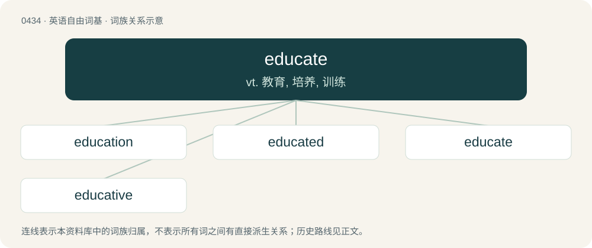

# 0497 · educate — vt. 教育, 培养, 训练

[总目录](../00_总目录_按常用程度.md)

**类型**：英语自由词基　｜　**来源语言**：见词源记录

## 核心含义与来源

- 核心含义：vt. 教育, 培养, 训练
- 英文含义：To instruct or train.
- 词形：educate

**来源记录 1**（动词；To instruct or train.）

From Middle English educaten, from educat(e) (“educated”, also used as the past participle of educaten) + -en (verb-forming suffix), from Latin ēducātus, the perfect passive participle of ēducō (“(of a child, physically or mentally) to bring up, train, nourish; (of a person in learning or art) to rear, educate, train; (plants or animals) to nourish, support, or produce”) (see -ate (verb-forming suffix)), further from an intensive/frequentative formed on ēducō (“lead out, draw out; to raise up, erect”) + -ō.

## 词族图

## 单词速览（常用到不常用）

| 单词 | 音标 | 释义 |
|---|---|---|
| [education](#w-1) | 美 /ˌɛd͡ʒ.əˈkeɪ.ʃən/；/ˌɛd͡ʒ.ʊˈkeɪ.ʃən/ | n. 教育, 训练, 教育学；\[医\] 教育, 训练 |
| [educated](#w-2) | 英 /ˈɛd͡ʒəkeɪtɪd/；美 /ˈɛd͡ʒəkeɪtɪd/ | a. 受过教育的, 有教养的 |
| [educate](#w-3) | 美 /ˈɛd͡ʒ.əˌkeɪt/；/ˈɛd͡ʒ.ʊˌkeɪt/ | vt. 教育, 培养, 训练 |
| [educative](#w-4) | /ˈedjukətiv/ | a. 教育的, 教育上的, 教育性的 |

## 逐词详解

### 1. education

**词性**：名词　｜　**音标**：美 /ˌɛd͡ʒ.əˈkeɪ.ʃən/；/ˌɛd͡ʒ.ʊˈkeɪ.ʃən/

**中文释义**：n. 教育, 训练, 教育学；\[医\] 教育, 训练

**英文义项**：The process of imparting knowledge, skill and judgment. / Facts, skills and ideas that have been learned, especially through formal instruction.

**构词拆分**：educate + -ion

**词源与演化**：

Borrowed from Middle French éducation, from Latin ēducātiō (“a breeding, bringing up, rearing”), from ēducō (“to educate, train”), from ēdūcō (“to lead forth, to take out; to raise up, to erect”). See educate. Morphologically educate + -ion.

**例句**：

> The educations our children receive depend on their economic status.

该用例对应义项：Facts, skills and ideas that have been learned, especially through formal instruction.

### 2. educated

**词性**：形容词　｜　**音标**：英 /ˈɛd͡ʒəkeɪtɪd/；美 /ˈɛd͡ʒəkeɪtɪd/

**中文释义**：a. 受过教育的, 有教养的

**英文义项**：Having attained a level of higher education, such as a college degree. / Based on relevant information.

**构词拆分**：From educate + -ed.

**词源与演化**：

From educate + -ed.

**例句**：

> She cast an educated eye over the antiques.

该用例对应义项：Knowledgeable.

### 3. educate

**词性**：动词　｜　**音标**：美 /ˈɛd͡ʒ.əˌkeɪt/；/ˈɛd͡ʒ.ʊˌkeɪt/

**中文释义**：vt. 教育, 培养, 训练

**英文义项**：To instruct or train.

**词源与演化**：

From Middle English educaten, from educat(e) (“educated”, also used as the past participle of educaten) + -en (verb-forming suffix), from Latin ēducātus, the perfect passive participle of ēducō (“(of a child, physically or mentally) to bring up, train, nourish; (of a person in learning or art) to rear, educate, train; (plants or animals) to nourish, support, or produce”) (see -ate (verb-forming suffix)), further from an intensive/frequentative formed on ēducō (“lead out, draw out; to raise up, erect”) + -ō.

**例句**：

> Wang said such changes to the Baishui glacier provide the chance to educate visitors about global warming.

该用例对应义项：To instruct or train.

### 4. educative

**词性**：形容词　｜　**音标**：/ˈedjukətiv/

**中文释义**：a. 教育的, 教育上的, 教育性的

**英文义项**：Serving to educate; educational.

**构词拆分**：educate + -ive

**词源与演化**：

From educate + -ive.
