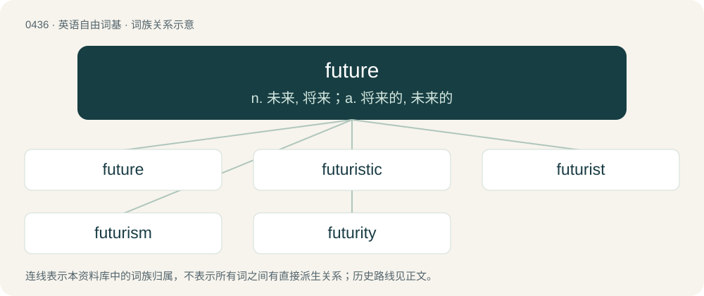

# 0498 · future — n. 未来, 将来；a. 将来的, 未来的

[总目录](../00_总目录_按常用程度.md)

**类型**：英语自由词基　｜　**来源语言**：见词源记录

## 核心含义与来源

- 核心含义：n. 未来, 将来；a. 将来的, 未来的
- 英文含义：The time ahead; those moments yet to be experienced.
- 词形：future

**来源记录 1**（名词；The time ahead; those moments yet to be experienced.）

From Middle English future, futur, from Old French futur, from Latin futūrus, irregular future active participle of sum (“to be”), from Proto-Indo-European \*bʰuH- (“to become, be”). Cognate with Old English bēo (“to become, will be; to be”). More at be. Doublet of futur. Displaced native Old English tōweard, which took on a different meaning as toward, and Middle English afterhede (“future”, literally “afterhood”) in the given sense.

## 词族图

## 单词速览（常用到不常用）

| 单词 | 音标 | 释义 |
|---|---|---|
| [future](#w-1) | 英 /ˈfjuː.t͡ʃəː/；美 /ˈfju.t͡ʃɚ/ | n. 未来, 将来；a. 将来的, 未来的 |
| [futuristic](#w-2) | 英 /ˌfjuːt͡ʃəˈɹɪstɪk/；美 /ˌfjut͡ʃəˈɹɪstɪk/ | a. 未来派的 |
| [futurist](#w-3) | /ˈfjuːtʃərist/ | n. 未来派画家, 未来主义者 |
| [futurism](#w-4) | /ˈfjuːt͡ʃəɹɪzəm/ | n. 未来派 |
| [futurity](#w-5) | /fjuːˈtjʊəɹɪti/ | n. 将来, 未来, 未来的事, 远景 |

## 逐词详解

### 1. future

**词性**：名词　｜　**音标**：英 /ˈfjuː.t͡ʃəː/；美 /ˈfju.t͡ʃɚ/

**中文释义**：n. 未来, 将来；a. 将来的, 未来的

**英文义项**：The time ahead; those moments yet to be experienced. / Something that will happen in moments yet to come.

**词源与演化**：

From Middle English future, futur, from Old French futur, from Latin futūrus, irregular future active participle of sum (“to be”), from Proto-Indo-European \*bʰuH- (“to become, be”). Cognate with Old English bēo (“to become, will be; to be”). More at be. Doublet of futur. Displaced native Old English tōweard, which took on a different meaning as toward, and Middle English afterhede (“future”, literally “afterhood”) in the given sense.

**例句**：

> There is no future in dwelling on the past.

该用例对应义项：Goodness in what is yet to come. Something to look forward to.

### 2. futuristic

**词性**：形容词　｜　**音标**：英 /ˌfjuːt͡ʃəˈɹɪstɪk/；美 /ˌfjut͡ʃəˈɹɪstɪk/

**中文释义**：a. 未来派的

**英文义项**：Of technology, a concept, etc, so far advanced as to appear to be from the future. / In or relating to the future tense.

**构词拆分**：future + -istic

**词源与演化**：

From future + -istic.

**例句**：

> The modernistic architecture was both ugly and unfunctional, in spite of its futuristic appearance.

该用例对应义项：Of technology, a concept, etc, so far advanced as to appear to be from the future.

### 3. futurist

**词性**：名词　｜　**音标**：/ˈfjuːtʃərist/

**中文释义**：n. 未来派画家, 未来主义者

**英文义项**：An adherent to the principles of the artistic movement of futurism. / One who studies and predicts possible futures.

**构词拆分**：future + -ist

**词源与演化**：

From future + -ist.

### 4. futurism

**词性**：名词　｜　**音标**：/ˈfjuːt͡ʃəɹɪzəm/

**中文释义**：n. 未来派

**英文义项**：An early 20th century avant-garde art movement focused on speed, the mechanical, and the modern, which took a deeply antagonistic attitude to traditional artistic conventions. / The study and prediction of possible futures.

**构词拆分**：future + -ism

**词源与演化**：

From future + -ism.

### 5. futurity

**词性**：名词　｜　**音标**：/fjuːˈtjʊəɹɪti/

**中文释义**：n. 将来, 未来, 未来的事, 远景

**英文义项**：The future. / The state of being in the future.

**构词拆分**：future + -ity

**词源与演化**：

From future + -ity.
