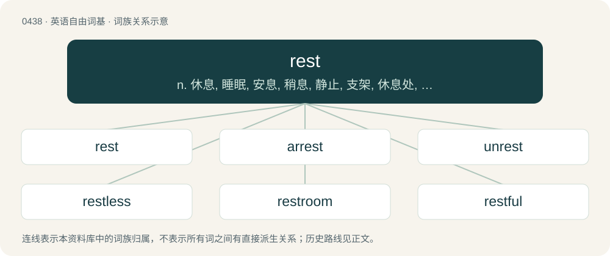

# 0500 · rest — n. 休息, 睡眠, 安息, 稍息, 静止, 支架, 休息处, 其余者, 剩余部分；vi. 休息, 睡, 长眠, 安心, 静止, 停止, 安置, 依赖；vt. 使休息, 使支撑, 把...寄托于

[总目录](../00_总目录_按常用程度.md)

**类型**：英语自由词基　｜　**来源语言**：见词源记录

## 核心含义与来源

- 核心含义：n. 休息, 睡眠, 安息, 稍息, 静止, 支架, 休息处, 其余者, 剩余部分；vi. 休息, 睡, 长眠, 安心, 静止, 停止, 安置, 依赖；vt. 使休息, 使支撑, 把...寄托于
- 英文含义：Relief from work or activity by sleeping; sleep.
- 词形：rest

**多个词源／构词路径**：同一拼写可能有不同来源；以下按词性和含义分别列出。

**来源记录 1**（名词；Relief from work or activity by sleeping; sleep.）

From Middle English rest, reste, from Old English ræst, from Proto-West Germanic \*rastu, from Proto-Germanic \*rastō, of uncertain origin; possibly derived from Proto-Indo-European \*h₁reh₁- (“to rest”) or \*Hre(h₁)s- (“to flow, rush”). Cognate with West Frisian rêst (“rest”), Dutch rust (“rest”), German Rast (“rest”), Swedish rast (“rest”), Norwegian rest (“rest”), Icelandic röst (“rest”), Old Irish árus (“dwelling”), German Ruhe (“calm”), Albanian resht (“to stop, pause”), Welsh araf (“quiet, calm, gentle”), Lithuanian rovà (“calm”), Ancient Greek ἐρωή (erōḗ, “rest, respite”), Avestan 𐬀𐬌𐬭𐬌𐬨𐬈 (aⁱrime, “calm, peaceful”), Sanskrit रमते (rámate, “he stays still, calms down”), Gothic 𐍂𐌹𐌼𐌹𐍃 (rimis, “tranquility”). Related to roo.

**来源记录 2**（动词；To cease from action, motion, work, or performance of any kind; stop; desist; be without motion.）

From Middle English resten, from Old English restan, from Proto-West Germanic \*rastijan (“to rest”), from Proto-Indo-European \*ros-, \*res-, \*erH- (“rest”). Cognate with Dutch rusten (“to rest”), Middle Low German resten (“to rest”), German rasten (“to rest”), Danish raste (“to rest”), Swedish rasta (“to rest”).

**来源记录 3**（名词；That which remains.）

From Middle English reste, from Old French reste, from Old French rester (“to remain”), from Latin restō (“to stay back, stay behind”), from re- + stō (“to stand”). Replaced native Middle English lave (“rest, remainder”) (from Old English lāf (“remnant, remainder”)).

**来源记录 4**（动词；To continue to be, remain, be left in a certain way.）

From Middle English resten, from Old French rester, from Latin restō.

## 词族图

## 单词速览（常用到不常用）

| 单词 | 音标 | 释义 |
|---|---|---|
| [rest](#w-1) | 英 /ɹɛst/ | n. 休息, 睡眠, 安息, 稍息, 静止, 支架, 休息处, 其余者, 剩余部分；vi. 休息, 睡, 长眠, 安心, 静止, 停止, 安置, 依赖；vt. 使休息, 使支撑, 把...寄托于 |
| [arrest](#w-2) | /əˈɹɛst/ | n. 逮捕, 监禁；vt. 拘捕, 抑制, 吸引, 阻止 |
| [unrest](#w-3) | /ʌnˈɹɛst/ | n. 不安的状态, 动荡的局面；\[医\] 不安 |
| [restless](#w-4) | /ˈɹɛstlɪs/ | a. 不安静的, 慌张的, 休息不充分的；\[医\] 不安静的, 不宁的 |
| [restroom](#w-5) | 美 /ˈɹɛstˌɹum/ | n. 洗手间；休息室；更衣室；厕所 |
| [restful](#w-6) | /ˈɹɛs(t)fʊl/ | a. 给人休息的, 素雅的, 安静的 |
| [headrest](#w-7) | /ˈhɛdˌɹɛst/ | n. 头靠, 弹性头垫；\[医\] 头靠 |
| [armrest](#w-8) | 美 /ˈɑɹmˌɹɛst/ | n. 扶手, 靠手 |

## 逐词详解

### 1. rest

**词性**：名词　｜　**音标**：英 /ɹɛst/

**中文释义**：n. 休息, 睡眠, 安息, 稍息, 静止, 支架, 休息处, 其余者, 剩余部分；vi. 休息, 睡, 长眠, 安心, 静止, 停止, 安置, 依赖；vt. 使休息, 使支撑, 把...寄托于

**英文义项**：Relief from work or activity by sleeping; sleep. / Any relief from exertion; a state of quiet and relaxation.

**词源与演化**：

From Middle English rest, reste, from Old English ræst, from Proto-West Germanic \*rastu, from Proto-Germanic \*rastō, of uncertain origin; possibly derived from Proto-Indo-European \*h₁reh₁- (“to rest”) or \*Hre(h₁)s- (“to flow, rush”). Cognate with West Frisian rêst (“rest”), Dutch rust (“rest”), German Rast (“rest”), Swedish rast (“rest”), Norwegian rest (“rest”), Icelandic röst (“rest”), Old Irish árus (“dwelling”), German Ruhe (“calm”), Albanian resht (“to stop, pause”), Welsh araf (“quiet, calm, gentle”), Lithuanian rovà (“calm”), Ancient Greek ἐρωή (erōḗ, “rest, respite”), Avestan 𐬀𐬌𐬭𐬌𐬨𐬈 (aⁱrime, “calm, peaceful”), Sanskrit रमते (rámate, “he stays still, calms down”), Gothic 𐍂𐌹𐌼𐌹𐍃 (rimis, “tranquility”). Related to roo.

**例句**：

> It was nice to have a rest from the phone ringing when I unplugged it for a while.

该用例对应义项：Peace; freedom from worry, anxiety, annoyances; tranquility.

### 2. arrest

**词性**：名词　｜　**音标**：/əˈɹɛst/

**中文释义**：n. 逮捕, 监禁；vt. 拘捕, 抑制, 吸引, 阻止

**英文义项**：A check; a stop; an act or instance of arresting something. / The condition of being stopped, standstill.

**构词拆分**：ad- + rest

**词源与演化**：

From Middle English arest (noun) and aresten (verb), from Old French areste (noun) and arester (“to stay, stop”, verb), from Vulgar Latin \*arrestō, from Latin ad- (“to”) + restō (“to stop, remain behind, stay back”), from re- (“back”) + stō (“to stand”), from Proto-Indo-European \*steh₂- (“to stand”), equivalent to ad- + rest. Compare French arrêter (“to stop”).

**例句**：

> State police made a total of 15 drug-related arrests across the city.

该用例对应义项：The process of arresting a criminal, suspect etc.

### 3. unrest

**词性**：名词　｜　**音标**：/ʌnˈɹɛst/

**中文释义**：n. 不安的状态, 动荡的局面；\[医\] 不安

**英文义项**：A state of trouble, confusion and turbulence, especially in a political context; a time of riots, demonstrations and protests. / Something that troubles or confuses; that which causes unrest.

**构词拆分**：un- + rest

**词源与演化**：

From Middle English unreste, equivalent to un- + rest. Cognate with West Frisian ûnrêst (“unrest”), Dutch onrust (“unrest”), German Low German Unrüst (“unrest”). Compare also Saterland Frisian Uunraue (“unrest”), German Unruhe (“unrest”), Danish uro (“unrest”), Swedish oro (“unrest”), Icelandic órói (“unrest”). Compare also Old English orrest (“battle”), Old Norse orrosta, orresta (“battle”).

**例句**：

> Social unrest may come about as a result of this long recession.

### 4. restless

**词性**：形容词　｜　**音标**：/ˈɹɛstlɪs/

**中文释义**：a. 不安静的, 慌张的, 休息不充分的；\[医\] 不安静的, 不宁的

**英文义项**：Not allowing or affording rest. / Without rest; unable to be still or quiet; uneasy; continually moving.

**构词拆分**：rest + -less

**词源与演化**：

From Middle English restles, restelees, from Old English ræstlēas, equivalent to rest + -less.

**例句**：

> They remained restless, sitting by the window the entire night.

该用例对应义项：Deprived of rest or sleep.

### 5. restroom

**词性**：名词　｜　**音标**：美 /ˈɹɛstˌɹum/

**中文释义**：n. 洗手间；休息室；更衣室；厕所

**英文义项**：A room containing a public toilet: a public lavatory.

**构词拆分**：rest + room

**词源与演化**：

From rest + room, from an earlier sense of "breakroom".

**例句**：

> Could you tell me where I can find the restroom?

该用例对应义项：A room containing a public toilet: a public lavatory.

### 6. restful

**词性**：形容词　｜　**音标**：/ˈɹɛs(t)fʊl/

**中文释义**：a. 给人休息的, 素雅的, 安静的

**英文义项**：peaceful; having a peaceful aspect / restorative; aiding rest

**构词拆分**：rest + -ful

**词源与演化**：

From Middle English restful, restfulle, equivalent to rest + -ful.

**例句**：

> After a hard day, Sue found the beauty of the park especially restful.

该用例对应义项：peaceful; having a peaceful aspect

### 7. headrest

**词性**：名词　｜　**音标**：/ˈhɛdˌɹɛst/

**中文释义**：n. 头靠, 弹性头垫；\[医\] 头靠

**英文义项**：The part of a seat designed to support the sitter's head.

**构词拆分**：head + rest

**词源与演化**：

From head + rest.

### 8. armrest

**词性**：名词　｜　**音标**：美 /ˈɑɹmˌɹɛst/

**中文释义**：n. 扶手, 靠手

**英文义项**：Part of the seat of a chair that is designed to support the arm.

**构词拆分**：arm + rest

**词源与演化**：

From arm + rest.

**例句**：

> In the armrest is a cup holder.
