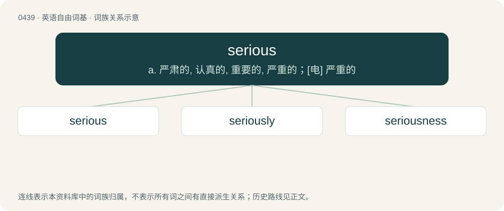

# 0501 · serious — a. 严肃的, 认真的, 重要的, 严重的；\[电\] 严重的

[总目录](../00_总目录_按常用程度.md)

**类型**：英语自由词基　｜　**来源语言**：见词源记录

## 核心含义与来源

- 核心含义：a. 严肃的, 认真的, 重要的, 严重的；\[电\] 严重的
- 英文含义：Without humor or expression of happiness; grave in manner or disposition.
- 词形：serious

**来源记录 1**（形容词；Without humor or expression of happiness; grave in manner or disposition.）

From Middle English seryows, from Old French serieux, from Medieval Latin sēriōsus, an extension of Latin sērius (“grave, earnest, serious”), possibly ultimately from Proto-Indo-European \*swer- (“heavy”). (If this root is correct, cognate with German schwer (“heavy, difficult, severe”), Old English swǣr (“heavy, grave, grievous”). More at swear, sweer. However, see sērius for an alternative derivation of the Latin.)

## 词族图

## 单词速览（常用到不常用）

| 单词 | 音标 | 释义 |
|---|---|---|
| [serious](#w-1) | 英 /ˈsɪə̯.ɹi.əs/；美 /ˈsɪɚ.i.əs/ | a. 严肃的, 认真的, 重要的, 严重的；\[电\] 严重的 |
| [seriously](#w-2) | 英 /ˈsɪə.ɹi.əs.li/；美 /ˈsɪɹ.i.əs.li/ | adv. 严肃地, 认真地, 严重地 |
| [seriousness](#w-3) | 英 /ˈsɪəɹiəsnəs/；美 /ˈsɪɹiəsnəs/ | n. 严肃, 认真, 严重性 |

## 逐词详解

### 1. serious

**词性**：形容词　｜　**音标**：英 /ˈsɪə̯.ɹi.əs/；美 /ˈsɪɚ.i.əs/

**中文释义**：a. 严肃的, 认真的, 重要的, 严重的；\[电\] 严重的

**英文义项**：Without humor or expression of happiness; grave in manner or disposition. / Important; weighty; not insignificant.

**词源与演化**：

From Middle English seryows, from Old French serieux, from Medieval Latin sēriōsus, an extension of Latin sērius (“grave, earnest, serious”), possibly ultimately from Proto-Indo-European \*swer- (“heavy”). (If this root is correct, cognate with German schwer (“heavy, difficult, severe”), Old English swǣr (“heavy, grave, grievous”). More at swear, sweer. However, see sērius for an alternative derivation of the Latin.)

**例句**：

> It was a surprise to see the captain, who had always seemed so serious, laugh so heartily.

该用例对应义项：Without humor or expression of happiness; grave in manner or disposition.

### 2. seriously

**词性**：副词　｜　**音标**：英 /ˈsɪə.ɹi.əs.li/；美 /ˈsɪɹ.i.əs.li/

**中文释义**：adv. 严肃地, 认真地, 严重地

**英文义项**：In a serious or literal manner. / Gravely; deeply; very much.

**构词拆分**：serious + -ly

**词源与演化**：

From Middle English seriously, sereously, ceryously, seryowslech (“earnestly”), equivalent to serious + -ly.

**例句**：

> Unless you're seriously strapped (armed), you're about to be not okay too.

该用例对应义项：In an extreme or major way; majorly.

### 3. seriousness

**词性**：名词　｜　**音标**：英 /ˈsɪəɹiəsnəs/；美 /ˈsɪɹiəsnəs/

**中文释义**：n. 严肃, 认真, 严重性

**英文义项**：The state or quality of being serious.

**构词拆分**：serious + -ness

**词源与演化**：

From serious + -ness.

**例句**：

> A lack of solemnity is not necessarily a lack of seriousness.

该用例对应义项：the trait of being serious
