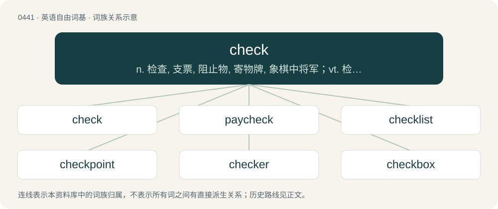

# 0506 · check — n. 检查, 支票, 阻止物, 寄物牌, 象棋中将军；vt. 检查, 阻止, 核对, 寄存, 托运；vi. 逐项相符, 开支票

[总目录](../00_总目录_按常用程度.md)

**类型**：英语自由词基　｜　**来源语言**：见词源记录

## 核心含义与来源

- 核心含义：n. 检查, 支票, 阻止物, 寄物牌, 象棋中将军；vt. 检查, 阻止, 核对, 寄存, 托运；vi. 逐项相符, 开支票
- 英文含义：An inspection or examination.
- 词形：check

**多个词源／构词路径**：同一拼写可能有不同来源；以下按词性和含义分别列出。

**来源记录 1**（名词；An inspection or examination.）

From Middle English chek, chekke, borrowed from Old French eschec, eschek, eschac, from Medieval Latin scaccus, borrowed from Arabic شَاه (šāh, “king or check at chess, shah”), borrowed from Classical Persian شَاه (šāh, “king”), from Middle Persian 𐭬𐭫𐭪𐭠 (mlkʾ /⁠šāh⁠/), from Old Persian 𐏋 (XŠ /⁠xšāyaθiya⁠/, “king”), from Proto-Indo-Iranian \*kšáyati (“he rules, he has power over”), ultimately from Proto-Indo-European \*tek- (“to gain power over, gain control over”). Compare Saterland Frisian Schak, Schach, Dutch schaak, German Schach, Danish skak, Swedish schack, Icelandic skák, French échec, Italian scacco. Doublet of chess and shah (“king of Persia or Iran”), from the same source, as well as thig, which derives from the Germanic cognate. All of the English senses developed from the chess sense.

**来源记录 2**（动词；To inspect; to examine.）

From Middle English chekken, partly from Old French eschequier and partly from the noun (see above).

**来源记录 3**（名词；A pattern made up of a grid of squares of alternating colors; a checkered pattern.）

By shortening from chequer, from Old French eschequier (“chessboard”), from Medieval Latin scaccarium, ultimately from the same Persian root as above.

## 词族图

## 单词速览（常用到不常用）

| 单词 | 音标 | 释义 |
|---|---|---|
| [check](#w-1) | /t͡ʃɛk/ | n. 检查, 支票, 阻止物, 寄物牌, 象棋中将军；vt. 检查, 阻止, 核对, 寄存, 托运；vi. 逐项相符, 开支票 |
| [paycheck](#w-2) | 英 /ˈpeɪ.t͡ʃɛk/ | n. 付薪水的支票, 薪水 |
| [checklist](#w-3) | /ˈt͡ʃɛklɪst/ | n. 清单, (美)选举人名单, 名册, 目录册 |
| [checkpoint](#w-4) | 美 /ˈt͡ʃɛkˌpɔɪnt/ | n. 检查站；\[计\] 检查点 |
| [checker](#w-5) | 英 /ˈtʃɛkə/；美 /ˈt͡ʃɛkɚ/ | n. 制止者, 查对者, 阻止者；\[计\] 检查程序, 检验程序, 检验器, 西洋跳棋 |
| [checkbox](#w-6) | 英 /ˈtʃɛkbɒks/；美 /ˈt͡ʃɛkbɑks/ | 检验栏, 检验盒 |
| [recheck](#w-7) | /ˈriːˈtʃek/ | \[计\] 复查；\[化\] 复验 |
| [checksum](#w-8) |  | \[计\] 检查和, 检验和 |
| [uncheck](#w-9) | /ʌnˈt͡ʃɛk/ | 未寄存 |
| [soundcheck](#w-10) |  | （对录音或音响设备的）校音 |
| [checkmark](#w-11) | /ˈtʃek,maːk/ | n. 选择目录；检查标志；注销记录 |

## 逐词详解

### 1. check

**词性**：名词　｜　**音标**：/t͡ʃɛk/

**中文释义**：n. 检查, 支票, 阻止物, 寄物牌, 象棋中将军；vt. 检查, 阻止, 核对, 寄存, 托运；vi. 逐项相符, 开支票

**英文义项**：An inspection or examination. / A control; a limit or stop.

**词源与演化**：

From Middle English chek, chekke, borrowed from Old French eschec, eschek, eschac, from Medieval Latin scaccus, borrowed from Arabic شَاه (šāh, “king or check at chess, shah”), borrowed from Classical Persian شَاه (šāh, “king”), from Middle Persian 𐭬𐭫𐭪𐭠 (mlkʾ /⁠šāh⁠/), from Old Persian 𐏋 (XŠ /⁠xšāyaθiya⁠/, “king”), from Proto-Indo-Iranian \*kšáyati (“he rules, he has power over”), ultimately from Proto-Indo-European \*tek- (“to gain power over, gain control over”). Compare Saterland Frisian Schak, Schach, Dutch schaak, German Schach, Danish skak, Swedish schack, Icelandic skák, French échec, Italian scacco. Doublet of chess and shah (“king of Persia or Iran”), from the same source, as well as thig, which derives from the Germanic cognate. All of the English senses developed from the chess sense.

**例句**：

> I summoned the waiter, paid the check, and hurried to leave.

该用例对应义项：A bill, particularly in a restaurant.

### 2. paycheck

**词性**：名词　｜　**音标**：英 /ˈpeɪ.t͡ʃɛk/

**中文释义**：n. 付薪水的支票, 薪水

**英文义项**：A periodic payment, usually in the form of a paper check, received by an employee from an employer for work performed.

**构词拆分**：From pay (“wages or salary”) + check (“a means of payment”).

**词源与演化**：

From pay (“wages or salary”) + check (“a means of payment”).

**例句**：

> He was delighted after getting his first paycheck, but subsequently blew it all on the horses.

该用例对应义项：A periodic payment, usually in the form of a paper check, received by an employee from an employer for work performed.

### 3. checklist

**词性**：名词　｜　**音标**：/ˈt͡ʃɛklɪst/

**中文释义**：n. 清单, (美)选举人名单, 名册, 目录册

**英文义项**：A list of tasks to be completed, names to be consulted, conditions to be verified and similar. / An inventory, especially of species.

**构词拆分**：check + list

**词源与演化**：

From check + list.

**用法示例／搭配（非完整句）**：

> a checklist of the plants of the Guiana Shield

该用例对应义项：An inventory, especially of species.

### 4. checkpoint

**词性**：名词　｜　**音标**：美 /ˈt͡ʃɛkˌpɔɪnt/

**中文释义**：n. 检查站；\[计\] 检查点

**英文义项**：A point or place where a check is performed, especially a point along a road or on a frontier where travellers are stopped for inspection. / A situation, often represented by a point in time, at which the state of a database system is known to be valid, and to which it can be returned in the event of a crisis by using a combination of backups and logs; the data stored at this event.

**构词拆分**：check + point

**词源与演化**：

From check + point.

**例句**：

> You can't finish the race if you haven't passed all of the checkpoints on the track.

该用例对应义项：A predetermined point in a map, level or scenario that the player may resume from if they die or restart.

### 5. checker

**词性**：名词　｜　**音标**：英 /ˈtʃɛkə/；美 /ˈt͡ʃɛkɚ/

**中文释义**：n. 制止者, 查对者, 阻止者；\[计\] 检查程序, 检验程序, 检验器, 西洋跳棋

**英文义项**：One who or that which checks or verifies something. / One who makes a check mark.

**构词拆分**：check + -er

**词源与演化**：

From check + -er.

**例句**：

> There was a long line at the grocery store because the checker was so slow.

该用例对应义项：The clerk who tallies cost of purchases and accepts payment.

### 6. checkbox

**词性**：名词　｜　**音标**：英 /ˈtʃɛkbɒks/；美 /ˈt͡ʃɛkbɑks/

**中文释义**：检验栏, 检验盒

**英文义项**：A space on a paper form that can be optionally filled with a check mark. / An on-screen box that can be optionally filled with a check mark, to enable or disable a setting.

**构词拆分**：check + box

**词源与演化**：

From check + box.

### 7. recheck

**词性**：名词　｜　**音标**：/ˈriːˈtʃek/

**中文释义**：\[计\] 复查；\[化\] 复验

**英文义项**：The act of checking again; reverification.

**构词拆分**：re- + check

**词源与演化**：

From re- + check.

**例句**：

> The article needed a complete recheck.

该用例对应义项：The act of checking again; reverification.

### 8. checksum

**词性**：名词

**中文释义**：\[计\] 检查和, 检验和

**英文义项**：A number, derived by applying a suitable algorithm to some data, used to check whether errors have occurred in transmission, storage or data entry.

**构词拆分**：check + sum

**词源与演化**：

From check + sum.

### 9. uncheck

**词性**：动词　｜　**音标**：/ʌnˈt͡ʃɛk/

**中文释义**：未寄存

**英文义项**：To remove a checkmark. / To remove a previously checked-in passenger from the check-in system, allowing changes to the ticket.

**构词拆分**：From un- + check.

**词源与演化**：

From un- + check.

**例句**：

> Uncheck the “save my password” box.

该用例对应义项：To remove a checkmark.

### 10. soundcheck

**词性**：名词

**中文释义**：（对录音或音响设备的）校音

**英文义项**：An activity that takes place before a concert, etc., when the performer and sound crew run through a small portion of the upcoming show on the venue's sound system to verify the volume and tonal frequencies.

**构词拆分**：sound + check

**词源与演化**：

From sound + check.

**例句**：

> The band is doing a soundcheck.

### 11. checkmark

**词性**：动词　｜　**音标**：/ˈtʃek,maːk/

**中文释义**：n. 选择目录；检查标志；注销记录

**英文义项**：To mark with a ✓ symbol; to tick.

**构词拆分**：From check + mark.

**词源与演化**：

From check + mark.

**例句**：

> A double checkmark indicates that the message has been read by the recipient.
