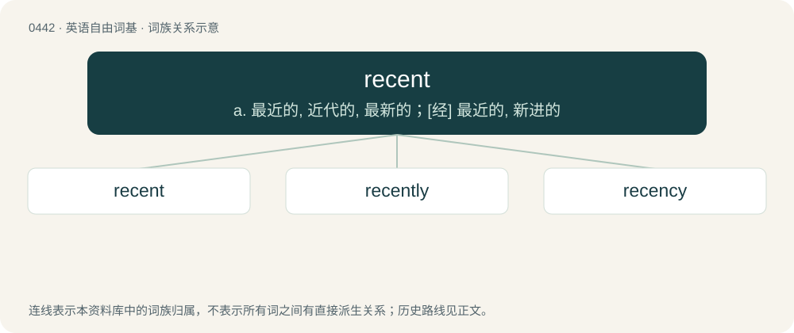

# 0507 · recent — a. 最近的, 近代的, 最新的；\[经\] 最近的, 新进的

[总目录](../00_总目录_按常用程度.md)

**类型**：英语自由词基　｜　**来源语言**：见词源记录

## 核心含义与来源

- 核心含义：a. 最近的, 近代的, 最新的；\[经\] 最近的, 新进的
- 英文含义：Having happened a short while ago.
- 词形：recent

**来源记录 1**（形容词；Having happened a short while ago.）

Borrowed from Latin recēns (genitive recentis).

## 词族图

## 单词速览（常用到不常用）

| 单词 | 音标 | 释义 |
|---|---|---|
| [recent](#w-1) | 英 /ˈɹiː.sənt/；美 /ˈɹi.sənt/ | a. 最近的, 近代的, 最新的；\[经\] 最近的, 新进的 |
| [recently](#w-2) | 英 /ˈɹiːsənt.li/；美 /ˈɹi.sənt.li/ | adv. 最近 |
| [recency](#w-3) | /ˈɹiːsənsi/ | n. 崭新, 新近 |

## 逐词详解

### 1. recent

**词性**：形容词　｜　**音标**：英 /ˈɹiː.sənt/；美 /ˈɹi.sənt/

**中文释义**：a. 最近的, 近代的, 最新的；\[经\] 最近的, 新进的

**英文义项**：Having happened a short while ago. / Up-to-date; not old-fashioned or dated.

**词源与演化**：

Borrowed from Latin recēns (genitive recentis).

**例句**：

> I met three recent graduates at the conference.

该用例对应义项：Having done something a short while ago that distinguishes them as what they are called.

### 2. recently

**词性**：副词　｜　**音标**：英 /ˈɹiːsənt.li/；美 /ˈɹi.sənt.li/

**中文释义**：adv. 最近

**英文义项**：a short while ago. / in recent times.

**构词拆分**：recent + -ly

**词源与演化**：

From recent + -ly.

**例句**：

> My recently published book about the life stories of recently-arrived immigrants.

该用例对应义项：a short while ago.

### 3. recency

**词性**：名词　｜　**音标**：/ˈɹiːsənsi/

**中文释义**：n. 崭新, 新近

**英文义项**：The property of being recent; newness.

**构词拆分**：recent + -cy

**词源与演化**：

From Latin recentia, from recens, equivalent to recent + -cy. See recent.

**例句**：

> Due to its recency, there are no used parts available for this model.

该用例对应义项：The property of being recent; newness.
