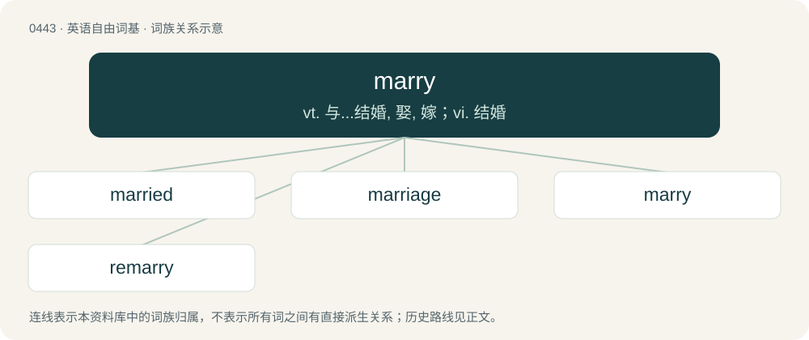

# 0508 · marry — vt. 与...结婚, 娶, 嫁；vi. 结婚

[总目录](../00_总目录_按常用程度.md)

**类型**：英语自由词基　｜　**来源语言**：见词源记录

## 核心含义与来源

- 核心含义：vt. 与...结婚, 娶, 嫁；vi. 结婚
- 英文含义：To enter into the conjugal or connubial state; to take a husband or a wife.
- 词形：marry

**来源记录 1**（动词；To enter into the conjugal or connubial state; to take a husband or a wife.）

From Middle English marien, from Anglo-Norman marïer, from Latin marītāre (“to wed”), from marītus (“husband, suitor”), from mās (“man, male”), of uncertain origin. Possibly from Proto-Indo-European \*méryos (“young man”), same source as Sanskrit मर्य (márya, “suitor, young man”). Compare its feminine derivatives: Welsh morwyn (“girl”), merch (“daughter”), Crimean Gothic marzus (“wedding”), Ancient Greek μεῖραξ (meîrax, “boy; girl”), Lithuanian marti̇̀ (“bride”), Avestan 𐬨𐬀𐬌𐬭𐬌𐬌𐬀 (maⁱriia, “yeoman”).) Displaced native Old English hīwian.

## 词族图

## 单词速览（常用到不常用）

| 单词 | 音标 | 释义 |
|---|---|---|
| [married](#w-1) | 英 /ˈmæɹ.ɪd/；/ˈmæɹ.id/ | a. 已婚的, 婚姻的；\[法\] 结了婚的, 有配偶的, 夫妇的 |
| [marriage](#w-2) | 英 /ˈmæɹɪd͡ʒ/；/ˈmæɹɪd͡ʒ/ | n. 婚姻, 结婚, 婚礼, 合并；\[医\] 婚姻, 结婚 |
| [marry](#w-3) | 英 /ˈmæɹi/；/ˈmæɹi/ | vt. 与...结婚, 娶, 嫁；vi. 结婚 |
| [remarry](#w-4) | 英 /ɹiːˈmæɹi/ | v. (使)再婚 |

## 逐词详解

### 1. married

**词性**：形容词　｜　**音标**：英 /ˈmæɹ.ɪd/；/ˈmæɹ.id/

**中文释义**：a. 已婚的, 婚姻的；\[法\] 结了婚的, 有配偶的, 夫妇的

**英文义项**：In a state of marriage; having a wife or a husband. / Showing commitment or devotion normally reserved for a spouse; strongly committed or attached to something.

**构词拆分**：marry + -ed

**词源与演化**：

From Middle English maried, imaried, mariet, past participle of Middle English marien (“to marry”), equivalent to marry + -ed.

**例句**：

> Yes, I drafted the business proposal, but I'm not married to it, so it's okay if the board doesn't approve it.

该用例对应义项：Showing commitment or devotion normally reserved for a spouse; strongly committed or attached to something.

### 2. marriage

**词性**：名词　｜　**音标**：英 /ˈmæɹɪd͡ʒ/；/ˈmæɹɪd͡ʒ/

**中文释义**：n. 婚姻, 结婚, 婚礼, 合并；\[医\] 婚姻, 结婚

**英文义项**：The state of being married. / A union of two or more people that creates a family tie and carries legal, social, or religious rights and responsibilities.

**构词拆分**：marry + -age

**词源与演化**：

From Middle English mariage, from Old French mariage, from marier (“to marry”), from Latin marītō (“marry”, verb, literally “give in marriage”), from marītus (“lover”, “nuptial”), from mas (“male, masculine, of the male sex”). Equivalent to marry + -age. Doublet of maritage. Displaced native Old English sinsċipe.

**例句**：

> You are cordially invited to the marriage of James Smith and Jane Doe.

该用例对应义项：A wedding; a ceremony in which people wed.

### 3. marry

**词性**：动词　｜　**音标**：英 /ˈmæɹi/；/ˈmæɹi/

**中文释义**：vt. 与...结婚, 娶, 嫁；vi. 结婚

**英文义项**：To enter into the conjugal or connubial state; to take a husband or a wife. / To enter into marriage with one another.

**词源与演化**：

From Middle English marien, from Anglo-Norman marïer, from Latin marītāre (“to wed”), from marītus (“husband, suitor”), from mās (“man, male”), of uncertain origin. Possibly from Proto-Indo-European \*méryos (“young man”), same source as Sanskrit मर्य (márya, “suitor, young man”). Compare its feminine derivatives: Welsh morwyn (“girl”), merch (“daughter”), Crimean Gothic marzus (“wedding”), Ancient Greek μεῖραξ (meîrax, “boy; girl”), Lithuanian marti̇̀ (“bride”), Avestan 𐬨𐬀𐬌𐬭𐬌𐬌𐬀 (maⁱriia, “yeoman”).) Displaced native Old English hīwian.

**例句**：

> The attempt to marry medieval plainsong with speed metal produced interesting results.

该用例对应义项：To unite; to join together into a close union.

### 4. remarry

**词性**：动词　｜　**音标**：英 /ɹiːˈmæɹi/

**中文释义**：v. (使)再婚

**英文义项**：To marry a second or subsequent time (the same spouse or a different one) after the end of a marriage.

**构词拆分**：re- + marry

**词源与演化**：

From re- + marry.

**例句**：

> This church will remarry widows or widowers, but not divorcés.

该用例对应义项：To marry a second or subsequent time (the same spouse or a different one) after the end of a marriage.
