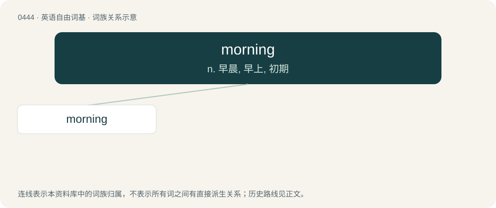

# 0509 · morning — n. 早晨, 早上, 初期

[总目录](../00_总目录_按常用程度.md)

**类型**：英语自由词基　｜　**来源语言**：见词源记录

## 核心含义与来源

- 核心含义：n. 早晨, 早上, 初期
- 英文含义：The early part of the day, especially from midnight to noon.
- 词形：morning

**来源记录 1**（名词；The early part of the day, especially from midnight to noon.）

From Middle English morwenynge, from morwen + -ynge. By surface analysis, morn + -ing. See also morrow (Middle English morwe).

## 词族图

## 单词速览（常用到不常用）

| 单词 | 音标 | 释义 |
|---|---|---|
| [morning](#w-1) | 英 /ˈmɔːnɪŋ/；美 /ˈmoɹnɪŋ/ | n. 早晨, 早上, 初期 |

## 逐词详解

### 1. morning

**词性**：名词　｜　**音标**：英 /ˈmɔːnɪŋ/；美 /ˈmoɹnɪŋ/

**中文释义**：n. 早晨, 早上, 初期

**英文义项**：The early part of the day, especially from midnight to noon. / The early part of anything.

**词源与演化**：

From Middle English morwenynge, from morwen + -ynge. By surface analysis, morn + -ing. See also morrow (Middle English morwe).

**例句**：

> I'm working in the morning, so let's meet in the afternoon.

该用例对应义项：The early part of the day, especially from midnight to noon.
