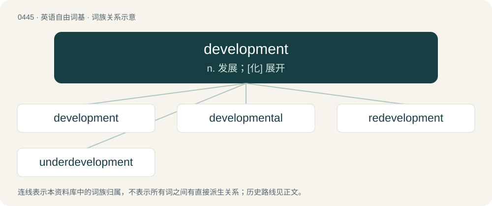

# 0510 · development — n. 发展；\[化\] 展开

[总目录](../00_总目录_按常用程度.md)

**类型**：英语自由词基　｜　**来源语言**：见词源记录

## 核心含义与来源

- 核心含义：n. 发展；\[化\] 展开
- 英文含义：The process of developing; growth, directed change.
- 词形：development

**来源记录 1**（名词；The process of developing; growth, directed change.）

From French développement, from Old French desvelopemens (“unrolling”). By surface analysis, develop + -ment. First attested in 1756.

## 词族图

## 单词速览（常用到不常用）

| 单词 | 音标 | 释义 |
|---|---|---|
| [development](#w-1) | 英 /dɪˈvɛl.əp.mənt/ | n. 发展；\[化\] 展开 |
| [developmental](#w-2) | /dɪˌvɛləpˈmɛntəl/ | a. 发展的, 进化的, 启发的；\[医\] 发育的 |
| [redevelopment](#w-3) |  | n. 再开发；重点恢复 |
| [underdevelopment](#w-4) | /,ʌndədiˈveləpmənt/ | n. 发展不充分, 不发达, 显影不足；\[医\] 显影不足; 发育不全 |

## 逐词详解

### 1. development

**词性**：名词　｜　**音标**：英 /dɪˈvɛl.əp.mənt/

**中文释义**：n. 发展；\[化\] 展开

**英文义项**：The process of developing; growth, directed change. / The process by which a mature multicellular organism or part of an organism is produced by the addition of new cells.

**词源与演化**：

From French développement, from Old French desvelopemens (“unrolling”). By surface analysis, develop + -ment. First attested in 1756.

**例句**：

> White's development is good, but black's has been hampered by the pawn on e5.

该用例对应义项：The active placement of the pieces, or the process of achieving it.

### 2. developmental

**词性**：形容词　｜　**音标**：/dɪˌvɛləpˈmɛntəl/

**中文释义**：a. 发展的, 进化的, 启发的；\[医\] 发育的

**英文义项**：Related to development.

**构词拆分**：development + -al

**词源与演化**：

From development + -al.

**例句**：

> Developmental psychology studies how the mind forms as children and adolescents grow.

该用例对应义项：Related to development.

### 3. redevelopment

**词性**：名词

**中文释义**：n. 再开发；重点恢复

**英文义项**：The process of developing something anew. / The demolition of old, redundant or unfashionable buildings or infrastructure and the construction of new ones on the same site.

**构词拆分**：re- + development

**词源与演化**：

From re- + development.

**用法示例／搭配（非完整句）**：

> the redevelopment of the hero's character in a comic book

该用例对应义项：The process of developing something anew.

### 4. underdevelopment

**词性**：名词　｜　**音标**：/,ʌndədiˈveləpmənt/

**中文释义**：n. 发展不充分, 不发达, 显影不足；\[医\] 显影不足; 发育不全

**英文义项**：The condition of being underdeveloped.

**构词拆分**：under- + development

**词源与演化**：

From under- + development.

**例句**：

> How is Algeria fighting its way out of underdevelopment?
