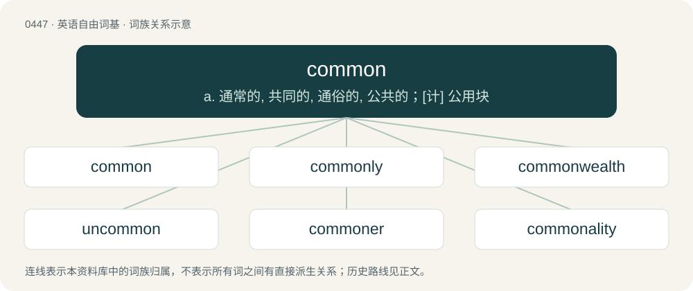

# 0511 · common — a. 通常的, 共同的, 通俗的, 公共的；\[计\] 公用块

[总目录](../00_总目录_按常用程度.md)

**类型**：英语自由词基　｜　**来源语言**：见词源记录

## 核心含义与来源

- 核心含义：a. 通常的, 共同的, 通俗的, 公共的；\[计\] 公用块
- 英文含义：Mutual; shared by more than one.
- 词形：common

**来源记录 1**（形容词；Mutual; shared by more than one.）

From Middle English comun, from Anglo-Norman comun, from Old French comun (rare in the Gallo-Romance languages, but reinforced as a Carolingian calque of Proto-West Germanic \*gamainī (“common”) in Old French), from Latin commūnis (“common, public, general”), from Proto-Indo-European \*ḱom-moy-ni-s (“held in common”), from Proto-Indo-European \*mey- (“to exchange, change”). Displaced native Middle English imene, ȝemǣne (“common, general, universal”) (from Old English ġemǣne (“common, universal”)), Middle English mene, mǣne (“mean, common”) (also from Old English ġemǣne (“common, universal”)), Middle English samen, somen (“in common, together”) (from Old English samen (“together”)). Doublet of gmina and mean.

## 词族图

## 单词速览（常用到不常用）

| 单词 | 音标 | 释义 |
|---|---|---|
| [common](#w-1) | 英 /ˈkɒmən/；美 /ˈkɑmən/ | a. 通常的, 共同的, 通俗的, 公共的；\[计\] 公用块 |
| [commonly](#w-2) | 英 /ˈkɒmənli/；美 /ˈkɑmənli/ | adv. 一般, 普通, 通常 |
| [commonwealth](#w-3) | 英 /ˈkɒmənˌwɛlθ/；美 /ˈkɑmənˌwɛlθ/ | n. 共和国；联邦；国民整体 |
| [uncommon](#w-4) | /ʌnˈkɒmən/ | a. 不寻常的, 非凡的, 罕有的；adv. 不平常地 |
| [commoner](#w-5) | 英 /ˈkɒm.ə.nə(ɹ)/；美 /ˈkɑ.mə.nɚ/ | n. 平民, 自费学生, 有共用权的人；\[法\] 平民, 下议院议员, 有共有权的人 |
| [commonality](#w-6) | 英 /ˌkɒm.əˈnæl.ɪ.ti/；美 /ˌkɑ.məˈnæl.ə.ti/ | n. 共同特性, 平民百姓 |

## 逐词详解

### 1. common

**词性**：形容词　｜　**音标**：英 /ˈkɒmən/；美 /ˈkɑmən/

**中文释义**：a. 通常的, 共同的, 通俗的, 公共的；\[计\] 公用块

**英文义项**：Mutual; shared by more than one. / Existing among virtually all people; universal.

**词源与演化**：

From Middle English comun, from Anglo-Norman comun, from Old French comun (rare in the Gallo-Romance languages, but reinforced as a Carolingian calque of Proto-West Germanic \*gamainī (“common”) in Old French), from Latin commūnis (“common, public, general”), from Proto-Indo-European \*ḱom-moy-ni-s (“held in common”), from Proto-Indo-European \*mey- (“to exchange, change”). Displaced native Middle English imene, ȝemǣne (“common, general, universal”) (from Old English ġemǣne (“common, universal”)), Middle English mene, mǣne (“mean, common”) (also from Old English ġemǣne (“common, universal”)), Middle English samen, somen (“in common, together”) (from Old English samen (“together”)). Doublet of gmina and mean.

**例句**：

> "Commoner" used to be commoner, but "more common" is now more common.

该用例对应义项：Found in large numbers or in a large quantity; usual.

### 2. commonly

**词性**：副词　｜　**音标**：英 /ˈkɒmənli/；美 /ˈkɑmənli/

**中文释义**：adv. 一般, 普通, 通常

**英文义项**：As a rule; frequently; usually.

**构词拆分**：common + -ly

**词源与演化**：

Inherited from Middle English comunly; equivalent to common + -ly.

**例句**：

> Sami began to move into what we commonly call a mid-life crisis.

### 3. commonwealth

**词性**：名词　｜　**音标**：英 /ˈkɒmənˌwɛlθ/；美 /ˈkɑmənˌwɛlθ/

**中文释义**：n. 共和国；联邦；国民整体

**英文义项**：The entirety of a (secular) society, a polity, a state. / Republic. Often capitalized, as Commonwealth.

**构词拆分**：common (“public”) + wealth (“well-being”)

**词源与演化**：

From common (“public”) + wealth (“well-being”). From c. 1450 as common wele (commonweal). In the form common-wealth (common welthe) from c. 1520, used by Tyndale in the sense "secular society" in particular, for which other authors preferred publike weal. Also from the 1520s treated as a synonym or loan-translation of res publica (republic) (Rollison 2017:67f).

**例句**：

> The British Commonwealth of Nations is unable to let go of power.

### 4. uncommon

**词性**：形容词　｜　**音标**：/ʌnˈkɒmən/

**中文释义**：a. 不寻常的, 非凡的, 罕有的；adv. 不平常地

**英文义项**：Rare; not readily found; unusual. / Remarkable; exceptional.

**构词拆分**：un- + common

**词源与演化**：

From un- + common.

**例句**：

> Bald eagles are an uncommon sighting in this state.

该用例对应义项：Rare; not readily found; unusual.

### 5. commoner

**词性**：名词　｜　**音标**：英 /ˈkɒm.ə.nə(ɹ)/；美 /ˈkɑ.mə.nɚ/

**中文释义**：n. 平民, 自费学生, 有共用权的人；\[法\] 平民, 下议院议员, 有共有权的人

**英文义项**：A member of the common people who holds no title or rank. / Someone who is not of noble rank.

**构词拆分**：common + -er

**词源与演化**：

From Middle English comoner, comyner, cumuner, equivalent to common + -er.

**例句**：

> One of England's kings abdicated the throne in order to marry a commoner.

### 6. commonality

**词性**：名词　｜　**音标**：英 /ˌkɒm.əˈnæl.ɪ.ti/；美 /ˌkɑ.məˈnæl.ə.ti/

**中文释义**：n. 共同特性, 平民百姓

**英文义项**：The joint possession of a set of attributes or characteristics. / Such a shared attribute or characteristic

**构词拆分**：common + -ality

**词源与演化**：

From common + -ality.
