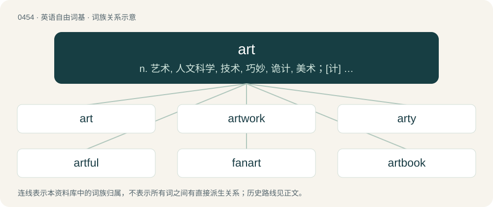

# 0512 · art — n. 艺术, 人文科学, 技术, 巧妙, 诡计, 美术；\[计\] 实际保持时间, 特许权和资源表, 平均检索时间, 平均运行时间

[总目录](../00_总目录_按常用程度.md)

**类型**：英语自由词基　｜　**来源语言**：见词源记录

## 核心含义与来源

- 核心含义：n. 艺术, 人文科学, 技术, 巧妙, 诡计, 美术；\[计\] 实际保持时间, 特许权和资源表, 平均检索时间, 平均运行时间
- 英文含义：The conscious production or arrangement of sounds, colours, forms, movements, or other elements in a manner that affects the senses and emotions, usually specifically the production of the beautiful in a graphic or plastic medium.
- 词形：art

**来源记录 1**（名词；The conscious production or arrangement of sounds, colours, forms, movements, or other elements in a manner that affects the senses and emotions, usually specifically the production of the beautiful in a graphic or plastic medium.）

From Middle English art, from Old French art, from Latin artem, accusative of ars (“art”). Partly displaced native Old English cræft, whence Modern English craft. See also archaic English list (“art, craft, cunning, skill”).

## 词族图

## 单词速览（常用到不常用）

| 单词 | 音标 | 释义 |
|---|---|---|
| [art](#w-1) | 英 /ɑːt/；美 /ɑɹt/ | n. 艺术, 人文科学, 技术, 巧妙, 诡计, 美术；\[计\] 实际保持时间, 特许权和资源表, 平均检索时间, 平均运行时间 |
| [artwork](#w-2) | 英 /ˈɑːtˌwɜːk/；美 /ˈɑɹtˌwɝk/ | n. 插图, 艺术作品；\[计\] 原图 |
| [arty](#w-3) | /ˈɑː(ɹ)ti/ | a. 装作爱好艺术的, 附庸风雅的 |
| [artful](#w-4) | 美 /ˈɑːtf(ʊ)l/ | a. 巧妙的, 狡猾的 |
| [fanart](#w-5) | 英 /ˈfænˌɑːt/；美 /ˈfænˌɑɹt/ | 【英文】Artwork created unofficially by fans of a media work and based on that work. |
| [artbook](#w-6) |  | 【英文】A book about art, particularly concept art for an animated media production. |
| [artless](#w-7) | /ˈɑɹt.lɪs/ | a. 无虚饰的, 单纯的, 自然的 |

## 逐词详解

### 1. art

**词性**：名词　｜　**音标**：英 /ɑːt/；美 /ɑɹt/

**中文释义**：n. 艺术, 人文科学, 技术, 巧妙, 诡计, 美术；\[计\] 实际保持时间, 特许权和资源表, 平均检索时间, 平均运行时间

**英文义项**：The conscious production or arrangement of sounds, colours, forms, movements, or other elements in a manner that affects the senses and emotions, usually specifically the production of the beautiful in a graphic or plastic medium. / The creative and emotional expression of mental imagery, such as visual, auditory, social, etc.

**词源与演化**：

From Middle English art, from Old French art, from Latin artem, accusative of ars (“art”). Partly displaced native Old English cræft, whence Modern English craft. See also archaic English list (“art, craft, cunning, skill”).

**例句**：

> There is a debate as to whether graffiti is art or vandalism.

该用例对应义项：The conscious production or arrangement of sounds, colours, forms, movements, or other elements in a manner that affects the senses and emotions, usually specifically the production of the beautiful in a graphic or plastic medium.

### 2. artwork

**词性**：名词　｜　**音标**：英 /ˈɑːtˌwɜːk/；美 /ˈɑɹtˌwɝk/

**中文释义**：n. 插图, 艺术作品；\[计\] 原图

**英文义项**：A painting, drawing, sculpture or other piece of creative, visual art. / Artistic work.

**构词拆分**：art + -work

**词源与演化**：

From art + -work.

**例句**：

> A myriad of Hellenic artworks reflects the perceptions of the citizens of Ancient Greece.

该用例对应义项：A painting, drawing, sculpture or other piece of creative, visual art.

### 3. arty

**词性**：形容词　｜　**音标**：/ˈɑː(ɹ)ti/

**中文释义**：a. 装作爱好艺术的, 附庸风雅的

**英文义项**：Inclined towards the arts. / Pretending to artistic worth; high-flown.

**构词拆分**：art + -y

**词源与演化**：

From art + -y.

**例句**：

> Movies by Greenaway are all noticeably arty.

### 4. artful

**词性**：形容词　｜　**音标**：美 /ˈɑːtf(ʊ)l/

**中文释义**：a. 巧妙的, 狡猾的

**英文义项**：Characterized by, or performed with, cleverness or contrivance; clever, ingenious. / Not naturally produced; artificial; imitative.

**构词拆分**：art (“skill that is attained by study, practice, or observation”) + -ful (suffix forming adjectives from nouns, with the sense of being full of, tending to, or thoroughly possessing the quality expressed by the noun)

**词源与演化**：

From art (“skill that is attained by study, practice, or observation”) + -ful (suffix forming adjectives from nouns, with the sense of being full of, tending to, or thoroughly possessing the quality expressed by the noun).

**例句**：

> An artful choice of metaphors.

该用例对应义项：marked by skill in achieving a desired end especially with cunning or craft

### 5. fanart

**词性**：名词　｜　**音标**：英 /ˈfænˌɑːt/；美 /ˈfænˌɑɹt/

**英文义项**：Artwork created unofficially by fans of a media work and based on that work.

**构词拆分**：fan + art

**词源与演化**：

From fan + art.

### 6. artbook

**词性**：名词

**英文义项**：A book about art, particularly concept art for an animated media production. / A book containing art.

**构词拆分**：art + book

**词源与演化**：

From art + book.

### 7. artless

**词性**：形容词　｜　**音标**：/ˈɑɹt.lɪs/

**中文释义**：a. 无虚饰的, 单纯的, 自然的

**英文义项**：Having or displaying no guile, cunning, or deceit. / Free of artificiality; natural.

**构词拆分**：art + -less

**词源与演化**：

From art + -less.

**例句**：

> This pendant has artless charm.

该用例对应义项：Free of artificiality; natural.
