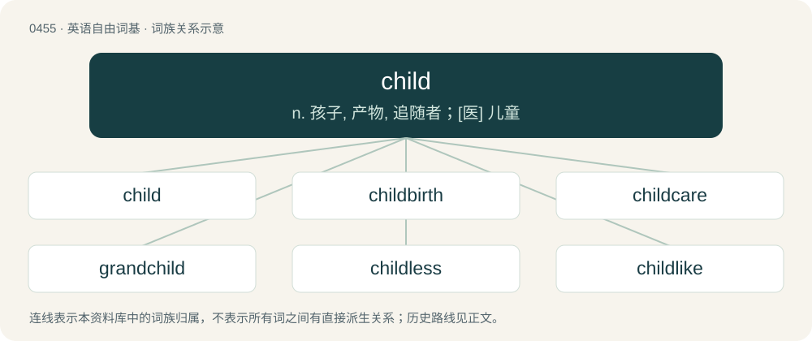

# 0514 · child — n. 孩子, 产物, 追随者；\[医\] 儿童

[总目录](../00_总目录_按常用程度.md)

**类型**：英语自由词基　｜　**来源语言**：见词源记录

## 核心含义与来源

- 核心含义：n. 孩子, 产物, 追随者；\[医\] 儿童
- 英文含义：A person who has not yet reached adulthood, whether natural (puberty), cultural (initiation), or legal (majority).
- 词形：child

**来源记录 1**（名词；A person who has not yet reached adulthood, whether natural (puberty), cultural (initiation), or legal (majority).）

From Middle English child, from Old English ċild, from Proto-West Germanic \*kilþ, \*kelþ, from Proto-Germanic \*kelþaz (“womb; fetus”), from Proto-Indo-European \*ǵelt- (“womb”), perhaps from Proto-Indo-European \*gel- (“to ball up, amass”). Cognate with Danish kuld (“brood, litter”), Swedish kull (“brood, litter”), Icelandic kelta, kjalta (“lap”), Gothic 𐌺𐌹𐌻𐌸𐌴𐌹 (kilþei, “womb”), Sanskrit जर्त (jarta), जर्तु (jártu, “vulva”).

## 词族图

## 单词速览（常用到不常用）

| 单词 | 音标 | 释义 |
|---|---|---|
| [child](#w-1) | 英 /tʃaɪld/ | n. 孩子, 产物, 追随者；\[医\] 儿童 |
| [childbirth](#w-2) | 美 /ˈt͡ʃaɪldˌbɝθ/ | n. 分娩；\[医\] 分娩, 生产 |
| [childcare](#w-3) | /ˈtʃaildkεə/ | n. 儿童照管；儿童保育 |
| [grandchild](#w-4) | /ˈɡɹændˌtʃaɪld/ | n. 孙, 外孙女, 外孙, 孙女, 孙子 |
| [childless](#w-5) | /ˈtʃaildlis/ | a. 无儿女的 |
| [childlike](#w-6) | /ˈt͡ʃaɪldlaɪk/ | a. 孩子似的, 天真烂漫的 |
| [brainchild](#w-7) | 英 /ˈbɹeɪnt͡ʃaɪld/；美 /ˈbɹeɪnˌt͡ʃaɪld/ | n. 脑力劳动的产物 |
| [childbearing](#w-8) | /ˈtʃaildbєəriŋ/ | n. 分娩；\[医\] 分娩, 生产 |
| [stepchild](#w-9) | /ˈstɛp.tʃaɪld/ | n. 前夫(或前妻)所生子女；\[法\] 妻与前夫所生的孩子, 继子女 |
| [childline](#w-10) |  | 【英文】A telephone counselling service for children and young people. |

## 逐词详解

### 1. child

**词性**：名词　｜　**音标**：英 /tʃaɪld/

**中文释义**：n. 孩子, 产物, 追随者；\[医\] 儿童

**英文义项**：A person who has not yet reached adulthood, whether natural (puberty), cultural (initiation), or legal (majority). / A youth aged 1 to 9 years, whereas neonates are aged 0 to 1 month, infants are aged 1 to 12 months, and adolescents are aged 10 to 20 years.

**词源与演化**：

From Middle English child, from Old English ċild, from Proto-West Germanic \*kilþ, \*kelþ, from Proto-Germanic \*kelþaz (“womb; fetus”), from Proto-Indo-European \*ǵelt- (“womb”), perhaps from Proto-Indo-European \*gel- (“to ball up, amass”). Cognate with Danish kuld (“brood, litter”), Swedish kull (“brood, litter”), Icelandic kelta, kjalta (“lap”), Gothic 𐌺𐌹𐌻𐌸𐌴𐌹 (kilþei, “womb”), Sanskrit जर्त (jarta), जर्तु (jártu, “vulva”).

**例句**：

> My husband is such a child, going out with his sled everytime it snows.

该用例对应义项：An adult or adolescent with childish or stupid behaviors.

### 2. childbirth

**词性**：名词　｜　**音标**：美 /ˈt͡ʃaɪldˌbɝθ/

**中文释义**：n. 分娩；\[医\] 分娩, 生产

**英文义项**：The fact or action of giving birth to a child, as the culmination of pregnancy; the process by which it happens.

**构词拆分**：child + birth

**词源与演化**：

From Middle English childbyrth \[and other forms\], perhaps a partial calque of Old Norse barnburðr (“childbearing, childbirth”, literally “bairn birth”); equivalent to child + birth. Compare Swedish barnsbörd (“childbirth”), Icelandic barnsburður (“childbirth”).

**例句**：

> Many women pursue higher education and careers, thus delaying marriage and childbirth.

### 3. childcare

**词性**：名词　｜　**音标**：/ˈtʃaildkεə/

**中文释义**：n. 儿童照管；儿童保育

**英文义项**：The act, practice, or occupation of supervising and taking care of young children. / A place where young children are supervised while away from their parents or guardians.

**构词拆分**：child + care

**词源与演化**：

From child + care.

**例句**：

> Only a handful of men want to take childcare leave.

### 4. grandchild

**词性**：名词　｜　**音标**：/ˈɡɹændˌtʃaɪld/

**中文释义**：n. 孙, 外孙女, 外孙, 孙女, 孙子

**英文义项**：A child of someone's child.

**构词拆分**：From grand- + child.

**词源与演化**：

From grand- + child.

**例句**：

> Maybe my grandchild will be the first person to set foot on Mars.

### 5. childless

**词性**：形容词　｜　**音标**：/ˈtʃaildlis/

**中文释义**：a. 无儿女的

**英文义项**：Not having any children.

**构词拆分**：child + -less

**词源与演化**：

From Middle English childles; equivalent to child + -less.

**例句**：

> Tom and Mary are childless by choice.

### 6. childlike

**词性**：形容词　｜　**音标**：/ˈt͡ʃaɪldlaɪk/

**中文释义**：a. 孩子似的, 天真烂漫的

**英文义项**：Innocent and trustful; credulous; artless. / Of, like, or suitable for a child.

**构词拆分**：child + -like

**词源与演化**：

From child + -like.

**例句**：

> I spent five years in university, which seemed like 500 childlike years.

### 7. brainchild

**词性**：名词　｜　**音标**：英 /ˈbɹeɪnt͡ʃaɪld/；美 /ˈbɹeɪnˌt͡ʃaɪld/

**中文释义**：n. 脑力劳动的产物

**英文义项**：A creation of one's brain; an original idea or innovation of a person or group of people, an organization, etc.

**构词拆分**：brain + child

**词源与演化**：

From brain + child.

**例句**：

> The entire project was the brainchild of a small group of visionaries.

该用例对应义项：A creation of one's brain; an original idea or innovation of a person or group of people, an organization, etc.

### 8. childbearing

**词性**：名词　｜　**音标**：/ˈtʃaildbєəriŋ/

**中文释义**：n. 分娩；\[医\] 分娩, 生产

**英文义项**：The process of giving birth; pregnancy and parturition.

**构词拆分**：By surface analysis, child + bearing

**词源与演化**：

From Middle English childberyng, childbering, chyldberynge, child berynge. By surface analysis, child + bearing.

**用法示例／搭配（非完整句）**：

> women of childbearing age

该用例对应义项：The process of giving birth; pregnancy and parturition.

### 9. stepchild

**词性**：名词　｜　**音标**：/ˈstɛp.tʃaɪld/

**中文释义**：n. 前夫(或前妻)所生子女；\[法\] 妻与前夫所生的孩子, 继子女

**英文义项**：The child of one's spouse from a previous relationship.

**构词拆分**：step- + child

**词源与演化**：

From Middle English stepchild, stepchyld, from Old English stēopċild (“stepchild”), equivalent to step- + child. Compare Dutch stiefkind (“stepchild”), German Stiefkind (“stepchild”), Swedish styvbarn (“stepchild”).

### 10. childline

**词性**：名词

**英文义项**：A telephone counselling service for children and young people.

**构词拆分**：child + line

**词源与演化**：

From child + line, from the company name ChildLine.
