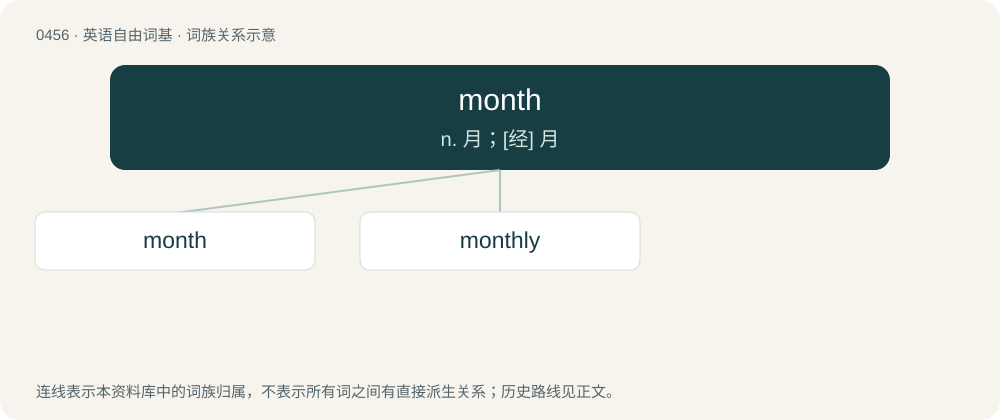

# 0515 · month — n. 月；\[经\] 月

[总目录](../00_总目录_按常用程度.md)

**类型**：英语自由词基　｜　**来源语言**：见词源记录

## 核心含义与来源

- 核心含义：n. 月；\[经\] 月
- 英文含义：A period into which a year is divided, historically based on the phases of the moon.
- 词形：month

**来源记录 1**（名词；A period into which a year is divided, historically based on the phases of the moon.）

From Middle English mon(e)th, from Old English mōnaþ, from Proto-West Germanic \*mānōþ, from Proto-Germanic \*mēnōþs (“month”), from Proto-Indo-European \*mḗh₁n̥s (“moon, month”), probably derived from \*meh₁- (“measure”) with moon-cycles being used to measure time. Related to moon. Cognate with Saterland Frisian Mound (“month”), Dutch maand (“month”), German Low German Maand (“month”), German Monat (“month”), Danish måned (“month”), Swedish månad (“month”), Icelandic mánuður (“month”). Eclipsed non-native Old English calend (“month”), borrowed from Latin calendae.

## 词族图

## 单词速览（常用到不常用）

| 单词 | 音标 | 释义 |
|---|---|---|
| [month](#w-1) | /mʌnθ/ | n. 月；\[经\] 月 |
| [monthly](#w-2) | /ˈmʌnθli/ | n. 月刊；a. 每月的, 每月一次的 |

## 逐词详解

### 1. month

**词性**：名词　｜　**音标**：/mʌnθ/

**中文释义**：n. 月；\[经\] 月

**英文义项**：A period into which a year is divided, historically based on the phases of the moon. / A period of 30 days, 31 days, or some alternation thereof.

**词源与演化**：

From Middle English mon(e)th, from Old English mōnaþ, from Proto-West Germanic \*mānōþ, from Proto-Germanic \*mēnōþs (“month”), from Proto-Indo-European \*mḗh₁n̥s (“moon, month”), probably derived from \*meh₁- (“measure”) with moon-cycles being used to measure time. Related to moon. Cognate with Saterland Frisian Mound (“month”), Dutch maand (“month”), German Low German Maand (“month”), German Monat (“month”), Danish måned (“month”), Swedish månad (“month”), Icelandic mánuður (“month”). Eclipsed non-native Old English calend (“month”), borrowed from Latin calendae.

**例句**：

> We went on holiday for two months.

该用例对应义项：A period of 30 days, 31 days, or some alternation thereof.

### 2. monthly

**词性**：形容词　｜　**音标**：/ˈmʌnθli/

**中文释义**：n. 月刊；a. 每月的, 每月一次的

**英文义项**：Occurring every month.

**构词拆分**：month + -ly (adjectival suffix)

**词源与演化**：

From month + -ly (adjectival suffix), perhaps via Middle English \*monethly (attested only adverbially), from Old English mōnaþlīċ (“monthly”), from Proto-West Germanic \*mānōþlīk, from Proto-Germanic \*mēnōþlīkaz (“monthly”). Cognate with Saterland Frisian moundelk (“monthly”), German monatlich (“monthly”), Danish månedlig (“monthly”), Swedish månatlig (“monthly”), Norwegian Bokmål månedlig (“monthly”), Icelandic mánaðarlegur (“monthly”).

**例句**：

> It's time give the dog its monthly bath.

该用例对应义项：Occurring every month.
