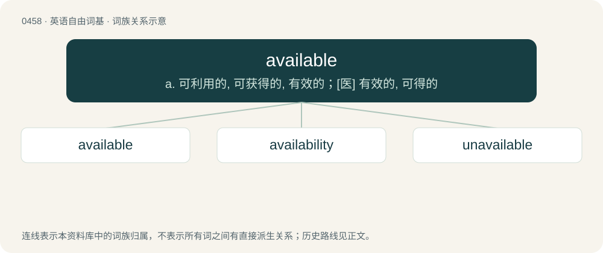

# 0516 · available — a. 可利用的, 可获得的, 有效的；\[医\] 有效的, 可得的

[总目录](../00_总目录_按常用程度.md)

**类型**：英语自由词基　｜　**来源语言**：见词源记录

## 核心含义与来源

- 核心含义：a. 可利用的, 可获得的, 有效的；\[医\] 有效的, 可得的
- 英文含义：Such as one may avail oneself of; capable of being used for the accomplishment of a purpose.
- 词形：available

**来源记录 1**（形容词；Such as one may avail oneself of; capable of being used for the accomplishment of a purpose.）

From Middle English available, avayllable, avayleable, equivalent of avail + -able.

## 词族图

## 单词速览（常用到不常用）

| 单词 | 音标 | 释义 |
|---|---|---|
| [available](#w-1) | 英 /əˈveɪ.lə.bəl/ | a. 可利用的, 可获得的, 有效的；\[医\] 有效的, 可得的 |
| [availability](#w-2) | 英 /əˌveɪ.ləˈbɪl.ɪ.ti/；美 /əˌveɪ.ləˈbɪl.ɪ.ti/ | n. 有效性, 可利用性, 可利用的人；\[计\] 有效性; 可用性 |
| [unavailable](#w-3) | /ˌʌnəˈveɪləbəl/ | a. 得不到的, 不能利用的, 无用的；\[化\] 不可得的; 无效的; 不能利用的 |

## 逐词详解

### 1. available

**词性**：形容词　｜　**音标**：英 /əˈveɪ.lə.bəl/

**中文释义**：a. 可利用的, 可获得的, 有效的；\[医\] 有效的, 可得的

**英文义项**：Such as one may avail oneself of; capable of being used for the accomplishment of a purpose. / Readily obtainable.

**构词拆分**：avail + -able

**词源与演化**：

From Middle English available, avayllable, avayleable, equivalent of avail + -able.

**例句**：

> I asked her if she was available, but she said she had a boyfriend.

该用例对应义项：Free to meet someone, speak on the telephone, enter a romantic relationship, or the like.

### 2. availability

**词性**：名词　｜　**音标**：英 /əˌveɪ.ləˈbɪl.ɪ.ti/；美 /əˌveɪ.ləˈbɪl.ɪ.ti/

**中文释义**：n. 有效性, 可利用性, 可利用的人；\[计\] 有效性; 可用性

**英文义项**：The quality of being available. / That which is available.

**构词拆分**：available + -ity

**词源与演化**：

From available + -ity; attested since the early 1800s.

**例句**：

> What is your availability this week?

该用例对应义项：The quality of being available.

### 3. unavailable

**词性**：形容词　｜　**音标**：/ˌʌnəˈveɪləbəl/

**中文释义**：a. 得不到的, 不能利用的, 无用的；\[化\] 不可得的; 无效的; 不能利用的

**英文义项**：Not available.

**构词拆分**：un- + available

**词源与演化**：

From un- + available.

**例句**：

> This product is unavailable at the moment, but we hope to order more by next week.

该用例对应义项：Not available.
