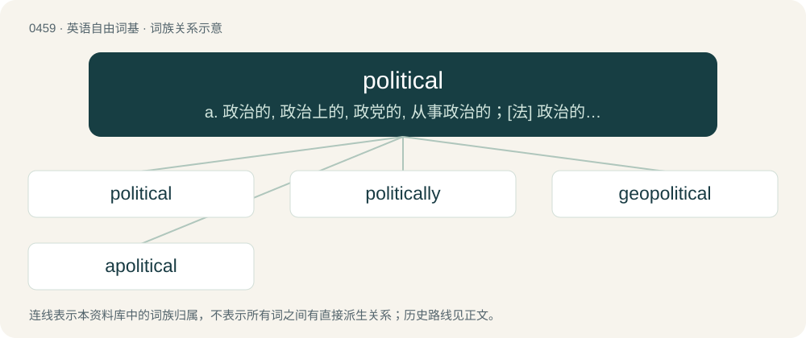

# 0517 · political — a. 政治的, 政治上的, 政党的, 从事政治的；\[法\] 政治的, 政治上的, 党派政治的

[总目录](../00_总目录_按常用程度.md)

**类型**：英语自由词基　｜　**来源语言**：见词源记录

## 核心含义与来源

- 核心含义：a. 政治的, 政治上的, 政党的, 从事政治的；\[法\] 政治的, 政治上的, 党派政治的
- 英文含义：Concerning or relating to politics, the art and process of governing.
- 词形：political

**来源记录 1**（形容词；Concerning or relating to politics, the art and process of governing.）

From politic + -al.

## 词族图

## 单词速览（常用到不常用）

| 单词 | 音标 | 释义 |
|---|---|---|
| [political](#w-1) | 英 /pəˈlɪt.ɪ.kəl/；美 /pəˈlɪt.ɪ.kəl/ | a. 政治的, 政治上的, 政党的, 从事政治的；\[法\] 政治的, 政治上的, 党派政治的 |
| [politically](#w-2) |  | adv. 政治上 |
| [geopolitical](#w-3) | /,dʒi(ː)əupəˈlitikəl/ | \[计\] 地理的 |
| [apolitical](#w-4) | /.eipəˈlitikl/ | a. 不关心政治的 |

## 逐词详解

### 1. political

**词性**：形容词　｜　**音标**：英 /pəˈlɪt.ɪ.kəl/；美 /pəˈlɪt.ɪ.kəl/

**中文释义**：a. 政治的, 政治上的, 政党的, 从事政治的；\[法\] 政治的, 政治上的, 党派政治的

**英文义项**：Concerning or relating to politics, the art and process of governing. / Concerning a polity or its administrative components.

**构词拆分**：From politic + -al.

**词源与演化**：

From politic + -al.

**例句**：

> The media alleged that the Federal Reserve chairman’s decision to cut rates before the election was political.

该用例对应义项：Inappropriately motivated by political calculation, as it pertains to elections, power dynamics, ideologies, etc.

### 2. politically

**词性**：副词

**中文释义**：adv. 政治上

**英文义项**：In a political manner. / Regarding politics, in a way connected to politics.

**构词拆分**：political + -ly

**词源与演化**：

From political + -ly.

**例句**：

> Although politically he claims to be a Democrat, his actions are more Republican.

该用例对应义项：Regarding politics, in a way connected to politics.

### 3. geopolitical

**词性**：形容词　｜　**音标**：/,dʒi(ː)əupəˈlitikəl/

**中文释义**：\[计\] 地理的

**英文义项**：Of or relating to geopolitics.

**构词拆分**：geo- + political

**词源与演化**：

From geo- (“geographical”) + political.

**例句**：

> Algeria needs to reassert its determination to remain a regional geopolitical power.

### 4. apolitical

**词性**：形容词　｜　**音标**：/.eipəˈlitikl/

**中文释义**：a. 不关心政治的

**英文义项**：Having no interest or involvement in politics. / Having no political relevance or function.

**构词拆分**：a- + political

**词源与演化**：

From a- + political.

**例句**：

> My colleagues and I come to this task with open minds, we are apolitical and independent of any political party.

该用例对应义项：Politically neutral, unbiased, nonaligned and free from party politics.
