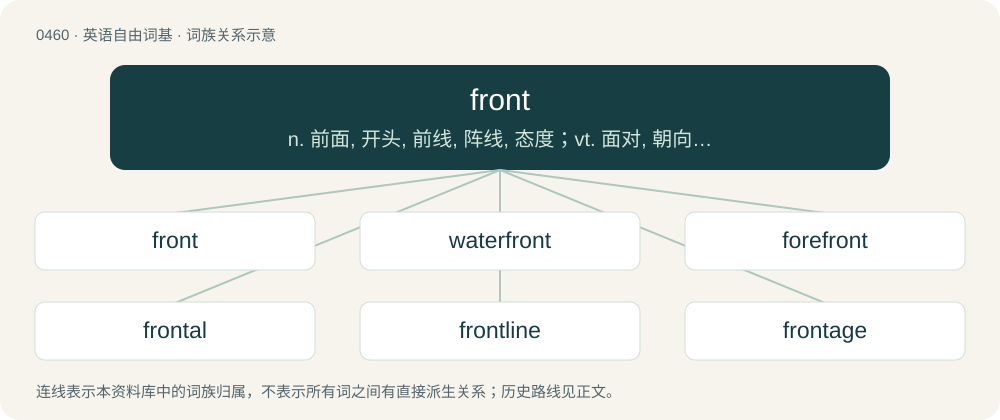

# 0519 · front — n. 前面, 开头, 前线, 阵线, 态度；vt. 面对, 朝向, 对抗；vi. 朝向

[总目录](../00_总目录_按常用程度.md)

**类型**：英语自由词基　｜　**来源语言**：见词源记录

## 核心含义与来源

- 核心含义：n. 前面, 开头, 前线, 阵线, 态度；vt. 面对, 朝向, 对抗；vi. 朝向
- 英文含义：The foremost side of something or the end that faces the direction it normally moves.
- 词形：front

**来源记录 1**（名词；The foremost side of something or the end that faces the direction it normally moves.）

From Middle English front, frunt, frount, from Old French front, frunt, from Latin frōns, frontem (“forehead”). Doublet of frons.

## 词族图

## 单词速览（常用到不常用）

| 单词 | 音标 | 释义 |
|---|---|---|
| [front](#w-1) | 英 /fɹʌnt/ | n. 前面, 开头, 前线, 阵线, 态度；vt. 面对, 朝向, 对抗；vi. 朝向 |
| [waterfront](#w-2) | /ˈwɔːtəfrʌnt/ | n. 水边, 滨水区, 滩, 海滨, 江边 |
| [forefront](#w-3) | 英 /ˈfɔːfɹʌnt/；美 /ˈfoɹfɹʌnt/ | n. 最前部, 最前线 |
| [frontal](#w-4) | 英 /ˈfɹʌn.təl/；美 /ˈfɹʌn.tl̩/ | a. 前面的, 正面的, 额的；n. 额骨, 祭坛(前面的)帏帘, (建筑物的)正面 |
| [frontline](#w-5) | /ˈfrʌntlɑɪn/ | n. 前线; \[体\]锋线（包括大前锋, 小前锋, 中锋） |
| [frontage](#w-6) | /ˈfɹʌn.tɪd͡ʒ/ | n. 房子的正面, 前方, 临街地 |
| [storefront](#w-7) | /ˈstɒːfrʌnt/ | n. 店面 |
| [beachfront](#w-8) | 美 /ˈbit͡ʃˌfɹʌnt/ | n. 海滨地区；a. 靠海滨的 |
| [riverfront](#w-9) | /ˈrivəfrʌnt/ | n. (城镇的)河边地区,河边陆地 |
| [battlefront](#w-10) | /ˈbætlfrʌnt/ | n. 前线 |
| [seafront](#w-11) | /ˈsiːfrʌnt/ | n. 面向海的一面 |
| [lakefront](#w-12) | 美 /ˈleɪkˌfɹʌnt/ | n. 湖边平地, 湖边, 湖畔 |
| [oceanfront](#w-13) | /ˈəjʃənfrʌnt/ | n. 海滨 |
| [wavefront](#w-14) | /ˈweivfrʌnt/ | \[计\] 波前 |
| [frontcourt](#w-15) | /ˈfrʌntˈkɔːt/ | n. \[篮\]前场 |
| [frontside](#w-16) |  | n. 正视图；进料侧 |
| [bayfront](#w-17) | 美 /ˈbeɪˌfɹʌnt/ | 【英文】Adjoining or fronting on a bay. |

## 逐词详解

### 1. front

**词性**：名词　｜　**音标**：英 /fɹʌnt/

**中文释义**：n. 前面, 开头, 前线, 阵线, 态度；vt. 面对, 朝向, 对抗；vi. 朝向

**英文义项**：The foremost side of something or the end that faces the direction it normally moves. / The side of a building with the main entrance.

**词源与演化**：

From Middle English front, frunt, frount, from Old French front, frunt, from Latin frōns, frontem (“forehead”). Doublet of frons.

**例句**：

> Officially it's a dry-cleaning shop, but everyone knows it's a front for the mafia.

该用例对应义项：A person or institution acting as the public face of some other, covert group.

### 2. waterfront

**词性**：名词　｜　**音标**：/ˈwɔːtəfrʌnt/

**中文释义**：n. 水边, 滨水区, 滩, 海滨, 江边

**英文义项**：The land alongside a body of water. / The dockland district of a town.

**构词拆分**：water + front

**词源与演化**：

From water + front.

**例句**：

> On Monday night, around one hundred rebels came to the city's waterfront.

### 3. forefront

**词性**：名词　｜　**音标**：英 /ˈfɔːfɹʌnt/；美 /ˈfoɹfɹʌnt/

**中文释义**：n. 最前部, 最前线

**英文义项**：The leading position or edge.

**构词拆分**：fore- + front

**词源与演化**：

From Middle English forefrount, forfrount, forefronte, equivalent to fore- + front.

**例句**：

> That laboratory researches topics at the forefront of technology.

该用例对应义项：The leading position or edge.

### 4. frontal

**词性**：形容词　｜　**音标**：英 /ˈfɹʌn.təl/；美 /ˈfɹʌn.tl̩/

**中文释义**：a. 前面的, 正面的, 额的；n. 额骨, 祭坛(前面的)帏帘, (建筑物的)正面

**英文义项**：Of, relating to, directed toward, or situated at the front. / Directed against the front or at the main point or issue.

**构词拆分**：front + -al

**词源与演化**：

Borrowed from New Latin frontālis, from frons (“the forehead, brow, front”) + -ālis (“-al”, adjectival suffix), equivalent to front + -al; cognate of French frontal. Doublet of frontalis.

**用法示例／搭配（非完整句）**：

> a frontal attack

该用例对应义项：Directed against the front or at the main point or issue.

### 5. frontline

**词性**：形容词　｜　**音标**：/ˈfrʌntlɑɪn/

**中文释义**：n. 前线; \[体\]锋线（包括大前锋, 小前锋, 中锋）

**英文义项**：Located at a front. / Most advanced or important.

**构词拆分**：front + line

**词源与演化**：

From front + line.

**例句**：

> Now they have a second frontline, just to kill the deserters.

### 6. frontage

**词性**：名词　｜　**音标**：/ˈfɹʌn.tɪd͡ʒ/

**中文释义**：n. 房子的正面, 前方, 临街地

**英文义项**：The front part of a property or building that faces the street. / The land between a property and the street.

**构词拆分**：front + -age

**词源与演化**：

From front + -age.

**例句**：

> Frontage roads are universal in Texas.

### 7. storefront

**词性**：名词　｜　**音标**：/ˈstɒːfrʌnt/

**中文释义**：n. 店面

**英文义项**：The side of a store (or other shop) which faces the street and usually contains display windows. / An e-commerce website offering goods or services to the public.

**构词拆分**：store + front

**词源与演化**：

From store + front.

**例句**：

> The storefront doesn't look good, but the food was actually surprisingly delicious.

### 8. beachfront

**词性**：形容词　｜　**音标**：美 /ˈbit͡ʃˌfɹʌnt/

**中文释义**：n. 海滨地区；a. 靠海滨的

**英文义项**：Of property (real estate): located on a beach.

**构词拆分**：beach + front

**词源与演化**：

From beach + front.

**例句**：

> Tom took Mary to a beachfront restaurant for dinner.

### 9. riverfront

**词性**：名词　｜　**音标**：/ˈrivəfrʌnt/

**中文释义**：n. (城镇的)河边地区,河边陆地

**英文义项**：The real estate located along the banks of a river.

**构词拆分**：river + front

**词源与演化**：

From river + front.

**例句**：

> Even in rural areas, dirt-cheap riverfront property seems to be a thing of the past.

该用例对应义项：The real estate located along the banks of a river.

### 10. battlefront

**词性**：名词　｜　**音标**：/ˈbætlfrʌnt/

**中文释义**：n. 前线

**英文义项**：The region or line along which opposing armies engage in combat. / The area in which opponents or opposing ideas meet.

**构词拆分**：battle + front

**词源与演化**：

From battle + front.

### 11. seafront

**词性**：名词　｜　**音标**：/ˈsiːfrʌnt/

**中文释义**：n. 面向海的一面

**英文义项**：The seashore, the coast. / The waterfront of a seaside town.

**构词拆分**：sea + front

**词源与演化**：

From sea + front.

**例句**：

> In Algiers, the Sablette Seafront is a popular place for Friday outings.

### 12. lakefront

**词性**：形容词　｜　**音标**：美 /ˈleɪkˌfɹʌnt/

**中文释义**：n. 湖边平地, 湖边, 湖畔

**英文义项**：Adjacent to a lake. Usually used to describe real estate.

**构词拆分**：lake + front

**词源与演化**：

From lake + front.

**例句**：

> Lakefront property is very expensive because many people want access to the water for recreation.

该用例对应义项：Adjacent to a lake. Usually used to describe real estate.

### 13. oceanfront

**词性**：形容词　｜　**音标**：/ˈəjʃənfrʌnt/

**中文释义**：n. 海滨

**英文义项**：Of property or real estate: adjacent to the ocean.

**构词拆分**：ocean + front

**词源与演化**：

From ocean + front.

**例句**：

> Oceanfront houses bore the brunt of the huge waves whipped up by the storm.

### 14. wavefront

**词性**：名词　｜　**音标**：/ˈweivfrʌnt/

**中文释义**：\[计\] 波前

**英文义项**：An imaginary surface passing through points of a medium oscillating in phase.

**构词拆分**：wave + front

**词源与演化**：

From wave + front.

### 15. frontcourt

**词性**：名词　｜　**音标**：/ˈfrʌntˈkɔːt/

**中文释义**：n. \[篮\]前场

**英文义项**：The half of the court where a team's offensive basket is located. / The center and forwards of a team.

**构词拆分**：front + court

**词源与演化**：

From front + court.

**例句**：

> The team's frontcourt has not been performing this season.

该用例对应义项：The center and forwards of a team.

### 16. frontside

**词性**：名词

**中文释义**：n. 正视图；进料侧

**英文义项**：The obverse, in contrast to the reverse.

**构词拆分**：front + side

**词源与演化**：

From front + side.

### 17. bayfront

**词性**：形容词　｜　**音标**：美 /ˈbeɪˌfɹʌnt/

**英文义项**：Adjoining or fronting on a bay.

**构词拆分**：bay + front

**词源与演化**：

From bay + front.

**例句**：

> She ushered us into her spacious bayfront office.

该用例对应义项：Adjoining or fronting on a bay.
