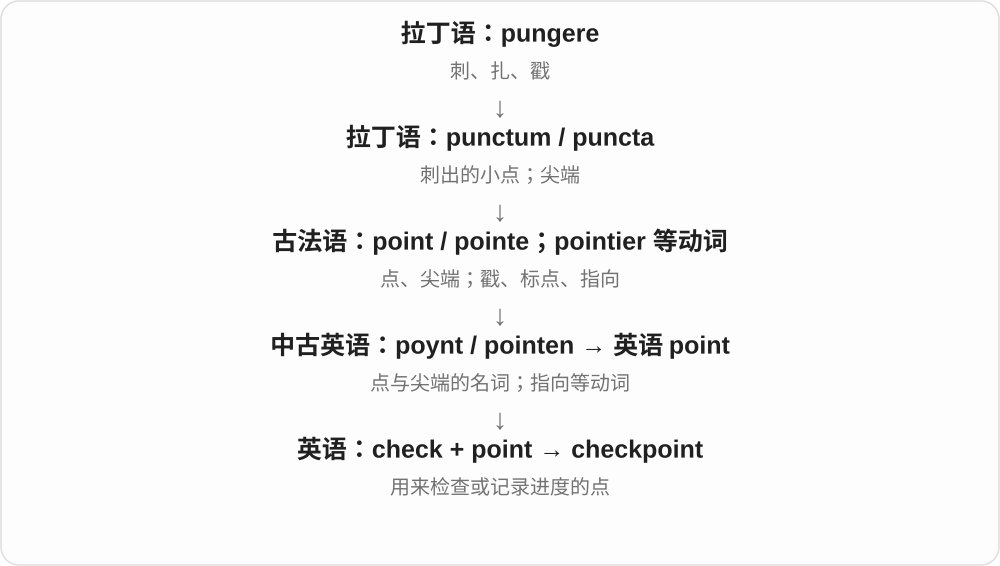

# 0520 · check — 检查、核对、制止；勾选及其工具

[逐词精讲目录](../00_逐词精讲目录.md) · [总目录](../00_总目录_按常用程度.md)

## 核心词根与来源

check 远接波斯语国王的词，经阿拉伯语和欧洲语言进入棋局称呼，再扩展出制约、核查等。checker 的棋子分支须和检查工具分开。

**CHECK：核一下，也能让势头停一下**

今天最常用是核对，历史却有棋局将军的背景；按现代用途分组，比硬套单一路线更清楚。

- **核查基础**：check · checker · recheck · checkpoint
- **清单与勾选**：checklist · checkbox · checkmark · uncheck
- **专门核验和支付词**：checksum · soundcheck · paycheck
- **check → checks／checked：核查、限制与检查事项**：check · checks · checked
- **check → checks／checked／checking：正在核查**：check · checking
- **棋语的不同借入形式：check 与 chess**：check · chess
- **checkbox → checkboxes：可勾选的小框**：checkbox · checkboxes
- **check + out → checkout**：checkout

## 词形与演化规律

check → checker、recheck；checklist 逐项核查；checkbox 容器、checkmark 记号、uncheck 撤销选择；checksum 检验数据、soundcheck 演前试音。

check 的棋局将军称呼远接波斯 shāh 国王，核查、限制、付款等现代分支有不同使用史。

checking 的 ch 为 /tʃ/，直接加 -ing，不另改词干；具体检查对象和 check 的其他搭配仍看语境。

chess 经古法语 esches 的复数形整体借入，check 走相关棋语路线，现代不是 check 复数改字母。

check 在这里取勾选记号、核验义。

checkout 是 check out 的名词形式，常说付款处、结账流程、退房；不同用途沿各自语境发展，英语借入 check 的更远词史另见基础词。

## 单词速览（按词族由简到繁）

同一基础词的相关扩展放在一起，先读基础形式，再读扩展；各组之间优先读常用的。具体词源关系见各词讲解。

| 单词 | 音标 | 核心意思 |
|---|---|---|
| [check](#w-1) | /tʃek/ | 检查；核对；制止；勾选记号；支票〔美〕；账单〔美〕 |
| [checked](#w-12) | /tʃekt/ | 检查、核对了；制止、托运了；格子图案的；check 的过去式和过去分词等 |
| [checking](#w-14) | /ˈtʃekɪŋ/ | 正在检查、核对；控制、托运等动作；check 的 -ing 形式 |
| [checks](#w-13) | /tʃeks/ | 检查、核对事项；制约；支票〔美式〕；检查、制止〔动词形式〕 |
| [checkout](#w-17) | 英、美 /ˈtʃekaʊt/ | 结账、付款流程；付款处；退房手续 |
| [checklist](#w-3) | /ˈtʃeklɪst/ | 核查清单；检查表 |
| [checkpoint](#w-4) | 英、美 /ˈtʃekpɔɪnt/ | 检查站；检查点；进度存档点 |
| [checker](#w-5) | 英 /ˈtʃekə/；美 /ˈtʃekər/ | 检查者、检查工具；西洋跳棋棋子；方格 |
| [checkbox](#w-6) | 英 /ˈtʃekbɒks/；美 /ˈtʃekbɑːks/ | 复选框；可勾选的小方框 |
| [checkboxes](#w-16) | 英 /ˈtʃekbɒksɪz/；美 /ˈtʃekbɑːksɪz/ | 勾选框、复选框〔复数〕 |
| [checksum](#w-8) | /ˈtʃeksʌm/ | 校验和；校验值 |
| [checkmark](#w-11) | 英 /ˈtʃekmɑːk/；美 /ˈtʃekmɑːrk/ | 勾选记号；对勾 |
| [paycheck](#w-2) | /ˈpeɪtʃek/ | 工资支票；一次发放的工资〔尤美〕 |
| [recheck](#w-7) | /ˌriːˈtʃek/ | 再次核查；复查 |
| [uncheck](#w-9) | /ʌnˈtʃek/ | 取消勾选 |
| [soundcheck](#w-10) | /ˈsaʊndtʃek/ | 演出前音响检查；试音 |
| [chess](#w-15) | /tʃes/ | 国际象棋 |

## 逐词讲解

### 1. check — 检查；核对；制止；勾选记号；支票〔美〕；账单〔美〕

**音标**：/tʃek/

**先抓住这个画面**

最常用时是停一下，看看是否正确；制止某股势头时，则是让它不能继续冲下去。

**怎么拆**

英语近源经法语接棋局的将军称呼，远处与波斯语 shāh 国王相关。不同义项经过制约、核验等多条历史分支形成，不能编成先勾选才发明支票的一条简单线。格子图案义还联系 chequer 的缩短。

**怎么变成今天的意思**

**波斯语 shāh 国王 → 经阿拉伯语、欧洲中介形式到法语 eschec**  
棋局中的将军、限制对手

↓

**中古英语 chek → check**  
将军、制止；后又形成核查、记号等多种固定用法

check the address 核对地址，check growth 抑制增长，a check mark 勾选记号；美式 check 可是支票或餐馆账单，对应英式常用 cheque、bill。

**常见搭配与例句**

check that；double check；keep in check；pay by check。

> Please check that the window is closed.

请检查窗户是否关好了。

> The gardeners checked the spread of the weeds.

园丁控制住了杂草蔓延。

> Could we have the check, please?

请给我们账单，好吗？

**别混淆**

check 核查不保证查出问题；check in 办理入住、登乘等，check out 结账离开、查看等，是另按短语使用的分支。

### 2. checked — 检查、核对了；制止、托运了；格子图案的；check 的过去式和过去分词等

**音标**：/tʃekt/

**先抓住这个画面**

把信息核过一遍，是 checked；让东西受控制、办好托运行李等，也有固定 check 用法。衣服上的 checked 则说格子图案。

**怎么拆**

check + -ed，/k/ 后读 /t/。check 的棋局、制约、核验词族远接波斯 shāh；格子纹样用法还与 chequer 等形式联系，分别看现代搭配。

**怎么变成今天的意思**

**法语棋局相关称呼及后续英语 check；另看 chequer 图案词关系**  
制约、核验等；格纹分支

↓

**check + -ed → checked**  
过去检查、托运等；格子纹样的

checked the facts 核实了事实；checked the luggage 托运行李；a checked shirt 格子衬衫；checked in 办理入住、报到、值机〔看场景〕。

**常见搭配与例句**

carefully checked；checked with the organiser。

> We checked the opening times before leaving.

出发前，我们核对了开放时间。

> He wore a blue checked shirt to the picnic.

他穿着一件蓝色格子衬衫去野餐。

**别混淆**

checked a bag 在出行场景可说办了托运，checked a bag for damage 则是在检查有无损坏。checked shirt 的格纹义也要靠名词场景理解。

### 3. checking — 正在检查、核对；控制、托运等动作；check 的 -ing 形式

**音标**：/ˈtʃekɪŋ/

**先抓住这个画面**

把情况过一遍、核实有没有问题，是 checking。它也可随 check in、check on 等搭配，说报到、查看某人情况等不同动作。

**怎么拆**

check + -ing，保留 ck，读 /ˈtʃekɪŋ/。词基的棋局称呼远接波斯 shāh，核查、限制、托运等现代分支按搭配使用。

**怎么变成今天的意思**

**棋局相关称呼 → 英语 check 的不同现代分支**  
核验、限制、托运等

↓

**check + -ing → checking**  
进行中的核查、控制、托运等动作

checking the figures 核对数字；checking on a friend 看看朋友的情况；checking in 办理入住、报到、值机；checking baggage 托运行李。

**常见搭配与例句**

keep checking；checking for mistakes。

> I am checking the names before printing the list.

打印名单前，我正在核对姓名。

> Thanks for checking on us after the storm.

谢谢你在暴风雨后关心我们的情况。

**别混淆**

checking for mistakes 是在查有没有错误，checking the figures 是把数字核一遍。check on someone 常是查看对方是否安好或事情进展怎样。

### 4. checks — 检查、核对事项；制约；支票〔美式〕；检查、制止〔动词形式〕

**音标**：/tʃeks/

**先抓住这个画面**

把事情核一遍，看是否合适，是 checks；在前面挡一下、让速度停下来，也属于 check 的限制分支。支票则是另一个固定的付款用法。

**怎么拆**

check + -s，/k/ 后读 /s/。经法语 eschec 等棋局中的将军称呼传入，远接波斯 shāh 国王；核验、制约、记号、付款等现代义各有使用史。

**怎么变成今天的意思**

**波斯 shāh → 经中介语言的法语 eschec → 英语 check**  
棋局将军、制约；后有核验等分支

↓

**check 名词、动词 + -s → checks**  
多项检查、制约、支票等；单数主语核查、制止

routine checks 常规检查；checks the address 核对地址；keeps costs in check 控制费用；writes checks 开支票〔美式〕。

**常见搭配与例句**

make several checks；checks the details。

> She checks the address before sending each parcel.

她每寄一个包裹前都会核对地址。

> We made a few final checks before opening the doors.

开门前，我们作了最后几项检查。

**别混淆**

checks 在美式可说支票，英式这层常拼 cheques；普通检查在英美都写 checks。check the address 是核对地址；check on someone 是看看某人的情况。

### 5. checkout — 结账、付款流程；付款处；退房手续

**音标**：英、美 /ˈtʃekaʊt/

**先抓住这个画面**

购物车里的东西选好了，进入付款这一关，是 checkout；在酒店住完，办理离店手续，也叫 checkout。

**怎么拆**

check + out 的动词短语转为名词 checkout。check out 的几种用途分别发展出付款处、付款流程、退房等名词义，现代也用于网页上的购物付款环节。

**怎么变成今天的意思**

**check out 的相关办结、核验动作 → checkout 名词**  
名词历史还有飞行培训等较早用途

↓

**商店付款与酒店退房用法 → 网上 checkout**  
同一个名词在具体服务场景中确定所指

at the checkout 是在付款处；proceed to checkout 是进入结账；checkout time 是退房时间；guest checkout 是无需注册账户的购物结账。

**常见搭配与例句**

at the checkout；proceed to checkout；checkout time。

> There was a short queue at the checkout.

付款处排着一小队人。

> The hotel lists its checkout time on the booking page.

酒店在预订页面上注明了退房时间。

**别混淆**

checkout 作名词常连写；check out 作动词通常分开写。酒店 checkout time 要理解成退房时间，购物网站 checkout 则是付款流程。

### 6. checklist — 核查清单；检查表

**音标**：/ˈtʃeklɪst/

**先抓住这个画面**

把不能漏的事项列出来，做完或确认一项，就勾掉一项。

**怎么拆**

check 核查 + list 清单。不是随机列一堆名字，而是供逐项确认的清单；电子表也可实现同样作用。

**怎么变成今天的意思**

**check 核查；list 清单**  
并列构词部分

↓

**checklist**  
供逐项检查、确认的清单

a packing checklist 行李核查清单，a safety checklist 安全检查表；work through a checklist 逐项完成检查。

**常见搭配与例句**

a safety checklist；a packing checklist；go through a checklist。

> Use the checklist to make sure nothing is missing.

用核查清单确认没有遗漏。

> She made a packing checklist before the trip.

她旅行前做了行李核查清单。

**别混淆**

list 是列表上位词，checklist 强调逐项确认；shopping list 通常列购买对象，也可以按核查清单的方式使用。

### 7. checkpoint — 检查站；检查点；进度存档点

**音标**：英、美 /ˈtʃekpɔɪnt/

**先抓住这个画面**

走到这个位置先检查一下，再继续往前。可以是道路上的站点，也可以是程序或游戏保存进度的位置。

**怎么拆**

check“检查” + point“位置、节点”，英语合成。

**怎么变成今天的意思**

安全检查站要核验通行；计算中的 checkpoint 保存某一阶段的状态，方便恢复。两者都像在长路上设一个可确认的位置。

**常见搭配与例句**

a security checkpoint；pass a checkpoint；save a checkpoint。

> Everyone showed a pass at the checkpoint.

每个人都在检查站出示了通行证。

> The game restarted from the last checkpoint.

游戏从上一个存档点重新开始。

**别混淆**

checklist 是要查的项目清单；checkpoint 是执行检查或记录状态的位置、阶段。

### 8. checker — 检查者、检查工具；西洋跳棋棋子；方格

**音标**：英 /ˈtʃekə/；美 /ˈtʃekər/

**先抓住这个画面**

检查工具是帮你查错的东西；跳棋棋子、方格则走棋盘的另一条历史，不是小检查员。

**怎么拆**

检查者、工具义可拆 check + -er；棋盘、方格及棋子相关义联系中古英语 cheker、法语 escheker 等。远处棋局背景相关，不代表每个 checker 都是英语动词加人物后缀。

**怎么变成今天的意思**

**波斯语 shāh 国王 → 经阿拉伯语、欧洲中介形式到法语 eschec**  
棋局中的将军、限制对手

↓

**中古英语 chek → check**  
将军、制止；后又形成核查、记号等多种固定用法

↓

**check + -er；另有 cheker 棋盘形式延续**  
检查者、工具；另一分支方格、棋子

a spelling checker 拼写检查工具；checkers 在美国英语中是西洋跳棋。a checker pattern 也可说方格图案。

**常见搭配与例句**

a grammar checker；a spelling checker；play checkers。

> The grammar checker missed an error in the title.

语法检查工具漏掉了标题中的一个错误。

> They played checkers after dinner.

他们晚饭后下西洋跳棋。

**别混淆**

checker 工具或棋子，看语境；checking 是检查动作。checkerboard 棋盘不能直接按查错板理解。

### 9. checkbox — 复选框；可勾选的小方框

**音标**：英 /ˈtʃekbɒks/；美 /ˈtʃekbɑːks/

**先抓住这个画面**

表单里一个小格子，勾上就表示选了这一项；它不是装支票的盒子。

**怎么拆**

check 勾选记号、核验 + box 小方框，形成纸质、电子表单里的控件名称。

**怎么变成今天的意思**

**check 勾选；box 方框**  
并列构词部分

↓

**checkbox**  
表示某项是否选中的小方框

select a checkbox 勾选复选框，clear a checkbox 取消勾选；同一组通常可以多选，也能只有一个同意选项。

**常见搭配与例句**

select a checkbox；clear the checkbox；a checkbox label。

> Select the checkbox beside each file you want to move.

勾选每个要移动的文件旁边的复选框。

> The form has a checkbox for email updates.

表单有一个接收邮件更新的复选框。

**别混淆**

checkbox 复选框和 radio button 单选按钮的典型选择方式不同；具体表单仍要看说明和设计。

### 10. checkboxes — 勾选框、复选框〔复数〕

**音标**：英 /ˈtʃekbɒksɪz/；美 /ˈtʃekbɑːksɪz/

**先抓住这个画面**

旁边写一个选项，小框里勾一下表示选中，这些框就是 checkboxes。纸质表格和屏幕表单都可有。

**怎么拆**

check 勾选记号 + box 框 → checkbox，整词加 -es，/ks/ 后读 /ɪz/。

**怎么变成今天的意思**

**check + box → checkbox**  
用勾选记号表达选择的小框

↓

**checkbox + -es → checkboxes**  
多个勾选框

select the checkboxes 勾选小框；empty checkboxes 未勾选框。

**常见搭配与例句**

checkboxes beside the options 选项旁的框；tick the checkboxes 勾选框。

> The form has checkboxes beside each option.

表单的每个选项旁都有勾选框。

> She selected two checkboxes on the page.

她勾选了页面上的两个框。

**别混淆**

复选框常用于可分别开关的选项；单选按钮常用于一组选一，具体表单仍看实际要求。

### 11. checksum — 校验和；校验值

**音标**：/ˈtʃeksʌm/

**先抓住这个画面**

根据一段数据算出一个较短的核对值；数据变了，这个值可能跟着变，方便发现传输或存储差错。

**怎么拆**

check 核验 + sum 总和，名称联系早期把数据按规则求和的办法；现代校验算法不一定只是普通加法。

**怎么变成今天的意思**

**check 核验；sum 总和**  
并列构词部分

↓

**checksum**  
从数据算出的差错核验值

calculate a checksum 计算校验值，a checksum mismatch 校验值不匹配。两份校验值一样并不能对所有算法都保证文件绝对相同或安全。

**常见搭配与例句**

calculate a checksum；verify a checksum；a checksum mismatch。

> The download tool reported a checksum mismatch.

下载工具报告校验值不匹配。

> The program calculates a checksum for each data block.

程序为每个数据块计算一个校验值。

**别混淆**

checksum 通常用于检测差错，cryptographic hash 加密散列有专门性质；相关工具可能都显示一串值，但不能据此外形断定安全能力相同。

### 12. checkmark — 勾选记号；对勾

**音标**：英 /ˈtʃekmɑːk/；美 /ˈtʃekmɑːrk/

**先抓住这个画面**

用一个勾表示看过、选了或确认完成，像在清单旁写一个小小的完成信号。

**怎么拆**

check 核验、勾选 + mark 记号，也可写 check mark。这里是记号本身，不是装记号的方框。

**怎么变成今天的意思**

**check 核验、勾选；mark 记号**  
并列构词部分

↓

**checkmark**  
表示选择、核查或完成的勾记号

put a checkmark beside an item 在一项旁打勾；英式日常也常用 tick。标记究竟代表正确、完成还是选择，需看表单说明。

**常见搭配与例句**

a checkmark beside；put a checkmark；a green checkmark。

> Put a checkmark beside each completed task.

在每项已完成任务旁打勾。

> A green checkmark appeared when the upload finished.

上传完成时，出现了一个绿色对勾。

**别混淆**

checkmark 是勾的记号，checkbox 是可放勾的小框；框里没有勾，仍然可以是 checkbox。

### 13. paycheck — 工资支票；一次发放的工资〔尤美〕

**音标**：/ˈpeɪtʃek/

**先抓住这个画面**

原来是一张发薪支票，如今钱直接到账，也能沿用 paycheck 说这一期工资。

**怎么拆**

pay（工资）+ check（支票），美式 check 对应英式 cheque 的相关拼写。现代已常从支付凭证转指薪资金额。

**怎么变成今天的意思**

**英语 pay；check〔支票〕**  
并列组合的两部分

↓

**pay + check〔支票〕 → paycheck**  
工资支票 → 定期领取的薪资

get a paycheck 是领工资，a bigger paycheck 是更高薪资；live paycheck to paycheck 是每次工资接下一次，几乎没余钱的生活状态。

**常见搭配与例句**

get a paycheck；a monthly paycheck；live paycheck to paycheck。

> Her first paycheck arrived at the end of the month.

她在月底领到了第一笔工资。

> He wanted meaningful work as well as a steady paycheck.

他希望工作有意义，也有稳定薪水。

**别混淆**

paycheck 特指工作报酬这一路，receipt 是付款收据；领到薪水与拿到购物收据不同。

### 14. recheck — 再次核查；复查

**音标**：/ˌriːˈtʃek/

**先抓住这个画面**

已经看过一遍，还要再看一次，确认没有漏掉或后来发生变化。

**怎么拆**

re- 再次 + check 核查；也可作名词，常重读前部。再次检查不保证第一次一定出错。

**怎么变成今天的意思**

**波斯语 shāh 国王 → 经阿拉伯语、欧洲中介形式到法语 eschec**  
棋局中的将军、限制对手

↓

**中古英语 chek → check**  
将军、制止；后又形成核查、记号等多种固定用法

↓

**re- + check → recheck**  
核查 → 再核查

recheck the figures 重新核对数字，recheck the booking 复核预订信息；a recheck of the list 对名单的复查。

**常见搭配与例句**

recheck the details；recheck the figures；a final recheck。

> Please recheck the delivery address.

请再次核对收货地址。

> A quick recheck confirmed that the total was correct.

迅速复核后确认总数正确。

**别混淆**

recheck 再检查，correct 改正；再次检查后可能什么也不用改。

### 15. uncheck — 取消勾选

**音标**：/ʌnˈtʃek/

**先抓住这个画面**

原来方框里有勾、这项已经选中，现在把这个选择撤掉。

**怎么拆**

un- 撤销动作 + check 勾选；并不是停止所有检查工作的泛用词。

**怎么变成今天的意思**

**波斯语 shāh 国王 → 经阿拉伯语、欧洲中介形式到法语 eschec**  
棋局中的将军、限制对手

↓

**中古英语 chek → check**  
将军、制止；后又形成核查、记号等多种固定用法

↓

**check 的勾选义 → uncheck**  
勾选 → 取消勾选

uncheck the box 取消勾选，uncheck an option 撤销某选项；可能需要另外保存，具体看软件。

**常见搭配与例句**

uncheck the box；uncheck an option；uncheck all items。

> Uncheck the box if you do not want email updates.

如果不想接收邮件更新，请取消勾选。

> She unchecked two items before saving the form.

她保存表单前取消勾选了两项。

**别混淆**

uncheck 取消勾选，unchecked 作形容词还可能指未经检查、未受控制；不能把每个 unchecked 都理解成界面没打勾。

### 16. soundcheck — 演出前音响检查；试音

**音标**：/ˈsaʊndtʃek/

**先抓住这个画面**

观众还没正式听演出，先试试麦克风、乐器和扩声音量配合得怎样。

**怎么拆**

sound 声音 + check 检查，形成演出准备步骤名称。不是只检查声音这个英文词有没有拼错。

**怎么变成今天的意思**

**sound 声音；check 检查**  
并列构词部分

↓

**soundcheck**  
演出前检查音响、声音效果

do a soundcheck 试音，arrive for soundcheck 来参加演前音响检查；可能包含演奏几段，但目的和正式演出不同。

**常见搭配与例句**

do a soundcheck；during soundcheck；a pre-show soundcheck。

> The band arrived early for soundcheck.

乐队提前到场试音。

> We tested each microphone during the soundcheck.

试音时，我们测试了每支麦克风。

**别混淆**

soundcheck 检查、调整声音，rehearsal 排练可包括动作、台词、流程等，二者可能相连但不全相同。

### 17. chess — 国际象棋

**音标**：/tʃes/

**先抓住这个画面**

两人在棋盘上轮流调动棋子，围绕对方的王作攻防，是 chess。它在英语里是整种游戏的名字，不是在说几枚棋子的复数。

**怎么拆**

借古法语 esches，原是 eschec 的复数形式，相关棋语经拉丁、阿拉伯传播远接波斯 shah 国王。它与 check 同属棋语历史，但不是现代 check 加英语复数形成 chess。

**怎么变成今天的意思**

**波斯 shah 及阿拉伯、拉丁传播 → 法语 eschec、esches**  
国王、棋局中的关键称呼 → 棋子、棋戏名称

↓

**古法语复数 esches → 英语 chess**  
来源词形是复数，英语重新作整种游戏名使用

play chess 下国际象棋；a chess game 一盘国际象棋；a chess club 国际象棋俱乐部。

**常见搭配与例句**

learn chess 学国际象棋；chess pieces 国际象棋棋子。

> They play chess every Sunday.

他们每周日下国际象棋。

> She joined the school chess club.

她加入了学校的国际象棋俱乐部。

**别混淆**

chess 通常不可数，数一盘用 a game of chess。英语 chess 不自动包括中文象棋，谈不同棋类时要明确名称。

## 这一组要分清什么

checkbox 框，checkmark 勾；checker 可是棋子或检查工具；check 美式可说支票，英式常写 cheque。

## 串起来练习

Check the checklist, then uncheck any item you no longer need.

核对清单，然后取消勾选不再需要的项目。
