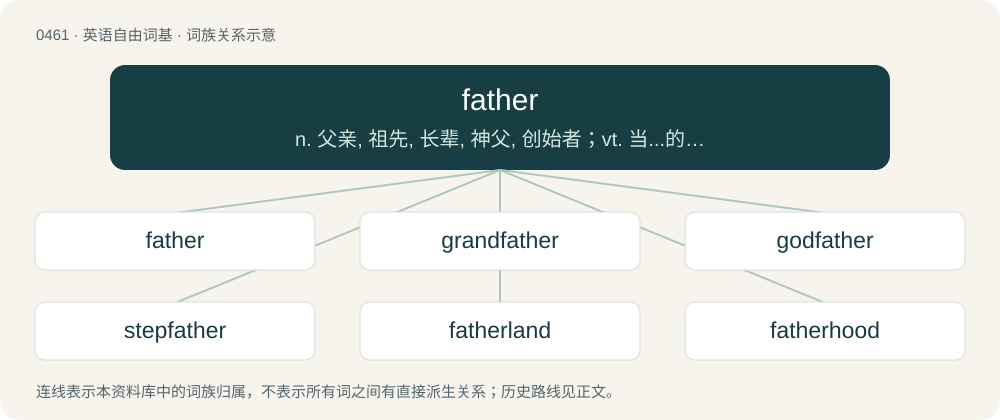

# 0520 · father — n. 父亲, 祖先, 长辈, 神父, 创始者；vt. 当...的父亲, 保护, 创作, 发明, 培养

[总目录](../00_总目录_按常用程度.md)

**类型**：英语自由词基　｜　**来源语言**：见词源记录

## 核心含义与来源

- 核心含义：n. 父亲, 祖先, 长辈, 神父, 创始者；vt. 当...的父亲, 保护, 创作, 发明, 培养
- 英文含义：A male parent, especially of a human; a male who parents a child (which he has sired, adopted, fostered, etc.).
- 词形：father

**来源记录 1**（名词；A male parent, especially of a human; a male who parents a child (which he has sired, adopted, fostered, etc.).）

Inherited from Middle English fader, from Old English fæder, from Proto-West Germanic \*fader, from Proto-Germanic \*fadēr, from Proto-Indo-European \*ph₂tḗr, possibly from \*peh₂- + \*-tḗr. Doublet of ayr, faeder, athair, padre, pater, and père.

## 词族图

## 单词速览（常用到不常用）

| 单词 | 音标 | 释义 |
|---|---|---|
| [father](#w-1) | 英 /ˈfɑː.ðə/；美 /ˈfɑ.ðəɹ/ | n. 父亲, 祖先, 长辈, 神父, 创始者；vt. 当...的父亲, 保护, 创作, 发明, 培养 |
| [grandfather](#w-2) | 英 /ˈɡɹæn(d)ˌfɑːðə(r)/；美 /ˈɡɹæn(d)ˌfɑðɚ/ | n. 祖父, 始祖；\[电\] 原始资料组 |
| [godfather](#w-3) | 英 /ˈɡɒdfɑːðə/；美 /ˈɡɑdfɑðɚ/ | n. 教父；vt. 当教父 |
| [stepfather](#w-4) | /ˈstep,fɑːðə/ | n. 继父；\[法\] 继父 |
| [fatherland](#w-5) | /ˈfɑːðəˈlænd/ | n. 祖国 |
| [fatherhood](#w-6) | 英 /ˈfɑːðəːˌhʊd/；美 /ˈfɑ.ðɚˌhʊd/ | n. 父亲的身分, 父性, 父权, 父道 |
| [fatherless](#w-7) | /ˈfɑːðəlis/ | a. 无父的；\[法\] 没有父亲的, 生父不明的 |
| [fatherly](#w-8) | 英 /ˈfɑːðəli/；美 /ˈfɑðɚli/ | a. 父亲的, 如父亲的, 慈爱的 |
| [forefather](#w-9) | 英 /ˈfɔːˌfɑːðə/；美 /ˈfɔɹˌfɑːðɚ/ | n. 祖先 |

## 逐词详解

### 1. father

**词性**：名词　｜　**音标**：英 /ˈfɑː.ðə/；美 /ˈfɑ.ðəɹ/

**中文释义**：n. 父亲, 祖先, 长辈, 神父, 创始者；vt. 当...的父亲, 保护, 创作, 发明, 培养

**英文义项**：A male parent, especially of a human; a male who parents a child (which he has sired, adopted, fostered, etc.). / A male ancestor more remote than a parent; a progenitor; especially, a first ancestor.

**词源与演化**：

Inherited from Middle English fader, from Old English fæder, from Proto-West Germanic \*fader, from Proto-Germanic \*fadēr, from Proto-Indo-European \*ph₂tḗr, possibly from \*peh₂- + \*-tḗr. Doublet of ayr, faeder, athair, padre, pater, and père.

**例句**：

> My brother was a father to me after my parents got divorced.

该用例对应义项：A person who plays the role of a father in some way.

### 2. grandfather

**词性**：名词　｜　**音标**：英 /ˈɡɹæn(d)ˌfɑːðə(r)/；美 /ˈɡɹæn(d)ˌfɑðɚ/

**中文释义**：n. 祖父, 始祖；\[电\] 原始资料组

**英文义项**：A father of someone's parent. / A male forefather.

**构词拆分**：grand- + father

**词源与演化**：

The noun is derived from Middle English grandfadre, graundfadir, graunfadir, grauntfader, and other forms, from graunt (“big, large; great, important”) + fā̆der (“male parent, father; remoter male ancestor”), probably modelled after Middle French grandpere, grant pere (“male parent; remoter male ancestor”) (whence French grand-père); the English word is analysable as grand- + father. Superseded earlier eldfather, elderfather. The verb is derived from the noun.

**例句**：

> My grandfather is fond of taking a walk early in the morning.

### 3. godfather

**词性**：名词　｜　**音标**：英 /ˈɡɒdfɑːðə/；美 /ˈɡɑdfɑðɚ/

**中文释义**：n. 教父；vt. 当教父

**英文义项**：A man present at the christening of a baby who promises to help raise the child in a Christian manner; a male godparent who sponsors the baptism of a child. / Someone who plays a key role in fostering the development of something.

**构词拆分**：god- + father

**词源与演化**：

From Middle English godfader, from Old English godfæder (“godfather”), equivalent to god- + father. Cognate with Old Saxon godfadar (“godfather”), Middle Dutch godvader (“godfather”), Danish gudfader, gudfar (“godfather”), Swedish gudfader, gudfar (“godfather”), Icelandic guðfaðir (“godfather”).

**例句**：

> Thank you for sending me the link to purchase "The Godfather" movie.

### 4. stepfather

**词性**：名词　｜　**音标**：/ˈstep,fɑːðə/

**中文释义**：n. 继父；\[法\] 继父

**英文义项**：The husband of one's biological mother after her initial marriage to or relationship with one's biological father. / The husband of one's parent distinct from one's biological father or person with a similar relationship.

**构词拆分**：step- + father

**词源与演化**：

From Middle English stepfader, from Old English stēopfæder, from Proto-Germanic \*steupafadēr (“stepfather”), equivalent to step- + father. Cognate with Saterland Frisian Stäiffoar (“stepfather”), Dutch stiefvader (“stepfather”), German Low German Steevvader (“stepfather”), German Stiefvater (“stepfather”), Swedish styvfar (“stepfather”), Icelandic stjúpfaðir (“stepfather”).

**例句**：

> I hope my new stepfather sticks around longer than the last one.

### 5. fatherland

**词性**：名词　｜　**音标**：/ˈfɑːðəˈlænd/

**中文释义**：n. 祖国

**英文义项**：The country of one's ancestors. / The country of one's birth, origin.

**构词拆分**：father + land

**词源与演化**：

From father + land. Compare Dutch vaderland (“fatherland”), German Vaterland (“fatherland”), Danish fædreland (“fatherland”), Icelandic föðurland (“fatherland”). Does not continue Middle English fæderland, from Old English fæderland. First attested in the 1620s.

**例句**：

> The teacher said that we are the future of the fatherland.

### 6. fatherhood

**词性**：名词　｜　**音标**：英 /ˈfɑːðəːˌhʊd/；美 /ˈfɑ.ðɚˌhʊd/

**中文释义**：n. 父亲的身分, 父性, 父权, 父道

**英文义项**：The state of being a father (biological father, stepfather, adoptive father, foster father; sometimes the biological father specifically).

**构词拆分**：father + -hood

**词源与演化**：

From Middle English faderhode, fadirhode, fadirhede, equivalent to father + -hood.

**例句**：

> Having never married, he experienced fatherhood vicariously through his nieces and nephews.

### 7. fatherless

**词性**：形容词　｜　**音标**：/ˈfɑːðəlis/

**中文释义**：a. 无父的；\[法\] 没有父亲的, 生父不明的

**英文义项**：Without a (living) father. / Without a known author or inventor.

**构词拆分**：father + -less

**词源与演化**：

From Middle English faderles, federles, from Old English fæderlēas, from Proto-Germanic \*fadērlausaz, equivalent to father + -less. Cognate with German vaterlos.

### 8. fatherly

**词性**：形容词　｜　**音标**：英 /ˈfɑːðəli/；美 /ˈfɑðɚli/

**中文释义**：a. 父亲的, 如父亲的, 慈爱的

**英文义项**：Characteristic of what is considered the ideal behaviour pertaining to fatherhood. / Befitting of a father; protective, paternal.

**构词拆分**：father + -ly

**词源与演化**：

From Middle English faderly, from Old English fæderlīċ (“fatherly, paternal”), from Proto-West Germanic \*faderlīk, from Proto-Germanic \*fadurlīkaz (“fatherly, paternal”), equivalent to father + -ly. Cognate with West Frisian faderlik (“fatherly”), Dutch vaderlijk (“fatherly”), German väterlich (“fatherly”), Danish faderlig (“fatherly”), Swedish faderlig (“fatherly”), Icelandic föðurlegur (“fatherly”) . Doublet of fatherlike.

**例句**：

> Tom gave his son some fatherly advice.

### 9. forefather

**词性**：名词　｜　**音标**：英 /ˈfɔːˌfɑːðə/；美 /ˈfɔɹˌfɑːðɚ/

**中文释义**：n. 祖先

**英文义项**：An ancestor. / A cultural ancestor; one who originated an idea or tradition.

**构词拆分**：fore- + father

**词源与演化**：

From Middle English forefader, forfader, vorvader, from Old English forefæder (“forefather”), but possibly also merged with Old Norse forfaðir. Equivalent to fore- + father. Compare Dutch voorvader (“forefather”), German Vorvater, Vorfahr (“forefather”), Danish forfader (“forefather”), Swedish förfader (“forefather”).

**例句**：

> Abraham was the common forefather of the Jews and Arabs.
