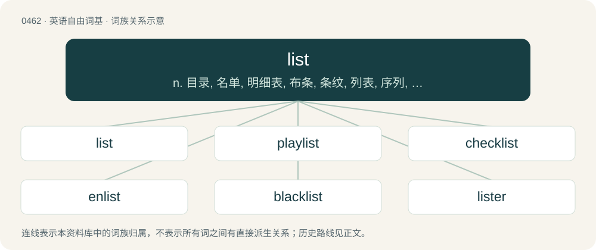

# 0521 · list — n. 目录, 名单, 明细表, 布条, 条纹, 列表, 序列, 数据清单；vt. 列出, 列于表上, 记入名单内, 装布条；vi. 列于表上

[总目录](../00_总目录_按常用程度.md)

**类型**：英语自由词基　｜　**来源语言**：见词源记录

## 核心含义与来源

- 核心含义：n. 目录, 名单, 明细表, 布条, 条纹, 列表, 序列, 数据清单；vt. 列出, 列于表上, 记入名单内, 装布条；vi. 列于表上
- 英文含义：A strip of fabric, especially from the edge of a piece of cloth.
- 词形：list

**多个词源／构词路径**：同一拼写可能有不同来源；以下按词性和含义分别列出。

**来源记录 1**（名词；A strip of fabric, especially from the edge of a piece of cloth.）

From Middle English lī̆st, lī̆ste (“band, stripe; hem, selvage; border, edge, rim; list, specification; barriers enclosing area for jousting, etc.”), from Old English līste (“hem, edge, strip”), or Old French liste, listre (“border; band; strip of paper; list”), or Medieval Latin lista, all from Proto-West Germanic \*līstā, possibly from Proto-Indo-European \*leys- (“to trace, track”). Cognates \* Saterland Frisian Lieste (“margin, strip, list”) \* Dutch lijst (“picture frame, list”) \* German Low German Liest (“edging, border”) \* German Leiste (“strip, rail, ledge; (heraldry) bar”) \* Swedish lista (“list”) \* Icelandic lista listi (“list”) \* Italian lista (“list; strip”) \* Portuguese lista (“list”) \* Spanish lista (“list, roll; stripe”) \* Galician lista (“band, strip; list”) \* Finnish lista (“(informal) list; batten”).

**来源记录 2**（动词；To listen.）

From Middle English listen, from Old English hlystan (“to listen”), from hlyst (“hearing”), from Proto-West Germanic \*hlusti, from Proto-Germanic \*hlustiz (“hearing”).

**来源记录 3**（名词；A tilt to a building.）

Uncertain; possibly from tilting on lists in jousts, or from Etymology 4 in the sense of inclining towards what one desires.

## 词族图

## 单词速览（常用到不常用）

| 单词 | 音标 | 释义 |
|---|---|---|
| [list](#w-1) | /lɪst/ | n. 目录, 名单, 明细表, 布条, 条纹, 列表, 序列, 数据清单；vt. 列出, 列于表上, 记入名单内, 装布条；vi. 列于表上 |
| [playlist](#w-2) | /ˈpleɪˌlɪst/ | n. 播放列表；演出剧目表 |
| [checklist](#w-3) | /ˈt͡ʃɛklɪst/ | n. 清单, (美)选举人名单, 名册, 目录册 |
| [enlist](#w-4) | /ɛnˈlɪst/ | vt. 征募, 参与, 谋取；vi. 从军, 应募, 赞助 |
| [blacklist](#w-5) | /ˈblæklɪst/ | n. 黑名单 |
| [lister](#w-6) | /ˈlistə/ | n. 双耕犁, 制表人 |
| [wishlist](#w-7) | 美 /ˈwɪʃ.lɪst/ | n. 意愿清单 |
| [setlist](#w-8) | 美 /ˈsɛtˌlɪst/ | 【英文】A list of the songs to be played by a particular band or musical act for a particular show or tour. |
| [watchlist](#w-9) | 英 /ˈwɒt͡ʃˌlɪst/；美 /ˈwɔt͡ʃˌlɪst/ | 【英文】A list of people or things that are assigned to receive special attention or monitoring. |
| [listless](#w-10) | /ˈlɪstlɪs/ | a. 倦怠的, 无精打采的；\[经\] 交易清淡的 |
| [tracklist](#w-11) |  | 【英文】A tracklisting; a list of tracks appearing on an album, EP, LP etc. |
| [booklist](#w-12) | /ˈbʊklɪst/ | (某个题目或学科的)推荐书目, 书单 |
| [whitelist](#w-13) |  | 【英文】To place on a whitelist; to mark or note a person or entity as trustworthy or acceptable. |
| [waitlist](#w-14) | /ˈweɪtˌlɪst/ | vt. 把...登入申请人名单 |
| [longlist](#w-15) |  | 【英文】An initial, relatively long, shortlist, from which a further shortlist is selected. |

## 逐词详解

### 1. list

**词性**：动词　｜　**音标**：/lɪst/

**中文释义**：n. 目录, 名单, 明细表, 布条, 条纹, 列表, 序列, 数据清单；vt. 列出, 列于表上, 记入名单内, 装布条；vi. 列于表上

**英文义项**：To create or recite a list. / To place in listings.

**词源与演化**：

From Middle English lī̆st, lī̆ste (“band, stripe; hem, selvage; border, edge, rim; list, specification; barriers enclosing area for jousting, etc.”), from Old English līste (“hem, edge, strip”), or Old French liste, listre (“border; band; strip of paper; list”), or Medieval Latin lista, all from Proto-West Germanic \*līstā, possibly from Proto-Indo-European \*leys- (“to trace, track”). Cognates \* Saterland Frisian Lieste (“margin, strip, list”) \* Dutch lijst (“picture frame, list”) \* German Low German Liest (“edging, border”) \* German Leiste (“strip, rail, ledge; (heraldry) bar”) \* Swedish lista (“list”) \* Icelandic lista listi (“list”) \* Italian lista (“list; strip”) \* Portuguese lista (“list”) \* Spanish lista (“list, roll; stripe”) \* Galician lista (“band, strip; list”) \* Finnish lista (“(informal) list; batten”).

**例句**：

> I was able to invest as soon as the company was listed.

该用例对应义项：To trade on a particular stock exchange.

### 2. playlist

**词性**：动词　｜　**音标**：/ˈpleɪˌlɪst/

**中文释义**：n. 播放列表；演出剧目表

**英文义项**：To include (a track) on a playlist.

**构词拆分**：play + list

**词源与演化**：

From play + list.

**例句**：

> She achieved success when her first single was playlisted on national radio.

该用例对应义项：To include (a track) on a playlist.

### 3. checklist

**词性**：名词　｜　**音标**：/ˈt͡ʃɛklɪst/

**中文释义**：n. 清单, (美)选举人名单, 名册, 目录册

**英文义项**：A list of tasks to be completed, names to be consulted, conditions to be verified and similar. / An inventory, especially of species.

**构词拆分**：check + list

**词源与演化**：

From check + list.

**用法示例／搭配（非完整句）**：

> a checklist of the plants of the Guiana Shield

该用例对应义项：An inventory, especially of species.

### 4. enlist

**词性**：动词　｜　**音标**：/ɛnˈlɪst/

**中文释义**：vt. 征募, 参与, 谋取；vi. 从军, 应募, 赞助

**英文义项**：To enter on a list; to enroll; to register. / To voluntarily join a cause or organization, especially military service.

**构词拆分**：en- + list

**词源与演化**：

From en- + list.

**例句**：

> The army wants potential soldiers to enlist.

该用例对应义项：To voluntarily join a cause or organization, especially military service.

### 5. blacklist

**词性**：名词　｜　**音标**：/ˈblæklɪst/

**中文释义**：n. 黑名单

**英文义项**：A list or set of people or entities to be shunned or banned, disallowed or blocked.

**构词拆分**：black + list

**词源与演化**：

From black + list.

**例句**：

> The software included a lengthy blacklist of disreputable websites to block.

该用例对应义项：A list or set of people or entities to be shunned or banned, disallowed or blocked.

### 6. lister

**词性**：名词　｜　**音标**：/ˈlistə/

**中文释义**：n. 双耕犁, 制表人

**英文义项**：One who, or that which, lists or produces a listing. / A person or organisation that creates or maintains lists.

**构词拆分**：list + -er

**词源与演化**：

From list + -er.

### 7. wishlist

**词性**：动词　｜　**音标**：美 /ˈwɪʃ.lɪst/

**中文释义**：n. 意愿清单

**英文义项**：To include on a wishlist.

**构词拆分**：wish + list

**词源与演化**：

From wish + list.

**例句**：

> One of the items on your wishlist is on sale.

### 8. setlist

**词性**：名词　｜　**音标**：美 /ˈsɛtˌlɪst/

**英文义项**：A list of the songs to be played by a particular band or musical act for a particular show or tour.

**构词拆分**：set + list

**词源与演化**：

From set + list.

### 9. watchlist

**词性**：名词　｜　**音标**：英 /ˈwɒt͡ʃˌlɪst/；美 /ˈwɔt͡ʃˌlɪst/

**英文义项**：A list of people or things that are assigned to receive special attention or monitoring.

**构词拆分**：watch + list

**词源与演化**：

From watch + list.

**例句**：

> The police have hundreds of citizens on their watchlists.

该用例对应义项：A list of people or things that are assigned to receive special attention or monitoring.

### 10. listless

**词性**：形容词　｜　**音标**：/ˈlɪstlɪs/

**中文释义**：a. 倦怠的, 无精打采的；\[经\] 交易清淡的

**英文义项**：Lacking energy, enthusiasm, or liveliness.

**构词拆分**：list (“desire”) + -less

**词源与演化**：

From Middle English lystles, equivalent to list (“desire”) + -less. Compare German lustlos and Dutch lusteloos (“lethargic, listless”). Doublet of lustless.

**例句**：

> He was listless and bored.

该用例对应义项：lacking zest or vivacity

### 11. tracklist

**词性**：名词

**英文义项**：A tracklisting; a list of tracks appearing on an album, EP, LP etc.

**构词拆分**：track + list

**词源与演化**：

From track + list.

**例句**：

> On the inlay card she had neatly printed the tracklist and drawn a heart.

### 12. booklist

**词性**：名词　｜　**音标**：/ˈbʊklɪst/

**中文释义**：(某个题目或学科的)推荐书目, 书单

**英文义项**：Any list of books. / The list of books published by a publisher.

**构词拆分**：book + list

**词源与演化**：

From book + list.

### 13. whitelist

**词性**：动词

**英文义项**：To place on a whitelist; to mark or note a person or entity as trustworthy or acceptable.

**构词拆分**：white + list

**词源与演化**：

From white + list.

**例句**：

> The email program allows you to whitelist email from known sources.

该用例对应义项：To place on a whitelist; to mark or note a person or entity as trustworthy or acceptable.

### 14. waitlist

**词性**：名词　｜　**音标**：/ˈweɪtˌlɪst/

**中文释义**：vt. 把...登入申请人名单

**英文义项**：A waiting list.

**构词拆分**：wait + list

**词源与演化**：

From wait + list.

### 15. longlist

**词性**：名词

**英文义项**：An initial, relatively long, shortlist, from which a further shortlist is selected.

**构词拆分**：long + list

**词源与演化**：

From long + list.
