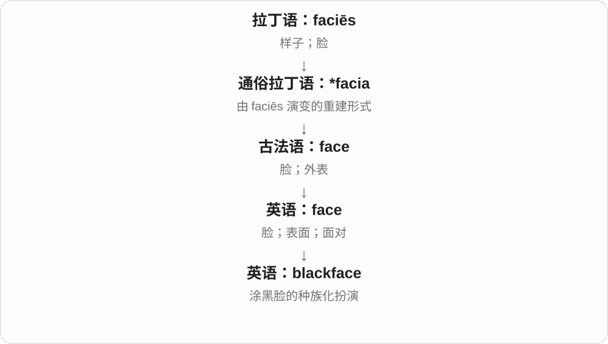

# 0522 · black — 黑、暗及相关命名；遮蔽、排斥等引申

[逐词精讲目录](../00_逐词精讲目录.md) · [总目录](../00_总目录_按常用程度.md)

## 核心词根与来源

black 接古英语 blæc。blackmail 的 mail 是旧租金、贡赋词，不能按电子邮件理解；blackbird、blackcurrant 等固定名也不按所有字面颜色对象泛化。

**BLACK：先看颜色，再看具体命名和固定比喻**

黑板、黑莓、铁匠各有命名对象；抹黑、勒索、禁止名单则各有历史和用法，不能一个黑字全包。

- **颜色、性质与变化**：black · blacken · blackish · blackness
- **器物、工匠与具体生物**：blackboard · blacksmith · blackberry · blackcurrant · blackbird · blackhead · blacktop
- **勒索、排斥、中断和牌戏**：blackmail · blacklist · blackout · blackjack
- **既有社会文化用法精讲**：blackface

## 词形与演化规律

black → blacken、blackish、blackness；blackboard、blacksmith、果类鸟类相邻分组；blackmail、blacklist、blackout、blackjack 分别讲固定历史、机制和多义。

## 单词速览（按词族由简到繁）

同一基础词的相关扩展放在一起，先读基础形式，再读扩展；各组之间优先读常用的。具体词源关系见各词讲解。

| 单词 | 音标 | 核心意思 |
|---|---|---|
| [black](#w-1) | /blæk/ | 黑的；黑色；暗的；黑人相关的〔社会分类〕 |
| [blackberry](#w-2) | 英 /ˈblækbəri/；美 /ˈblækberi/ | 黑莓；黑莓植株 |
| [blackmail](#w-3) | /ˈblækmeɪl/ | 敲诈；勒索；要挟 |
| [blacksmith](#w-4) | /ˈblæksmɪθ/ | 铁匠 |
| [blackjack](#w-5) | /ˈblækdʒæk/ | 二十一点牌戏；某些短棍等物名〔另义〕 |
| [blacklist](#w-6) | /ˈblæklɪst/ | 禁止、排除名单；把……列入禁止名单 |
| [blackness](#w-7) | /ˈblæknəs/ | 黑暗；黑色、漆黑的性质；黑人身份相关概念〔特定讨论〕 |
| [blackboard](#w-8) | 英 /ˈblækbɔːd/；美 /ˈblækbɔːrd/ | 黑板；粉笔书写板 |
| [blackbird](#w-11) | 英 /ˈblækbɜːd/；美 /ˈblækbɜːrd/ | 乌鸫；某些美洲黑羽鸟类〔依地区〕 |
| [blackface](#w-12) | /ˈblækˌfeɪs/ | 涂黑脸的种族化扮演 |
| [blackish](#w-13) | /ˈblækɪʃ/ | 发黑的；略黑的 |
| [blacken](#w-16) | /ˈblækən/ | 使变黑；变黑；败坏〔名声等〕 |
| [blacktop](#w-17) | 英 /ˈblæktɒp/；美 /ˈblæktɑːp/ | 沥青路面；铺了沥青的场地〔尤美〕 |
| [blackcurrant](#w-18) | 英 /ˈblækkʌrənt/；美 /ˈblækkɜːrənt/ | 黑加仑；黑穗醋栗 |
| [blackhead](#w-20) | /ˈblækhed/ | 黑头；黑头粉刺 |
| [blackout](#w-22) | /ˈblækaʊt/ | 停电、熄灯；记忆空白、短暂失去意识；信息封锁 |

## 逐词讲解

### 1. black — 黑的；黑色；暗的；黑人相关的〔社会分类〕

**音标**：/blæk/

**先抓住这个画面**

先想黑墨、黑布和无光的夜；其他用法再按物品、文化、固定表达理解。

**怎么拆**

接古英语 blæc、中古英语 blak、black；更早与燃烧词族的联系是词源解释之一，不把所有细节讲成确定故事。

**怎么变成今天的意思**

**古英语 blæc → 中古英语 blak / black**  
黑、暗；墨色

↓

**英语 black**  
黑色；无光；相关社会分类和固定用语

a black coat 黑外套，black coffee 不加奶的咖啡，go black 变黑或屏幕黑掉。Black / black 用于人群和身份时，按材料中的社会文化分类理解。

**常见搭配与例句**

a black coat；black coffee；in black；go black。

> The screen suddenly went black.

屏幕突然黑了。

> She ordered black coffee without sugar.

她点了不加糖的黑咖啡。

**别混淆**

black coffee 按有无奶命名，不要求咖啡真如墨水一样黑；black 的物理颜色义与人群身份词要分语境。

### 2. blackberry — 黑莓；黑莓植株

**音标**：英 /ˈblækbəri/；美 /ˈblækberi/

**先抓住这个画面**

成熟果实由一颗颗小果粒簇成深色的一团，外观是最直观的命名线索。

**怎么拆**

black + berry，古英语已有相应组合，中古英语 blakberie 等延续。berry 在日常果名里用法宽，不按植物学浆果定义硬套每个名称。

**怎么变成今天的意思**

**black；berry**  
并列构词部分

↓

**blackberry**  
成熟呈深色的黑莓果实、植株

blackberry jam 黑莓果酱，pick blackberries 摘黑莓；复数 y 变 ies。大写 BlackBerry 还可能是品牌，按语境分。

**常见搭配与例句**

blackberry jam；pick blackberries；a blackberry bush。

> She made blackberry jam from the fruit in the garden.

她用花园里的果实做了黑莓果酱。

> The children picked blackberries beside the path.

孩子们在小径旁摘黑莓。

**别混淆**

blackberry 黑莓，blackcurrant 黑加仑，是不同果类；不是只因同为深色就能互作准确菜名。

### 3. blackmail — 敲诈；勒索；要挟

**音标**：/ˈblækmeɪl/

**先抓住这个画面**

拿某人害怕的事作筹码，逼他交钱或照要求做；不是给他发一封黑色邮件。

**怎么拆**

black + 旧苏格兰语 mail（租金、贡赋等），与邮寄邮件 mail 不同。早期涉及边境索取保护费等背景；black 的具体命名动机有多种解释，不把黑牛支付故事说成定论。

**怎么变成今天的意思**

**旧苏格兰语 mail〔租金、贡赋〕与 black 组合**  
边境保护费等旧用法

↓

**英语 blackmail**  
以威胁揭露等方式敲诈、要挟

blackmail someone into doing something 要挟某人做事，emotional blackmail 情感要挟。一般词义抓威胁与强迫，现实法律范围则按具体材料。

**常见搭配与例句**

blackmail someone into；blackmail someone over；emotional blackmail。

> The novel centers on an attempt to blackmail a public figure.

小说围绕一次对公众人物的勒索企图展开。

> She refused to give in to emotional blackmail.

她拒绝向情感要挟屈服。

**别混淆**

blackmail 不是邮件种类；bribe 贿赂常是给好处拉人办事，blackmail 则拿威胁逼人，不是一个动作。

### 4. blacksmith — 铁匠

**音标**：/ˈblæksmɪθ/

**先抓住这个画面**

把铁加热后锻打成工具、构件，金属表面常带深色氧化皮。

**怎么拆**

black + smith，black 与锻铁的深色表面相关；smith 是金属匠等旧从业者称谓，不是某个姓 Smith 才能做这工作。

**怎么变成今天的意思**

**black；smith〔铁匠、金属工匠〕**  
并列构词部分

↓

**blacksmith**  
主要锻造铁、钢等的工匠

a blacksmith’s forge 铁匠铺、锻炉，a village blacksmith 村里的铁匠。传统也参与制作马蹄铁等，但不只给马钉掌。

**常见搭配与例句**

a village blacksmith；a blacksmith’s forge；a blacksmith’s hammer。

> The blacksmith shaped the hot iron with a hammer.

铁匠用锤子锻打热铁。

> The museum recreated a village blacksmith’s workshop.

博物馆复原了村里的铁匠工坊。

**别混淆**

blacksmith 铁匠，goldsmith 金匠、silversmith 银匠按材料分；不是用人的肤色命名职业。

### 5. blackjack — 二十一点牌戏；某些短棍等物名〔另义〕

**音标**：/ˈblækdʒæk/

**先抓住这个画面**

今天最容易在赌场、纸牌题材遇到，是一个固定牌戏名，不能逐字译成黑色杰克。

**怎么拆**

black + jack；历史上整体用于多种物品名称，现代主要常见于二十一点牌戏。jack 有人物、工具、纸牌 J 等多义，不凭组成就替每个同形义编同一演化链。

**怎么变成今天的意思**

**black；jack〔多义成分〕**  
并列构词部分

↓

**blackjack**  
多种固定物名；现代常见二十一点牌戏名

play blackjack 玩二十一点，a blackjack table 二十一点牌桌；读旧小说时 blackjack 也可能指短棍武器等，不是所有都在写纸牌。

**常见搭配与例句**

play blackjack；a blackjack table；a game of blackjack。

> The film includes a scene at a blackjack table.

电影里有一场二十一点牌桌旁的戏。

> He read a book about the history of blackjack.

他读了一本关于二十一点牌戏历史的书。

**别混淆**

blackjack 整体是牌戏等名称，a black jack 在牌面描述中可只是黑色花色的 J；名称与任意牌张描述不同。

### 6. blacklist — 禁止、排除名单；把……列入禁止名单

**音标**：/ˈblæklɪst/

**先抓住这个画面**

把不准进入、不准使用或不愿接触的对象，明确列出来拦住。

**怎么拆**

black + list，传统命名把排斥、禁止一类评价借黑来表达；现代技术材料也常叫 blocklist，名称不保证所有系统默认行为相同。

**怎么变成今天的意思**

**black；list**  
并列构词部分

↓

**blacklist**  
需排除、阻止的对象名单；列入此名单

on a blacklist 在禁止名单上，blacklist an address 屏蔽某地址。历史就业语境也会指对人的不录用、排斥名单。

**常见搭配与例句**

on a blacklist；add to a blacklist；blacklist an address。

> The filter checks incoming messages against a blacklist.

过滤器按禁止名单检查收到的消息。

> The company denied keeping a blacklist of former employees.

公司否认保留了针对前员工的排斥名单。

**别混淆**

blacklist 明确阻止，whitelist 明确允许；blocklist、allowlist 是更直白的相应名称。

### 7. blackness — 黑暗；黑色、漆黑的性质；黑人身份相关概念〔特定讨论〕

**音标**：/ˈblæknəs/

**先抓住这个画面**

灯一关，眼前整片漆黑；把这种黑、暗的状态本身说出来。

**怎么拆**

black + -ness，中古英语已有 blaknesse 等，-ness 表性质、状态。社会文化研究另可用 Blackness 讨论黑人身份、文化经验。

**怎么变成今天的意思**

**古英语 blæc → 中古英语 blak / black**  
黑、暗；墨色

↓

**英语 black**  
黑色；无光；相关社会分类和固定用语

↓

**black + -ness → blackness**  
黑色、黑暗的性质；社会语境的身份概念

the blackness of the night 夜的漆黑，disappear into blackness 消失在黑暗里。谈文化身份时，不要只按色卡深浅翻译。

**常见搭配与例句**

the blackness of；into the blackness；complete blackness。

> The boat disappeared into the blackness of the night.

小船消失在漆黑夜色里。

> A single candle broke the blackness of the room.

一支蜡烛打破了房里的漆黑。

**别混淆**

blackness 状态、性质，blackout 常是一段断电、记忆空白或信息中断事件。

### 8. blackboard — 黑板；粉笔书写板

**音标**：英 /ˈblækbɔːd/；美 /ˈblækbɔːrd/

**先抓住这个画面**

老师用粉笔写，擦了还能再写；名称来自早期常见深色板面。

**怎么拆**

black + board（板），早期常用黑色石板等材料。今天有些粉笔板是绿色，也仍沿用 blackboard 名称。

**怎么变成今天的意思**

**black；board〔书写板〕**  
并列构词部分

↓

**blackboard**  
用粉笔书写、可擦除的板

write on the blackboard 在黑板上写，a blackboard eraser 黑板擦；也常说 chalkboard，突出用粉笔。

**常见搭配与例句**

write on a blackboard；a blackboard eraser；at the blackboard。

> The teacher wrote the equation on the blackboard.

老师把方程写在黑板上。

> Someone had cleaned the blackboard before class.

上课前，有人擦干净了黑板。

**别混淆**

blackboard 常粉笔书写，whiteboard 通常专用笔书写；不只按眼前颜色认名称。

### 9. blackbird — 乌鸫；某些美洲黑羽鸟类〔依地区〕

**音标**：英 /ˈblækbɜːd/；美 /ˈblækbɜːrd/

**先抓住这个画面**

按黑色鸟的形象起名，但成为鸟名后，范围比“所有黑色的鸟”更具体。

**怎么拆**

black + bird，中古英语有 blakebird、blacbrid 等。不同地区的 blackbird 可以对应不同鸟类，不能只凭颜色定种。

**怎么变成今天的意思**

**black；bird**  
并列构词部分

↓

**blackbird**  
乌鸫等特定鸟类名称

a singing blackbird 鸣唱的乌鸫，blackbirds in the garden 花园里的乌鸫等鸟。欧洲乌鸫雄鸟通常黑，雌鸟常偏褐，不因名字就全是纯黑。

**常见搭配与例句**

a singing blackbird；a blackbird’s song；blackbirds in the garden。

> A blackbird was singing in the garden.

花园里一只乌鸫在鸣唱。

> The bird guide compares male and female blackbirds.

鸟类图鉴对比了雄性与雌性乌鸫。

**别混淆**

blackbird 连写是具体鸟名；a black bird 分写可以只是任意一只黑鸟，比如乌鸦，不必就是乌鸫。

### 10. blackface — 涂黑脸的种族化扮演

**音标**：/ˈblækˌfeɪs/

**先抓住这个画面**

这个词常指非黑人表演者涂黑脸部、模仿黑人的表演传统，尤其关联种族刻板印象与贬损。

**怎么拆**

black + face，是英语合成；不是所有黑色面部化妆在任何情境下都具有同一历史含义。

**怎么变成今天的意思**

字面黑脸在特定演出传统中形成固定文化含义。理解影视和社会讨论时，要连同其历史背景看，不能只按颜色翻译。

**常见搭配与例句**

blackface performance；the history of blackface。

> The documentary examines the history of blackface in entertainment.

纪录片考察了娱乐业中涂黑脸表演的历史。

> The theatre removed the scene because it used blackface.

剧院因该场景使用涂黑脸表演而将其删除。

**别混淆**

black face 是普通的两个词组合；blackface 作为固定词通常指上述表演做法。

### 11. blackish — 发黑的；略黑的

**音标**：/ˈblækɪʃ/

**先抓住这个画面**

看起来偏黑，但可能混着灰、棕，不把色调说死。

**怎么拆**

black + -ish，中古英语有 blackysshe、blakkyssh；-ish 表略带、大致这种特点。

**怎么变成今天的意思**

**古英语 blæc → 中古英语 blak / black**  
黑、暗；墨色

↓

**英语 black**  
黑色；无光；相关社会分类和固定用语

↓

**black + -ish → blackish**  
颜色偏黑、略黑

a blackish stain 发黑的污痕，blackish brown 黑褐色。它说明颜色观感，不直接解释成因。

**常见搭配与例句**

a blackish stain；blackish brown；a blackish coating。

> A blackish stain spread across the old fabric.

旧布上有一片发黑的污痕。

> The rock was dark gray with a blackish surface.

石头是深灰色的，表面偏黑。

**别混淆**

blackish 偏黑，blackened 已变黑；一个说状态、一个还提示变化过程。

### 12. blacken — 使变黑；变黑；败坏〔名声等〕

**音标**：/ˈblækən/

**先抓住这个画面**

表面被烟熏黑，名声也能被负面说法“抹黑”。

**怎么拆**

black + -en，中古英语有 blaknen、blakkenen 等相应动词；-en 表变成、使变成。

**怎么变成今天的意思**

**古英语 blæc → 中古英语 blak / black**  
黑、暗；墨色

↓

**英语 black**  
黑色；无光；相关社会分类和固定用语

↓

**black + -en → blacken**  
变黑、使黑 → 使名声等受损

smoke blackened the wall 烟熏黑墙，blacken someone’s name 败坏某人名声。后者说负面评价和损害，不是皮肤颜色变化。

**常见搭配与例句**

blacken a wall；blacken someone’s name；blackened by smoke。

> Smoke had blackened the ceiling.

烟把天花板熏黑了。

> The rumors were intended to blacken her reputation.

那些谣言意在败坏她的名声。

**别混淆**

blacken 变黑，darken 变暗的范围更广；lightly darkened 不一定已经 black 黑到极深。

### 13. blacktop — 沥青路面；铺了沥青的场地〔尤美〕

**音标**：英 /ˈblæktɒp/；美 /ˈblæktɑːp/

**先抓住这个画面**

路面表层铺上深色沥青，远看是一片黑色硬面。

**怎么拆**

black（黑色）+ top（表面），用外观命名路面材料和铺成的道路、活动区域；也可作动词说铺沥青。

**怎么变成今天的意思**

**英语 black；top**  
并列组合的两部分

↓

**black + top → blacktop**  
深色沥青铺面；所铺场地

美式学校叙述中 the blacktop 可指铺面操场，公路叙述则是沥青路面。并非任一黑色上衣都用这个连写复合词。

**常见搭配与例句**

a blacktop road；a stretch of blacktop；play on the blacktop。

> The children played basketball on the blacktop.

孩子们在沥青铺面的场地上打篮球。

> The gravel road gave way to smooth blacktop.

碎石路逐渐接上了平整的沥青路。

**别混淆**

blacktop 是铺面，a black top 分开可以是黑色上衣；top 在两个结构里选了不同义项。

### 14. blackcurrant — 黑加仑；黑穗醋栗

**音标**：英 /ˈblækkʌrənt/；美 /ˈblækkɜːrənt/

**先抓住这个画面**

小小一颗深紫色果实，常出现在果汁、果酱的口味名里。

**怎么拆**

black + currant；currant 是醋栗类果名，在别的食品语境也可指某类葡萄干，组合后的 blackcurrant 先当固定果名学。

**怎么变成今天的意思**

**black；currant**  
并列构词部分

↓

**blackcurrant**  
黑穗醋栗的果实、植株

blackcurrant juice 黑加仑汁，blackcurrant jam 黑加仑果酱；也可分写 black currant。

**常见搭配与例句**

blackcurrant juice；blackcurrant jam；blackcurrant flavor。

> She bought a bottle of blackcurrant juice.

她买了一瓶黑加仑汁。

> The cake had a sharp blackcurrant filling.

蛋糕里夹着酸味鲜明的黑加仑馅。

**别混淆**

blackcurrant 不是所有黑葡萄干；currant 的多义不能把这个固定果名随意换成另种果实。

### 15. blackhead — 黑头；黑头粉刺

**音标**：/ˈblækhed/

**先抓住这个画面**

皮肤表面露出一个小黑点，用外面看见的颜色和小尖端来命名。

**怎么拆**

black + head，日常皮肤用法是开口处呈黑色的粉刺；这里 head 是小突起、端部，不是人的整颗头。另有鸟类等名称，暂不展开。

**怎么变成今天的意思**

**英语 black；head〔小端部〕**  
并列组合的两部分

↓

**black + head〔小端部〕 → blackhead**  
表面呈黑点的粉刺

一般谈护肤、皮肤外观时可见，常用复数 blackheads。名称并不表示黑色就是没洗干净留下的污垢。

**常见搭配与例句**

blackheads on the nose；the appearance of blackheads；blackheads and whiteheads。

> The article explains why blackheads look dark.

文章解释了黑头为什么看起来发黑。

> The guide includes a section on blackheads and whiteheads.

指南中有一节介绍黑头与白头粉刺。

**别混淆**

blackhead 表面开口呈黑点，whitehead 是另一种常见粉刺名称；这类词先理解外观命名，不能用颜色直接推断护理办法。

### 16. blackout — 停电、熄灯；记忆空白、短暂失去意识；信息封锁

**音标**：/ˈblækaʊt/

**先抓住这个画面**

原本看得见、记得住、传得出的那一段，突然整片黑掉、中断。

**怎么拆**

black + out，由变黑、熄灭一类短语用法形成名词；不同场景再扩到供电、记忆、信息的中断。不是说所有义都真有物理黑色。

**怎么变成今天的意思**

**black；out**  
并列构词部分

↓

**blackout**  
灯光、供电、意识或信息等的中断

a power blackout 停电，a memory blackout 记忆空白，a news blackout 消息封锁。动词常分写 black out；blackout curtains 是遮光窗帘。

**常见搭配与例句**

a power blackout；a news blackout；blackout curtains；a memory blackout。

> A blackout left the neighborhood without power.

一次停电让整个街区没了电。

> The film describes a news blackout during the crisis.

影片描写了危机期间的消息封锁。

**别混淆**

blackout 停电与 blackout curtains 遮光窗帘关注点不同；后者描述遮光用途，不表示房间正在停电。

## 这一组要分清什么

blackmail 的 mail 不是邮件；blackbird 鸟名不等于所有黑鸟；blackout 中断事件，blackness 黑暗状态；blacklist 禁止、whitelist 允许。

## 串起来练习

During the blackout, only the outline of the blackboard was visible.

停电时，只能隐约看见黑板轮廓。
