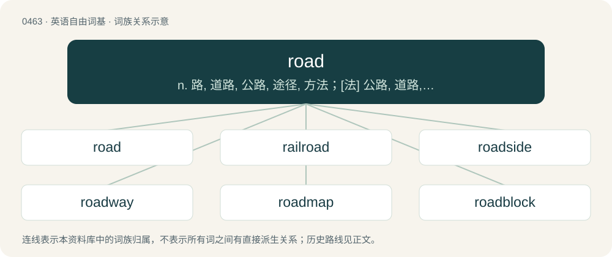

# 0523 · road — n. 路, 道路, 公路, 途径, 方法；\[法\] 公路, 道路, 行车道

[总目录](../00_总目录_按常用程度.md)

**类型**：英语自由词基　｜　**来源语言**：见词源记录

## 核心含义与来源

- 核心含义：n. 路, 道路, 公路, 途径, 方法；\[法\] 公路, 道路, 行车道
- 英文含义：A way used for travelling between places, originally one wide enough to allow foot passengers and horses to travel, now (US) usually one surfaced with asphalt or concrete and designed to accommodate many vehicles travelling in both directions. In the UK both senses are heard: a country road is the same as a country lane.
- 词形：road

**来源记录 1**（名词；A way used for travelling between places, originally one wide enough to allow foot passengers and horses to travel, now (US) usually one surfaced with asphalt or concrete and designed to accommodate many vehicles travelling in both directions. In the UK both senses are heard: a country road is the same as a country lane.）

From Middle English rode, rade (“ride, journey”), from Old English rād (“riding, hostile incursion”), from Proto-West Germanic \*raidu, from Proto-Germanic \*raidō (“a ride”), from Proto-Indo-European \*reydʰ- (“to ride”). Doublet of raid, acquired from Scots. Cognates include West Frisian reed (paved trail/road, driveway). The current primary meaning of "street, way for traveling" originated relatively late — Shakespeare seemed to expect his audiences to find it unfamiliar — and probably arose through reinterpretation of roadway (“a way for riding on”) as saying way twice, in other words as a tautological compound.

## 词族图

## 单词速览（常用到不常用）

| 单词 | 音标 | 释义 |
|---|---|---|
| [road](#w-1) | 美 /ɹod/；/ɹəʊd/ | n. 路, 道路, 公路, 途径, 方法；\[法\] 公路, 道路, 行车道 |
| [railroad](#w-2) | 英 /ˈɹeɪlɹəʊd/；美 /ˈɹeɪlɹoʊd/ | n. 铁路, 铁路公司；vt. 铺设铁路, 用铁路运输；vi. 在铁路工作 |
| [roadside](#w-3) | 英 /ˈɹəʊdsaɪd/；美 /ˈɹoʊdsaɪd/ | n. 路旁, 路边；a. 路边的 |
| [roadway](#w-4) | 美 /ˈɹoʊdˌweɪ/ | n. 车道, 道路, 轨道；\[法\] 道路, 路面, 快车道 |
| [roadmap](#w-5) | /ˈrod,mæp/ | n. 路标 |
| [roadblock](#w-6) | /ˈrəudblɒk/ | n. 障碍, 障碍物 |
| [roadshow](#w-7) | /ˈrəʊdʃəʊ/ | n. （由广播电台、杂志或公司组织的）路演, 巡回演出; 巡回演出; 巡回宣传（或竞选）团队 |
| [roadster](#w-8) | 英 /ˈɹəʊdstə/；美 /ˈɹoʊdstəɹ/ | n. 敞篷小客车, 流浪者 |
| [roadhouse](#w-9) | 英 /ˈɹəʊdˌhaʊs/；美 /ˈɹoʊdˌhaʊs/ | n. 郊外小旅馆, 客栈 |
| [roadkill](#w-10) | 英 /ˈɹəʊdˌkɪl/；美 /ˈɹoʊdˌkɪl/ | 路上被轧死的动物 |
| [roadie](#w-11) | 英 /ˈɹəʊdi/；美 /ˈɹoʊdi/ | n. 巡回乐队管理员 |
| [crossroad](#w-12) | /ˈkrɒsrəud/ | n. 交叉路, 岔道, 十字路口 |
| [roadrunner](#w-13) | 英 /ˈɹəʊdˌɹʌnə/；美 /ˈɹoʊdˌɹʌnɚ/ | n. \[鸟\](中美、北美产)走鹃 |
| [roading](#w-14) | /ˈrəudiŋ/ | n. 公路建设与保养 |
| [roadwork](#w-15) | /ˈrəjdw\\\\ːk/ | n. 越野长跑训练 |
| [roadbed](#w-16) | 美 /ˈɹoʊdˌbɛd/ | n. 路基 |

## 逐词详解

### 1. road

**词性**：名词　｜　**音标**：美 /ɹod/；/ɹəʊd/

**中文释义**：n. 路, 道路, 公路, 途径, 方法；\[法\] 公路, 道路, 行车道

**英文义项**：A way used for travelling between places, originally one wide enough to allow foot passengers and horses to travel, now (US) usually one surfaced with asphalt or concrete and designed to accommodate many vehicles travelling in both directions. In the UK both senses are heard: a country road is the same as a country lane. / Roads in general as a means of travel, especially by motor vehicle.

**词源与演化**：

From Middle English rode, rade (“ride, journey”), from Old English rād (“riding, hostile incursion”), from Proto-West Germanic \*raidu, from Proto-Germanic \*raidō (“a ride”), from Proto-Indo-European \*reydʰ- (“to ride”). Doublet of raid, acquired from Scots. Cognates include West Frisian reed (paved trail/road, driveway). The current primary meaning of "street, way for traveling" originated relatively late — Shakespeare seemed to expect his audiences to find it unfamiliar — and probably arose through reinterpretation of roadway (“a way for riding on”) as saying way twice, in other words as a tautological compound.

**例句**：

> the road to happiness; the road to success.

该用例对应义项：A path chosen, as in life or career.

### 2. railroad

**词性**：名词　｜　**音标**：英 /ˈɹeɪlɹəʊd/；美 /ˈɹeɪlɹoʊd/

**中文释义**：n. 铁路, 铁路公司；vt. 铺设铁路, 用铁路运输；vi. 在铁路工作

**英文义项**：A permanent track consisting of fixed metal rails to drive trains or similar motorized vehicles on. / The transportation system comprising such tracks and vehicles fitted to travel on the rails, usually with several vehicles connected together in a train.

**构词拆分**：rail + road

**词源与演化**：

From rail + road.

**例句**：

> The lawyers made the procedure a railroad to get the signatures they needed.

该用例对应义项：A procedure conducted in haste without due consideration.

### 3. roadside

**词性**：形容词　｜　**音标**：英 /ˈɹəʊdsaɪd/；美 /ˈɹoʊdsaɪd/

**中文释义**：n. 路旁, 路边；a. 路边的

**英文义项**：Located beside a road (or railway).

**构词拆分**：road + -side

**词源与演化**：

From road + -side.

**例句**：

> The roadside stand did a good business just selling products to people who merely wanted directions.

该用例对应义项：Located beside a road (or railway).

### 4. roadway

**词性**：名词　｜　**音标**：美 /ˈɹoʊdˌweɪ/

**中文释义**：n. 车道, 道路, 轨道；\[法\] 道路, 路面, 快车道

**英文义项**：A way used as a road. / The main or central portion of a road, used by the vehicles.

**构词拆分**：road + way

**词源与演化**：

From Middle English \*rodeway, \*radewey (attested in radewey-stile (literally “roadway-stile”)), equivalent to road + way; road had the early sense of "riding" when the compound was formed, thus originally "a way for riding on".

**例句**：

> Environmental and roadway factors can also contribute to single-vehicle crashes.

### 5. roadmap

**词性**：动词　｜　**音标**：/ˈrod,mæp/

**中文释义**：n. 路标

**英文义项**：To construct a plan of action regarding (something).

**构词拆分**：road + map

**词源与演化**：

From road + map.

### 6. roadblock

**词性**：名词　｜　**音标**：/ˈrəudblɒk/

**中文释义**：n. 障碍, 障碍物

**英文义项**：Something that blocks or obstructs a road. / An obstacle or impediment.

**构词拆分**：From road + block.

**词源与演化**：

From road + block.

**用法示例／搭配（非完整句）**：

> to hit roadblocks

该用例对应义项：An obstacle or impediment.

### 7. roadshow

**词性**：名词　｜　**音标**：/ˈrəʊdʃəʊ/

**中文释义**：n. （由广播电台、杂志或公司组织的）路演, 巡回演出; 巡回演出; 巡回宣传（或竞选）团队

**英文义项**：A show that travels from place to place. / The showing of a film in selected cinemas prior to its general release.

**构词拆分**：road + show

**词源与演化**：

From road + show.

### 8. roadster

**词性**：名词　｜　**音标**：英 /ˈɹəʊdstə/；美 /ˈɹoʊdstəɹ/

**中文释义**：n. 敞篷小客车, 流浪者

**英文义项**：A bicycle, or tricycle, adapted for common roads, rather than for the racing track, usually of classic style and steel-framed construction. / One who drives much; a coach driver.

**构词拆分**：road + -ster

**词源与演化**：

Derived from road + -ster.

### 9. roadhouse

**词性**：名词　｜　**音标**：英 /ˈɹəʊdˌhaʊs/；美 /ˈɹoʊdˌhaʊs/

**中文释义**：n. 郊外小旅馆, 客栈

**英文义项**：An inn or similar establishment situated beside a road beyond the jurisdiction of a town or city. In the centuries before motor vehicles, such inns were places for travellers to stop at night during multi-day journeys, besides being public houses for their local countryfolk. / A receiving house.

**构词拆分**：road + house

**词源与演化**：

From road + house.

### 10. roadkill

**词性**：名词　｜　**音标**：英 /ˈɹəʊdˌkɪl/；美 /ˈɹoʊdˌkɪl/

**中文释义**：路上被轧死的动物

**英文义项**：The killing of an animal by a road vehicle. / A successful kill in a deathmatch game by hitting an opponent with a road vehicle. A point or score (when considered collectively) gained by successfully killing opponents by a road vehiclein a deathmatch game.

**构词拆分**：road + kill

**词源与演化**：

From road + kill.

**例句**：

> Vultures usually feed on carrion or roadkill.

该用例对应义项：the dead body of an animal that has been killed on a road by a vehicle

### 11. roadie

**词性**：名词　｜　**音标**：英 /ˈɹəʊdi/；美 /ˈɹoʊdi/

**中文释义**：n. 巡回乐队管理员

**英文义项**：One of the crew for a musical group or other travelling stage production, especially a stagehand or technician. / A cyclist who rides on the roads rather than off-road.

**构词拆分**：road + -ie

**词源与演化**：

From road + -ie.

**例句**：

> I don't know about any trails for cycling because I'm mainly a roadie.

该用例对应义项：A cyclist who rides on the roads rather than off-road.

### 12. crossroad

**词性**：名词　｜　**音标**：/ˈkrɒsrəud/

**中文释义**：n. 交叉路, 岔道, 十字路口

**英文义项**：A crossroads (place where one road crosses another). / A road that crosses another.

**构词拆分**：cross + road

**词源与演化**：

From cross + road.

**例句**：

> It was historic center of the province and remains an important transportation crossroad.

### 13. roadrunner

**词性**：名词　｜　**音标**：英 /ˈɹəʊdˌɹʌnə/；美 /ˈɹoʊdˌɹʌnɚ/

**中文释义**：n. \[鸟\](中美、北美产)走鹃

**英文义项**：Either of two species of fast-running bird in the genus Geococcyx of the cuckoo family native to North and Central America, the lesser roadrunner (Geococcyx velox) and, especially, the greater roadrunner (Geococcyx californianus).

**构词拆分**：road + runner

**词源与演化**：

From road + runner, probably a calque of Spanish correcaminos (“roadrunner”), from correr (“to run”) + caminos (“roads”).

**例句**：

> The roadrunner is a bird also known as the "Chaparral Cock" in Texas.

### 14. roading

**词性**：名词　｜　**音标**：/ˈrəudiŋ/

**中文释义**：n. 公路建设与保养

**英文义项**：The construction of roads. / The act of running races in teams.

**构词拆分**：road + -ing

**词源与演化**：

From road + -ing.

### 15. roadwork

**词性**：名词　｜　**音标**：/ˈrəjdw\\\\ːk/

**中文释义**：n. 越野长跑训练

**英文义项**：The construction or maintenance done to roads. / Exercise such as running and jogging done on the roads.

**构词拆分**：road + work

**词源与演化**：

From road + work.

**例句**：

> The athlete needed to get home early to do his roadwork before it got too dark to be safe.

该用例对应义项：Exercise such as running and jogging done on the roads.

### 16. roadbed

**词性**：名词　｜　**音标**：美 /ˈɹoʊdˌbɛd/

**中文释义**：n. 路基

**英文义项**：The prepared location for a road, including its foundation. / A trackbed.

**构词拆分**：road + bed

**词源与演化**：

From road + bed.
