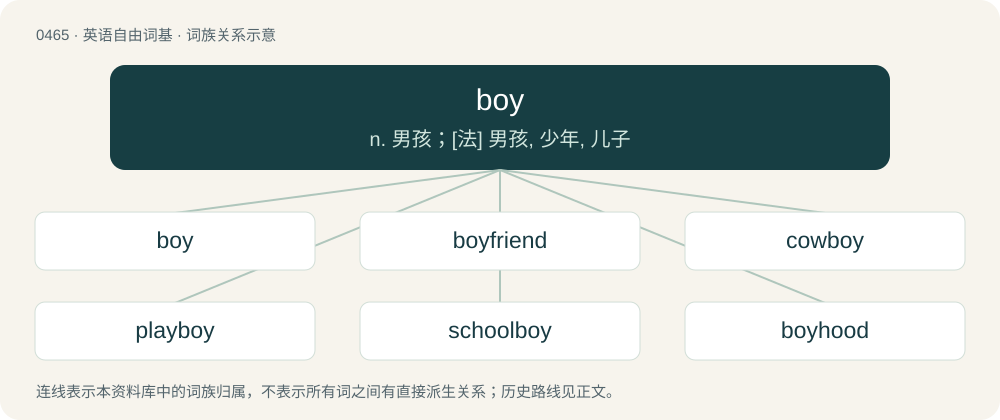

# 0527 · boy — n. 男孩；\[法\] 男孩, 少年, 儿子

[总目录](../00_总目录_按常用程度.md)

**类型**：英语自由词基　｜　**来源语言**：见词源记录

## 核心含义与来源

- 核心含义：n. 男孩；\[法\] 男孩, 少年, 儿子
- 英文含义：A male child.
- 词形：boy

**来源记录 1**（名词；A male child.）

From Middle English boy /boye (“servant, commoner, knave, boy”), from Old English \*bōia (“boy”), from Proto-West Germanic \*bōjō, from Proto-Germanic \*bōjô (“younger brother, young male relation”), from Proto-Germanic \*bō- (“brother, close male relation”), from Proto-Indo-European \*bʰā-, \*bʰāt- (“father, elder brother, brother”). Cognate with Scots boy (“boy”), West Frisian boai (“boy”), Dutch boi (“boy”), Low German Boi (“boy”), and probably to the Old English proper name Bōia. Also related to Saterland Frisian Bouge (“boy”), West Flemish boe (“brother”), Norwegian dialectal boa (“brother”), Dutch boef (“rogue, knave”), Bavarian Bua (“young boy, lad”), German Bube ("boy; knave; jack"; &gt; English bub), Icelandic bófi (“rogue, crook, bandit, knave”), Lombard bagaj ("boy"; (&lt; Germanic)). See also bully.

## 词族图

## 单词速览（常用到不常用）

| 单词 | 音标 | 释义 |
|---|---|---|
| [boy](#w-1) | 英 /bɔɪ/；/bɑːj/ | n. 男孩；\[法\] 男孩, 少年, 儿子 |
| [boyfriend](#w-2) | 美 /ˈbɔɪˌfɹɛnd/ | n. 男朋友 |
| [cowboy](#w-3) | /ˈkaʊˌbɔɪ/ | n. 牛仔, 牛郎, 牧童 |
| [playboy](#w-4) | 英 /ˈpleɪbɔɪ/；美 /ˈpleɪˌbɔɪ/ | n. 花花公子, 乖巧的人 |
| [schoolboy](#w-5) | 美 /ˈskulˌbɔɪ/ | n. 男学生 |
| [boyhood](#w-6) | /ˈbɔɪˌhʊd/ | n. 少年时代 |
| [fanboy](#w-7) | 美 /ˈfænˌbɔɪ/ | n. （某种游戏、高科技产品、动漫等的）极端痴迷者, 狂热粉丝 |
| [boyish](#w-8) | /ˈbɔɪ.ɪʃ/ | a. 男孩的, 像男孩的 |
| [tomboy](#w-9) | 英 /ˈtɒm.bɔɪ/；美 /ˈtɑm.bɔɪ/ | n. 似男孩的顽皮姑娘, 假小子 |
| [superboy](#w-10) | /ˈsjuːpəbɔi/ | \[美俚\]喷气机驾驶员 |
| [ladyboy](#w-11) | /ˈleɪdiˌbɔɪ/ | n. 具有女性性征的男子 |
| [paperboy](#w-12) | /ˈpeɪpərbɔɪ/ | n. 报童, 送报人 |
| [boyo](#w-13) | 英 /ˈbɔɪ.əʊ/；美 /ˈbɔɪ.oʊ/ | n. 男孩, 小伙子 |
| [doughboy](#w-14) | /ˈdəubɒi/ | n. 团子, 步兵 |
| [loverboy](#w-15) | 美 /ˈlʌvɚˌbɔɪ/ | n. &lt;美俚&gt;情夫,美男子,追求女色的人 |
| [wonderboy](#w-16) |  | 【英文】A male child prodigy, or (loosely) a talented male of any age. |
| [newsboy](#w-17) | /ˈnjuːzbɒi/ | n. 报童, 送报人 |
| [busboy](#w-18) | /ˈbʌsˌbɔɪ/ | n. 餐馆里的服务员助手 |

## 逐词详解

### 1. boy

**词性**：名词　｜　**音标**：英 /bɔɪ/；/bɑːj/

**中文释义**：n. 男孩；\[法\] 男孩, 少年, 儿子

**英文义项**：A male child. / A young man.

**词源与演化**：

From Middle English boy /boye (“servant, commoner, knave, boy”), from Old English \*bōia (“boy”), from Proto-West Germanic \*bōjō, from Proto-Germanic \*bōjô (“younger brother, young male relation”), from Proto-Germanic \*bō- (“brother, close male relation”), from Proto-Indo-European \*bʰā-, \*bʰāt- (“father, elder brother, brother”). Cognate with Scots boy (“boy”), West Frisian boai (“boy”), Dutch boi (“boy”), Low German Boi (“boy”), and probably to the Old English proper name Bōia. Also related to Saterland Frisian Bouge (“boy”), West Flemish boe (“brother”), Norwegian dialectal boa (“brother”), Dutch boef (“rogue, knave”), Bavarian Bua (“young boy, lad”), German Bube ("boy; knave; jack"; &gt; English bub), Icelandic bófi (“rogue, crook, bandit, knave”), Lombard bagaj ("boy"; (&lt; Germanic)). See also bully.

**例句**：

> Kieran plays football with other boys in his school.

该用例对应义项：A male child.

### 2. boyfriend

**词性**：名词　｜　**音标**：美 /ˈbɔɪˌfɹɛnd/

**中文释义**：n. 男朋友

**英文义项**：A male partner in an unmarried romantic relationship. / A male friend.

**构词拆分**：boy + friend

**词源与演化**：

From boy + friend.

**例句**：

> I was playing the drums and my boyfriend was playing the electric guitar.

该用例对应义项：A male partner in an unmarried romantic relationship.

### 3. cowboy

**词性**：名词　｜　**音标**：/ˈkaʊˌbɔɪ/

**中文释义**：n. 牛仔, 牛郎, 牧童

**英文义项**：A man who tends free-range cattle, especially in the American West. / A man who identifies with cowboy culture, including wearing a cowboy hat and being a fan of country and western music.

**构词拆分**：cow + boy

**词源与演化**：

From cow + boy. More on Wikipedia.

**例句**：

> Tom was wearing a cowboy hat the last time I saw him.

### 4. playboy

**词性**：名词　｜　**音标**：英 /ˈpleɪbɔɪ/；美 /ˈpleɪˌbɔɪ/

**中文释义**：n. 花花公子, 乖巧的人

**英文义项**：A single man, especially a wealthy one, who devotes himself to a life of leisure and pleasure, often sexual, without commitments or responsibilities.

**构词拆分**：play + boy

**词源与演化**：

From play + boy.

**例句**：

> He was the putative playboy of the librarian set.

### 5. schoolboy

**词性**：名词　｜　**音标**：美 /ˈskulˌbɔɪ/

**中文释义**：n. 男学生

**英文义项**：A boy attending school.

**构词拆分**：school + boy

**词源与演化**：

From school + boy.

**例句**：

> Did you know the four-in-hand knot is also known as the schoolboy knot?

### 6. boyhood

**词性**：名词　｜　**音标**：/ˈbɔɪˌhʊd/

**中文释义**：n. 少年时代

**英文义项**：The state or condition of being a boy. / The childhood of a boy.

**构词拆分**：boy + -hood

**词源与演化**：

From boy + -hood.

**例句**：

> Visiting Algiers is, for me, a boyhood fantasy coming true.

### 7. fanboy

**词性**：名词　｜　**音标**：美 /ˈfænˌbɔɪ/

**中文释义**：n. （某种游戏、高科技产品、动漫等的）极端痴迷者, 狂热粉丝

**英文义项**：A male fan who is obsessive about a particular subject (especially, something or someone in popular entertainment media).

**构词拆分**：fan + boy

**词源与演化**：

From fan + boy.

**例句**：

> John is a certified Apple fanboy.

### 8. boyish

**词性**：形容词　｜　**音标**：/ˈbɔɪ.ɪʃ/

**中文释义**：a. 男孩的, 像男孩的

**英文义项**：Like a stereotypical boy in appearance or demeanor. / Relating to a boy, or occurring in boyhood.

**构词拆分**：boy + -ish

**词源与演化**：

From boy + -ish.

**例句**：

> People disliked his boyish and juvenile behaviour.

该用例对应义项：Like a stereotypical boy in appearance or demeanor.

### 9. tomboy

**词性**：名词　｜　**音标**：英 /ˈtɒm.bɔɪ/；美 /ˈtɑm.bɔɪ/

**中文释义**：n. 似男孩的顽皮姑娘, 假小子

**英文义项**：A girl who behaves in a typically boyish manner. / A butch lesbian.

**构词拆分**：tom + boy

**词源与演化**：

From tom + boy. First attested in Ralph Roister Doister (published 1567, written circa 1552), where it is used to describe a boisterous girl; the OED says the citation is however "generally taken" to mean a boisterous boy, and says that a use in The Old Law (published 1656, thought to have been written circa 1599) "certainly" means a boy: "must young court-tits / play tomboys' tricks with her?" By 1579 it was attested in the meaning "an immodest woman", and by no later than 1592 it had developed its modern meaning of a “girl who acts like a boy”.

**例句**：

> His sister, his dearest and only playmate, is a tomboy at heart.

该用例对应义项：A girl who behaves in a typically boyish manner.

### 10. superboy

**词性**：名词　｜　**音标**：/ˈsjuːpəbɔi/

**中文释义**：\[美俚\]喷气机驾驶员

**英文义项**：A very remarkable, talented or otherwise exceptional boy.

**构词拆分**：super- + boy

**词源与演化**：

From super- + boy. From 1945's Superboy, published by DC Comics and dated January-February 1945.

### 11. ladyboy

**词性**：名词　｜　**音标**：/ˈleɪdiˌbɔɪ/

**中文释义**：n. 具有女性性征的男子

**英文义项**：A trans woman or transfeminine person in or from Asia, especially Thailand.

**构词拆分**：lady + boy

**词源与演化**：

From lady + boy.

**例句**：

> Gabor was dating a Thai ladyboy.

### 12. paperboy

**词性**：名词　｜　**音标**：/ˈpeɪpərbɔɪ/

**中文释义**：n. 报童, 送报人

**英文义项**：A boy who delivers newspapers to houses on a paper round.

**构词拆分**：paper + boy

**词源与演化**：

From paper + boy.

**例句**：

> Our current paperboy does a nicely consistent job of throwing the paper onto the porch. Our old paperboy sometimes would fling it into the bushes!

该用例对应义项：A boy who delivers newspapers to houses on a paper round.

### 13. boyo

**词性**：名词　｜　**音标**：英 /ˈbɔɪ.əʊ/；美 /ˈbɔɪ.oʊ/

**中文释义**：n. 男孩, 小伙子

**英文义项**：A boy or lad. / A stereotypically Welsh form of address for a man, usually younger than the speaker.

**构词拆分**：boy + -o

**词源与演化**：

From boy + -o.

### 14. doughboy

**词性**：名词　｜　**音标**：/ˈdəubɒi/

**中文释义**：n. 团子, 步兵

**英文义项**：An American infantryman, especially one from World War I. / A kind of flour dumpling.

**构词拆分**：dough + boy

**词源与演化**：

From dough + boy; its use to refer to an infantryman is unknown, but dates from 1847, during the Mexican–American War.

### 15. loverboy

**词性**：名词　｜　**音标**：美 /ˈlʌvɚˌbɔɪ/

**中文释义**：n. &lt;美俚&gt;情夫,美男子,追求女色的人

**英文义项**：A male lover, especially a young one. / A lady-killer.

**构词拆分**：lover + boy

**词源与演化**：

From lover + boy.

### 16. wonderboy

**词性**：名词

**英文义项**：A male child prodigy, or (loosely) a talented male of any age.

**构词拆分**：wonder + boy

**词源与演化**：

From wonder + boy.

### 17. newsboy

**词性**：名词　｜　**音标**：/ˈnjuːzbɒi/

**中文释义**：n. 报童, 送报人

**英文义项**：A boy, or by extension a man, who sells and/or delivers newspapers.

**构词拆分**：news + boy

**词源与演化**：

From news + boy.

**例句**：

> A newsboy passed by, yelling, "Extra! Extra! Read all about it!"

该用例对应义项：A boy, or by extension a man, who sells and/or delivers newspapers.

### 18. busboy

**词性**：名词　｜　**音标**：/ˈbʌsˌbɔɪ/

**中文释义**：n. 餐馆里的服务员助手

**英文义项**：An assistant waiter; one who clears plates from and cleans tables.

**词源与演化**：

Clipping of omnibus (“assistant waiter”) + boy.

**例句**：

> Yanni's first job was a busboy.
