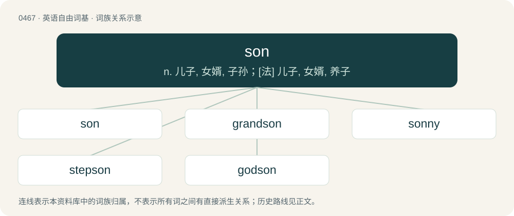

# 0528 · son — n. 儿子, 女婿, 子孙；\[法\] 儿子, 女婿, 养子

[总目录](../00_总目录_按常用程度.md)

**类型**：英语自由词基　｜　**来源语言**：见词源记录

## 核心含义与来源

- 核心含义：n. 儿子, 女婿, 子孙；\[法\] 儿子, 女婿, 养子
- 英文含义：One's male offspring.
- 词形：son

**多个词源／构词路径**：同一拼写可能有不同来源；以下按词性和含义分别列出。

**来源记录 1**（名词；One's male offspring.）

From Middle English sonn, sone, sun, sune, from Old English sunu (“son”), from Proto-West Germanic \*sunu, from Proto-Germanic \*sunuz (“son”), from Proto-Indo-European \*suHnús (“son”), from Proto-Indo-European \*sewH- (“to bear; give birth”).

**来源记录 2**（动词；To produce (i.e. bear, father, beget) a son.）

From Middle English sonen, sunen, from the noun (see above).

**来源记录 3**（名词；Son cubano, a genre of music and dance blending Spanish and African elements that originated in Cuba during the late 19th century.）

From Spanish son (literally “tone, sound”).

## 词族图

## 单词速览（常用到不常用）

| 单词 | 音标 | 释义 |
|---|---|---|
| [son](#w-1) | /sʌn/ | n. 儿子, 女婿, 子孙；\[法\] 儿子, 女婿, 养子 |
| [grandson](#w-2) | /ˈɡɹæn(d)sʌn/ | n. 孙子, 外孙 |
| [sonny](#w-3) | /ˈsʌni/ | n. 宝贝, 小家伙 |
| [stepson](#w-4) | /ˈstɛpsʌn/ | n. 妻与前夫所生的儿子, 夫与前妻所生的儿子；\[法\] 妻与前夫所生的儿子, 继子 |
| [godson](#w-5) | 英 /ˈɡɒdˌsʌn/；美 /ˈɡɑdˌsʌn/ | n. 教子 |

## 逐词详解

### 1. son

**词性**：名词　｜　**音标**：/sʌn/

**中文释义**：n. 儿子, 女婿, 子孙；\[法\] 儿子, 女婿, 养子

**英文义项**：One's male offspring. / A male adopted person in relation to his adoptive parents.

**词源与演化**：

From Middle English sonn, sone, sun, sune, from Old English sunu (“son”), from Proto-West Germanic \*sunu, from Proto-Germanic \*sunuz (“son”), from Proto-Indo-European \*suHnús (“son”), from Proto-Indo-European \*sewH- (“to bear; give birth”).

**例句**：

> Before the birth of the man's child, he said: "I want a son, not a daughter."

该用例对应义项：One's male offspring.

### 2. grandson

**词性**：名词　｜　**音标**：/ˈɡɹæn(d)sʌn/

**中文释义**：n. 孙子, 外孙

**英文义项**：A son of one's child.

**构词拆分**：grand- + son

**词源与演化**：

From grand- + son.

**例句**：

> When I go to see my grandson, I always give him something.

### 3. sonny

**词性**：名词　｜　**音标**：/ˈsʌni/

**中文释义**：n. 宝贝, 小家伙

**英文义项**：A familiar form of address for a boy. / Form of address to a boy or man, to express contempt, warning etc.

**构词拆分**：son + -y

**词源与演化**：

From son + -y.

**例句**：

> Come here, sonny. You'll be my eyes.

### 4. stepson

**词性**：名词　｜　**音标**：/ˈstɛpsʌn/

**中文释义**：n. 妻与前夫所生的儿子, 夫与前妻所生的儿子；\[法\] 妻与前夫所生的儿子, 继子

**英文义项**：The son of one's spouse from a previous relationship.

**构词拆分**：step- + son

**词源与演化**：

From Middle English stepsone, stepsune, from Old English stēopsunu (“stepson”), from Proto-Germanic \*steupasunuz (“stepson”), equivalent to step- + son. Cognate with Saterland Frisian Stäifsuun (“stepson”), West Frisian styfsoan (“stepson”), Dutch stiefzoon (“stepson”), German Low German Steevsöhn (“stepson”), German Stiefsohn (“stepson”), Danish stedsøn (“stepson”), Swedish styvson (“stepson”), Icelandic stjúpsonur (“stepson”).

**例句**：

> Lorenzo was having a hard time connecting with his stepson.

### 5. godson

**词性**：名词　｜　**音标**：英 /ˈɡɒdˌsʌn/；美 /ˈɡɑdˌsʌn/

**中文释义**：n. 教子

**英文义项**：A male child whose baptism is sponsored by a godparent.

**构词拆分**：god- + son

**词源与演化**：

From Middle English godsone, gossone, from Old English godsunu (“godson”), equivalent to god- + son. Cognate with Danish gudsøn (“godson”), Swedish gudson (“godson”), Icelandic guðsonur (“godson”).

**例句**：

> Whenever she travels, she buys a gift for her godson.
