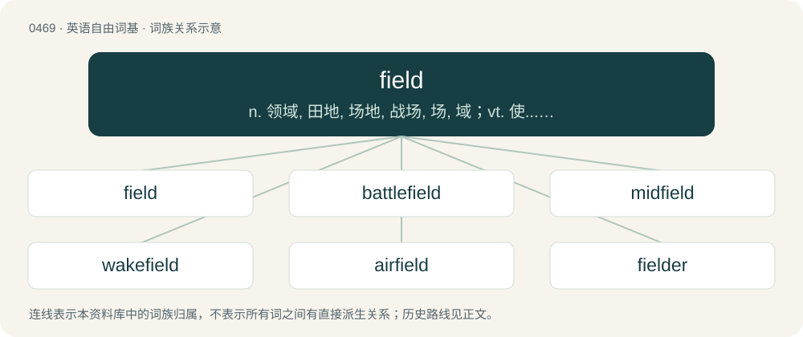

# 0532 · field — n. 领域, 田地, 场地, 战场, 场, 域；vt. 使...晒在场上, 使上场；a. 田间的, 野生的, 野外的, 田赛的

[总目录](../00_总目录_按常用程度.md)

**类型**：英语自由词基　｜　**来源语言**：见词源记录

## 核心含义与来源

- 核心含义：n. 领域, 田地, 场地, 战场, 场, 域；vt. 使...晒在场上, 使上场；a. 田间的, 野生的, 野外的, 田赛的
- 英文含义：A land area free of woodland, cities, and towns; an area of open country.
- 词形：field

**来源记录 1**（名词；A land area free of woodland, cities, and towns; an area of open country.）

From Middle English feld, feeld (“field”), from Old English feld (“field”), from Proto-West Germanic \*felþu (“field”), from Proto-Germanic \*felþuz (“field”), ultimately from Proto-Indo-European \*pleh₂- (“field, plain”) or \*pleth₂- (“flat”) (with schwebeablaut). Cognates Cognate with Scots feld, feild (“field”), North Frisian fial, fälj (“field”), Saterland Frisian Fäild (“field”), West Frisian fjild (“field”), Dutch veld (“field”), German and Luxembourgish Feld (“field”), Vilamovian fald (“field”), Danish, Norwegian Bokmål, and Norwegian Nynorsk felt (“field”), Swedish fält (“field”), Finnish pelto (“field”), Asturian and Leonese platu (“plate”), Aragonese and Spanish plato (“plate”), Catalan plat (“plate”), French plat (“dish”), Galician, Mirandese, and Portuguese prato (“plate”), Italian piatto (“plate”), Latin \*plattus (“flattened”), Greek πλατύς (platýs, “wide, broad”). Doublet of plate. Related also to Middle English flat (“flat”), Old English folde (“earth, land, territory”), Old English folm (“palm of the hand”). More at flat, fold. Not related to English felt.

## 词族图

## 单词速览（常用到不常用）

| 单词 | 音标 | 释义 |
|---|---|---|
| [field](#w-1) | /ˈfi(ː)ld/ | n. 领域, 田地, 场地, 战场, 场, 域；vt. 使...晒在场上, 使上场；a. 田间的, 野生的, 野外的, 田赛的 |
| [battlefield](#w-2) | /ˈbætəlˌfiːld/ | n. 战场, 沙场 |
| [midfield](#w-3) | /ˈmɪd.fiːld/ | n. 球场中央部分；a. 中场的 |
| [wakefield](#w-4) | /ˈweikfiːld/ | n. 韦克菲尔德（英格兰北部城市） |
| [airfield](#w-5) | /ˈєəfiːld/ | n. 飞机场 |
| [fielder](#w-6) | /ˈfiːldə(r)/ | n. 外场员, 守队队员 |
| [greenfield](#w-7) | /ˈgriːnfiːld/ | a. 未开发地区的；待开发地区的 |
| [outfield](#w-8) | 美 /ˈaʊtfild/ | n. 外场, (思想中的)未知世界, 边境 |
| [infield](#w-9) | /ˈɪnfiːld/ | n. 农宅周围的田园, 耕地, 内野 |
| [afield](#w-10) | /əˈfiːld/ | adv. 离开着, 偏离着, 在战场上 |
| [fieldwork](#w-11) | 英 /ˈfiːldwɜːk/；美 /ˈfildwɝk/ | n. 野战工事, 野外工作；\[经\] 农田工作 |
| [minefield](#w-12) | 美 /ˈmaɪnˌfild/ | n. 布雷区, 布雷水域, 布雷场 |
| [backfield](#w-13) | 英 /ˈbakfiːld/；美 /ˈbækˌfild/ | n. 后卫；守卫区 |
| [lichfield](#w-14) |  | 【英文】Synonym of burial ground. |
| [downfield](#w-15) | /ˈdajnˈfiːld/ | a. & adv.\[美橄\]在前场(的), 向前场(的) |
| [brownfield](#w-16) | /ˈbraʊnfiːld/ | a. 棕色地带 |
| [cornfield](#w-17) | 英 /ˈkɔːnfiːld/；美 /ˈkɔɹnˌfild/ | n. 玉米田 |
| [ashfield](#w-18) |  | 【英文】A field that is covered in ash. |
| [coalfield](#w-19) | /ˈkəulfiːld/ | n. 煤田 |
| [goldfield](#w-20) | /ˈgəuldfiːld/ | n. 采金区 |
| [upfield](#w-21) | /ʌpˈfiːld/ | (足球等运动中)向前场的\[地\], 高磁场 |
| [subfield](#w-22) | /ˈsʌbfiːld/ | \[计\] 子字段 |
| [hayfield](#w-23) | /ˈheifiːld/ | n. 草田 |
| [playfield](#w-24) | /ˈpleifiːld/ | n. 室外运动场, 球场 |
| [fieldstone](#w-25) | /ˈfiːldstəun/ | n. 粗石；散石；大卵石 |

## 逐词详解

### 1. field

**词性**：名词　｜　**音标**：/ˈfi(ː)ld/

**中文释义**：n. 领域, 田地, 场地, 战场, 场, 域；vt. 使...晒在场上, 使上场；a. 田间的, 野生的, 野外的, 田赛的

**英文义项**：A land area free of woodland, cities, and towns; an area of open country. / The open country near or belonging to a town or city.

**词源与演化**：

From Middle English feld, feeld (“field”), from Old English feld (“field”), from Proto-West Germanic \*felþu (“field”), from Proto-Germanic \*felþuz (“field”), ultimately from Proto-Indo-European \*pleh₂- (“field, plain”) or \*pleth₂- (“flat”) (with schwebeablaut). Cognates Cognate with Scots feld, feild (“field”), North Frisian fial, fälj (“field”), Saterland Frisian Fäild (“field”), West Frisian fjild (“field”), Dutch veld (“field”), German and Luxembourgish Feld (“field”), Vilamovian fald (“field”), Danish, Norwegian Bokmål, and Norwegian Nynorsk felt (“field”), Swedish fält (“field”), Finnish pelto (“field”), Asturian and Leonese platu (“plate”), Aragonese and Spanish plato (“plate”), Catalan plat (“plate”), French plat (“dish”), Galician, Mirandese, and Portuguese prato (“plate”), Italian piatto (“plate”), Latin \*plattus (“flattened”), Greek πλατύς (platýs, “wide, broad”). Doublet of plate. Related also to Middle English flat (“flat”), Old English folde (“earth, land, territory”), Old English folm (“palm of the hand”). More at flat, fold. Not related to English felt.

**例句**：

> The form has fields for each element of the customer's home address and shipping address.

该用例对应义项：A section of a form which is supposed to be filled with data.

### 2. battlefield

**词性**：名词　｜　**音标**：/ˈbætəlˌfiːld/

**中文释义**：n. 战场, 沙场

**英文义项**：The area where a land battle is fought, which may not necessarily be a field.

**构词拆分**：battle + field

**词源与演化**：

From battle + field.

**例句**：

> Which game do you prefer playing, Call of Duty or Battlefield?

### 3. midfield

**词性**：名词　｜　**音标**：/ˈmɪd.fiːld/

**中文释义**：n. 球场中央部分；a. 中场的

**英文义项**：The portion of a team which typically plays centrally, between the attack (or forwards) and the defence (or backs). / The middle of the field of play.

**构词拆分**：mid- + field

**词源与演化**：

From mid- + field.

**例句**：

> He scored a goal from midfield!

### 4. wakefield

**词性**：名词　｜　**音标**：/ˈweikfiːld/

**中文释义**：n. 韦克菲尔德（英格兰北部城市）

**英文义项**：The electron density wave structure which immediately follows an intense laser beam or relativistic charged particle beam as it passes through a plasma; the electric field or potential associated with such a structure.

**构词拆分**：wake + field

**词源与演化**：

From wake + field.

### 5. airfield

**词性**：名词　｜　**音标**：/ˈєəfiːld/

**中文释义**：n. 飞机场

**英文义项**：An open field designated for the taking off and landing of aircraft, but which, unlike an airport, does not necessarily have terminals or paved runways.

**构词拆分**：air + field

**词源与演化**：

From air + field.

**例句**：

> The airfield on the island is now covered with weeds.

### 6. fielder

**词性**：名词　｜　**音标**：/ˈfiːldə(r)/

**中文释义**：n. 外场员, 守队队员

**英文义项**：A dog trained in pursuit of game in the field. / A defensive player in the field.

**构词拆分**：field + -er

**词源与演化**：

From Middle English feldere (“one who works in the field; rustic”), from Old English feldeware (“field-dweller”), equivalent to field + -er. The baseball sense is from 1832.

**例句**：

> The left fielder ran hard and caught the long fly.

### 7. greenfield

**词性**：名词　｜　**音标**：/ˈgriːnfiːld/

**中文释义**：a. 未开发地区的；待开发地区的

**英文义项**：A site, to be used for housing or commerce, whose previous use (if any) was agricultural.

**构词拆分**：green + field

**词源与演化**：

From green + field.

**用法示例／搭配（非完整句）**：

> greenfield development

该用例对应义项：A site, to be used for housing or commerce, whose previous use (if any) was agricultural.

### 8. outfield

**词性**：名词　｜　**音标**：美 /ˈaʊtfild/

**中文释义**：n. 外场, (思想中的)未知世界, 边境

**英文义项**：The region of the field between the infield and the outer fence. / The region of the field roughly outside of the infield or the wicket-keeper, slips, gully, point, cover, mid off, mid on, midwicket and square leg.

**构词拆分**：out- + field

**词源与演化**：

From out- + field.

**例句**：

> He hit a long fly ball to the outfield in the gap to left.

该用例对应义项：The region of the field between the infield and the outer fence.

### 9. infield

**词性**：名词　｜　**音标**：/ˈɪnfiːld/

**中文释义**：n. 农宅周围的田园, 耕地, 内野

**英文义项**：The area inside a racetrack or running track. / A constrained scope or area.

**构词拆分**：in- + field

**词源与演化**：

From in- + field.

**例句**：

> They covered the infield with a tarp when it started to rain.

该用例对应义项：The region of the field roughly bounded by the home plate, first base, second base and third base.

### 10. afield

**词性**：副词　｜　**音标**：/əˈfiːld/

**中文释义**：adv. 离开着, 偏离着, 在战场上

**英文义项**：Away (from the home or starting point, physical or conceptual). (Often preceded by far, farther, or further.) / On the field.

**构词拆分**：a- (“on”) + field

**词源与演化**：

From Middle English afeld, a-felde, o felde, on felde, from Old English on felde (“afield”, literally “in (the) field”), equivalent to a- (“on”) + field.

**例句**：

> His latest remarks went far afield of any mainstream conception.

该用例对应义项：Away (from the home or starting point, physical or conceptual). (Often preceded by far, farther, or further.)

### 11. fieldwork

**词性**：名词　｜　**音标**：英 /ˈfiːldwɜːk/；美 /ˈfildwɝk/

**中文释义**：n. 野战工事, 野外工作；\[经\] 农田工作

**英文义项**：Work done out in the fields as opposed to that done elsewhere on the farm (e.g., barn, house, outbuildings, office). / Work done out in the real world rather than in controlled conditions.

**构词拆分**：field + work

**词源与演化**：

From Middle English \*felde-werk (found in plural felde werkes), equivalent to field + work.

**例句**：

> Besides the bookkeeping and marketing, there's a ton of fieldwork to get done this week.

该用例对应义项：Work done out in the fields as opposed to that done elsewhere on the farm (e.g., barn, house, outbuildings, office).

### 12. minefield

**词性**：名词　｜　**音标**：美 /ˈmaɪnˌfild/

**中文释义**：n. 布雷区, 布雷水域, 布雷场

**英文义项**：An area in which land mines or naval mines have been laid. / A matter or situation presenting multiple risks, dangers, complications or difficulties.

**构词拆分**：mine + field

**词源与演化**：

From mine + field. Compare Saterland Frisian Mienenfäield (“minefield”), West Frisian mynfjild (“minefield”), Dutch mijnenveld (“minefield”), German Low German Minenfeld (“minefield”), German Minenfeld (“minefield”), Danish minefelt (“minefield”), Swedish minfält (“minefield”).

**例句**：

> Be careful. Foreign property investments are a minefield, and some people have lost a lot of money.

该用例对应义项：A matter or situation presenting multiple risks, dangers, complications or difficulties.

### 13. backfield

**词性**：名词　｜　**音标**：英 /ˈbakfiːld/；美 /ˈbækˌfild/

**中文释义**：n. 后卫；守卫区

**英文义项**：Synonym of outfield. / The area behind the line of scrimmage occupied before the snap by the team on offense.

**构词拆分**：back + field

**词源与演化**：

From back + field.

### 14. lichfield

**词性**：名词

**英文义项**：Synonym of burial ground.

**构词拆分**：lich + field

**词源与演化**：

From lich + field.

### 15. downfield

**词性**：形容词　｜　**音标**：/ˈdajnˈfiːld/

**中文释义**：a. & adv.\[美橄\]在前场(的), 向前场(的)

**英文义项**：Towards the lower part of a field. / Toward the defending team's end of the playing field.

**构词拆分**：From down- + field.

**词源与演化**：

From down- + field.

**例句**：

> He threw to a downfield receiver.

该用例对应义项：toward or in the defending team's end of the playing field

### 16. brownfield

**词性**：形容词　｜　**音标**：/ˈbraʊnfiːld/

**中文释义**：a. 棕色地带

**英文义项**：Being a development that has to integrate with legacy systems.

**构词拆分**：brown + field

**词源与演化**：

From brown + field.

**用法示例／搭配（非完整句）**：

> a brownfield project

该用例对应义项：Being a development that has to integrate with legacy systems.

### 17. cornfield

**词性**：名词　｜　**音标**：英 /ˈkɔːnfiːld/；美 /ˈkɔɹnˌfild/

**中文释义**：n. 玉米田

**英文义项**：A field of corn: maize, wheat, or other cereal crop. / A field of corn (maize).

**构词拆分**：corn + field

**词源与演化**：

From corn + field.

**例句**：

> For the astronomers it was like finding a skyscraper in the middle of a cornfield.

### 18. ashfield

**词性**：名词

**英文义项**：A field that is covered in ash.

**构词拆分**：ash + field

**词源与演化**：

From ash + field.

### 19. coalfield

**词性**：名词　｜　**音标**：/ˈkəulfiːld/

**中文释义**：n. 煤田

**英文义项**：Any region containing deposits of coal that may be mined.

**构词拆分**：coal + field

**词源与演化**：

From coal + field.

### 20. goldfield

**词性**：名词　｜　**音标**：/ˈgəuldfiːld/

**中文释义**：n. 采金区

**英文义项**：An area where gold ore is found

**构词拆分**：gold + field

**词源与演化**：

From gold + field.

### 21. upfield

**词性**：形容词　｜　**音标**：/ʌpˈfiːld/

**中文释义**：(足球等运动中)向前场的\[地\], 高磁场

**英文义项**：Towards the upper part of a field. / Away from the defending team's end of the playing field.

**构词拆分**：From up- + field.

**词源与演化**：

From up- + field.

### 22. subfield

**词性**：名词　｜　**音标**：/ˈsʌbfiːld/

**中文释义**：\[计\] 子字段

**英文义项**：A smaller, more specialized area of study or occupation within a larger one / A subring of a field, containing the multiplicative identity and closed under inversion.

**构词拆分**：sub- + field

**词源与演化**：

From sub- + field.

**例句**：

> My favorite subfield of physics is mechanics.

### 23. hayfield

**词性**：名词　｜　**音标**：/ˈheifiːld/

**中文释义**：n. 草田

**英文义项**：A field of hay.

**构词拆分**：hay + field

**词源与演化**：

From hay + field.

**例句**：

> They hurried to the hayfield below the barn where Matthew was coiling hay.

### 24. playfield

**词性**：名词　｜　**音标**：/ˈpleifiːld/

**中文释义**：n. 室外运动场, 球场

**英文义项**：A playing field. / The onscreen area within which a game (especially a video game) is played.

**构词拆分**：play + field

**词源与演化**：

From play + field.

**例句**：

> Germany is the playfield of international intelligence agencies.

### 25. fieldstone

**词性**：名词　｜　**音标**：/ˈfiːldstəun/

**中文释义**：n. 粗石；散石；大卵石

**英文义项**：A stone found in fields and used for building.

**构词拆分**：field + stone

**词源与演化**：

From field + stone.
