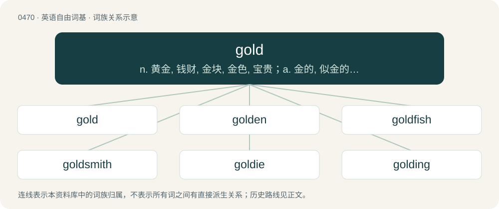

# 0534 · gold — n. 黄金, 钱财, 金块, 金色, 宝贵；a. 金的, 似金的, 金色的, 金制的

[总目录](../00_总目录_按常用程度.md)

**类型**：英语自由词基　｜　**来源语言**：见词源记录

## 核心含义与来源

- 核心含义：n. 黄金, 钱财, 金块, 金色, 宝贵；a. 金的, 似金的, 金色的, 金制的
- 英文含义：(uncountable) A heavy yellow elemental metal of great value, with atomic number 79.
- 词形：gold

**多个词源／构词路径**：同一拼写可能有不同来源；以下按词性和含义分别列出。

**来源记录 1**（名词；(uncountable) A heavy yellow elemental metal of great value, with atomic number 79.）

From Middle English gold, from Old English gold (“gold”), from Proto-West Germanic \*golþ, from Proto-Germanic \*gulþą (“gold”), from Proto-Indo-European \*ǵʰl̥h₃tóm (“gold”), from Proto-Indo-European \*ǵʰelh₃- (“green, yellow”). Related to yellow; see there for more. Germanic cognates include Scots gowd, Dutch goud, German Gold, Faroese, Icelandic, Norwegian Bokmål, and Norwegian Nynorsk gull, Danish and Swedish guld, and cognates from other Indo-European languages include Latvian zelts, Russian зо́лото (zóloto), Persian زرد (zard, “yellow, golden”), Sanskrit हिरण्य (hiraṇya).

**来源记录 2**（形容词；In a finished state, ready for manufacturing.）

From gold master, a copy of the code certified as being ready for release.

## 词族图

## 单词速览（常用到不常用）

| 单词 | 音标 | 释义 |
|---|---|---|
| [gold](#w-1) | 英 /ɡəʊld/；美 /ɡoʊld/ | n. 黄金, 钱财, 金块, 金色, 宝贵；a. 金的, 似金的, 金色的, 金制的 |
| [golden](#w-2) | 英 /ˈɡəʊl.dən/；美 /ˈɡoʊl.dən/ | a. 金的, 含金的, 金色的, 贵重的, 繁盛的；\[法\] 金制的, 金色的, 兴隆的 |
| [goldfish](#w-3) | /ˈɡoʊldfɪʃ/ | n. 金鱼 |
| [goldsmith](#w-4) | 美 /ˈɡoʊldˌsmɪθ/ | n. 金匠 |
| [goldie](#w-5) |  | 【英文】Something which is golden in color. |
| [golding](#w-6) | 英 /ˈɡəʊldɪŋ/；美 /ˈɡoʊldɪŋ/ | 【英文】The corn marigold (Glebionis segetum). |
| [goldfinch](#w-7) | 美 /ˈɡoʊldˌfɪnt͡ʃ/ | n. 红额金翅雀 |
| [goldy](#w-8) | /ˈ^əjldi/ | a. 似黄金的, 金黄的 |
| [goldfield](#w-9) | /ˈgəuldfiːld/ | n. 采金区 |

## 逐词详解

### 1. gold

**词性**：名词　｜　**音标**：英 /ɡəʊld/；美 /ɡoʊld/

**中文释义**：n. 黄金, 钱财, 金块, 金色, 宝贵；a. 金的, 似金的, 金色的, 金制的

**英文义项**：(uncountable) A heavy yellow elemental metal of great value, with atomic number 79. / A coin or coinage made of this material, or supposedly so.

**词源与演化**：

From Middle English gold, from Old English gold (“gold”), from Proto-West Germanic \*golþ, from Proto-Germanic \*gulþą (“gold”), from Proto-Indo-European \*ǵʰl̥h₃tóm (“gold”), from Proto-Indo-European \*ǵʰelh₃- (“green, yellow”). Related to yellow; see there for more. Germanic cognates include Scots gowd, Dutch goud, German Gold, Faroese, Icelandic, Norwegian Bokmål, and Norwegian Nynorsk gull, Danish and Swedish guld, and cognates from other Indo-European languages include Latvian zelts, Russian зо́лото (zóloto), Persian زرد (zard, “yellow, golden”), Sanskrit हिरण्य (hiraṇya).

**例句**：

> That food mixer you gave me is absolute gold, mate!

该用例对应义项：Anything or anyone that is very valuable.

### 2. golden

**词性**：形容词　｜　**音标**：英 /ˈɡəʊl.dən/；美 /ˈɡoʊl.dən/

**中文释义**：a. 金的, 含金的, 金色的, 贵重的, 繁盛的；\[法\] 金制的, 金色的, 兴隆的

**英文义项**：Made of, or relating to, gold. / Having a color or other richness suggestive of gold.

**构词拆分**：gold + -en

**词源与演化**：

From Middle English golden, a restored form (due to the noun gold) of earlier Middle English gulden, gylden, gilden ("golden"; &gt; English gilden), from Old English gylden (“golden”), from Proto-West Germanic \*gulþīn, from Proto-Germanic \*gulþīnaz (“golden, made of gold”), equivalent to gold + -en. Cognate with Dutch gouden, gulden (“golden”), German gülden, golden (“golden”), Danish gylden (“golden”). Doublet of gilden. More at gold.

**例句**：

> After retiring, Bob and Judy moved to Arizona to live out their golden years.

该用例对应义项：Relating to the elderly or retired.

### 3. goldfish

**词性**：名词　｜　**音标**：/ˈɡoʊldfɪʃ/

**中文释义**：n. 金鱼

**英文义项**：A type of small fish, Carassius auratus, typically orange-colored. / A person with an unreliable memory.

**构词拆分**：gold + fish

**词源与演化**：

From gold + fish.

**例句**：

> For the children's fair we'll have a few games they can play, so that each child "wins" a goldfish as a prize.

该用例对应义项：A type of small fish, Carassius auratus, typically orange-colored.

### 4. goldsmith

**词性**：名词　｜　**音标**：美 /ˈɡoʊldˌsmɪθ/

**中文释义**：n. 金匠

**英文义项**：A person who makes, repairs or sells things of gold, especially jewelry.

**构词拆分**：gold + smith

**词源与演化**：

From Middle English goldsmith, from Old English goldsmiþ (“goldsmith”), from Proto-Germanic \*gulþasmiþaz (“goldsmith”), equivalent to gold + smith. Cognate with Scots goldsmyth, gouldsmeth (“goldsmith”), Saterland Frisian Gouldsmid (“goldsmith”), West Frisian goudsmid (“goldsmith”), Dutch goudsmid (“goldsmith”), German Goldschmied (“goldsmith”), Danish guldsmed (“goldsmith”), Swedish guldsmed (“goldsmith”), Icelandic gullsmiður (“goldsmith”). Eclipsed non-native Middle English orbatour, orbatur (“goldsmith”) and orfever, orfevre (“goldsmith”), both borrowed from Old French.

**例句**：

> The Queen's goldsmith spent years working on the jewelled coffin.

### 5. goldie

**词性**：名词

**英文义项**：Something which is golden in color. / The golden eagle.

**构词拆分**：gold + -ie

**词源与演化**：

From gold + -ie.

**例句**：

> At 10½, Goldie is older than most adoptees.

### 6. golding

**词性**：名词　｜　**音标**：英 /ˈɡəʊldɪŋ/；美 /ˈɡoʊldɪŋ/

**英文义项**：The corn marigold (Glebionis segetum). / The ladybird (family Coccinellidae).

**构词拆分**：gold + -ing

**词源与演化**：

First attested circa 1580; formed as gold + -ing.

### 7. goldfinch

**词性**：名词　｜　**音标**：美 /ˈɡoʊldˌfɪnt͡ʃ/

**中文释义**：n. 红额金翅雀

**英文义项**：A European goldfinch, Eurasian goldfinch (Carduelis carduelis) / An American goldfinch (Spinus tristis, syn. Carduelis tristis)

**构词拆分**：gold + finch

**词源与演化**：

From Middle English goldfinch, goldfynch, goldefynch, from Old English goldfinċ, equivalent to gold + finch. Compare West Frisian goudfink (“goldfinch”), Dutch goudvink (“bullfinch”), German Goldfink (“goldfinch”), Danish guldfink (“goldfinch”), Icelandic gullfinka (“goldfinch”).

**例句**：

> Near us a multicoloured goldfinch drank from the water of the stream.

### 8. goldy

**词性**：形容词　｜　**音标**：/ˈ^əjldi/

**中文释义**：a. 似黄金的, 金黄的

**英文义项**：Synonym of goldish.

**构词拆分**：gold + -y

**词源与演化**：

From Middle English goldy, equivalent to gold + -y.

### 9. goldfield

**词性**：名词　｜　**音标**：/ˈgəuldfiːld/

**中文释义**：n. 采金区

**英文义项**：An area where gold ore is found

**构词拆分**：gold + field

**词源与演化**：

From gold + field.
