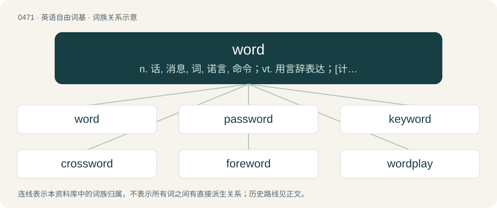

# 0535 · word — n. 话, 消息, 词, 诺言, 命令；vt. 用言辞表达；\[计\] 字

[总目录](../00_总目录_按常用程度.md)

**类型**：英语自由词基　｜　**来源语言**：见词源记录

## 核心含义与来源

- 核心含义：n. 话, 消息, 词, 诺言, 命令；vt. 用言辞表达；\[计\] 字
- 英文含义：The smallest unit of language that has a particular meaning and can be expressed by itself; the smallest discrete, meaningful unit of language. (contrast morpheme.)
- 词形：word

**来源记录 1**（名词；The smallest unit of language that has a particular meaning and can be expressed by itself; the smallest discrete, meaningful unit of language. (contrast morpheme.)）

From Middle English word, from Old English word, from Proto-West Germanic \*word, from Proto-Germanic \*wurdą (“word”), from Proto-Indo-European \*werdʰom (“word”), from \*werh₁- (“to say, speak”). Doublet of verb, verve, and vort; further related to vrata. Cognates Cognate with Scots wird (“word”), North Frisian uurd, Uurt, wurd, wårde, wür (“word”), Saterland Frisian Woud, Wud (“word”), West Frisian wurd (“word”), Alemannic German wort, wourd, wuart, wòrt, wört (“word”), Bavarian boart, bort, bört, Wurt (“word”), Cimbrian bóart, bort (“word”), Dutch woord (“word”), German Wort (“word”), German Low German Woord, Woort (“word”), Limburgish waord, Woërt (“word”), Luxembourgish Wuert (“word”), Mòcheno bourt (“word”), Vilamovian wiüt, wuyt (“word”), Yiddish וואָרט (vort, “word”), Danish, Norwegian Bokmål, Norwegian Nynorsk, and Swedish ord (“word”), Elfdalian uord (“word”), Faroese, Icelandic, and Scanian orð (“word”), Gutnish ård (“word”), Gothic 𐍅𐌰𐌿𐍂𐌳 (waurd, “word”); also Ancient Greek ῥητός (rhētós, “spoken, stipulated”); also Latin verbum (“word”), Umbrian 𐌖𐌄𐌓𐌚𐌀𐌋𐌄 (uerfale, “temple”), Ancient Greek εἴρω (eírō, “to say, speak, tell”), Latgalian vuords (“name; word”), Latvian vārds (“name; word”), Lithuanian var̃das (“name”), Russian врать (vratʹ, “to lie”), Serbo-Croatian ва̏рати, vȁrati (“to cheat, deceive, trick, swindle; to be mistaken”), Armenian հորջորջել (horǰorǰel, “to call, name”), Ashkun vīri (“word”), Kamkata-viri vëri, viri (“word”), Prasuni veri, verī, vëre, vëri (“word”), Sanskrit व्रत (vrata, “command; law; will”).

## 词族图

## 单词速览（常用到不常用）

| 单词 | 音标 | 释义 |
|---|---|---|
| [word](#w-1) | 英 /wɜːd/；美 /wɜɹd/ | n. 话, 消息, 词, 诺言, 命令；vt. 用言辞表达；\[计\] 字 |
| [password](#w-2) | 美 /ˈpæs.wɜɹd/ | n. 密码, 口令, 通行手段；\[计\] 口令 |
| [keyword](#w-3) | 英 /ˈkiː.wɜːd/；美 /ˈki.wɝd/ | \[计\] 关键字 |
| [crossword](#w-4) | /ˈkɹɒswɜː(ɹ)d/ | n. 纵横填字游戏, 纵横填字字谜；\[计\] 纵横组字 |
| [foreword](#w-5) | 英 /ˈfɔːwɜːd/；美 /ˈfɔɹwɝd/ | n. 前言, 序 |
| [wordplay](#w-6) | /ˈwɜːdpleɪ/ | n. 文字游戏, 俏皮话, 双关语 |
| [buzzword](#w-7) | 英 /ˈbʌzwɜː(ɹ)d/；美 /ˈbʌzwɜɹd/ | n. 流行词 |
| [wordless](#w-8) | /ˈwəːdlis/ | a. 沉默的, 无言的 |
| [wordy](#w-9) | 美 /ˈwɝdi/ | a. 罗唆的, 口头的, 多言的 |
| [afterword](#w-10) | 英 /ˈɑːf.tə.wɜːd/；美 /ˈæf.tɚˌwɝd/ | n. 后记 |
| [codeword](#w-11) | 美 /ˈkoʊdˌwɝd/ | \[医\]暗号用语 |
| [wordsmith](#w-12) | 英 /ˈwɜːdsmɪθ/；美 /ˈwɝdˌsmɪθ/ | n. 擅长文字的人, 舞文弄墨者；作家 |
| [watchword](#w-13) | /ˈwɒt͡ʃwɜː(ɹ)d/ | n. 暗号, 口令, 标语, 口号 |
| [byword](#w-14) | 英 /ˈbaɪ.wə(ɹ)d/；美 /ˈbaɪ.wɚd/ | n. 谚语, 俗话, 笑柄 |
| [reword](#w-15) | /ˌriːˈwəːd/ | vt. 重述, 改说 |

## 逐词详解

### 1. word

**词性**：名词　｜　**音标**：英 /wɜːd/；美 /wɜɹd/

**中文释义**：n. 话, 消息, 词, 诺言, 命令；vt. 用言辞表达；\[计\] 字

**英文义项**：The smallest unit of language that has a particular meaning and can be expressed by itself; the smallest discrete, meaningful unit of language. (contrast morpheme.) / The smallest discrete unit of spoken language with a particular meaning, composed of one or more phonemes and one or more morphemes.

**词源与演化**：

From Middle English word, from Old English word, from Proto-West Germanic \*word, from Proto-Germanic \*wurdą (“word”), from Proto-Indo-European \*werdʰom (“word”), from \*werh₁- (“to say, speak”). Doublet of verb, verve, and vort; further related to vrata. Cognates Cognate with Scots wird (“word”), North Frisian uurd, Uurt, wurd, wårde, wür (“word”), Saterland Frisian Woud, Wud (“word”), West Frisian wurd (“word”), Alemannic German wort, wourd, wuart, wòrt, wört (“word”), Bavarian boart, bort, bört, Wurt (“word”), Cimbrian bóart, bort (“word”), Dutch woord (“word”), German Wort (“word”), German Low German Woord, Woort (“word”), Limburgish waord, Woërt (“word”), Luxembourgish Wuert (“word”), Mòcheno bourt (“word”), Vilamovian wiüt, wuyt (“word”), Yiddish וואָרט (vort, “word”), Danish, Norwegian Bokmål, Norwegian Nynorsk, and Swedish ord (“word”), Elfdalian uord (“word”), Faroese, Icelandic, and Scanian orð (“word”), Gutnish ård (“word”), Gothic 𐍅𐌰𐌿𐍂𐌳 (waurd, “word”); also Ancient Greek ῥητός (rhētós, “spoken, stipulated”); also Latin verbum (“word”), Umbrian 𐌖𐌄𐌓𐌚𐌀𐌋𐌄 (uerfale, “temple”), Ancient Greek εἴρω (eírō, “to say, speak, tell”), Latgalian vuords (“name; word”), Latvian vārds (“name; word”), Lithuanian var̃das (“name”), Russian врать (vratʹ, “to lie”), Serbo-Croatian ва̏рати, vȁrati (“to cheat, deceive, trick, swindle; to be mistaken”), Armenian հորջորջել (horǰorǰel, “to call, name”), Ashkun vīri (“word”), Kamkata-viri vëri, viri (“word”), Prasuni veri, verī, vëre, vëri (“word”), Sanskrit व्रत (vrata, “command; law; will”).

**例句**：

> I've tried for weeks to get word, but I still don't know where she is or if she's all right.

该用例对应义项：News; tidings.

### 2. password

**词性**：名词　｜　**音标**：美 /ˈpæs.wɜɹd/

**中文释义**：n. 密码, 口令, 通行手段；\[计\] 口令

**英文义项**：A word relayed to a person to gain admittance to a place or to gain access to information. / A string of characters used to log in to a computer or network, to access a level in a video game, and so on; archetypally a word but nowadays often an alphanumeric string or a phrase.

**构词拆分**：pass + word

**词源与演化**：

From pass + word. The sentry-passing sense predates the cryptographic sense and was its inspiration.

**例句**：

> A strong password has a mixture of lowercase and uppercase letters, numbers, and punctuation marks.

该用例对应义项：A string of characters used to log in to a computer or network, to access a level in a video game, and so on; archetypally a word but nowadays often an alphanumeric string or a phrase.

### 3. keyword

**词性**：名词　｜　**音标**：英 /ˈkiː.wɜːd/；美 /ˈki.wɝd/

**中文释义**：\[计\] 关键字

**英文义项**：Any word used as the key to a code. / Any word used in a reference work to link to other words or other information.

**构词拆分**：key + word

**词源与演化**：

From key + word.

**例句**：

> You can use a keyword to help you remember complicated topics.

### 4. crossword

**词性**：名词　｜　**音标**：/ˈkɹɒswɜː(ɹ)d/

**中文释义**：n. 纵横填字游戏, 纵横填字字谜；\[计\] 纵横组字

**英文义项**：A word puzzle in which interlocking words are entered usually horizontally and vertically into a grid based on clues given for each word. / The grid of such a puzzle.

**构词拆分**：cross + word

**词源与演化**：

From cross + word. Various word puzzles referred to as "crosswords" date back to the 1860s. The modern crossword puzzle was invented in 1913 by Arthur Wynne, who coined the name word-cross – crossword first appeared a few weeks later as a typographical error or deliberate transposition.

**例句**：

> I've worked out every word in the crossword bar the last one.

### 5. foreword

**词性**：名词　｜　**音标**：英 /ˈfɔːwɜːd/；美 /ˈfɔɹwɝd/

**中文释义**：n. 前言, 序

**英文义项**：An introductory section preceding the main text of a book or other document; especially, one written by another person (not the author of the work thus introduced).

**构词拆分**：fore- + word

**词源与演化**：

Morphologically fore- + word. Calque of German Vorwort, itself a calque of Latin praefatio (“preface”). Cognate with German Low German Vörwoord (“foreword”), Dutch voorwoord (“foreword”), West Frisian foarwurd (“foreword”), Danish forord (“preface; proviso”), Swedish förord (“foreword”). Compare also Old English forword, foreword (“proviso; condition”).

**例句**：

> A book without a foreword is like a body without a soul.

### 6. wordplay

**词性**：名词　｜　**音标**：/ˈwɜːdpleɪ/

**中文释义**：n. 文字游戏, 俏皮话, 双关语

**英文义项**：A humorous play on words; such plays on words collectively. / A witty verbal exchange; such exchanges collectively.

**构词拆分**：word + play

**词源与演化**：

From word + play.

**例句**：

> I found those sentences very funny. The wordplay the author uses is simply brilliant.

### 7. buzzword

**词性**：名词　｜　**音标**：英 /ˈbʌzwɜː(ɹ)d/；美 /ˈbʌzwɜɹd/

**中文释义**：n. 流行词

**英文义项**：A word drawn from, or imitative of, technical jargon, used more to impress others than to convey meaning.

**构词拆分**：buzz + word

**词源与演化**：

Coined in the 1970s in the United States, from buzz + word.

**例句**：

> Their salespeople know all the right buzzwords, but they can't really help you solve your problems.

该用例对应义项：A word drawn from, or imitative of, technical jargon, used more to impress others than to convey meaning.

### 8. wordless

**词性**：形容词　｜　**音标**：/ˈwəːdlis/

**中文释义**：a. 沉默的, 无言的

**英文义项**：Conveyed without the use of words; unspoken or unsaid. / Unable or unwilling to speak; dumb, silent or inarticulate.

**构词拆分**：word + -less

**词源与演化**：

From Middle English wordles, equivalent to word + -less. Compare Dutch woordeloos (“speechless, inexpressible in words”), German wortlos (“silent, speechless”), Danish ordløs (“wordless”), Swedish ordlös (“wordless”), Icelandic orðlaus (“wordless, speechless”).

**例句**：

> Choking exasperation and wordless shame.

该用例对应义项：expressed without speech

### 9. wordy

**词性**：形容词　｜　**音标**：美 /ˈwɝdi/

**中文释义**：a. 罗唆的, 口头的, 多言的

**英文义项**：Using an excessive number of words.

**构词拆分**：word + -y

**词源与演化**：

From Middle English wordy, woordi, from Old English wordiġ (“wordy, verbose”), equivalent to word + -y. Cognate with Icelandic orðigur (“wordy”).

**例句**：

> The story was long and very wordy.

该用例对应义项：Using an excessive number of words.

### 10. afterword

**词性**：名词　｜　**音标**：英 /ˈɑːf.tə.wɜːd/；美 /ˈæf.tɚˌwɝd/

**中文释义**：n. 后记

**英文义项**：an epilogue. / a postscript.

**构词拆分**：after- + word

**词源与演化**：

From after- + word. Compare foreword.

### 11. codeword

**词性**：名词　｜　**音标**：美 /ˈkoʊdˌwɝd/

**中文释义**：\[医\]暗号用语

**英文义项**：A string representing an encoded piece of text. / A word or phrase (or by extension a concept) used to make a (concealed) reference to another word or concept.

**构词拆分**：code + word

**词源与演化**：

From code + word.

**例句**：

> Bob cannot get any information out of the codeword since he doesn't know what transmission bases Alice used.

该用例对应义项：A string representing an encoded piece of text.

### 12. wordsmith

**词性**：名词　｜　**音标**：英 /ˈwɜːdsmɪθ/；美 /ˈwɝdˌsmɪθ/

**中文释义**：n. 擅长文字的人, 舞文弄墨者；作家

**英文义项**：One who uses words skilfully.

**构词拆分**：word + smith (“craftsperson who works metal into desired forms; (by extension) one who makes anything”)

**词源与演化**：

The noun is derived from word + smith (“craftsperson who works metal into desired forms; (by extension) one who makes anything”). The verb is derived from the noun.

**例句**：

> She has always been known as a capable wordsmith, but in this latest novel she also shows surprising emotional depth.

该用例对应义项：One who uses words skilfully.

### 13. watchword

**词性**：名词　｜　**音标**：/ˈwɒt͡ʃwɜː(ɹ)d/

**中文释义**：n. 暗号, 口令, 标语, 口号

**英文义项**：A word used as a motto, as expressive of a principle, belief, or rule of action; a rallying cry. / A prearranged reply to the challenge of a sentry or a guard; a password or signal by which friends can be known from enemies.

**构词拆分**：watch (“guard, sentinel, sentry”) + word

**词源与演化**：

From Middle English wacche word, wacchworde, morphologically as watch (“guard, sentinel, sentry”) + word.

**例句**：

> Our watchword will be `democracy'.

该用例对应义项：a slogan used to rally support for a cause

### 14. byword

**词性**：名词　｜　**音标**：英 /ˈbaɪ.wə(ɹ)d/；美 /ˈbaɪ.wɚd/

**中文释义**：n. 谚语, 俗话, 笑柄

**英文义项**：A proverb or proverbial expression, common saying; a frequently used word or phrase. / A characteristic word or expression; a word or phrase associated with a person or group.

**构词拆分**：by- + word

**词源与演化**：

From Middle English byword, byworde (“proverb”), from Old English bīword, bīwyrd, bīwyrde (“proverb, household word", also "adverb”), from Proto-West Germanic \*bīwurdī, equivalent to by- + word. Compare Latin proverbium, which byword may possibly be a translation of. Cognate with Old High German pīwurti (“proverb”). Compare also Old English bīspel (“proverb, example”), bīcwide (“byword, proverb, tale, fable”), Dutch bijwoord (“adverb”).

**例句**：

> The name Cleopatra has become a byword for a beautiful woman.

### 15. reword

**词性**：动词　｜　**音标**：/ˌriːˈwəːd/

**中文释义**：vt. 重述, 改说

**英文义项**：To change the wording of; to restate using different words.

**构词拆分**：re- + word

**词源与演化**：

From re- + word.

**例句**：

> How would you reword this sentence to make it sound more natural?
