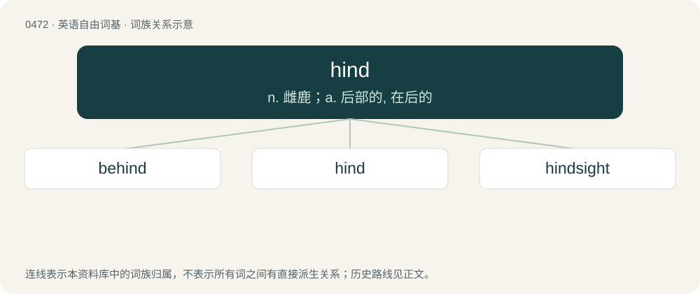

# 0536 · hind — n. 雌鹿；a. 后部的, 在后的

[总目录](../00_总目录_按常用程度.md)

**类型**：英语自由词基　｜　**来源语言**：见词源记录

## 核心含义与来源

- 核心含义：n. 雌鹿；a. 后部的, 在后的
- 英文含义：Located at the rear (most often said of animals' body parts).
- 词形：hind

**多个词源／构词路径**：同一拼写可能有不同来源；以下按词性和含义分别列出。

**来源记录 1**（形容词；Located at the rear (most often said of animals' body parts).）

From Middle English hinde, from Old English hindan (“at the rear, from behind”), Proto-Germanic \*hinder (“behind, beyond”), from Proto-Indo-European \*ḱem-ta- (“down, below, with, far, along, against”), from \*ḱóm (“beside, near, by, with”). Cognate with Gothic 𐌷𐌹𐌽𐌳𐌰𐌽𐌰 (hindana, “from beyond”), Old Norse hindr (“obstacle”), Old Norse handan (“from that side, beyond”), Old High German hintana (“behind”), German hinter (“behind, beyond”), Old English hinder (“behind, back, in the farthest part, down”), Latin contra (“in return, against”). More at hinder, contrary.

**来源记录 2**（名词；A doe (female deer), especially a red deer at least two years old.）

From Middle English hind, hinde, hynde, from Old English hind, Proto-West Germanic \*hindu, from Proto-Germanic \*hindō, \*hindiz, from a formation on Proto-Indo-European \*ḱem- (“hornless”). Cognate with Dutch hinde, German Hinde, Danish hind.

## 词族图

## 单词速览（常用到不常用）

| 单词 | 音标 | 释义 |
|---|---|---|
| [behind](#w-1) | /biˈhaind/ | adv. 在后地；prep. 在...背后 |
| [hind](#w-2) | /haɪnd/ | n. 雌鹿；a. 后部的, 在后的 |
| [hindsight](#w-3) | /ˈhaɪn(d)saɪt/ | n. 枪的表尺, 事后聪明 |

## 逐词详解

### 1. behind

**词性**：形容词　｜　**音标**：/biˈhaind/

**中文释义**：adv. 在后地；prep. 在...背后

**英文义项**：Not advanced to the required or expected degree; overdue or in arrears. / Slow.

**构词拆分**：be- + hind

**词源与演化**：

From Middle English behinde, behinden, from Old English behindan (“on the back side of, behind”), from Proto-West Germanic \*bihindan, \*bihindini (“on the back side of, in the rear of, behind”), from Proto-West Germanic \*bi- + \*hindō (“the hind side, back part”), equivalent to be- + hind. Compare Old Saxon bihindan (“behind”, adverb), Middle High German behinter (“behind; back”).

**例句**：

> My employer is two paychecks behind on paying my salary.

该用例对应义项：Not advanced to the required or expected degree; overdue or in arrears.

### 2. hind

**词性**：形容词　｜　**音标**：/haɪnd/

**中文释义**：n. 雌鹿；a. 后部的, 在后的

**英文义项**：Located at the rear (most often said of animals' body parts). / Backward; to the rear.

**词源与演化**：

From Middle English hinde, from Old English hindan (“at the rear, from behind”), Proto-Germanic \*hinder (“behind, beyond”), from Proto-Indo-European \*ḱem-ta- (“down, below, with, far, along, against”), from \*ḱóm (“beside, near, by, with”). Cognate with Gothic 𐌷𐌹𐌽𐌳𐌰𐌽𐌰 (hindana, “from beyond”), Old Norse hindr (“obstacle”), Old Norse handan (“from that side, beyond”), Old High German hintana (“behind”), German hinter (“behind, beyond”), Old English hinder (“behind, back, in the farthest part, down”), Latin contra (“in return, against”). More at hinder, contrary.

**例句**：

> Back (or hind) legs.

该用例对应义项：located at or near the back of an animal

### 3. hindsight

**词性**：名词　｜　**音标**：/ˈhaɪn(d)saɪt/

**中文释义**：n. 枪的表尺, 事后聪明

**英文义项**：Realization or understanding of the significance and nature of events after they have occurred. / The rear sight of a firearm.

**构词拆分**：hind + sight

**词源与演化**：

From hind + sight, 19th c. Compare Latinate retrospect.

**例句**：

> In hindsight, I realize that I should have studied harder for the exam.

该用例对应义项：Realization or understanding of the significance and nature of events after they have occurred.
