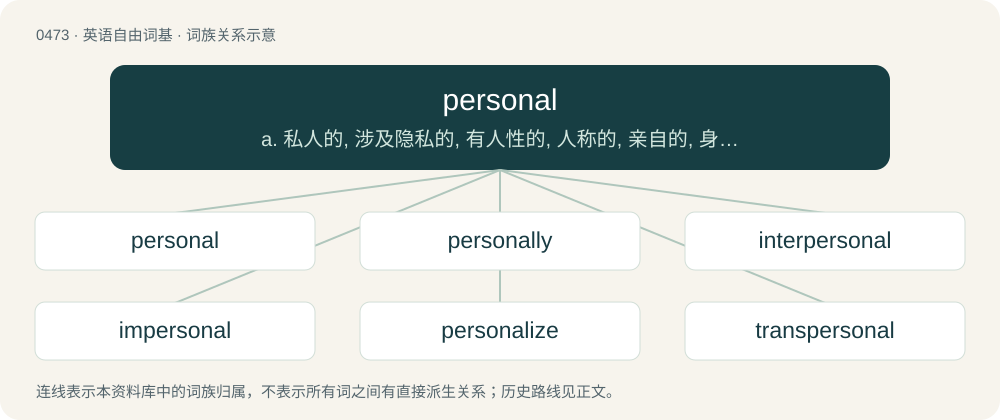

# 0539 · personal — a. 私人的, 涉及隐私的, 有人性的, 人称的, 亲自的, 身体的；\[医\] 人的; 个人的, 自身的

[总目录](../00_总目录_按常用程度.md)

**类型**：英语自由词基　｜　**来源语言**：见词源记录

## 核心含义与来源

- 核心含义：a. 私人的, 涉及隐私的, 有人性的, 人称的, 亲自的, 身体的；\[医\] 人的; 个人的, 自身的
- 英文含义：Pertaining to persons (human beings as opposed to things or animals).
- 词形：personal

**来源记录 1**（形容词；Pertaining to persons (human beings as opposed to things or animals).）

From Middle English personal, personele, from Anglo-Norman personel, personal, personell, Old French personal, personel, from Late Latin persōnālis (“of a person, personly”), equivalent to person + -al. Doublet of personnel.

## 词族图

## 单词速览（常用到不常用）

| 单词 | 音标 | 释义 |
|---|---|---|
| [personal](#w-1) | 英 /ˈpɜː.sə.nəl/；美 /ˈpɜɹ.sə.nəl/ | a. 私人的, 涉及隐私的, 有人性的, 人称的, 亲自的, 身体的；\[医\] 人的; 个人的, 自身的 |
| [personally](#w-2) | 英 /ˈpɜː.sə.nə.li/；美 /ˈpɝ.sə.nə.li/ | adv. 亲自地, 个别地, 当面, 就本人而言, 针对个人地 |
| [interpersonal](#w-3) | /.intəˈpəːsənəl/ | a. 人与人之间的, 人际(关系)的；\[法\] 人与人之间的, 需要与他人接触的 |
| [impersonal](#w-4) | 美 /ɪmˈpɝsənəl/；/ɪmˈpɜː.sn̩.ɫ̩/ | a. 客观的, 和个人无关的, 没有人情味的, 非人称的；n. 非人称动词(或代词) |
| [personalize](#w-5) | 英 /ˈpɜː.sə.nə.laɪz/；美 /ˈpɝ.sə.nəˌlaɪz/ | vt. (贬)使个人化, 体现, 使人格化, 在(物品)上标明姓名/标出地址/标出记号 |
| [transpersonal](#w-6) | /trænsˈpəːsənl/ | a. 超越个人的, 非个人的 |

## 逐词详解

### 1. personal

**词性**：形容词　｜　**音标**：英 /ˈpɜː.sə.nəl/；美 /ˈpɜɹ.sə.nəl/

**中文释义**：a. 私人的, 涉及隐私的, 有人性的, 人称的, 亲自的, 身体的；\[医\] 人的; 个人的, 自身的

**英文义项**：Pertaining to persons (human beings as opposed to things or animals). / Of or pertaining to a particular person; relating to, or affecting, an individual, or each of many individuals

**构词拆分**：person + -al

**词源与演化**：

From Middle English personal, personele, from Anglo-Norman personel, personal, personell, Old French personal, personel, from Late Latin persōnālis (“of a person, personly”), equivalent to person + -al. Doublet of personnel.

**例句**：

> I can't believe you went through my drawers and looked at all my personal things!

该用例对应义项：Dealing with subjects about which one wishes (or people usually wish) to maintain privacy or discretion; not for public view; sensitive, intimate.

### 2. personally

**词性**：副词　｜　**音标**：英 /ˈpɜː.sə.nə.li/；美 /ˈpɝ.sə.nə.li/

**中文释义**：adv. 亲自地, 个别地, 当面, 就本人而言, 针对个人地

**英文义项**：In a personal manner. / In person.

**构词拆分**：personal + -ly

**词源与演化**：

From Middle English personally, personely, personallich, personaliche, equivalent to personal + -ly.

**例句**：

> I like you personally, but as a colleague you have yet to do well.

该用例对应义项：As a person.

### 3. interpersonal

**词性**：形容词　｜　**音标**：/.intəˈpəːsənəl/

**中文释义**：a. 人与人之间的, 人际(关系)的；\[法\] 人与人之间的, 需要与他人接触的

**英文义项**：Between two or more people.

**构词拆分**：inter- + personal

**词源与演化**：

From inter- + personal.

**例句**：

> Interpersonal situations in which speech occurs.

该用例对应义项：occurring among or involving several people

### 4. impersonal

**词性**：形容词　｜　**音标**：美 /ɪmˈpɝsənəl/；/ɪmˈpɜː.sn̩.ɫ̩/

**中文释义**：a. 客观的, 和个人无关的, 没有人情味的, 非人称的；n. 非人称动词(或代词)

**英文义项**：Not personal; not representing a person; not having personality. / Lacking warmth or emotion; cold.

**构词拆分**：im- + personal

**词源与演化**：

From French impersonnel, from Latin impersōnālis, from im- (“not”) + persōnālis (“personal”), equivalent to im- + personal.

**例句**：

> She sounded impersonal as she gave her report of the Nazi death camps.

该用例对应义项：Lacking warmth or emotion; cold.

### 5. personalize

**词性**：动词　｜　**音标**：英 /ˈpɜː.sə.nə.laɪz/；美 /ˈpɝ.sə.nəˌlaɪz/

**中文释义**：vt. (贬)使个人化, 体现, 使人格化, 在(物品)上标明姓名/标出地址/标出记号

**英文义项**：To adapt something to the needs or tastes of an individual. / To represent something abstract as a person; to embody.

**构词拆分**：personal + -ize

**词源与演化**：

From personal + -ize.

**例句**：

> I think it would be difficult to personalize every wedding invitation.

### 6. transpersonal

**词性**：形容词　｜　**音标**：/trænsˈpəːsənl/

**中文释义**：a. 超越个人的, 非个人的

**英文义项**：That transcends the personal or individual

**构词拆分**：trans- + personal

**词源与演化**：

From trans- + personal.
