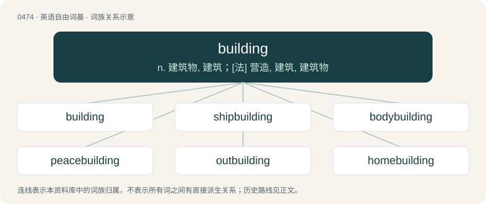

# 0540 · building — n. 建筑物, 建筑；\[法\] 营造, 建筑, 建筑物

[总目录](../00_总目录_按常用程度.md)

**类型**：英语自由词基　｜　**来源语言**：见词源记录

## 核心含义与来源

- 核心含义：n. 建筑物, 建筑；\[法\] 营造, 建筑, 建筑物
- 英文含义：The act or process by which something is built; construction.
- 词形：building

**来源记录 1**（名词；The act or process by which something is built; construction.）

From Middle English byldynge, buyldyng, byldyng, buldynge, buldyng, boldyng, equivalent to build + -ing. Compare also related Middle English bold (“edifice, castle, mansion”), from Old English bold (“building, dwelling, house”).

## 词族图

## 单词速览（常用到不常用）

| 单词 | 音标 | 释义 |
|---|---|---|
| [building](#w-1) | /ˈbɪl.dɪŋ/ | n. 建筑物, 建筑；\[法\] 营造, 建筑, 建筑物 |
| [shipbuilding](#w-2) | /ˈʃipbildiŋ/ | n. 造船 |
| [bodybuilding](#w-3) | 英 /ˈbɒ.diˌbɪl.dɪŋ/；美 /ˈbɑ.diˌbɪl.dɪŋ/ | n. 健美 |
| [peacebuilding](#w-4) | /ˈpiːsˌbɪl.dɪŋ/ | 【英文】The creation of peace or the conditions for peace. |
| [outbuilding](#w-5) | 英 /ˈaʊtˌbɪl.dɪŋ/ | n. 外屋；\[经\] 附属建筑物 |
| [homebuilding](#w-6) | /ˈhəjm,bildiŋ/ | n. 住宅建筑(或设计) |
| [worldbuilding](#w-7) |  | 【英文】The conception and description of a fictional world, often as the setting of a work of fiction, particularly in speculative fiction. |

## 逐词详解

### 1. building

**词性**：名词　｜　**音标**：/ˈbɪl.dɪŋ/

**中文释义**：n. 建筑物, 建筑；\[法\] 营造, 建筑, 建筑物

**英文义项**：The act or process by which something is built; construction. / A closed structure with walls and a roof.

**构词拆分**：build + -ing

**词源与演化**：

From Middle English byldynge, buyldyng, byldyng, buldynge, buldyng, boldyng, equivalent to build + -ing. Compare also related Middle English bold (“edifice, castle, mansion”), from Old English bold (“building, dwelling, house”).

**例句**：

> The building of the bridge will be completed in a couple of weeks.

该用例对应义项：The act or process by which something is built; construction.

### 2. shipbuilding

**词性**：名词　｜　**音标**：/ˈʃipbildiŋ/

**中文释义**：n. 造船

**英文义项**：The construction of ships. / A construction of a ship.

**构词拆分**：ship + building

**词源与演化**：

From ship + building.

**例句**：

> In 2013, Tom Jackson published a book about the history of shipbuilding.

### 3. bodybuilding

**词性**：名词　｜　**音标**：英 /ˈbɒ.diˌbɪl.dɪŋ/；美 /ˈbɑ.diˌbɪl.dɪŋ/

**中文释义**：n. 健美

**英文义项**：A sport in which the aesthetics of muscular development is the basis for competition. / Work done to construct or repair the body of an automobile.

**构词拆分**：body + building

**词源与演化**：

From body + building.

**例句**：

> Bodybuilding is his hobby so he has a very firm tight body with lots of muscle definition.

### 4. peacebuilding

**词性**：名词　｜　**音标**：/ˈpiːsˌbɪl.dɪŋ/

**英文义项**：The creation of peace or the conditions for peace. / The reconstruction of physical and societal institutions after a conflict

**构词拆分**：From peace + building.

**词源与演化**：

From peace + building.

### 5. outbuilding

**词性**：名词　｜　**音标**：英 /ˈaʊtˌbɪl.dɪŋ/

**中文释义**：n. 外屋；\[经\] 附属建筑物

**英文义项**：A building, such as a barn, shed, or garage, that is separate from, but associated with some main building.

**构词拆分**：out + building

**词源与演化**：

From out + building.

### 6. homebuilding

**词性**：名词　｜　**音标**：/ˈhəjm,bildiŋ/

**中文释义**：n. 住宅建筑(或设计)

**英文义项**：The part of the construction industry concerned with building individual homes.

**构词拆分**：home + building

**词源与演化**：

From home + building.

### 7. worldbuilding

**词性**：名词

**英文义项**：The conception and description of a fictional world, often as the setting of a work of fiction, particularly in speculative fiction.

**构词拆分**：world + building

**词源与演化**：

From world + building.
